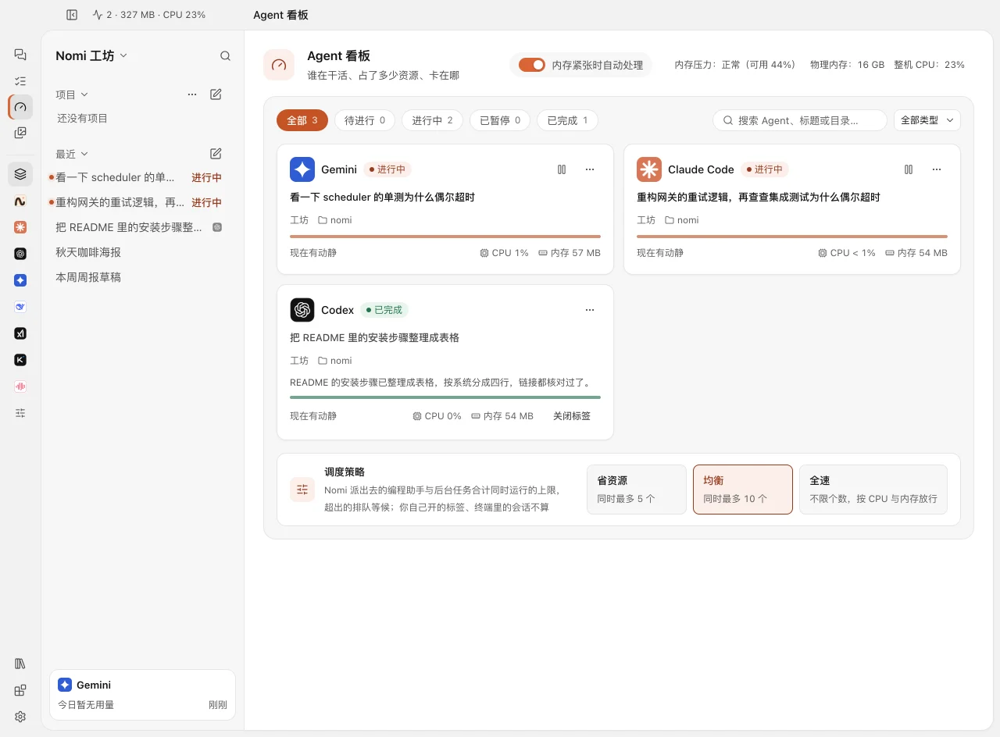
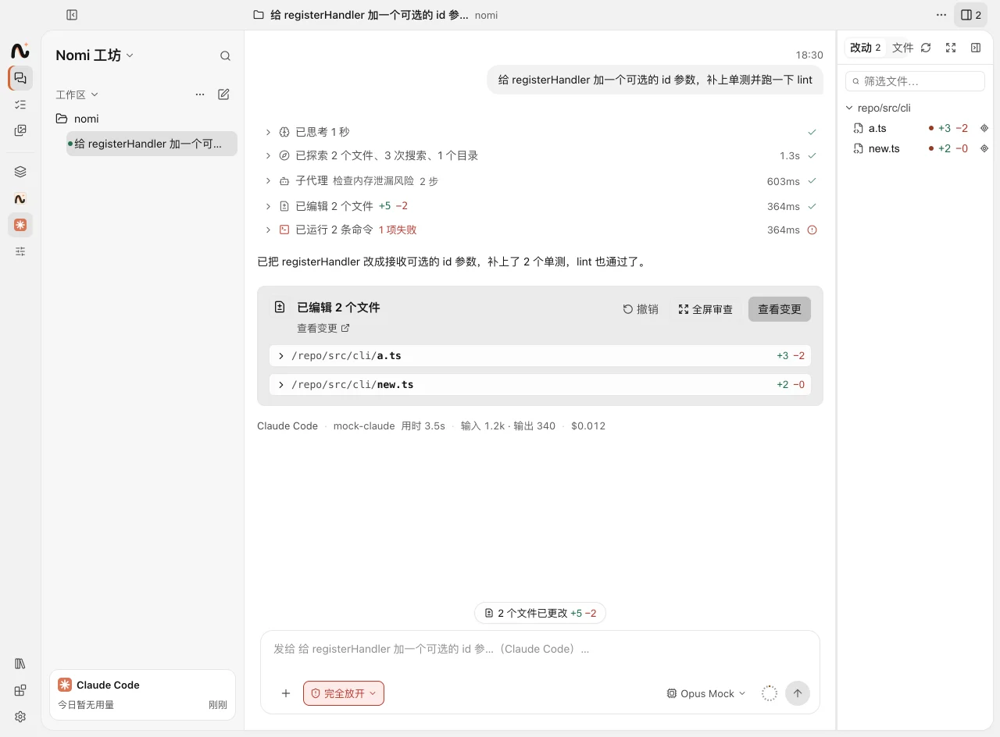
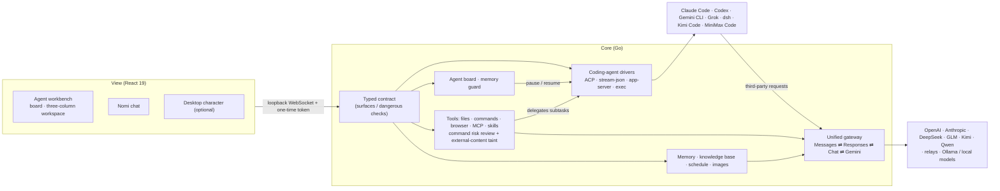

<p align="center"></p>

<h1 align="center">Nomi</h1>

<p align="center">
  <b>One place. Every AI capability.</b><br>
  让每一种 AI 能力，都为你所用
</p>

<p align="center">
  Run Claude Code, Codex and others in parallel, and manage them on one board. Connect a model once — official APIs, China-region, relays and local — and use it across those agents.<br>
  Local-first: no required cloud account, and no edits to those CLIs' global config. The desktop character is optional.
</p>

<p align="center">macOS · Windows · Linux　|　Go + Wails core, ~25 MB installer　|　MIT</p>

<p align="center">
  <a href="https://github.com/Cookieboty/nomi-ai/stargazers"></a>
  <a href="https://github.com/Cookieboty/nomi-ai/releases"></a>
  <a href="https://github.com/Cookieboty/nomi-ai/releases/latest"></a>
  <a href="https://github.com/Cookieboty/nomi-ai/commits/main"></a>
  <a href="LICENSE"></a>
</p>

<p align="center">
  <a href="https://github.com/Cookieboty/nomi-ai/releases/latest">Download</a> ·
  <a href="https://withnomi.app">Website</a> ·
  <a href="docs/README.md">Docs</a> ·
  <a href="docs/development/architecture.md">Architecture</a> ·
  <a href="CHANGELOG.md">Changelog</a>
</p>

<p align="center"><a href="README.md">中文</a> · <b>English</b></p>

<p align="center">
  
  
</p>

## What the workbench holds

| Capability        | In Nomi                                                                                                                                                          |
| ----------------- | ---------------------------------------------------------------------------------------------------------------------------------------------------------------- |
| **Coding agents** | Claude Code, Codex, Gemini CLI, Grok, dsh, Kimi Code and MiniMax Code, many sessions in parallel. Terminal or IDE sessions show on the board read-only; a CLI's own history can be resumed in the workshop |
| **Models**        | Official APIs, China-region, relays and local models: connect one once, and the built-in coding agents and Nomi can use it. An extra ACP agent does not use this gateway |
| **Tools**         | MCP, skills, browser, files and commands, managed in the UI with an audit log                                                                                    |
| **Nomi**          | An agent itself: memory, knowledge base, images, reminders, and it hands jobs to coding agents                                                                   |

They all live in one **agent workbench**: who is working, how far along, how much they use and where they're stuck, at a glance.

## Why Nomi

### 1. One board: run them in parallel, manage them together

The **agent board** puts what is working in one place: Nomi's chats and background runs, dispatched and workbench coding agents, and sessions you started yourself in a terminal or IDE (read-only). Each card shows status, source folder, memory and CPU, and anything waiting on you comes first.
When memory runs low it pauses the coding agents Nomi dispatched and resumes them where they stopped once it recovers; you can pause and resume by hand any time. A load indicator stays in the title bar.
Coding-agent sessions open right in the workbench. The built-in set is Claude Code, Codex, Gemini CLI, Grok, dsh, Kimi Code and MiniMax Code, connected through four session drivers (ACP, stream-json, Codex app-server, exec). Many sessions run in parallel, and the three-column workspace shows the diff and lets you commit or undo. The connection layer is a plugin system, so more ACP agents can join; an external agent does not use the gateway or official accounts.
→ [Coding agents](docs/features/coding-agents.md) · [Agent board](docs/development/agent-board.md) · [Coding-agent integration](docs/development/coding-agents.md)

### 2. Connect a model once

Add a provider once (pick a preset or enter a URL, paste a key). The source can be an official API, a China-region provider, a relay or a local model. Claude Code, Codex, Gemini CLI, Grok, dsh, Kimi Code, MiniMax Code and Nomi can all use its models, or you can switch everything to local models.
The local gateway detects and translates between **Anthropic Messages / OpenAI Responses / OpenAI Chat Completions / Gemini generateContent**. Streaming, tool calls, reasoning, images and context compaction keep working, so you can use DeepSeek, GLM, Kimi or Qwen right inside Claude Code. A dropped connection is retried on the same key; after repeated failures it moves to another provider that serves the **same model**.
Third-party routing applies only to the process Nomi launches. It does not edit the CLI's global config or touch official sign-ins. Each CLI's own official sign-in still works, and it is optional. Nomi has no cloud account to register.
→ [Unified gateway design](docs/development/gateway.md) · [Providers and models](docs/features/providers.md)

### 3. Local-first, no required cloud account

Chats, memory and the knowledge base stay on your machine by default. You can use each CLI's official sign-in, or only your own API keys or local models.
On macOS coding agents run in a **system sandbox** (on by default): they can't read SSH and Git credentials, cloud credentials, browser data or `.env` files, and can only write to the project folder; when something is blocked you allow it for this session or "always" (this project only) right in the chat, and the agent carries on. The working folder must be a project folder, and agents don't inherit tokens or keys from your environment. With the sandbox on, coding agents can safely run fully automatic.
Before a command runs, a helper model rates its risk: low risk runs, high risk asks you, and **once a turn has read external content (web pages, MCP results, skill files), medium-risk commands ask you too**, so a prompt injection can't use Nomi to run commands.
Chats, memory and the knowledge base stay on your machine by default; secrets are hidden before anything reaches a third-party model; API keys live in the system keychain.
→ [Privacy and security](docs/features/privacy-security.md) · [Local protection for coding agents](docs/features/coding-agents.md#本机保护)

### 4. Nomi is an agent too

It reads and writes files, runs commands, drives a browser, calls MCP servers and skills, remembers what you've told it (long-term memory), answers from your folders with clickable citations, and draws, edits images and sets reminders.
For coding it delegates to coding agents: each sub-task opens in its own column beside the chat, where you can interject, stop it or have it run another turn, and every result comes back to the main chat. It schedules with the agent board too.
Tools are offered on demand: small talk sends about 2K tokens of tool definitions, and more open up only when the chat needs them.
→ [Chat](docs/features/chat.md) · [Memory](docs/features/memory.md) · [Knowledge base](docs/features/knowledge-base.md)

### 5. The desktop character is optional

The desktop character is not required for the workbench. When you want it, it stays in a small transparent window, with expressions, gestures and lip sync. Close it from its toolbar's "More" menu and the workbench works the same.
With it on, plenty happens without opening the main window: a gesture marks a finished or failed task; the first lines of a reply show in a bubble beside it; drop a file on it for a summary; talk to it by voice and hear replies read aloud; double-click to open the chat.
→ [Desktop character](docs/features/mascot.md) · [Voice](docs/features/voice.md)

### 6. Light: a Go core on the native WebView

A Go core on [Wails v3](https://v3.wails.io) with no bundled Chromium. On macOS, Apple silicon, the DMG is about 24.5 MB and about 49 MiB installed.

## Architecture



The view talks to the core through one typed contract instead of ad-hoc IPC channels; which windows may call which procedures, and which ones are dangerous, is declared in the contract. See [Architecture](docs/development/architecture.md) and [the app contract](docs/development/contract.md).

## Features at a glance

**Agent workbench**

- **Agent board**: see who is working, how far along, and how much memory and CPU each one uses; a memory guard pauses and resumes automatically, with a load indicator in the title bar
- **Coding agents**: seven built-in CLIs, parallel sessions, a three-column workspace to review the diff, commit or undo; official accounts or third-party models; permission modes, and a system sandbox on macOS today
- **Tasks**: ongoing and scheduled tasks, run by Nomi or a coding agent

**Models and tools**

- **Models**: presets for OpenAI, Anthropic, DeepSeek, Kimi, Zhipu, Qwen, Doubao, Ollama and more; automatic multi-key rotation; usage and cost recorded per upstream request
- **Local models**: one-click open-source models (llama.cpp) or Ollama; run local-only, or let only local models read your files
- **MCP and skills**: manage MCP servers and `SKILL.md` skills in the UI, import them from other tools; tool calls are audit-logged
- **Third-party provider links**: relays and model platforms can offer an "Add to Nomi" link; see [Third-party provider integration](#third-party-provider-integration) below

**Nomi**

- **Chat**: reads and writes files, runs commands, drives a browser and delegates to coding agents; command palette and slash commands
- **Knowledge base and memory**: ask questions over a folder with clickable citations; chats turn into exportable long-term memory
- **Images**: draw, edit and use reference images, with an image model matched to the chat model's vendor; an asset library keeps them all
- **Voice and reminders**: local whisper.cpp or cloud speech input, read-aloud replies; reminders and quiet hours
- **Desktop character (optional)**: 2D art or a Rive animation with expressions and lip sync; its gestures tell you how tasks are going

<table>
  <tr>
    <td align="center" width="33%"><br><sub>Coding agents</sub></td>
    <td align="center" width="33%"><br><sub>Providers and models</sub></td>
    <td align="center" width="33%"><br><sub>Desktop character (optional)</sub></td>
  </tr>
</table>

More screenshots in [docs/screenshots](docs/screenshots/).

## Download

From [GitHub Releases](https://github.com/Cookieboty/nomi-ai/releases/latest):

| System                | Installer                                              | Notes                                                  |
| --------------------- | ------------------------------------------------------ | ------------------------------------------------------ |
| macOS · Apple silicon | `Nomi-<version>-arm64.dmg`                             | Drag into Applications                                 |
| macOS · Intel         | `Nomi-<version>.dmg`                                   | Same                                                   |
| Windows 10+ (x64)     | `Nomi-Setup-<version>.exe`                             | Needs WebView2 (usually preinstalled on Windows 10/11) |
| Linux (x64)           | `Nomi-<version>.AppImage` / `nomi_<version>_amd64.deb` | `chmod +x` the AppImage                                |

Installed copies offer updates in-app.

> **macOS says the app is damaged?** The app is signed but not notarized yet. After moving it to Applications, run:
>
> ```bash
> sudo xattr -dr com.apple.quarantine /Applications/Nomi.app
> ```
>
> **Windows SmartScreen?** Once you've confirmed the installer came from this repo's Releases, choose "More info → Run anyway".

## Get started in 3 minutes

1. Open Nomi and finish onboarding (language, theme). Don't want the desktop character? Close it from its toolbar's "More" menu.
2. Open a Claude Code or Codex session and pick a working folder. Sign in with that CLI's official account, or connect a model first and choose third-party. "Agents" in the left sidebar opens the board.
3. In Settings → Models & providers, add a provider and API key once, or download a local model under Local models. Official APIs, China-region, relays and local models all live there, and the built-in coding agents and Nomi can all pick them.
4. Hand a task to Nomi: `Ctrl/⌘+N` for a new chat, `Ctrl/⌘+K` for the command palette. For coding, it can delegate to a coding agent.

More detail in [Getting started](docs/getting-started.md).

## Build from source

Needs Node.js ≥ 22.12, pnpm 9 (`corepack enable`), Go (see `apps/desktop-go/go.mod`) and a cgo toolchain (plus GTK3 and WebKitGTK 4.1 dev packages on Linux).

```bash
git clone https://github.com/Cookieboty/nomi-ai.git && cd nomi-ai
corepack enable && pnpm install
pnpm dev          # hot-reloads the UI, rebuilds on Go changes
pnpm test         # unit tests for the views and shared packages
(cd apps/desktop-go && go test ./...)   # Go core tests
```

`pnpm run doctor` checks your setup. Go details are in [apps/desktop-go](apps/desktop-go/README.md), packaging and releases in [docs/RELEASE.md](docs/RELEASE.md), and the developer guide in [docs/development](docs/development/). PRs welcome; see the conventions in [AGENTS.md](AGENTS.md) first.

## Third-party provider integration

Relays and model platforms can put an "Add to Nomi" button on their own site so users add them in one click:

- `nomi://provider/import`: import the endpoint and key directly, with a few lines of template; Cherry Studio's import format also works.
- `nomi://provider/connect`: web authorization (OAuth + PKCE), so the key never appears in a link.

**Both end in a confirmation dialog in Nomi, and nothing is saved until the user confirms.** Link format, authorization flow and handling rules: [Third-party provider links](docs/integrations/provider-link.md).

## Contact

Questions and ideas go to [GitHub Issues](https://github.com/Cookieboty/nomi-ai/issues). To reach the authors on WeChat:

<table>
  <tr>
    <td align="center"><br><sub>言萧凡</sub></td>
    <td align="center"><br><sub>Tomo</sub></td>
  </tr>
</table>

## Acknowledgements

- **Sponsors**: [Amux AI](https://amux.ai) and [@zihe-xu](https://github.com/zihe-xu) sponsor Nomi's development.
- **Community**: [Linux.do](https://linux.do), whose members have shared a great deal of feedback and ideas.

<a href="https://github.com/zihe-xu"></a>

Nomi is built on Go, Wails, React, Vite, Vercel AI SDK, MCP, whisper.cpp / llama.cpp, Rive and other open-source projects; design credits are in [CREDITS.md](CREDITS.md).

## License

[MIT](LICENSE). Third-party components are listed in [THIRD_PARTY_NOTICES.md](THIRD_PARTY_NOTICES.md).
