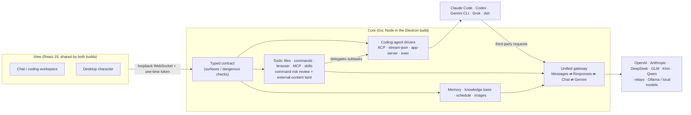

<p align="center"></p>

<h1 align="center">Nomi</h1>

<p align="center">
  <b>An AI companion on your desktop: bring any model, let it do the work, and let it hand specialist jobs to specialist AIs.</b><br>
  Models, coding agents, MCP and local tools in one place, coordinated by Nomi.
</p>

<p align="center">macOS · Windows · Linux　|　Go + Wails core, 39 MB installer　|　MIT</p>

<p align="center">
  <a href="https://github.com/Cookieboty/nomi-ai/stargazers"></a>
  <a href="https://github.com/Cookieboty/nomi-ai/releases"></a>
  <a href="https://github.com/Cookieboty/nomi-ai/releases/latest"></a>
  <a href="https://github.com/Cookieboty/nomi-ai/commits/main"></a>
  <a href="LICENSE"></a>
</p>

<p align="center">
  <a href="https://github.com/Cookieboty/nomi-ai/releases/latest">Download</a> ·
  <a href="https://withnomi.app">Website</a> ·
  <a href="docs/README.md">Docs</a> ·
  <a href="docs/development/architecture.md">Architecture</a> ·
  <a href="CHANGELOG.md">Changelog</a>
</p>

<p align="center"><a href="README.md">中文</a> · <b>English</b></p>

<p align="center">
  
  
</p>

## Why Nomi

### 1. Connect a model once, every AI can use it

Add a provider once (pick a preset or enter a URL, paste a key) and Nomi itself plus Claude Code, Codex, Gemini CLI, Grok and dsh can all use any of its models, or switch everything to local models.
The local gateway detects and translates between **Anthropic Messages / OpenAI Responses / OpenAI Chat Completions / Gemini generateContent**; streaming, tool calls, reasoning, images and context compaction keep working, so you can use DeepSeek, GLM, Kimi or Qwen right inside Claude Code.
Third-party routing applies only to the process Nomi launches; it never edits the CLI's global config or touches official sign-ins.
Third-party providers can also put an "Add to Nomi" link on their own site: one-click import of the endpoint and key, or web authorization (OAuth + PKCE, so the key never appears in a link). Either way, nothing is saved until you confirm in Nomi.
→ [Unified gateway design](docs/design/unified-gateway.md) · [Third-party provider links](docs/design/provider-link.md)

### 2. Nomi is an agent itself

It reads and writes files, runs commands, drives a browser, calls MCP servers and skills, remembers what you've told it (long-term memory), answers from your folders with clickable citations, and draws, edits images and sets reminders.
Tools are offered on demand: small talk sends about 2K tokens of tool definitions, and more open up only when the chat needs them.
→ [Docs](docs/README.md)

### 3. Specialist jobs go to specialist AIs

For coding, Nomi delegates to Claude Code, Codex and other coding agents, and you can open or stop each subtask's full conversation. You can also open a coding-agent session directly: five CLIs connect through four session drivers (ACP, stream-json, Codex app-server, exec), many sessions run in parallel, and the three-column workspace shows the diff and lets you commit or undo; sessions started in a terminal or IDE carry on here too.
Coding agents are the strongest kind of specialist today; the connection layer is a plugin system, so more can join.
→ [Coding workspace](docs/features/coding-workspace.md) · [CLI plugin architecture](docs/design/cli-plugin-architecture.md)

### 4. Let it work, keep the boundaries

Before a command runs, a helper model rates its risk: low risk runs, high risk asks you, and **once a turn has read external content (web pages, MCP results, skill files), medium-risk commands ask you too**, so a prompt injection can't use Nomi to run commands.
Chats, memory and the knowledge base stay on your machine by default; secrets are hidden before anything reaches a third-party model; API keys live in the system keychain.
→ [Privacy and security](docs/features/privacy-security.md)

### 5. Light: a Go core on the native WebView

The main build is a Go core on [Wails v3](https://v3.wails.io) with no bundled Chromium; the same UI also ships as an Electron build, and parity golden tests keep both behaving the same. Measured on macOS, Apple silicon (v2.0.5):

|                                 | Go build    | Electron build |
| ------------------------------- | ----------- | -------------- |
| DMG                             | **38.8 MB** | 153.0 MB       |
| Installed size                  | **69 MiB**  | 334 MiB        |
| Memory 30 s after launch        | **177 MiB** | 284 MiB        |
| Idle CPU (one core)             | **3.2%**    | 8.2%           |
| Launch until the window appears | **0.55 s**  | 0.82 s         |

## Architecture



The view talks to the core through one typed contract instead of ad-hoc IPC channels; which windows may call which procedures, and which ones are dangerous, is declared in the contract. See [Architecture](docs/development/architecture.md) and [Core / host decoupling](docs/design/core-host-decoupling.md).

## Features at a glance

- **Models**: presets for OpenAI, Anthropic, DeepSeek, Kimi, Zhipu, Qwen, Doubao, Ollama and more; automatic multi-key rotation; usage and cost recorded per upstream request
- **Third-party provider links**: relays and model platforms add themselves to Nomi with `nomi://provider/import` (one-click import) or `nomi://provider/connect` (web authorization); Cherry Studio's import format also works. See the [integration guide](docs/design/provider-link.md)
- **Local models**: one-click open-source models (llama.cpp) or Ollama; run local-only, or let only local models read your files
- **Images**: draw, edit and use reference images right in a Nomi chat, with an image model matched to the chat model's vendor; an asset library keeps every generated image
- **Knowledge base and memory**: ask questions over a folder with clickable citations; chats turn into exportable long-term memory
- **MCP and skills**: manage MCP servers and `SKILL.md` skills in the UI; tool calls are audit-logged
- **Voice and reminders**: local whisper.cpp or cloud speech input, read-aloud replies; reminders and scheduled tasks
- **Desktop character**: Nomi lives on your desktop as 2D art or a Rive animation with expressions and lip sync; drop a file on it to get a summary; swap the character with a [character pack](docs/character-pack/README.md)

<table>
  <tr>
    <td align="center" width="33%"><br><sub>Coding agents</sub></td>
    <td align="center" width="33%"><br><sub>Providers and models</sub></td>
    <td align="center" width="33%"><br><sub>Desktop character</sub></td>
  </tr>
</table>

More screenshots in [docs/screenshots](docs/screenshots/).

## Download

From [GitHub Releases](https://github.com/Cookieboty/nomi-ai/releases/latest):

| System                | Installer                                              | Notes                                                  |
| --------------------- | ------------------------------------------------------ | ------------------------------------------------------ |
| macOS · Apple silicon | `Nomi-<version>-arm64.dmg`                             | Drag into Applications                                 |
| macOS · Intel         | `Nomi-<version>.dmg`                                   | Same                                                   |
| Windows 10+ (x64)     | `Nomi-Setup-<version>.exe`                             | Needs WebView2 (usually preinstalled on Windows 10/11) |
| Linux (x64)           | `Nomi-<version>.AppImage` / `nomi_<version>_amd64.deb` | `chmod +x` the AppImage                                |

Files named `Nomi-Electron-…` are the Electron build. Installed copies offer updates in-app.

> **macOS says the app is damaged?** The app is signed but not notarized yet. After moving it to Applications, run:
>
> ```bash
> sudo xattr -dr com.apple.quarantine /Applications/Nomi.app
> ```
>
> **Windows SmartScreen?** Once you've confirmed the installer came from this repo's Releases, choose "More info → Run anyway".

## Get started in 3 minutes

1. Open Nomi and finish onboarding (language, theme, character).
2. Add a provider and API key in Settings → Models & providers, or download a local model under Local models if you'd rather not use a key.
3. Chat with Nomi: `Ctrl/⌘+N` for a new chat, `Ctrl/⌘+K` for the command palette.
4. Use a coding agent: open a Claude Code / Codex session, pick a working folder, and use your official account or the third-party model from step 2.

More detail in [Getting started](docs/getting-started.md).

## Build from source

Needs Node.js ≥ 22.12 and pnpm 9 (`corepack enable`); the Go build also needs Go (see `apps/desktop-go/go.mod`) and a cgo toolchain (plus GTK3 and WebKitGTK 4.1 dev packages on Linux).

```bash
git clone https://github.com/Cookieboty/nomi-ai.git && cd nomi-ai
corepack enable && pnpm install
pnpm dev:go       # Go build: hot-reloads the UI, rebuilds on Go changes
pnpm dev          # Electron build
pnpm test         # unit tests; pnpm test:e2e for headless end-to-end tests
```

`pnpm run doctor` checks your setup. Go details are in [apps/desktop-go](apps/desktop-go/README.md), packaging and releases in [docs/RELEASE.md](docs/RELEASE.md), and the developer guide in [docs/development](docs/development/). PRs welcome; see the conventions in [AGENTS.md](AGENTS.md) first.

## Contact

Questions and ideas go to [GitHub Issues](https://github.com/Cookieboty/nomi-ai/issues). To reach the authors on WeChat:

<table>
  <tr>
    <td align="center"><br><sub>言萧凡</sub></td>
    <td align="center"><br><sub>Tomo</sub></td>
  </tr>
</table>

## Acknowledgements

- **Sponsor**: [Amux AI](https://amux.ai) sponsors Nomi's development.
- **Community**: [Linux.do](https://linux.do), whose members have shared a great deal of feedback and ideas.

Nomi is built on Go, Wails, Electron, React, Vite, Vercel AI SDK, MCP, whisper.cpp / llama.cpp, Rive and other open-source projects; design credits are in [CREDITS.md](CREDITS.md).

## License

[MIT](LICENSE). Third-party components are listed in [THIRD_PARTY_NOTICES.md](THIRD_PARTY_NOTICES.md).
