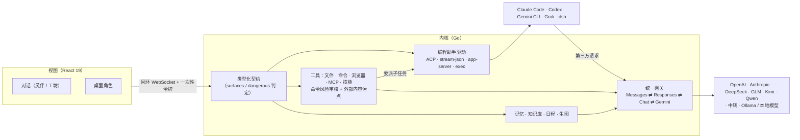

<p align="center"></p>

<h1 align="center">Nomi·诺米</h1>

<p align="center">
  <b>住在你桌面上的 AI 伙伴：接上任意模型，自己动手干活，也会把专业的活派给专业的 AI。</b><br>
  模型、编程助手、MCP 与本地工具都接到一处，由 Nomi 统一调度。
</p>

<p align="center">macOS · Windows · Linux　|　Go 内核，安装包约 25 MB　|　MIT</p>

<p align="center">
  <a href="https://github.com/Cookieboty/nomi-ai/stargazers"></a>
  <a href="https://github.com/Cookieboty/nomi-ai/releases"></a>
  <a href="https://github.com/Cookieboty/nomi-ai/releases/latest"></a>
  <a href="https://github.com/Cookieboty/nomi-ai/commits/main"></a>
  <a href="LICENSE"></a>
</p>

<p align="center">
  <a href="https://github.com/Cookieboty/nomi-ai/releases/latest">下载</a> ·
  <a href="https://withnomi.app">官网</a> ·
  <a href="docs/README.md">文档</a> ·
  <a href="docs/development/architecture.md">架构</a> ·
  <a href="CHANGELOG.md">更新日志</a>
</p>

<p align="center"><b>中文</b> · <a href="README.en.md">English</a></p>

<p align="center">
  
  
</p>

## 为什么是 Nomi

### 1. 模型只接一次，所有 AI 都能用

只添加一次供应商（选预设或填地址，粘贴 Key），Nomi 自己和 Claude Code、Codex、Gemini CLI、Grok、dsh 都能用它的任意模型，也可以全部换成本地模型。
本机网关自动识别并互转 **Anthropic Messages / OpenAI Responses / OpenAI Chat Completions / Gemini generateContent**，流式、工具调用、推理、图片、上下文压缩都照常工作：在 Claude Code 里直接用 DeepSeek、GLM、Kimi、Qwen。
第三方只作用于 Nomi 启动的那个进程，不改 CLI 的全局配置，不碰官方登录。
第三方供应商也可以在自己的网页上放一个「添加到 Nomi」链接：一键导入地址和 Key，或者走网页授权（OAuth + PKCE，Key 不出现在链接里）；不管哪种，都要你在 Nomi 里确认后才保存。
→ [统一网关设计](docs/development/gateway.md) · [第三方供应商链接接入](docs/integrations/provider-link.md)

### 2. Nomi 自己就是一个 agent

它能读写文件、跑命令、开浏览器、调 MCP 和技能，记得你说过的事（长期记忆），能在你的文件夹里查资料并给出可点击的引用，还能画图、改图、定提醒。
工具按需提供：闲聊时发给模型的工具定义约 2K token，聊到相关的事才展开。
→ [功能文档](docs/README.md)

### 3. 专业的活，派给专业的 AI

写代码这类活，Nomi 会委派给 Claude Code、Codex 等编程助手；子任务在对话旁边单独一栏打开，可以插话、停止、接着再做一轮，结果都回到主对话。你也可以直接打开编程助手会话：五个 CLI 经四种会话驱动接入（ACP、stream-json、Codex app-server、exec），多个会话并行，三栏工作区看 Diff、提交、撤销；终端和 IDE 里开的会话也能接着聊。
**Agent 看板**把所有在干活的放在一处：Nomi 的对话与后台运行、派出的和工坊里的编程助手，以及你在终端或 IDE 里自己开的会话（只读），每张卡片写明内存与 CPU。内存紧张时自动暂停 Nomi 派出的编程助手、缓解后从暂停处接着跑；Nomi 也会看着看板调度。
编程助手是目前最强的一类「专业 AI」，接入层是插件化的，后续可以接更多。
→ [编程助手](docs/features/coding-agents.md) · [编程助手接入](docs/development/coding-agents.md) · [Agent 看板](docs/development/agent-board.md)

### 4. 放手让它干，但边界在你手里

命令执行前先由辅助模型按风险分级：低风险直接跑，高风险交给你确认；**这一轮读过外部内容（网页、MCP 返回、技能文件）后，中风险命令也要你确认**，防止提示注入借 Nomi 的手执行命令。
macOS 上编程助手在**系统沙箱**里运行（默认开）：读不到 SSH 与 Git 凭据、云账号凭据、浏览器数据和 `.env`，只能写项目文件夹；被挡下时在对话里按本会话或「始终允许（只对这个项目）」授权，允许后自动接着做。工作目录只能是项目文件夹，也不继承环境里的令牌和密钥。开着沙箱，可以放心让编程助手全部自动运行。
对话、记忆、知识库默认只存在本机；发给第三方模型前自动隐藏密钥；API Key 存系统钥匙串。
→ [隐私与安全](docs/features/privacy-security.md) · [编程助手的本机保护](docs/features/coding-agents.md#本机保护)

### 5. 轻：Go 内核，原生 WebView

Go 内核 + [Wails v3](https://v3.wails.io)，不带 Chromium（2.2.0 起不再提供 Electron 版）。与同版本的 Electron 版对比，macOS Apple 芯片：

|                  | Go 版       | Electron 版 |
| ---------------- | ----------- | ----------- |
| DMG 安装包       | **24.5 MB** | 138.4 MB    |
| 安装后占用       | **49 MiB**  | 315 MiB     |
| 启动 30 秒后内存 | **177 MiB** | 284 MiB     |
| 空闲 CPU（单核） | **3.2%**    | 8.2%        |
| 启动到窗口出现   | **0.55 s**  | 0.82 s      |

体积是 v2.1.2 两个版本的 arm64 安装包实测；内存、CPU、启动耗时是 v2.0.5 与 2.0.4 的同机对比。

## 架构



视图与内核之间只有一条类型化契约，没有零散的 IPC 通道；哪些窗口能调用哪些过程、哪些属于危险操作，都在契约里声明。详见 [架构](docs/development/architecture.md)、[应用契约](docs/development/contract.md)。

## 功能一览

- **模型**：OpenAI、Anthropic、DeepSeek、Kimi、智谱、通义、豆包、Ollama 等预设；多 Key 自动切换；按每次上游请求记账，用量和费用看得见
- **第三方供应商链接接入**：中转站和模型平台用 `nomi://provider/import`（一键导入）或 `nomi://provider/connect`（网页授权）把自己加进 Nomi，兼容 Cherry Studio 的导入格式；接入规则见下方[第三方供应商接入](#第三方供应商接入)
- **本地模型**：一键下载开源小模型（llama.cpp）或管理 Ollama；可以只用本地模型，也可以只让本地模型读文件
- **生图**：Nomi 对话里直接画图、改图、以图生图，自动匹配同一厂商的图片模型；素材库统一管理生成的图片
- **Agent 看板**：看清谁在干活、各占多少内存与 CPU；内存守护自动暂停 / 恢复编程助手，标题栏常驻负载指示
- **知识库与记忆**：文件夹问答带可点击引用；对话自动整理成长期记忆，可导出
- **MCP 与技能**：图形化管理 MCP 服务器与 `SKILL.md`；工具调用有审计日志
- **语音与提醒**：本地 whisper.cpp 或云端语音输入、语音播报；提醒与定时任务
- **桌面角色**：Nomi 常驻桌面，2D 立绘或 Rive 动画，表情与口型同步；拖文件给它直接总结；角色可以通过[角色包](docs/character-pack/README.md)替换

<table>
  <tr>
    <td align="center" width="33%"><br><sub>编程助手</sub></td>
    <td align="center" width="33%"><br><sub>供应商与模型</sub></td>
    <td align="center" width="33%"><br><sub>桌面角色</sub></td>
  </tr>
</table>

更多界面见 [docs/screenshots](docs/screenshots/)。

## 下载安装

前往 [GitHub Releases](https://github.com/Cookieboty/nomi-ai/releases/latest)：

| 系统               | 安装包                                           | 说明                                    |
| ------------------ | ------------------------------------------------ | --------------------------------------- |
| macOS · Apple 芯片 | `Nomi-<版本>-arm64.dmg`                          | 拖进「应用程序」                        |
| macOS · Intel      | `Nomi-<版本>.dmg`                                | 同上                                    |
| Windows 10+（x64） | `Nomi-Setup-<版本>.exe`                          | 需要 WebView2（Windows 10/11 通常自带） |
| Linux（x64）       | `Nomi-<版本>.AppImage` / `nomi_<版本>_amd64.deb` | AppImage 需 `chmod +x`                  |

已安装的版本会在应用内提示更新。

> **macOS 提示「已损坏」？** 当前包已签名但尚未公证。拖到「应用程序」后执行：
>
> ```bash
> sudo xattr -dr com.apple.quarantine /Applications/Nomi.app
> ```
>
> **Windows 弹出 SmartScreen？** 确认安装包来自本仓库 Releases 后，选「更多信息 → 仍要运行」。

## 3 分钟上手

1. 打开 Nomi，完成首次引导（语言、主题、角色）。
2. 「设置 → 模型与供应商」添加供应商与 API Key；不想填 Key，就在「本机模型」下载一个本地模型。
3. 和 Nomi 对话：`Ctrl/⌘+N` 新对话，`Ctrl/⌘+K` 命令面板。
4. 用编程助手：新建一个 Claude Code / Codex 会话，选工作目录；用官方账号，或直接选第2步加的第三方模型。

更细的步骤见 [快速上手](docs/getting-started.md)。

## 从源码构建

需要 Node.js ≥ 22.12、pnpm 9（`corepack enable`）、Go（版本见 `apps/desktop-go/go.mod`）与 cgo 工具链（Linux 还要 GTK3 与 WebKitGTK 4.1 开发包）。

```bash
git clone https://github.com/Cookieboty/nomi-ai.git && cd nomi-ai
corepack enable && pnpm install
pnpm dev          # 界面热更新，改 Go 代码自动重编译
pnpm test         # 视图与共享包的单元测试
(cd apps/desktop-go && go test ./...)   # Go 内核测试
```

`pnpm run doctor` 检查开发环境。应用细节见 [apps/desktop-go](apps/desktop-go/README.md)；打包与发布见 [docs/RELEASE.md](docs/RELEASE.md)；开发指南见 [docs/development](docs/development/)。欢迎 PR，提交前请看 [AGENTS.md](AGENTS.md) 里的约定。

## 第三方供应商接入

中转站、模型平台可以在自己的网页上放一个「添加到 Nomi」按钮，用户点一下就把你加进 Nomi。两种方式任选，**最后都停在 Nomi 的确认框上，用户确认前不会保存任何东西**。完整规格见 [docs/integrations/provider-link.md](docs/integrations/provider-link.md)。

### 方式 A：直接导入（几行模板就能接）

```
nomi://provider/import?v=1&data=<base64url(UTF-8 JSON)>
```

```jsonc
{
  "name": "Example AI", // 必填，最多 64 字
  "homepage": "https://example.com", // 可选，确认框里显示
  "urls": {
    // 至少一个，对应网关的四种协议
    "chat": "https://api.example.com/v1", // OpenAI Chat Completions
    "responses": "https://api.example.com/v1", // OpenAI Responses
    "messages": "https://api.example.com", // Anthropic Messages
    "gemini": "https://api.example.com/gemini", // Gemini
  },
  "key": "sk-…", // 必填
  "models": ["gpt-5", "claude-sonnet-5-5"], // 可选，预填模型
}
```

- `data` 用 base64url（`+/` 换成 `-_`，可以不带 `=`），普通 base64 也认。
- 兼容 Cherry Studio 的扁平写法 `{ "name", "baseUrl", "apiKey", "type"? }`：`type` 为 `anthropic` 时当作 `messages`，`gemini` 当作 `gemini`，其余当作 `chat`。New API 等「聊天链接」模板把 scheme 换成 `nomi://provider/import` 即可。
- Key 会出现在链接里；不想这样就用方式 B。

### 方式 B：网页授权（Key 不进链接）

1. 网页放链接 `nomi://provider/connect?v=1&issuer=https://example.com`（`issuer` 只能是 https 源，不带路径）；用户也可以在 Nomi「设置 → 模型与供应商 → 网页授权」里填你的域名。
2. 提供 `https://example.com/.well-known/nomi-provider.json`：

   ```jsonc
   {
     "version": 1,
     "name": "Example AI",
     "urls": { "chat": "https://api.example.com/v1", "messages": "https://api.example.com" },
     "models": ["…"], // 可选
     "authorization_endpoint": "https://example.com/nomi/authorize",
     "token_endpoint": "https://example.com/api/nomi/token",
   }
   ```

   两个端点必须是 https，主机是 `issuer` 的主机或它的子域名。

3. 用户在 Nomi 里确认后，Nomi 用浏览器打开
   `{authorization_endpoint}?response_type=code&client_id=nomi&redirect_uri=nomi://provider/callback&state=…&code_challenge=…&code_challenge_method=S256`。
4. 用户在你的页面登录同意后，跳到 `nomi://provider/callback?code=…&state=…`（拒绝时带 `error=access_denied&state=…`）。
5. Nomi 向 `token_endpoint` 发 `POST application/x-www-form-urlencoded`：
   `grant_type=authorization_code&code=…&redirect_uri=nomi://provider/callback&client_id=nomi&code_verifier=…`，
   你返回 `{ "api_key": "sk-…", "name"?: "…", "urls"?: {…}, "models"?: […] }`（字段名也可以是 `key` / `access_token`；返回的 `urls` 覆盖清单里的同名协议）。
6. 弹出与方式 A 相同的确认框，用户确认后保存。

### Nomi 的处理规则

- **一律先确认**：确认框显示名称、来源（方式 A 显示「网页链接，无法确认来自哪个网站」，方式 B 显示 issuer 域名）、各协议地址、打码后的 Key、模型数；方式 B 打开浏览器前也要确认。
- **地址**：只接受 `https`、不带用户名密码、不指向本机或局域网的地址；本机服务请在设置里手动添加。授权与换 Key 请求不跟随跳转。
- **同地址就更新**：已有某个地址相同的第三方供应商（忽略末尾 `/`），就更新它：补上新 Key（已有同样的不重复加）和缺少的地址、模型，不新建。
- **限额**：整条链接 ≤ 16 KB；Key 为 8–512 个可见字符；模型最多 200 个；同时等待确认的最多 5 条，10 分钟过期；每次授权的 `state` 10 分钟内有效、只能用一次。
- **不留痕**：日志只记链接类型，不记原文；Key 只在内核里，界面只拿到打码后的样子，保存时存进系统钥匙串。
- **冷启动**：Nomi 没开时点的链接会先存着，对话窗口打开后再弹确认。

## 联系与交流

问题与建议请提 [GitHub Issues](https://github.com/Cookieboty/nomi-ai/issues)。微信扫码添加作者：

<table>
  <tr>
    <td align="center"><br><sub>言萧凡</sub></td>
    <td align="center"><br><sub>Tomo</sub></td>
  </tr>
</table>

## 致谢

- **赞助**：[Amux AI](https://amux.ai)、[@zihe-xu](https://github.com/zihe-xu) 赞助了 Nomi 的开发。
- **社区**：[Linux.do](https://linux.do) 社区的佬友们提了大量反馈与建议。

<a href="https://github.com/zihe-xu"></a>

Nomi 构建于 Go、Wails、React、Vite、Vercel AI SDK、MCP、whisper.cpp / llama.cpp、Rive 等开源项目之上，设计参考致谢见 [CREDITS.md](CREDITS.md)。

## 许可证

[MIT](LICENSE)。第三方组件见 [THIRD_PARTY_NOTICES.md](THIRD_PARTY_NOTICES.md)。
