<p align="center">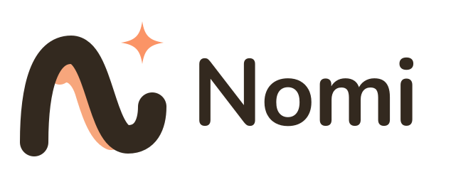</p>

<h1 align="center">Nomi·诺米</h1>

<p align="center">
  <b>你的桌面 AI 伙伴</b> —— 住在桌面，懂你所想，帮你做到。<br>
  <b>Your desktop AI companion</b> — lives on your desktop, gets what you mean, and gets it done.
</p>

<p align="center">macOS · Windows · Linux　|　MIT</p>

<p align="center">
  <a href="https://github.com/Cookieboty/nomi-ai/stargazers"></a>
  <a href="https://github.com/Cookieboty/nomi-ai/issues"></a>
  <a href="https://github.com/Cookieboty/nomi-ai/releases"></a>
  <a href="https://github.com/Cookieboty/nomi-ai/releases/latest"></a>
  <a href="https://github.com/Cookieboty/nomi-ai/commits/main"></a>
  <a href="LICENSE"></a>
</p>

<p align="center">
  <a href="https://withnomi.app">官网 / Website</a> ·
  <a href="https://github.com/Cookieboty/nomi-ai/releases/latest">下载 / Download</a> ·
  <a href="https://withnomi.app/features">功能 / Features</a> ·
  <a href="docs/README.md">文档 / Docs</a> ·
  <a href="https://withnomi.app/changelog">更新日志 / Changelog</a> ·
  <a href="https://withnomi.app/privacy">隐私 / Privacy</a>
</p>

<p align="center"><a href="#中文">中文</a> · <a href="#english">English</a></p>

## 📸 截图 / Screenshots

<table>
  <tr>
    <td align="center" colspan="2">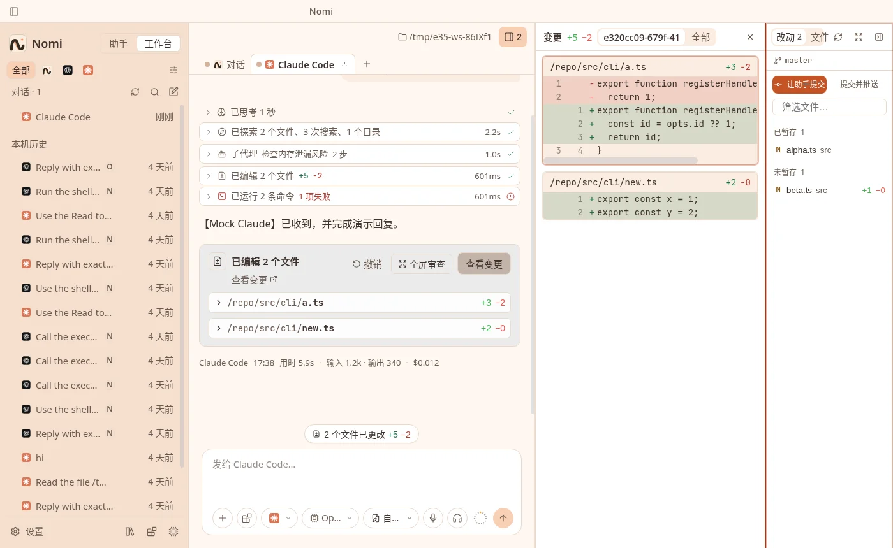 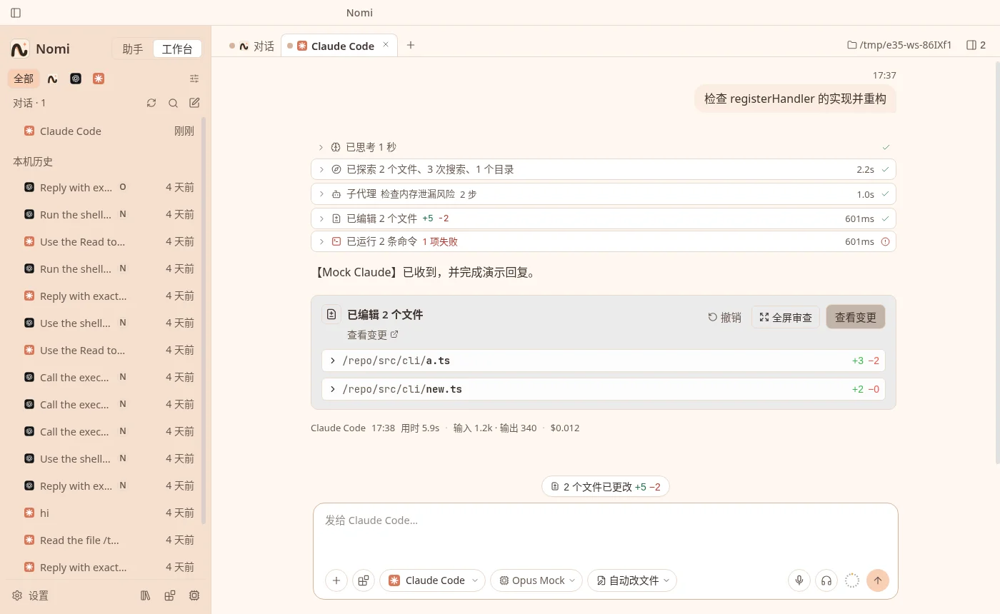<br><sub>v1.2.0 三栏工作区 · 本轮改动摘要卡（由 mock CLI 驱动的真实界面，内容仅作演示）/ v1.2.0 three-column workspace · per-turn edit summary (real UI driven by a mock CLI; content is demo-only)</sub></td>
  </tr>
  <tr>
    <td align="center" width="30%">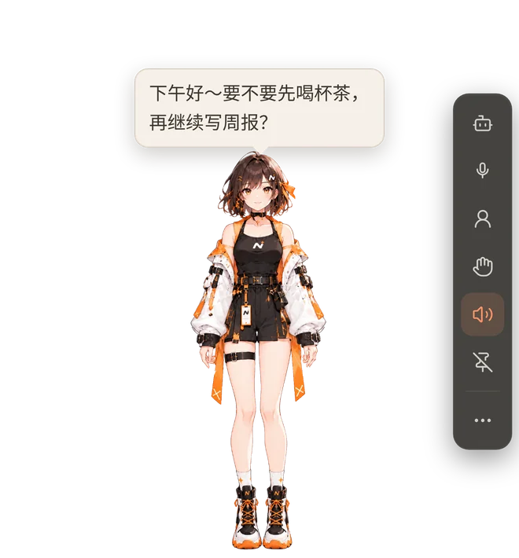<br><sub>桌面伙伴 / Desktop companion</sub></td>
    <td align="center">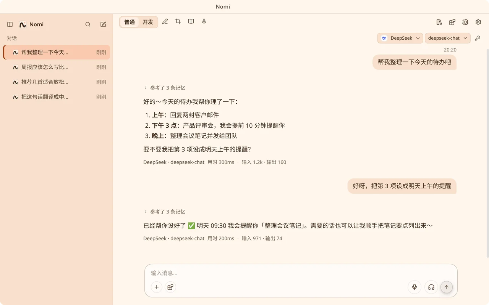<br><sub>助手模式对话 / Assistant-mode chat</sub></td>
  </tr>
  <tr>
    <td align="center" colspan="2">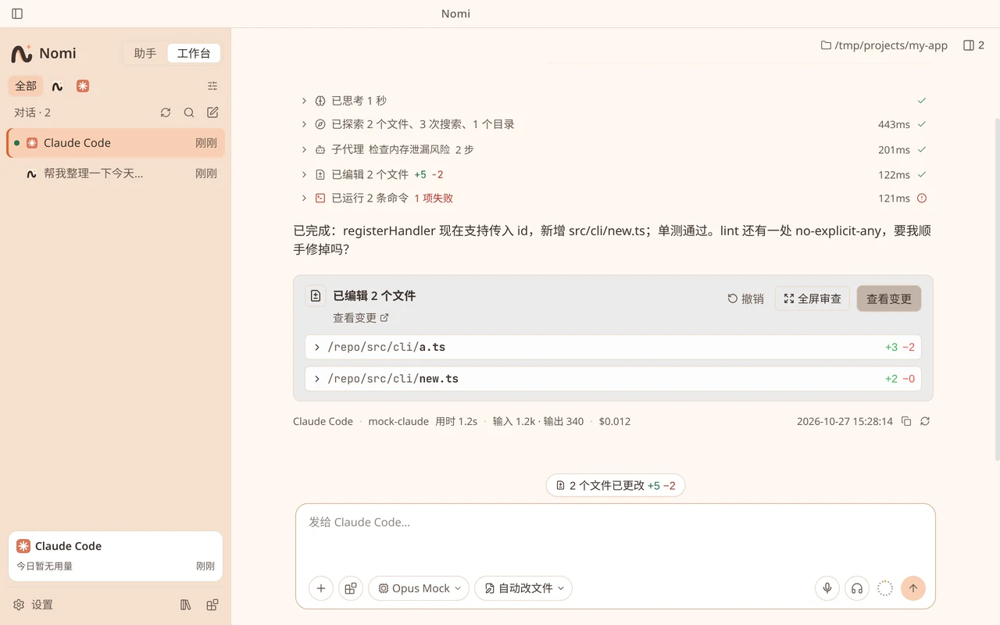 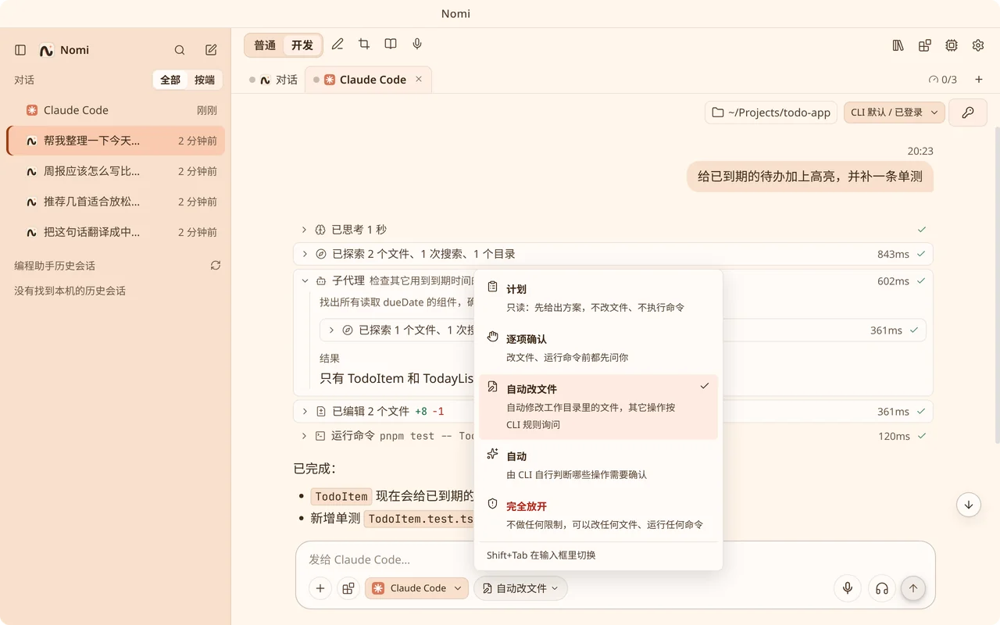<br><sub>编程助手对话 · 权限模式 / Coding agents · Permission modes</sub></td>
  </tr>
  <tr>
    <td align="center" colspan="2">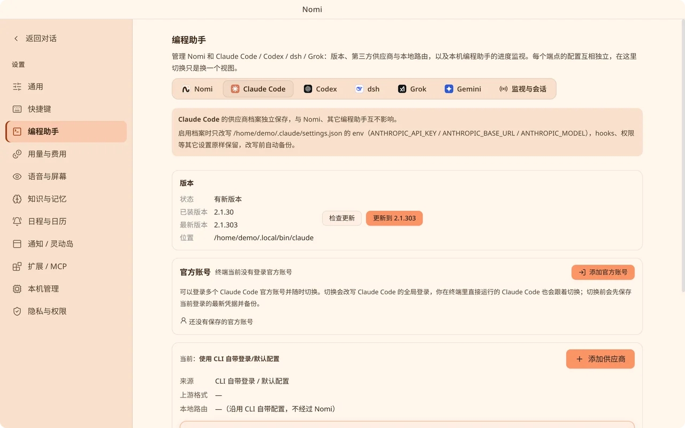 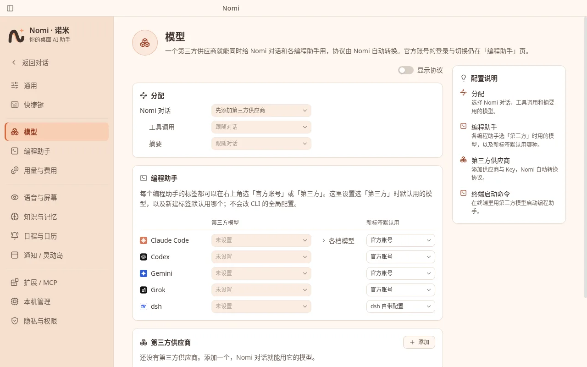<br><sub>官方账号与版本 · 供应商与模型 / Official accounts & version · Providers & models</sub></td>
  </tr>
  <tr>
    <td align="center" colspan="2">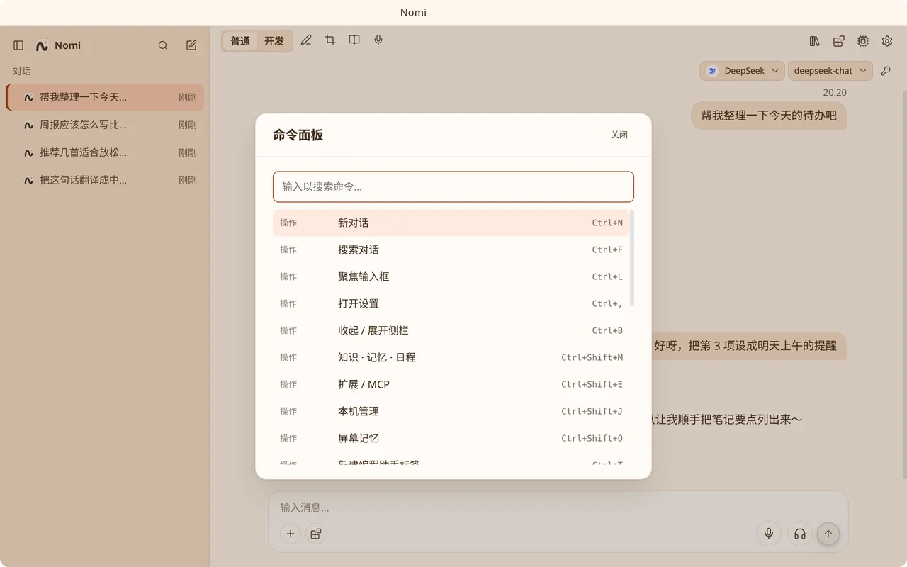 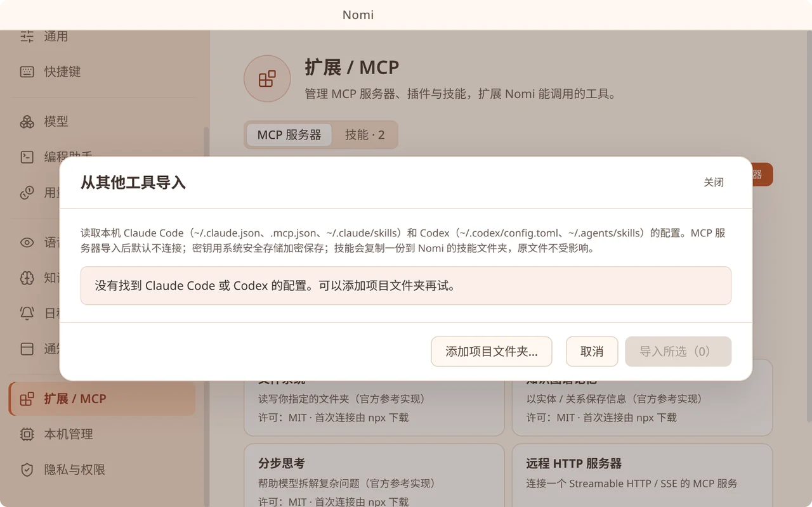 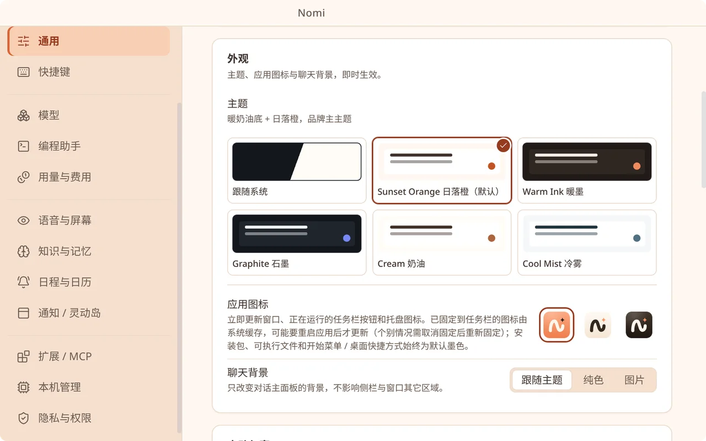<br><sub>命令面板 · 从其他工具导入 · 主题与聊天背景 / Command palette · Import from other tools · Themes & chat background</sub></td>
  </tr>
  <tr>
    <td align="center" colspan="2">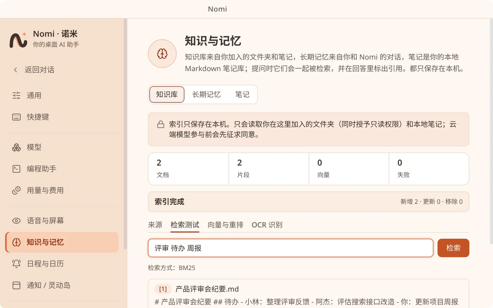 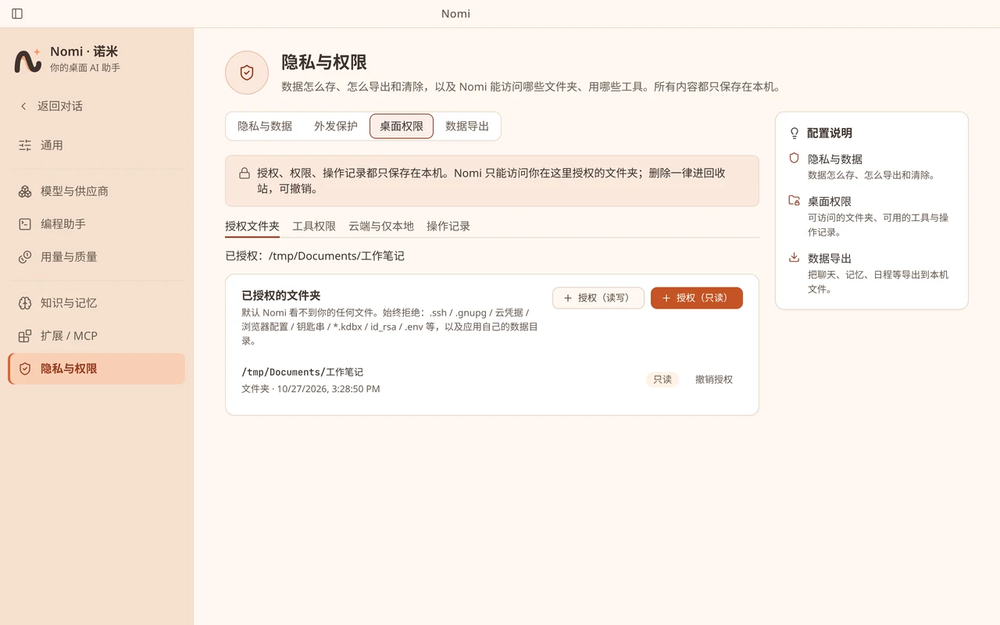 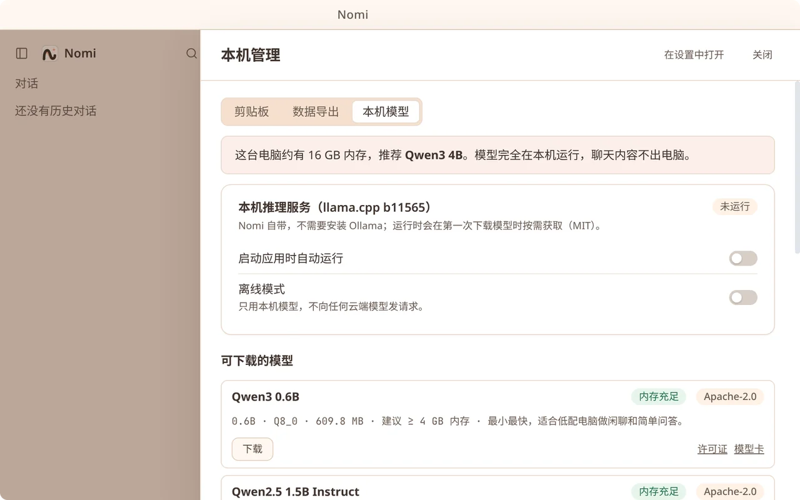<br><sub>知识库 · 工具权限 · 本地模型 / Knowledge base · Tool permissions · Local models</sub></td>
  </tr>
</table>

---

## 💬 联系与交流 / Contact

微信扫码添加作者。<br>Scan with WeChat to add the author.

<table>
  <tr>
    <td align="center"><br><sub>作者微信 · 言萧凡<br>Author WeChat · 言萧凡</sub></td>
    <td align="center"><br><sub>作者微信 · Tomo<br>Author WeChat · Tomo</sub></td>
  </tr>
</table>

## 中文

Nomi·诺米 是运行在你电脑上的桌面 AI 伙伴：一位会动、会说话的 Nomi，加上一个干净好用的对话窗口。
它能连接你喜欢的云端大模型，也能完全离线使用本地模型；它记得你、会主动提醒你，还能帮你读文件、看截图、管日程。

### ✨ 功能

#### 🧸 桌面伙伴 Nomi

- **会动的角色**：全身 Rive 角色——眨眼、表情、挥手等手势，说话时口型同步
- **大小随心**：约 30%–150% 缩放；不想看到她时可随时关闭
- **丰富表情**：开心、生气、难过、放松等表情随对话与任务状态自动切换；AI 也能让她做动作、换表情
- **好玩的互动**：摸头、单击、双击各有反应；拖着她甩一甩会手脚乱蹬，松手落到任务栏上弹一弹；可选沿屏幕底边散步，支持多显示器
- **透明不挡事**：只有角色本身可点击，其余区域鼠标直接穿透
- **对话气泡**：回复以气泡显示在她身边，自动避开脸部
- **陪你写代码**：可选的编程关键词台词与整点问候
- **拖文件给她**：把文件拖到 Nomi 身上，直接帮你总结

#### 💬 AI 对话

- **简洁的对话窗口**：类 Codex 的平静布局，流式输出，会话列表、侧栏可收起；聊天背景铺满整个窗口，可分别调侧栏、对话区、右侧面板的模糊程度
- **图片提问**：把图片粘贴或拖入输入框，直接带图提问
- **快捷命令**：输入框里按 `/` 打开命令，`↑` 找回上一条提问
- **首次引导**：几步完成语言、主题、启动方式、角色与声音、称呼与语气、模型和隐私设置

#### 🧑‍💻 编程助手

- **一个窗口用遍 CLI**：Claude Code、Codex、Gemini CLI、Grok、dsh 多会话并行，在侧栏里切换，在跑的显示「进行中」；工具调用、diff、子代理一目了然
- **权限模式**：计划 / 逐项确认 / 自动改文件 / 自动 / 完全放开，输入栏一键切换或 `Shift+Tab`
- **官方账号**：登录多个官方账号随时切换，也可改用第三方供应商
- **切换工作目录**：可带上当前对话继续
- **斜杠命令**：输入 `/` 使用 CLI 命令、项目命令与 Skills

**v1.2.0 新增 · 左中右三栏工作区**（对照 Codex Desktop 的布局）

- **三栏布局**：左侧会话 | 中间对话 | 右侧「改动 · 文件」；右栏可随时收起；对话列与右栏、Diff 与文件树之间的分割线可拖动，位置会被记住（双击复位）
- **改动 · 文件**：git 仓库里以 git 状态为准，分「已暂存 / 未暂存」，助手本会话改过的文件带标记、可只看本会话；文件树列出工作目录全部文件（依赖与缓存目录除外，被 `.gitignore` 忽略的置灰）并叠加变更标注，分支名显示在顶部
- **Diff 与审查**：Diff 在中栏查看，宽度够时左右并排；「全屏审查」把全部改动依次排开并配文件树；文件预览可直接编辑并保存，Markdown 文件多一个「预览」模式
- **本轮改动摘要卡**：助手每轮消息下显示「已编辑 N 个文件」（路径 +/−），≤3 个文件可在卡内展开行级 Diff，更多文件用列表卡；可确认后撤销本轮写入
- **让助手提交**：右栏的「让助手提交 / 提交并推送」只把提交指令填进输入框，由你确认后再发送；Nomi 的 Git 面板本身只读
- **上下文占用环**：输入栏旁的环形指示，悬停显示「当前上下文 xK / 最大」，默认只显示环形；用量取这一轮最后一次模型请求（Claude Code、Codex、Grok、Gemini、dsh 各按实测口径），窗口大小优先用 CLI 上报值（如 Claude 1M）
- **附图给编程助手**：粘贴 / 拖入图片发给 Claude Code、Codex、Grok、Gemini；能否附图按当前模型能力判断，明确不支持时提示是哪个模型；dsh 明确拒绝附图
- **思考深度**：minimal / low / medium / high / xhigh / max，Codex 另有 ultra（与 max 是两个独立档位）
- **侧栏**：收起按钮固定在标题栏红绿灯旁；收起后是一列会话方块（端点图标 + 状态点），悬停立刻显示标题、时间与状态
- **记住窗口位置与大小**：主界面关闭前的位置、大小（含最大化）下次打开时恢复；原位置已不在任何屏幕上时居中到主屏

#### 🔑 第三方供应商与模型

- **一键切换**：在对话区右上角、系统托盘或 `/model` 里直接切换模型，立即生效
- **内置预设**：OpenAI、Anthropic、Gemini、DeepSeek、Kimi、智谱 GLM、通义千问、豆包、MiniMax、xAI Grok、OpenRouter、硅基流动、Ollama、LM Studio 等，也可以直接贴任意地址
- **自动检测协议**：添加时并行检测 Anthropic / Responses / Chat / Gemini 四种协议并拉取模型列表，不用自己选协议
- **多 Key 自动切换**：每个供应商可配置主 Key 与备用 Key，遇到失效或额度用尽时自动切到下一个
- **加密保存**：API Key 用系统钥匙串加密，只保存在本机，界面只显示掩码
- **按任务分配模型**：对话、工具调用、摘要可以分别指定不同的模型

#### 📚 知识库

- 选几个文件夹，Nomi 就能基于它们回答，并标出**可点击的引用来源**
- 支持 txt、Markdown、PDF、Word，以及图片里的文字（本地 OCR）
- 增量更新索引；可选接入本地或云端向量模型提升检索效果

#### 🧠 长期记忆

- 对话结束后自动整理成记忆，下次聊到相关话题时自然想起
- 你的个人档案（称呼、偏好）随时可看、可改、可删、可导出

#### ⏰ 主动日程

- **提醒**：支持重复规则；错过的提醒在下次启动时补上
- **定时任务**：如「每日简报」，到点生成内容，告诉你并写进对话窗口
- **主动聊天**（默认关闭）：按你设定的频率、活跃时段与免打扰时间偶尔搭话
- **只提醒一次**：Nomi 在桌面上时用她的气泡；Nomi 关着时用灵动岛，灵动岛不可用时用系统通知；免打扰时段不打扰

#### 🧩 MCP 与技能

- 图形界面添加、连接、管理 MCP 服务器，查看工具列表；敏感工具调用前会请你确认
- 支持 `SKILL.md` 技能包：启用、编辑、新建，或从文件夹导入
- 从 Claude Code / Codex 一键导入 MCP 服务器与技能

#### 🏠 本地模型

- 一键下载开源小模型并在本机运行，自动注册为可用的供应商
- 管理本机 Ollama 模型：列出、拉取、删除
- 完全离线也能聊天、做知识库问答

#### 🤖 自动化

- **桌面文件**：授权文件夹后，AI 可以列出、搜索、阅读、总结文件；写入需确认，删除只进回收站并可撤销
- **提醒与剪贴板**：设提醒；读写剪贴板前先征得你的同意
- **受控浏览器**：AI 可在独立、无痕的窗口中浏览公开网页，你能随时看到它在做什么
- **代码沙箱**：在隔离的临时目录里运行 JavaScript / Python 片段
- 所有操作都有本地审计日志

#### 🎙️ 语音

- **语音输入**：本地离线识别、OpenAI 兼容服务，或豆包流式识别（边说边出字）；支持免按键对话
- **语音播报**：内置离线语音（模型按需下载），也可**接入你自己的 TTS 服务**（支持参考音频克隆音色）
- 说话时自动打断播报，Nomi 的口型随声音同步

#### 👀 编程助手监视

- 自动发现本机的 Claude Code、Codex、dsh、Grok、Gemini CLI，任务完成或需要你操作时用气泡提醒你
- 只读取本机已有的日志与会话文件

#### 🏝️ 灵动岛通知（macOS）

- Nomi 关着时，消息、编程助手进度和提醒以刘海处的「灵动岛」样式出现；其他平台可开启顶部胶囊

#### 🎨 个性化

- **主题**：日落橙（默认）、暖墨、石墨、奶油、冷雾，可跟随系统；聊天背景可换纯色或图片
- **启动方式**：启动后默认显示 Nomi 或主界面；关闭主界面时隐藏到托盘或直接退出
- **应用图标**：多款图标可选，窗口、任务栏与托盘即时更新
- **快捷键**：`Ctrl/⌘+K` 命令面板、`Ctrl/⌘+N` 新对话、`Ctrl/⌘+L` 聚焦输入框、`Ctrl/⌘+,` 设置……全部可在设置中查看与改键，并提示冲突
- **中文 / English** 界面，可跟随系统
- **无障碍**：完整键盘操作、焦点管理，并尊重系统「减少动态效果」设置

#### 🔄 自动更新

- 安装版会在后台检查并下载新版本，**经你确认后**才重启安装
- 检查 / 下载 / 安装失败时会说明失败在哪一步并给出「重试」；下载 90 秒没有进度会自动取消并标为失败

#### 🔒 隐私

- 对话、记忆、知识库、日程都保存在本机；可一键导出全部本地数据
- 可开启「仅本地模型」，敏感内容不发往云端

### 📦 下载安装

前往 [GitHub Releases](https://github.com/Cookieboty/nomi-ai/releases/latest) 页面，按你的系统下载对应安装包（macOS 按芯片选 `.dmg`，Windows 选 `.exe`，Linux 选 `.AppImage`），安装即用。文件名里的 `<版本号>` 即 Release 的版本号。

| 系统                         | 安装包                    | 说明                                         |
| ---------------------------- | ------------------------- | -------------------------------------------- |
| macOS · Apple 芯片（M 系列） | `Nomi-<版本号>-arm64.dmg` | 打开后把 Nomi 拖进「应用程序」               |
| macOS · Intel 芯片           | `Nomi-<版本号>.dmg`       | 同上                                         |
| Windows 10+（x64）           | `Nomi-Setup-<版本号>.exe` | 双击运行安装向导                             |
| Linux（x64）                 | `Nomi-<版本号>.AppImage`  | `chmod +x Nomi-<版本号>.AppImage` 后直接运行 |

> 💡 **macOS 提示「已损坏」或无法打开？** 当前安装包尚未经过 Apple 公证（notarize），Gatekeeper 可能拦截从网上下载的应用。先把 Nomi 拖到「应用程序」，再在终端执行：
>
> ```bash
> sudo xattr -dr com.apple.quarantine /Applications/Nomi.app
> ```
>
> 然后重新打开即可。
>
> 💡 **Windows 弹出 SmartScreen？** 当前安装包尚未做代码签名，确认下载来源是本仓库 Releases 后，点「更多信息 → 仍要运行」即可。

### 🚀 快速开始

1. 安装并打开 Nomi，跟着首次引导选择语言、主题和角色。
2. 在「设置 → 模型与供应商」里添加一个第三方供应商（选预设或贴地址，填入 API Key），或在同页的「本机模型」标签里下载一个本地模型。
3. 点击 Nomi 或按 `Ctrl/⌘+N` 开始对话；按 `Ctrl/⌘+K` 浏览全部功能。

### 🛠️ 从源码构建

需要 Node.js ≥ 22.12 和 pnpm 9（`corepack enable`）。

```bash
git clone https://github.com/Cookieboty/nomi-ai.git && cd nomi-ai
corepack enable
pnpm install
pnpm dev                    # 开发模式运行

pnpm test                   # 测试
pnpm package                # 为当前平台打包，产物在 dist/
```

可用 `pnpm run doctor` 检查开发环境。打包与发布说明见 [docs/RELEASE.md](docs/RELEASE.md)。

### 📄 许可证

[MIT](LICENSE)。随应用分发的第三方组件与素材均为开源许可，清单见 [THIRD_PARTY_NOTICES.md](THIRD_PARTY_NOTICES.md)。

### 🙏 致谢

Nomi 构建在这些优秀的开源项目之上：

- [Electron](https://www.electronjs.org/)、[React](https://react.dev/)、[Vite](https://vitejs.dev/)、[Turborepo](https://turbo.build/)、[pnpm](https://pnpm.io/)
- [Vercel AI SDK](https://ai-sdk.dev/) 与 [Model Context Protocol](https://modelcontextprotocol.io/)
- [whisper.cpp](https://github.com/ggml-org/whisper.cpp)、[llama.cpp](https://github.com/ggml-org/llama.cpp)、[Silero VAD](https://github.com/snakers4/silero-vad)、[ONNX Runtime Web](https://onnxruntime.ai/)
- [Tesseract.js](https://tesseract.projectnaptha.com/) 与 [tessdata_fast](https://github.com/tesseract-ocr/tessdata_fast)、[unpdf](https://github.com/unjs/unpdf)、[fflate](https://github.com/101arrowz/fflate)
- [Zod](https://zod.dev/)、[Lucide](https://lucide.dev/)、[react-window](https://github.com/bvaughn/react-window)
- [electron-builder](https://www.electron.build/) 与 electron-updater、[node-global-key-listener](https://github.com/LaunchMenu/node-global-key-listener)
- [Rive](https://rive.app/)（`@rive-app/canvas-lite`，MIT）、[Qwen](https://github.com/QwenLM) 开源模型（本地模型目录）
- 特别感谢 [magpie](https://github.com/yetone/magpie)（MIT）：统一网关的部分设计参考了它，比如推理档位贴合、不透明推理原样回传、工具调用 id 与配对处理；隐私模式的密钥脱敏也参考了它（占位符、回程还原、已见值匹配、跳过规则、出错不发），部分密钥识别规则移植自其 `internal/redact`，见 [CREDITS.md](CREDITS.md)

角色与图标的作者和许可也可以在应用内「致谢」页查看。

### 🔗 链接

- [官网](https://withnomi.app)
- [问题反馈](https://github.com/Cookieboty/nomi-ai/issues)
- [更新日志](CHANGELOG.md) · [官网更新日志](https://withnomi.app/changelog)
- [文档](docs/README.md)：功能说明、开发与测试
- [Git LFS](docs/development/git-lfs.md)：`.riv` / `.rml` / `rive/**` 大资源；贡献前请 `git lfs install`
- [委派隔离](docs/development/delegate-isolation.md)：P3 git worktree（非 Docker）

- [隐私](https://withnomi.app/privacy)

---

## English

Nomi·诺米 is a desktop AI companion that runs on your computer: an animated, talking Nomi plus a clean chat window.
Connect the cloud models you already like, or go fully offline with local models. Nomi remembers you, can nudge you with reminders, and helps with files and images.

### ✨ Features

#### 🧸 Desktop companion Nomi

- **A living character**: full-body Rive character — blinking, expressions, waves and gestures, lip-sync while speaking
- **Any size**: scale from about 30% to 150%; close her any time you want a clear desktop
- **Expressive**: happy, angry, sad, relaxed, and more switch with chat and task state; the AI can also trigger motions and expressions
- **Playful interaction**: pet, click, and double-click responses; fling her and she flails, then bounces when she lands on the taskbar; optional walk along the bottom edge, multi-monitor aware
- **Click-through**: only the character is clickable; the rest of the window lets mouse events pass through
- **Chat bubbles**: replies appear beside her, automatically avoiding her face
- **Coding company**: optional coding-keyword lines and hourly greetings
- **Drop files on her**: drag a file onto Nomi for a quick summary

#### 💬 AI chat

- **Calm chat window**: Codex-like layout, streaming replies, session list, collapsible sidebar; the chat background fills the whole window, with separate blur levels for the sidebar, chat area and right panel
- **Ask with images**: paste or drop an image into the input and ask about it
- **Slash commands**: press `/` in the input; `↑` recalls the last question
- **First-run onboarding**: language, theme, startup mode, character & voice, how to address you & tone, model, and privacy — in a few steps

#### 🧑‍💻 Coding agents

- **Every CLI in one window**: Claude Code, Codex, Gemini CLI, Grok and dsh as parallel sessions, switched from the sidebar (running ones show “Running”), with clear tool calls, diffs and subagents
- **Permission modes**: plan / manual / accept edits / auto / full access, switched from the input bar or with `Shift+Tab`
- **Official accounts**: sign in to several official accounts and switch any time, or use a third-party provider
- **Switch workspace**: optionally carry the current conversation along
- **Slash commands**: type `/` for CLI commands, project commands and Skills

**New in v1.2.0 · three-column workspace** (modelled on Codex Desktop's layout)

- **Three columns**: sessions on the left | chat in the middle | "Changes · Files" on the right; the right column can be collapsed any time; the dividers between chat and right column, and between Diff and file tree, are draggable, remembered, and reset on double-click
- **Changes · Files**: in a git repo it follows git status, split into "Staged / Unstaged", with files the assistant touched this session marked (and filterable); the file tree lists every file in the working directory (dependency and cache folders excluded, `.gitignore`d files greyed out) with change markers, and the branch name sits at the top
- **Diff & review**: diffs open in the middle column, side by side when wide enough; "Full-screen review" lays out all changes in sequence with a file tree; the file preview is editable and saveable, and Markdown files get a "Preview" mode
- **Per-turn edit summary**: under each assistant reply, "Edited N files" (path +/−); up to 3 files can expand line-level diffs inline, more files use a list card; undoing the turn's writes asks for confirmation first
- **Ask the assistant to commit**: "Ask assistant to commit / commit and push" in the right column only fills a commit instruction into the input box — you confirm before it is sent; Nomi's Git panel itself is read-only
- **Context ring**: a ring next to the input box; hover to see "current context xK / max" (ring only by default); usage is taken from the last model request of the turn (Claude Code, Codex, Grok, Gemini and dsh each measured their own way), and the window size prefers the value reported by the CLI (e.g. Claude 1M)
- **Images for coding agents**: paste or drop images for Claude Code, Codex, Grok and Gemini; whether images are accepted depends on the current model, and the hint names the model when it is not; dsh explicitly refuses images
- **Reasoning effort**: minimal / low / medium / high / xhigh / max, plus ultra for Codex (a separate level from max)
- **Sidebar**: the collapse button sits in the title bar next to the traffic lights; collapsed, it shows a column of session squares (endpoint icon + status dot) with an instant hover card for title, time and status
- **Window position & size memory**: the main window's position and size (including maximized) are restored on the next launch; if the saved position is no longer on any screen it is centred on the primary display

#### 🔑 Providers & token management

- **One-click switch**: change provider and model from the chat toolbar or system tray — takes effect immediately
- **Built-in presets**: OpenAI, Anthropic, Gemini, DeepSeek, Kimi, Zhipu GLM, Tongyi Qianwen, Doubao, MiniMax, xAI Grok, OpenRouter, SiliconFlow, Ollama, LM Studio, and fully custom endpoints
- **Fetch model list**: pull available models, enable what you want, set a default
- **Latency check**: a tiny probe request shows real delay
- **Multi-key failover**: primary and backup keys per provider; auto-switch on invalid key or quota exhaustion
- **Encrypted storage**: API keys in the OS keychain, local only; UI shows masked values
- **Per-task routing**: chat, tool calls, and summarization can use different providers and models

#### 📚 Knowledge base

- Point Nomi at folders; answers include **clickable citations**
- txt, Markdown, PDF, Word, plus text in images (local OCR)
- Incremental indexing; optional local or cloud embedding models for better retrieval

#### 🧠 Long-term memory

- Conversations are distilled into memories after chats; related topics come back naturally next time
- Your profile (name, preferences) is viewable, editable, deletable, and exportable anytime

#### ⏰ Proactive schedule

- **Reminders**: recurrence supported; missed ones catch up on next launch
- **Scheduled jobs**: e.g. daily briefing — Nomi tells you, and the result is also saved in the chat window
- **Proactive chat** (off by default): occasional hellos within your frequency, active hours, and do-not-disturb window
- **One alert, one place**: Nomi's bubble while she's on your desktop; the Dynamic Island when she's closed, or a system notification if the island is unavailable; nothing during quiet hours

#### 🧩 MCP & skills

- Add, connect, and manage MCP servers in the UI; review tools; sensitive calls ask for confirmation
- `SKILL.md` skill packs: enable, edit, create, or import from a folder
- Import MCP servers and skills from Claude Code / Codex in one step

#### 🏠 Local models

- One-click download and run of small open-source models; registered as providers automatically
- Manage local Ollama models: list, pull, delete
- Fully offline chat and knowledge-base Q&A

#### 🤖 Automation

- **Desktop files**: after you grant folders, the AI can list, search, read, and summarize; writes need confirmation; deletes go to trash and can be undone
- **Reminders & clipboard**: set reminders; reading or writing the clipboard asks you first
- **Controlled browser**: AI browses public pages in a separate, private window you can watch
- **Code sandbox**: run JavaScript / Python snippets in an isolated temp directory
- All actions have a local audit log

#### 🎙️ Voice

- **Speech input**: local offline recognition, an OpenAI-compatible service, or Doubao streaming ASR (text appears as you speak); hands-free conversation supported
- **Speech output**: built-in offline voice (model downloaded on demand), or **your own TTS service** (including reference-audio voice clone)
- Speaking interrupts playback; Nomi’s mouth syncs to the audio

#### 👀 Coding-agent monitor

- Discovers Claude Code, Codex, dsh, Grok, Gemini CLI on this machine; bubbles when a task finishes or needs you
- Reads only existing local logs and session files

#### 🏝️ Dynamic Island notifications (macOS)

- While Nomi is closed, messages, coding-agent progress, and reminders appear in a notch-style Dynamic Island; other platforms can turn on a top capsule

#### 🎨 Personalization

- **Themes**: Sunset Orange (default), Warm Ink, Graphite, Cream, Cool Mist — can follow the system; solid-color or image chat background
- **Startup**: open to Nomi or the main window; closing the main window hides to the tray or quits
- **App icons**: several options; window, taskbar, and tray update instantly
- **Shortcuts**: `Ctrl/⌘+K` command palette, `Ctrl/⌘+N` new chat, `Ctrl/⌘+L` focus input, `Ctrl/⌘+,` settings — all viewable/remappable with conflict hints
- **Chinese / English** UI, can follow the system
- **Accessibility**: full keyboard use, focus management, and respect for system “reduce motion”

#### 🔄 Auto-update

- Installed builds check and download updates in the background; restart/install only **after you confirm**
- When checking / downloading / installing fails, the stage is named with a "Retry" button; a download with no progress for 90 s is cancelled and marked failed

#### 🔒 Privacy

- Chat, memory, knowledge base, and schedule stay on this machine; export all local data in one click
- Optional “local models only” so sensitive content never leaves for the cloud

### 📦 Download

Open the [GitHub Releases](https://github.com/Cookieboty/nomi-ai/releases/latest) page and download the installer for your system (macOS: pick the `.dmg` for your chip; Windows: `.exe`; Linux: `.AppImage`), then install. `<version>` in the file names is the Release version.

| System                           | Installer                  | Notes                                        |
| -------------------------------- | -------------------------- | -------------------------------------------- |
| macOS · Apple Silicon (M-series) | `Nomi-<version>-arm64.dmg` | Open it and drag Nomi into Applications      |
| macOS · Intel                    | `Nomi-<version>.dmg`       | Same as above                                |
| Windows 10+ (x64)                | `Nomi-Setup-<version>.exe` | Run it to start the installer                |
| Linux (x64)                      | `Nomi-<version>.AppImage`  | `chmod +x Nomi-<version>.AppImage`, then run |

> 💡 **macOS says Nomi “is damaged” or won’t open?** The current build is not Apple-notarized, so Gatekeeper may block apps downloaded from the internet. Move Nomi into Applications, then run this in Terminal:
>
> ```bash
> sudo xattr -dr com.apple.quarantine /Applications/Nomi.app
> ```
>
> Then open it again.
>
> 💡 **Windows shows SmartScreen?** The current installer is not code-signed. After confirming you downloaded it from this repo’s Releases, click “More info → Run anyway”.

### 🚀 Quick start

1. Install and open Nomi; follow onboarding for language, theme, and character.
2. Add a third-party provider under Settings → Models & providers (pick a preset or paste a URL, enter the API key), or download a local model in its Local models tab.
3. Click Nomi or press `Ctrl/⌘+N` to chat; `Ctrl/⌘+K` opens everything else.

### 🛠️ Build from source

Requires Node.js ≥ 22.12 and pnpm 9 (`corepack enable`).

```bash
git clone https://github.com/Cookieboty/nomi-ai.git && cd nomi-ai
corepack enable
pnpm install
pnpm dev                    # run in development

pnpm test                   # tests
pnpm package                # package for this platform → dist/
```

Run `pnpm run doctor` to check your dev environment. Packaging and release notes: [docs/RELEASE.md](docs/RELEASE.md).

### 📄 License

[MIT](LICENSE). Third-party components and assets shipped with the app are under open-source licenses; see [THIRD_PARTY_NOTICES.md](THIRD_PARTY_NOTICES.md).

### 🙏 Acknowledgments

Nomi is built on excellent open-source projects:

- [Electron](https://www.electronjs.org/), [React](https://react.dev/), [Vite](https://vitejs.dev/), [Turborepo](https://turbo.build/), [pnpm](https://pnpm.io/)
- [Vercel AI SDK](https://ai-sdk.dev/) and [Model Context Protocol](https://modelcontextprotocol.io/)
- [whisper.cpp](https://github.com/ggml-org/whisper.cpp), [llama.cpp](https://github.com/ggml-org/llama.cpp), [Silero VAD](https://github.com/snakers4/silero-vad), [ONNX Runtime Web](https://onnxruntime.ai/)
- [Tesseract.js](https://tesseract.projectnaptha.com/) and [tessdata_fast](https://github.com/tesseract-ocr/tessdata_fast), [unpdf](https://github.com/unjs/unpdf), [fflate](https://github.com/101arrowz/fflate)
- [Zod](https://zod.dev/), [Lucide](https://lucide.dev/), [react-window](https://github.com/bvaughn/react-window)
- [electron-builder](https://www.electron.build/) and electron-updater, [node-global-key-listener](https://github.com/LaunchMenu/node-global-key-listener)
- [Rive](https://rive.app/) (`@rive-app/canvas-lite`, MIT), [Qwen](https://github.com/QwenLM) open models (local model catalog)
- Special thanks to [magpie](https://github.com/yetone/magpie) (MIT): parts of the unified gateway design draw on it, such as reasoning-effort fitting, passing sealed reasoning back unchanged, and tool-call id and pairing handling; privacy mode's secret masking draws on it too (placeholders, restoring on the way back, matching already-seen values, skip rules, and not sending on errors), and some secret-detection rules are ported from its `internal/redact` — see [CREDITS.md](CREDITS.md)

Authors and licenses for the character and icons are also listed in the in-app Credits page.

### 🔗 Links

- [Website](https://withnomi.app)
- [Issues](https://github.com/Cookieboty/nomi-ai/issues)
- [Changelog](CHANGELOG.md) · [Website changelog](https://withnomi.app/changelog)
- [Docs](docs/README.md): features, development, and testing
- [Privacy](https://withnomi.app/privacy)
