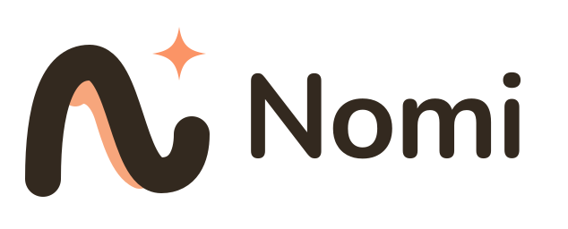
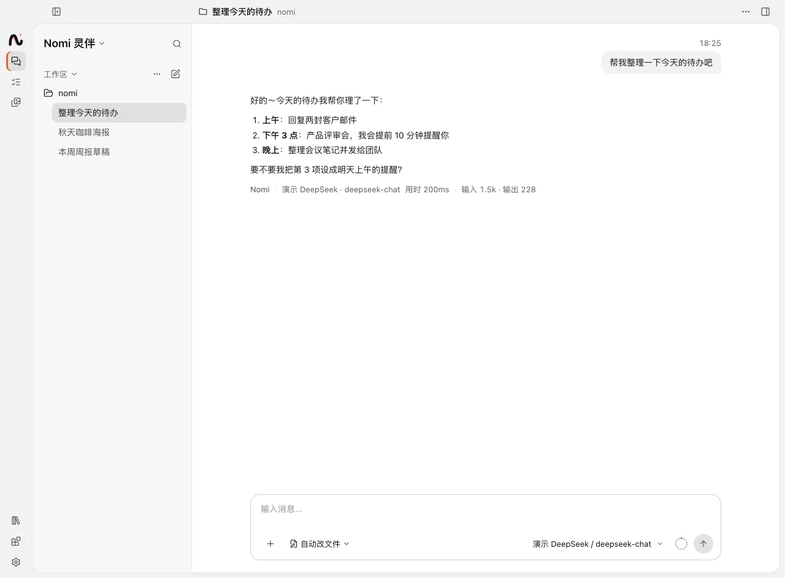
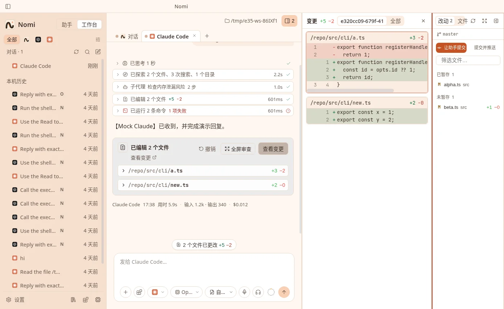
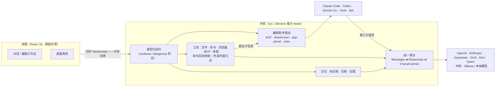
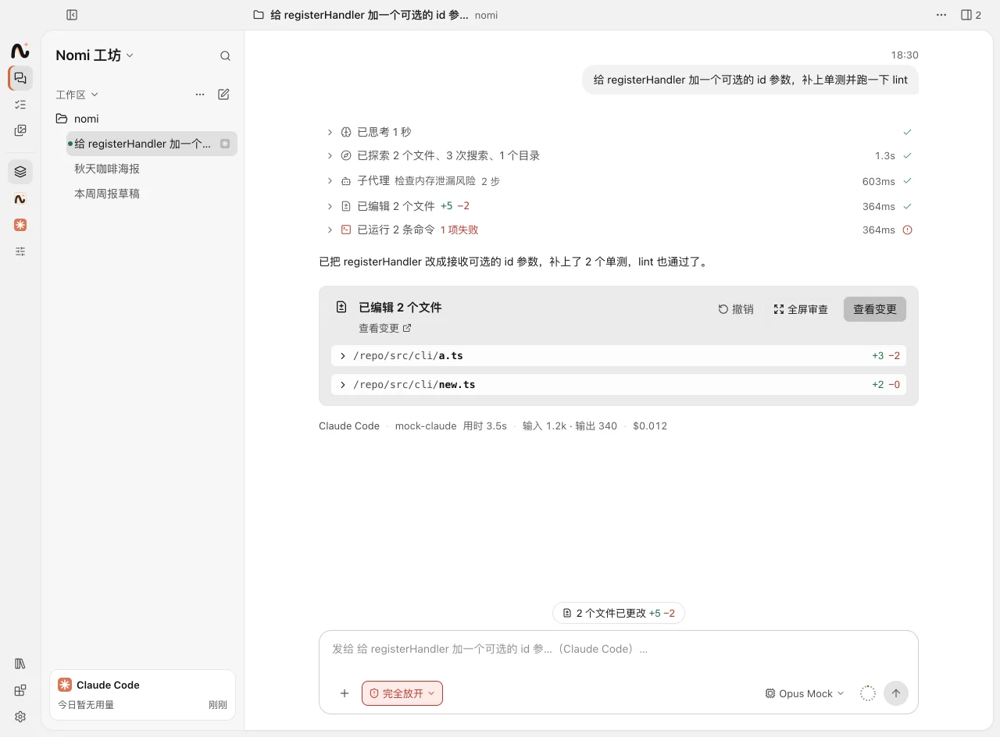
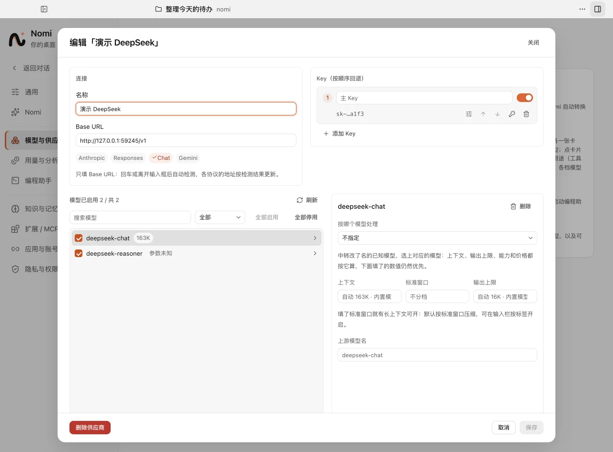
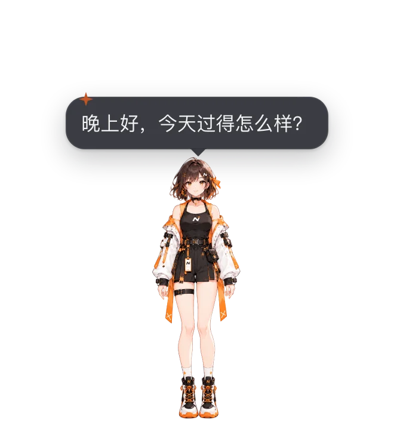

<p align="center"></p>

<h1 align="center">Nomi·诺米</h1>

<p align="center">
  <b>住在你桌面上的 AI 伙伴：接上任意模型，自己动手干活，也会把专业的活派给专业的 AI。</b><br>
  模型、编程助手、MCP 与本地工具都接到一处，由 Nomi 统一调度。
</p>

<p align="center">macOS · Windows · Linux　|　Go 内核，安装包 39 MB　|　MIT</p>

<p align="center">
  <a href="https://github.com/Cookieboty/nomi-ai/stargazers"></a>
  <a href="https://github.com/Cookieboty/nomi-ai/releases"></a>
  <a href="https://github.com/Cookieboty/nomi-ai/releases/latest"></a>
  <a href="https://github.com/Cookieboty/nomi-ai/commits/main"></a>
  <a href="LICENSE"></a>
</p>

<p align="center">
  <a href="https://github.com/Cookieboty/nomi-ai/releases/latest">下载</a> ·
  <a href="https://withnomi.app">官网</a> ·
  <a href="docs/README.md">文档</a> ·
  <a href="docs/development/architecture.md">架构</a> ·
  <a href="CHANGELOG.md">更新日志</a>
</p>

<p align="center"><b>中文</b> · <a href="README.en.md">English</a></p>

<p align="center">
  
  
</p>

## 为什么是 Nomi

### 1. 模型只接一次，所有 AI 都能用

只添加一次供应商（选预设或填地址，粘贴 Key），Nomi 自己和 Claude Code、Codex、Gemini CLI、Grok、dsh 都能用它的任意模型，也可以全部换成本地模型。
本机网关自动识别并互转 **Anthropic Messages / OpenAI Responses / OpenAI Chat Completions / Gemini generateContent**，流式、工具调用、推理、图片、上下文压缩都照常工作：在 Claude Code 里直接用 DeepSeek、GLM、Kimi、Qwen。
第三方只作用于 Nomi 启动的那个进程，不改 CLI 的全局配置，不碰官方登录。
→ [统一网关设计](docs/design/unified-gateway.md)

### 2. Nomi 自己就是一个 agent

它能读写文件、跑命令、开浏览器、调 MCP 和技能，记得你说过的事（长期记忆），能在你的文件夹里查资料并给出可点击的引用，还能画图、改图、定提醒。
工具按需提供：闲聊时发给模型的工具定义约 2K token，聊到相关的事才展开。
→ [功能文档](docs/README.md)

### 3. 专业的活，派给专业的 AI

写代码这类活，Nomi 会委派给 Claude Code、Codex 等编程助手，子任务的完整对话随时可看、可停。你也可以直接打开编程助手会话：五个 CLI 经四种会话驱动接入（ACP、stream-json、Codex app-server、exec），多个会话并行，三栏工作区看 Diff、提交、撤销；终端和 IDE 里开的会话也能接着聊。
编程助手是目前最强的一类「专业 AI」，接入层是插件化的，后续可以接更多。
→ [编程工作台](docs/features/coding-workspace.md) · [CLI 插件架构](docs/design/cli-plugin-architecture.md)

### 4. 放手让它干，但边界在你手里

命令执行前先由辅助模型按风险分级：低风险直接跑，高风险交给你确认；**这一轮读过外部内容（网页、MCP 返回、技能文件）后，中风险命令也要你确认**，防止提示注入借 Nomi 的手执行命令。
对话、记忆、知识库默认只存在本机；发给第三方模型前自动隐藏密钥；API Key 存系统钥匙串。
→ [隐私与安全](docs/features/privacy-security.md)

### 5. 轻：Go 内核，原生 WebView

正式版是 Go 内核 + [Wails v3](https://v3.wails.io)，不带 Chromium；同一套界面也有 Electron 版，一致性测试（parity golden）守住两边行为一致。macOS Apple 芯片实测（v2.0.5）：

|                  | Go 版       | Electron 版 |
| ---------------- | ----------- | ----------- |
| DMG 安装包       | **38.8 MB** | 153.0 MB    |
| 安装后占用       | **69 MiB**  | 334 MiB     |
| 启动 30 秒后内存 | **177 MiB** | 284 MiB     |
| 空闲 CPU（单核） | **3.2%**    | 8.2%        |
| 启动到窗口出现   | **0.55 s**  | 0.82 s      |

## 架构



视图与内核之间只有一条类型化契约，没有零散的 IPC 通道；哪些窗口能调用哪些过程、哪些属于危险操作，都在契约里声明。详见 [架构](docs/development/architecture.md)、[内核宿主分离](docs/design/core-host-decoupling.md)。

## 功能一览

- **模型**：OpenAI、Anthropic、DeepSeek、Kimi、智谱、通义、豆包、Ollama 等预设；多 Key 自动切换；按每次上游请求记账，用量和费用看得见
- **本地模型**：一键下载开源小模型（llama.cpp）或管理 Ollama；可以只用本地模型，也可以只让本地模型读文件
- **生图**：Nomi 对话里直接画图、改图、以图生图，自动匹配同一厂商的图片模型；素材库统一管理生成的图片
- **知识库与记忆**：文件夹问答带可点击引用；对话自动整理成长期记忆，可导出
- **MCP 与技能**：图形化管理 MCP 服务器与 `SKILL.md`；工具调用有审计日志
- **语音与提醒**：本地 whisper.cpp 或云端语音输入、语音播报；提醒与定时任务
- **桌面角色**：Nomi 常驻桌面，2D 立绘或 Rive 动画，表情与口型同步；拖文件给它直接总结；角色可以通过[角色包](docs/character-pack/README.md)替换

<table>
  <tr>
    <td align="center" width="33%"><br><sub>编程助手</sub></td>
    <td align="center" width="33%"><br><sub>供应商与模型</sub></td>
    <td align="center" width="33%"><br><sub>桌面角色</sub></td>
  </tr>
</table>

更多界面见 [docs/screenshots](docs/screenshots/)。

## 下载安装

前往 [GitHub Releases](https://github.com/Cookieboty/nomi-ai/releases/latest)：

| 系统               | 安装包                                           | 说明                                    |
| ------------------ | ------------------------------------------------ | --------------------------------------- |
| macOS · Apple 芯片 | `Nomi-<版本>-arm64.dmg`                          | 拖进「应用程序」                        |
| macOS · Intel      | `Nomi-<版本>.dmg`                                | 同上                                    |
| Windows 10+（x64） | `Nomi-Setup-<版本>.exe`                          | 需要 WebView2（Windows 10/11 通常自带） |
| Linux（x64）       | `Nomi-<版本>.AppImage` / `nomi_<版本>_amd64.deb` | AppImage 需 `chmod +x`                  |

文件名以 `Nomi-Electron-` 开头的是 Electron 版。已安装的版本会在应用内提示更新。

> **macOS 提示「已损坏」？** 当前包已签名但尚未公证。拖到「应用程序」后执行：
>
> ```bash
> sudo xattr -dr com.apple.quarantine /Applications/Nomi.app
> ```
>
> **Windows 弹出 SmartScreen？** 确认安装包来自本仓库 Releases 后，选「更多信息 → 仍要运行」。

## 3 分钟上手

1. 打开 Nomi，完成首次引导（语言、主题、角色）。
2. 「设置 → 模型与供应商」添加供应商与 API Key；不想填 Key，就在「本机模型」下载一个本地模型。
3. 和 Nomi 对话：`Ctrl/⌘+N` 新对话，`Ctrl/⌘+K` 命令面板。
4. 用编程助手：新建一个 Claude Code / Codex 会话，选工作目录；用官方账号，或直接选第2步加的第三方模型。

更细的步骤见 [快速上手](docs/getting-started.md)。

## 从源码构建

需要 Node.js ≥ 22.12、pnpm 9（`corepack enable`）；Go 版另需 Go（版本见 `apps/desktop-go/go.mod`）与 cgo 工具链（Linux 还要 GTK3 与 WebKitGTK 4.1 开发包）。

```bash
git clone https://github.com/Cookieboty/nomi-ai.git && cd nomi-ai
corepack enable && pnpm install
pnpm dev:go       # Go 版：界面热更新，改 Go 代码自动重编译
pnpm dev          # Electron 版
pnpm test         # 单元测试；pnpm test:e2e 跑无界面端到端测试
```

`pnpm run doctor` 检查开发环境。Go 版细节见 [apps/desktop-go](apps/desktop-go/README.md)；打包与发布见 [docs/RELEASE.md](docs/RELEASE.md)；开发指南见 [docs/development](docs/development/)。欢迎 PR，提交前请看 [AGENTS.md](AGENTS.md) 里的约定。

## 联系与交流

问题与建议请提 [GitHub Issues](https://github.com/Cookieboty/nomi-ai/issues)。微信扫码添加作者：

<table>
  <tr>
    <td align="center"><br><sub>言萧凡</sub></td>
    <td align="center"><br><sub>Tomo</sub></td>
  </tr>
</table>

## 许可证与致谢

[MIT](LICENSE)。第三方组件见 [THIRD_PARTY_NOTICES.md](THIRD_PARTY_NOTICES.md)，设计参考致谢见 [CREDITS.md](CREDITS.md)。

构建于 Go、Wails、Electron、React、Vite、Vercel AI SDK、MCP、whisper.cpp / llama.cpp、Rive 等开源项目之上。
