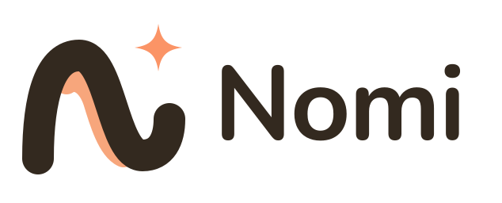
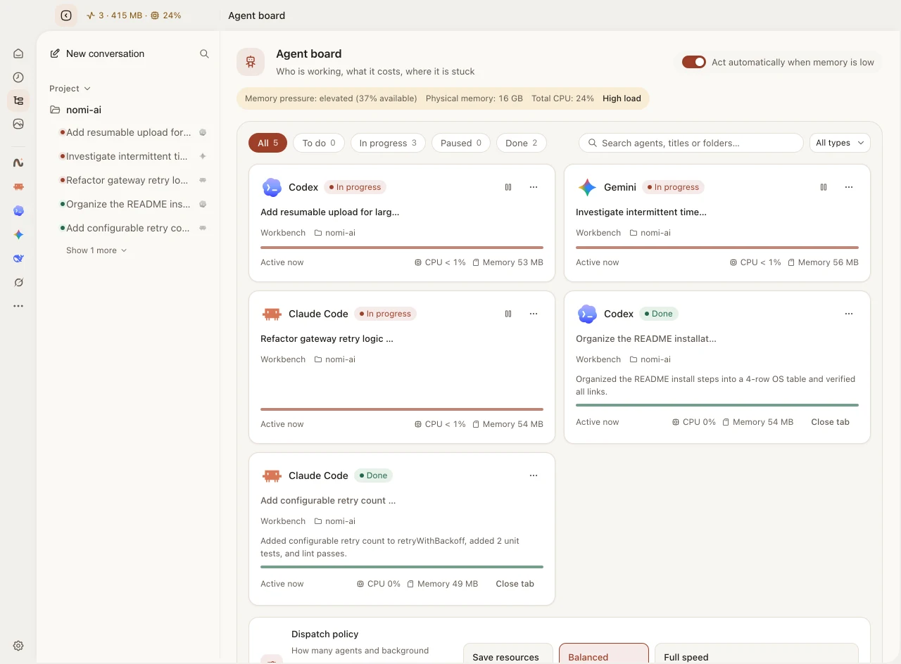
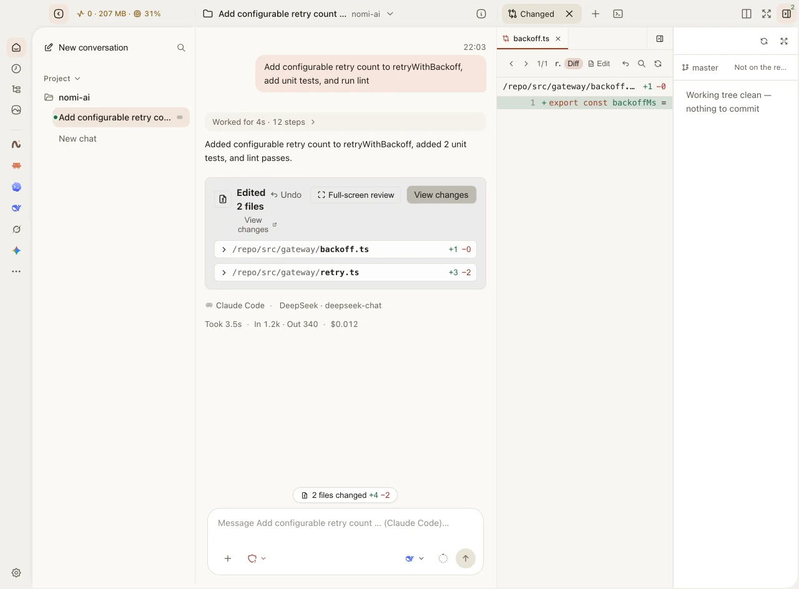
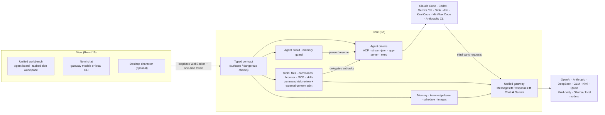
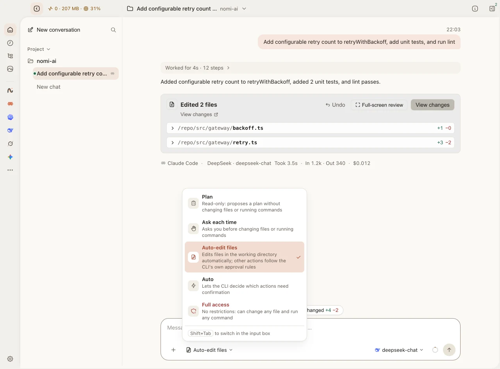
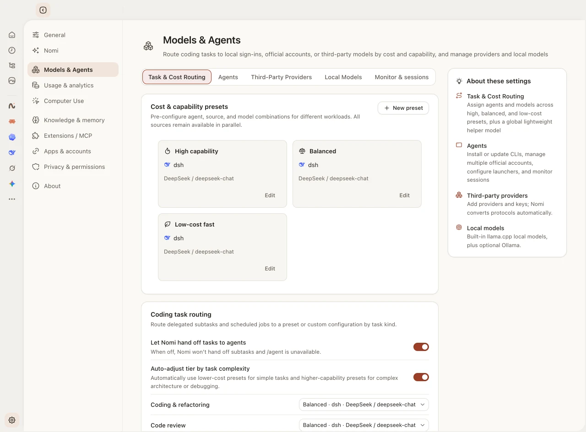
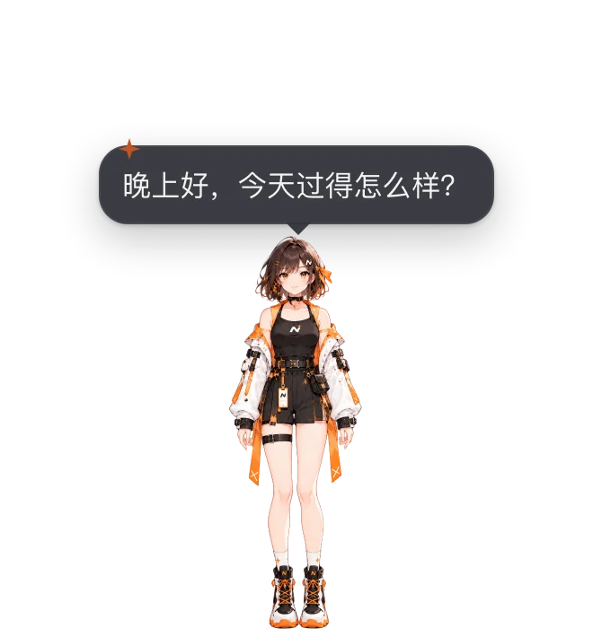

<p align="center"></p>

<h1 align="center">Nomi</h1>

<p align="center">
  <b>One place. Every AI capability.</b><br>
  让每一种 AI 能力，都为你所用
</p>

<p align="center">
  Run Claude Code, Codex, Gemini CLI, and Antigravity CLI in parallel on one board, or select an installed local CLI directly inside chat. Connect a model once — official APIs, third-party, or local. No Nomi cloud account. No edits to those CLIs' global config.<br>
  The desktop character is optional. Turn it off if you don't want it.
</p>

<p align="center">macOS · Windows · Linux　|　Go + Wails core, ~25 MB installer　|　MIT</p>

<p align="center">
  <a href="https://github.com/Cookieboty/nomi-ai/stargazers"></a>
  <a href="https://github.com/Cookieboty/nomi-ai/releases"></a>
  <a href="https://github.com/Cookieboty/nomi-ai/releases/latest"></a>
  <a href="https://github.com/Cookieboty/nomi-ai/commits/main"></a>
  <a href="LICENSE"></a>
</p>

<p align="center">
  <a href="https://github.com/Cookieboty/nomi-ai/releases/latest">Download</a> ·
  <a href="https://withnomi.app">Website</a> ·
  <a href="docs/README.md">Docs</a> ·
  <a href="docs/development/architecture.md">Architecture</a> ·
  <a href="CHANGELOG.md">Changelog</a>
</p>

<p align="center"><b>English</b> · <a href="README.zh-CN.md">简体中文</a></p>

<p align="center">
  
  
</p>

## What the workbench holds

| Capability | In Nomi                                                                                                                                                                                                                              |
| ---------- | ------------------------------------------------------------------------------------------------------------------------------------------------------------------------------------------------------------------------------------ |
| **Agents** | Eight built-in CLIs — Claude Code, Codex, Gemini CLI, Grok, dsh, Kimi Code, MiniMax Code, and Antigravity CLI (with in-app Google sign-in) — in parallel; pick a local CLI right inside main chat or resume CLI history on the board |
| **Models** | Official APIs, third-party, or local models (llama.cpp / Ollama): connect once, and all built-in agents and Nomi can use them. Custom ACP agents bypass this gateway                                                                 |
| **Tools**  | MCP, `SKILL.md` skills, embedded browser, project files, split-pane interactive terminal, and command approval with an audit log                                                                                                     |
| **Nomi**   | An agent itself: long-term memory, folder knowledge base, image generation and asset library, voice and reminders, plus delegating tasks to agents                                                                                   |

Everything lives in one **unified workbench**: a single sidebar with conversations, tasks, the agent board, and assets — showing who is working, how far along they are, how much they use, and where they're stuck.

## Why Nomi

### 1. One board & unified workspace

Nomi uses a **single unified sidebar** (conversations, tasks, Agent Board, and assets, with endpoint filtering) and reveals agent entry points automatically whenever local CLIs are detected — no manual mode switch needed.

- **Agent Board**: gathers Nomi chats and background runs, dispatched agents, local agent sessions, and sessions you started yourself in a terminal or IDE (read-only). Each card shows status, project directory, memory, and CPU, with anything waiting on approval or review sorted first.
- **Memory guard**: when memory runs low it pauses agents Nomi dispatched and resumes them where they stopped once pressure clears; you can pause and resume manually any time, with a live load indicator in the title bar.
- **Tabbed side workspace**: opens beside any conversation on demand for **Changes & Git** (review diff, commit, undo), **Project files** (drag into the composer for `@path`), **Split-pane terminal**, **Run traces** (graph, timeline, thinking, model audit), **Embedded browser**, and **Side chat**.
- **Eight built-in CLIs + plugin ACP**: Claude Code, Codex, Gemini CLI, Grok, dsh, Kimi Code, MiniMax Code, and Antigravity CLI (with in-app local Google sign-in), connected through four session drivers (`ACP`, `stream-json`, `Codex app-server`, `exec`). Additional custom ACP agents can join through the plugin layer (external ACP agents do not route through the gateway or official accounts).

→ [Agents](docs/features/coding-agents.md) · [Agent board](docs/development/agent-board.md) · [Agent integration](docs/development/coding-agents.md)

### 2. Connect a model once

Configure a provider once under **Settings → Models & Agents** (pick a preset or enter a Base URL and paste a key) for official APIs, third-party relays, or local models — or select an already-installed official CLI directly per conversation inside main chat without adding a provider first (switching CLIs mid-thread and switching back restores the prior CLI session with incremental updates).

- The local unified gateway detects and translates between **Anthropic Messages / OpenAI Responses / OpenAI Chat Completions / Gemini generateContent**. Streaming, tool calls, reasoning, images, and context compaction work end-to-end, so a third-party model runs cleanly inside Claude Code or Codex.
- Dropped connections retry on the same key automatically; **cross-provider circuit-breaker fallback is off by default** and can be enabled per provider card to fail over only to another provider serving the **same model**.
- Third-party routing applies strictly to processes Nomi launches. It never edits any CLI's global config or touches official sign-ins, and Nomi requires no cloud account.

→ [Unified gateway design](docs/development/gateway.md) · [Third-party providers](docs/features/providers.md)

### 3. Local-first, no required cloud account

Chats, memory, and the knowledge base stay on your machine by default. Use each CLI's official sign-in, your own API keys, or local models only.

- On macOS, agents run in a **system sandbox** (on by default): it blocks reads of SSH and Git credentials, cloud credentials, browser data, and `.env` files, and limits writes to the project directory; when blocked, allow for the current session or "always" (this project only) directly in chat. Working directories must be registered project folders, and agents do not inherit tokens or keys from your shell environment.
- Before a command runs, a helper model classifies its risk: low risk executes, high risk prompts you, and **once a turn reads external content (web pages, MCP outputs, skill files), medium-risk commands prompt you too**, blocking prompt-injection command execution.
- Secrets are redacted before reaching third-party models, and API keys are stored in the OS keychain.

→ [Privacy and security](docs/features/privacy-security.md) · [Local protection for agents](docs/features/coding-agents.md#本机保护)

### 4. Nomi is an agent too

Nomi reads and writes files, runs commands, operates an embedded browser, invokes MCP servers and skills, stores long-term memory, answers questions over your folders with clickable citations, generates and edits images, and manages reminders.

- For implementation work, it delegates subtasks to agents that run beside the main conversation, where you can interject, stop, or continue another turn while results return to the main thread; it also schedules work against the agent board.
- Tools load on demand: casual chat sends roughly 2K tokens of tool definitions, expanding only when the conversation needs them.

→ [Chat](docs/features/chat.md) · [Memory](docs/features/memory.md) · [Knowledge base](docs/features/knowledge-base.md)

### 5. The desktop character is optional

The desktop character is not required to use Nomi. Keep it running in a small transparent window with expressions, gestures, and lip sync — or close it from its toolbar's "More" menu while the rest of the workbench stays unchanged.

With it enabled, you can track finished or failed runs from character gestures, glance at reply previews in its speech bubble, drop files onto it for quick summaries, talk via voice with read-aloud replies, and double-click to open chat.

→ [Desktop character](docs/features/mascot.md) · [Voice](docs/features/voice.md)

### 6. Light: a Go core on the native WebView

A Go core on [Wails v3](https://v3.wails.io) with no bundled Chromium. On macOS (Apple silicon), the DMG installer is about 24.5 MB and about 49 MiB installed.

## Architecture



The view talks to the Go core exclusively through one typed contract instead of ad-hoc IPC channels; which windows may call which procedures, and which operations require elevated confirmation, are declared in the contract. See [Architecture](docs/development/architecture.md) and [the app contract](docs/development/contract.md).

## Features at a glance

**Unified workbench**

- **Agent board**: see who is working, how far along they are, and how much memory and CPU each session uses; a memory guard pauses and resumes automatically, with a live load indicator in the title bar
- **Agents**: eight built-in CLIs (including Antigravity CLI with in-app Google sign-in), parallel sessions, and a tabbed side workspace for Diff & Git, project files, split-pane interactive terminal, run traces, embedded browser, and side chat; pick local CLI bases inside main chat, official accounts, or third-party/local models; permission modes and macOS system sandbox
- **Tasks**: continuous and scheduled tasks, executed by Nomi or an agent

**Models, Agents, and tools**

- **Models & Agents**: five-tab settings (`Task & Cost Routing`, `Agents`, `Third-Party Providers`, `Local Models`, `Monitor & sessions`); presets for OpenAI, Anthropic, DeepSeek, Kimi, Zhipu, Qwen, Doubao, Ollama, and more; multi-key rotation, opt-in cross-provider fallback (off by default), and per-request usage/cost accounting
- **Local models**: one-click open-source models (llama.cpp) or Ollama management; run purely local or restrict file-reading chats to local models
- **MCP and skills**: manage MCP servers and `SKILL.md` skills in the UI or import from other tools, with audit logging on tool calls
- **Third-party provider links**: relays and model platforms can offer an "Add to Nomi" link; see [Third-party provider integration](#third-party-provider-integration) below

**Nomi**

- **Chat**: reads and writes files, runs commands, drives the embedded browser, delegates to agents, and lets you select an installed official CLI right in main chat; command palette and slash commands
- **Knowledge base and memory**: ask questions over a folder with clickable citations; conversations distill into exportable long-term memory
- **Images**: generate, edit, and reference images with vendor-matched image models, organized in an asset library
- **Voice and reminders**: local whisper.cpp or cloud speech input, read-aloud replies, reminders, and quiet hours
- **Desktop character (optional)**: 2D art or Rive animation with expressions, lip sync, and task-status gestures

<table>
  <tr>
    <td align="center" width="33%"><br><sub>Agents & permissions</sub></td>
    <td align="center" width="33%"><br><sub>Models & Agents</sub></td>
    <td align="center" width="33%"><br><sub>Desktop character (optional)</sub></td>
  </tr>
</table>

More screenshots in [docs/screenshots](docs/screenshots/).

## Download

From [GitHub Releases](https://github.com/Cookieboty/nomi-ai/releases/latest):

| System                | Installer                                              | Notes                                                  |
| --------------------- | ------------------------------------------------------ | ------------------------------------------------------ |
| macOS · Apple silicon | `Nomi-<version>-arm64.dmg`                             | Drag into Applications                                 |
| macOS · Intel         | `Nomi-<version>.dmg`                                   | Same                                                   |
| Windows 10+ (x64)     | `Nomi-Setup-<version>.exe`                             | Needs WebView2 (usually preinstalled on Windows 10/11) |
| Linux (x64)           | `Nomi-<version>.AppImage` / `nomi_<version>_amd64.deb` | `chmod +x` the AppImage                                |

Installed copies offer updates in-app.

> **macOS says the app is damaged?** The app is signed but not notarized yet. After moving it to Applications, run:
>
> ```bash
> sudo xattr -dr com.apple.quarantine /Applications/Nomi.app
> ```
>
> **Windows SmartScreen?** Once you've confirmed the installer came from this repo's Releases, choose "More info → Run anyway".

## Get started in 3 minutes

1. Open Nomi and finish onboarding (language and appearance, AI setup, personalization). The desktop character is off by default.
2. Pick an installed local CLI (Claude Code, Codex, Gemini CLI, or Antigravity CLI) right in main chat and choose a project folder — or open **Agent Board** from the sidebar to run multiple sessions in parallel.
3. Open **Settings → Models & Agents** to configure task & cost routing, manage CLI installations and official accounts, add a third-party provider key, or download a local model (llama.cpp / Ollama).
4. Hand work to Nomi: `Ctrl/⌘+N` for a new chat, `Ctrl/⌘+K` for the command palette (dispatch an agent, add a provider, open the board, new task), and toggle the tabbed side workspace whenever you want Diff & Git, project files, a split terminal, run traces, or the embedded browser.

More detail in [Getting started](docs/getting-started.md).

## Build from source

Needs Node.js ≥ 22.12, pnpm 9 (`corepack enable`), Go (see `apps/desktop-go/go.mod`) and a cgo toolchain (plus GTK3 and WebKitGTK 4.1 dev packages on Linux).

```bash
git clone https://github.com/Cookieboty/nomi-ai.git && cd nomi-ai
corepack enable && pnpm install
pnpm dev          # hot-reloads the UI, rebuilds on Go changes
pnpm test         # unit tests for the views and shared packages
(cd apps/desktop-go && go test ./...)   # Go core tests
```

`pnpm run doctor` checks your setup. Go details are in [apps/desktop-go](apps/desktop-go/README.md), packaging and releases in [docs/RELEASE.md](docs/RELEASE.md), and the developer guide in [docs/development](docs/development/). PRs welcome; see the conventions in [AGENTS.md](AGENTS.md) first.

## Third-party provider integration

Relays and model platforms can put an "Add to Nomi" button on their own site so users add them in one click:

- `nomi://provider/import`: import the endpoint and key directly, with a few lines of template; Cherry Studio's import format also works.
- `nomi://provider/connect`: web authorization (OAuth + PKCE), so the key never appears in a link.

**Both end in a confirmation dialog in Nomi, and nothing is saved until the user confirms.** Link format, authorization flow, and handling rules: [Third-party provider links](docs/integrations/provider-link.md).

## Contact

Questions and ideas go to [GitHub Issues](https://github.com/Cookieboty/nomi-ai/issues). To reach the authors on WeChat:

<table>
  <tr>
    <td align="center"><br><sub>言萧凡</sub></td>
    <td align="center"><br><sub>Tomo</sub></td>
  </tr>
</table>

## Acknowledgements

- **Sponsors**: [Amux AI](https://amux.ai) and [@zihe-xu](https://github.com/zihe-xu) sponsor Nomi's development.
- **Community**: [Linux.do](https://linux.do), whose members have shared a great deal of feedback and ideas.

<a href="https://github.com/zihe-xu"></a>

Nomi is built on Go, Wails, React, Vite, Vercel AI SDK, MCP, whisper.cpp / llama.cpp, Rive, and other open-source projects; design credits are in [CREDITS.md](CREDITS.md).

## License

[MIT](LICENSE). Third-party components are listed in [THIRD_PARTY_NOTICES.md](THIRD_PARTY_NOTICES.md).
