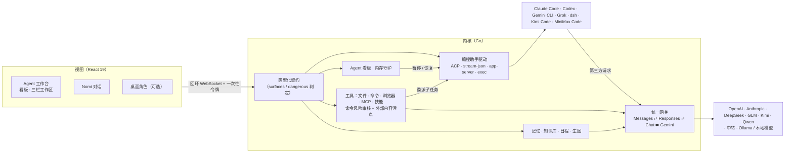

<p align="center"></p>

<h1 align="center">Nomi·诺米</h1>

<p align="center">
  <b>让每一种 AI 能力，都为你所用</b><br>
  One place. Every AI capability.
</p>

<p align="center">
  把 Claude Code、Codex 放到同一张看板上并行。模型只接一次，官方、国内、中转或本地都能用。不必绑定云账号，也不用改那些 CLI 的全局配置。<br>
  桌面角色可选，不需要就关掉。
</p>

<p align="center">macOS · Windows · Linux　|　Go 内核，安装包约 25 MB　|　MIT</p>

<p align="center">
  <a href="https://github.com/Cookieboty/nomi-ai/stargazers"></a>
  <a href="https://github.com/Cookieboty/nomi-ai/releases"></a>
  <a href="https://github.com/Cookieboty/nomi-ai/releases/latest"></a>
  <a href="https://github.com/Cookieboty/nomi-ai/commits/main"></a>
  <a href="LICENSE"></a>
</p>

<p align="center">
  <a href="https://github.com/Cookieboty/nomi-ai/releases/latest">下载</a> ·
  <a href="https://withnomi.app">官网</a> ·
  <a href="docs/README.md">文档</a> ·
  <a href="docs/development/architecture.md">架构</a> ·
  <a href="CHANGELOG.md">更新日志</a>
</p>

<p align="center"><b>中文</b> · <a href="README.en.md">English</a></p>

<p align="center">
  
  
</p>

## 工作台里有什么

| 能力         | 在 Nomi 里                                                                                                                          |
| ------------ | ----------------------------------------------------------------------------------------------------------------------------------- |
| **编程助手** | Claude Code、Codex、Gemini CLI、Grok、dsh、Kimi Code、MiniMax Code，多个会话并行。终端或 IDE 里开着的会话在看板上只读；各 CLI 记下的历史可以在工坊里续接 |
| **模型**     | 官方 API、国内、中转和本地模型，接一次，内置编程助手和 Nomi 都能用。另接的 ACP 助手不走这条网关                                     |
| **工具**     | MCP、技能、浏览器、文件与命令，图形化管理，调用有审计日志                                                                           |
| **Nomi**     | 本身就是一个 agent：记忆、知识库、生图、提醒，还会把活派给编程助手                                                                  |

它们都在一个 **Agent 工作台**里：谁在干活、做到哪了、占了多少资源、卡在哪，一眼看清。

## 为什么是 Nomi

### 1. 一张看板，并行跑、一起管

**Agent 看板**把在干活的放在一起：Nomi 的对话与后台运行、派出的和工坊里的编程助手，以及你在终端或 IDE 里自己开的会话（只读）。每张卡片写明状态、来源目录、内存与 CPU，等你授权、等你验收的排在前面。
内存紧张时，自动暂停 Nomi 派出的编程助手，缓解后从暂停处接着跑；也可以随时手动暂停、继续。标题栏常驻负载指示。
编程助手会话直接在工作台里开：内置 Claude Code、Codex、Gemini CLI、Grok、dsh、Kimi Code、MiniMax Code，经四种会话驱动接入（ACP、stream-json、Codex app-server、exec），多个会话并行，三栏工作区里看 Diff、提交、撤销。接入层是插件化的，也可以再接 ACP 助手；外部助手不走网关，也不接官方账号。
→ [编程助手](docs/features/coding-agents.md) · [Agent 看板](docs/development/agent-board.md) · [编程助手接入](docs/development/coding-agents.md)

### 2. 模型只接一次

只添加一次供应商（选预设或填地址，粘贴 Key）。来源可以是官方 API、国内、中转或本地。Claude Code、Codex、Gemini CLI、Grok、dsh、Kimi Code、MiniMax Code 和 Nomi 都能用它的模型，也可以全部换成本地模型。
本机网关自动识别并互转 **Anthropic Messages / OpenAI Responses / OpenAI Chat Completions / Gemini generateContent**，流式、工具调用、推理、图片、上下文压缩都照常工作：在 Claude Code 里直接用 DeepSeek、GLM、Kimi、Qwen。断线会在同一把 Key 上重试；同一家反复失败后，换到也提供**同一个模型**的下一家。
第三方只作用于 Nomi 启动的那个进程，不改 CLI 的全局配置，不碰官方登录。各 CLI 自己的官方登录仍然可用，而且不是必须的。Nomi 没有要注册的云账号。
→ [统一网关设计](docs/development/gateway.md) · [第三方供应商与模型](docs/features/providers.md)

### 3. 本地优先，不强制云账号

对话、记忆、知识库默认只在本机。要用各 CLI 的官方登录可以，也可以只用你自己的 API Key 或本地模型。
macOS 上编程助手在**系统沙箱**里运行（默认开）：读不到 SSH 与 Git 凭据、云账号凭据、浏览器数据和 `.env`，只能写项目文件夹；被挡下时在对话里按本会话或「始终允许（只对这个项目）」授权，允许后自动接着做。工作目录只能是项目文件夹，也不继承环境里的令牌和密钥。开着沙箱，可以放心让编程助手全部自动运行。
命令执行前先由辅助模型按风险分级：低风险直接跑，高风险交给你确认；**这一轮读过外部内容（网页、MCP 返回、技能文件）后，中风险命令也要你确认**，防止提示注入借 Nomi 的手执行命令。
对话、记忆、知识库默认只存在本机；发给第三方模型前自动隐藏密钥；API Key 存系统钥匙串。
→ [隐私与安全](docs/features/privacy-security.md) · [编程助手的本机保护](docs/features/coding-agents.md#本机保护)

### 4. Nomi 自己也是一个 agent

它能读写文件、跑命令、开浏览器、调 MCP 和技能，记得你说过的事（长期记忆），能在你的文件夹里查资料并给出可点击的引用，还能画图、改图、定提醒。
写代码这类活，它会委派给编程助手：子任务在对话旁边单独一栏打开，可以插话、停止、接着再做一轮，结果都回到主对话；它也会看着 Agent 看板调度。
工具按需提供：闲聊时发给模型的工具定义约 2K token，聊到相关的事才展开。
→ [AI 对话](docs/features/chat.md) · [长期记忆](docs/features/memory.md) · [知识库](docs/features/knowledge-base.md)

### 5. 桌面角色可选

桌面角色不是工作台的前提。需要时让它常驻：一个透明的小窗口，有表情、动作和口型；不需要，在它的工具栏「更多」里关掉，工作台照常用。
开着它，很多事不用打开主窗口：任务完成或出错时用动作提示；回复的前一两句显示在旁边的气泡里；把文件拖到它身上直接总结；可以用语音对话；双击打开对话。
→ [桌面角色](docs/features/mascot.md) · [语音](docs/features/voice.md)

### 6. 轻：Go 内核，原生 WebView

Go 内核 + [Wails v3](https://v3.wails.io)，不带 Chromium。macOS Apple 芯片上 DMG 约 24.5 MB，安装后约 49 MiB。

## 架构



视图与内核之间只有一条类型化契约，没有零散的 IPC 通道；哪些窗口能调用哪些过程、哪些属于危险操作，都在契约里声明。详见 [架构](docs/development/architecture.md)、[应用契约](docs/development/contract.md)。

## 功能一览

**Agent 工作台**

- **Agent 看板**：看清谁在干活、做到哪了、各占多少内存与 CPU；内存守护自动暂停 / 恢复，标题栏常驻负载指示
- **编程助手**：七个内置 CLI、多会话并行，三栏工作区看 Diff、提交、撤销；官方账号或第三方模型任选；权限模式，系统沙箱目前在 macOS
- **任务**：持续任务、定时任务，执行者可以是 Nomi 或编程助手

**模型与工具**

- **模型**：OpenAI、Anthropic、DeepSeek、Kimi、智谱、通义、豆包、Ollama 等预设；多 Key 自动切换；按每次上游请求记账，用量和费用看得见
- **本地模型**：一键下载开源小模型（llama.cpp）或管理 Ollama；可以只用本地模型，也可以只让本地模型读文件
- **MCP 与技能**：图形化管理 MCP 服务器与 `SKILL.md`，可从其他工具导入；工具调用有审计日志
- **第三方供应商链接接入**：中转站和模型平台可以放一个「添加到 Nomi」链接，见下方[第三方供应商接入](#第三方供应商接入)

**Nomi**

- **对话**：读写文件、跑命令、开浏览器，委派编程助手；命令面板与斜杠命令
- **知识库与记忆**：文件夹问答带可点击引用；对话自动整理成长期记忆，可导出
- **生图**：直接画图、改图、以图生图，自动匹配同一厂商的图片模型；素材库统一管理
- **语音与提醒**：本地 whisper.cpp 或云端语音输入、语音播报；提醒、免打扰
- **桌面角色（可选）**：2D 立绘或 Rive 动画，表情与口型同步，任务进度用动作告诉你

<table>
  <tr>
    <td align="center" width="33%"><br><sub>编程助手</sub></td>
    <td align="center" width="33%"><br><sub>供应商与模型</sub></td>
    <td align="center" width="33%"><br><sub>桌面角色（可选）</sub></td>
  </tr>
</table>

更多界面见 [docs/screenshots](docs/screenshots/)。

## 下载安装

前往 [GitHub Releases](https://github.com/Cookieboty/nomi-ai/releases/latest)：

| 系统               | 安装包                                           | 说明                                    |
| ------------------ | ------------------------------------------------ | --------------------------------------- |
| macOS · Apple 芯片 | `Nomi-<版本>-arm64.dmg`                          | 拖进「应用程序」                        |
| macOS · Intel      | `Nomi-<版本>.dmg`                                | 同上                                    |
| Windows 10+（x64） | `Nomi-Setup-<版本>.exe`                          | 需要 WebView2（Windows 10/11 通常自带） |
| Linux（x64）       | `Nomi-<版本>.AppImage` / `nomi_<版本>_amd64.deb` | AppImage 需 `chmod +x`                  |

已安装的版本会在应用内提示更新。

> **macOS 提示「已损坏」？** 当前包已签名但尚未公证。拖到「应用程序」后执行：
>
> ```bash
> sudo xattr -dr com.apple.quarantine /Applications/Nomi.app
> ```
>
> **Windows 弹出 SmartScreen？** 确认安装包来自本仓库 Releases 后，选「更多信息 → 仍要运行」。

## 3 分钟上手

1. 打开 Nomi，完成首次引导（语言、主题）。不需要桌面角色，可以在它的工具栏「更多」里关掉。
2. 新建一个 Claude Code / Codex 会话，选工作目录。可以用该 CLI 的官方登录，也可以先接模型再选「第三方」。左侧导航栏「Agents」打开看板。
3. 「设置 → 模型与供应商」添加一次供应商与 API Key，或在「本机模型」下载一个本地模型。官方 API、国内、中转和本地都在这里，内置编程助手和 Nomi 都能选。
4. 把任务交给 Nomi：`Ctrl/⌘+N` 新对话，`Ctrl/⌘+K` 命令面板。写代码的活它可以再派给编程助手。

更细的步骤见 [快速上手](docs/getting-started.md)。

## 从源码构建

需要 Node.js ≥ 22.12、pnpm 9（`corepack enable`）、Go（版本见 `apps/desktop-go/go.mod`）与 cgo 工具链（Linux 还要 GTK3 与 WebKitGTK 4.1 开发包）。

```bash
git clone https://github.com/Cookieboty/nomi-ai.git && cd nomi-ai
corepack enable && pnpm install
pnpm dev          # 界面热更新，改 Go 代码自动重编译
pnpm test         # 视图与共享包的单元测试
(cd apps/desktop-go && go test ./...)   # Go 内核测试
```

`pnpm run doctor` 检查开发环境。应用细节见 [apps/desktop-go](apps/desktop-go/README.md)；打包与发布见 [docs/RELEASE.md](docs/RELEASE.md)；开发指南见 [docs/development](docs/development/)。欢迎 PR，提交前请看 [AGENTS.md](AGENTS.md) 里的约定。

## 第三方供应商接入

中转站、模型平台可以在自己的网页上放一个「添加到 Nomi」按钮，用户点一下就把你加进 Nomi：

- `nomi://provider/import`：直接导入地址和 Key，几行模板就能接，兼容 Cherry Studio 的导入格式；
- `nomi://provider/connect`：网页授权（OAuth + PKCE），Key 不出现在链接里。

两种方式**最后都停在 Nomi 的确认框上，用户确认前不会保存任何东西**。链接格式、授权流程和处理规则见 [第三方供应商链接接入](docs/integrations/provider-link.md)。

## 联系与交流

问题与建议请提 [GitHub Issues](https://github.com/Cookieboty/nomi-ai/issues)。微信扫码添加作者：

<table>
  <tr>
    <td align="center"><br><sub>言萧凡</sub></td>
    <td align="center"><br><sub>Tomo</sub></td>
  </tr>
</table>

## 致谢

- **赞助**：[Amux AI](https://amux.ai)、[@zihe-xu](https://github.com/zihe-xu) 赞助了 Nomi 的开发。
- **社区**：[Linux.do](https://linux.do) 社区的佬友们提了大量反馈与建议。

<a href="https://github.com/zihe-xu"></a>

Nomi 构建于 Go、Wails、React、Vite、Vercel AI SDK、MCP、whisper.cpp / llama.cpp、Rive 等开源项目之上，设计参考致谢见 [CREDITS.md](CREDITS.md)。

## 许可证

[MIT](LICENSE)。第三方组件见 [THIRD_PARTY_NOTICES.md](THIRD_PARTY_NOTICES.md)。
