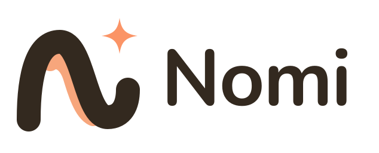
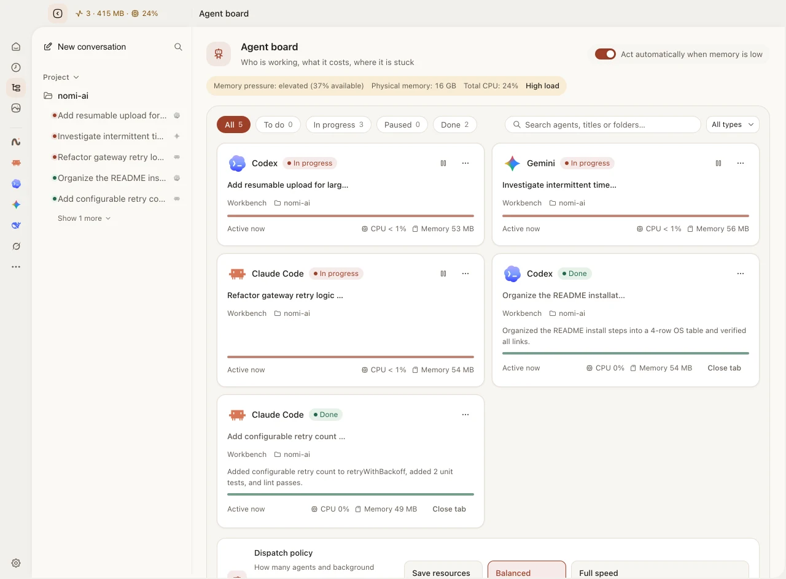
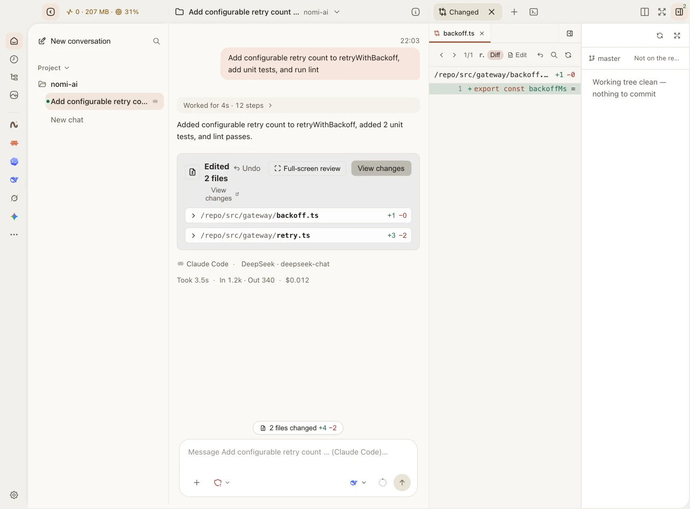
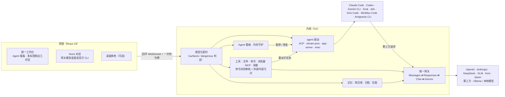
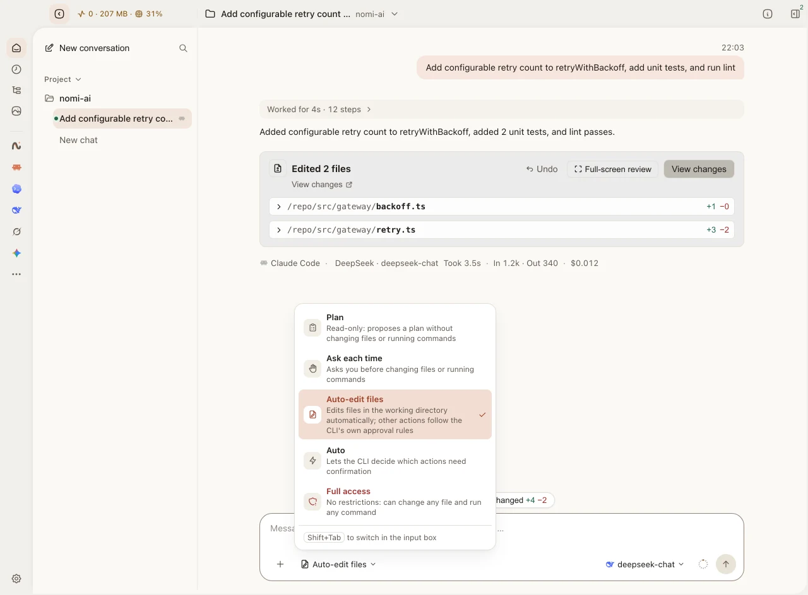
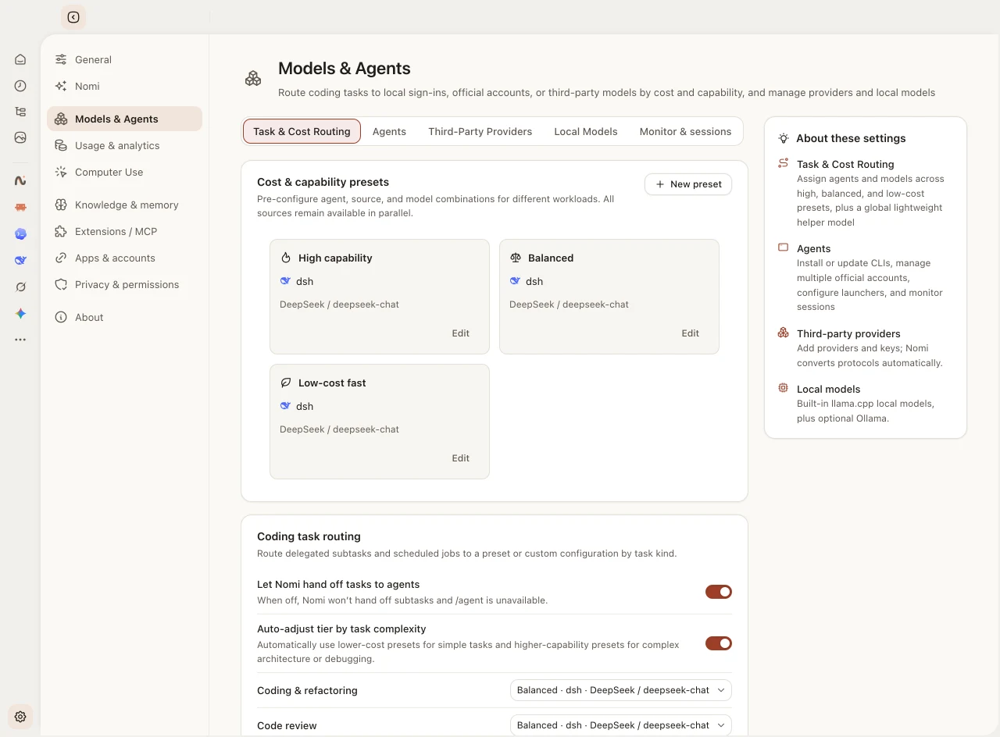
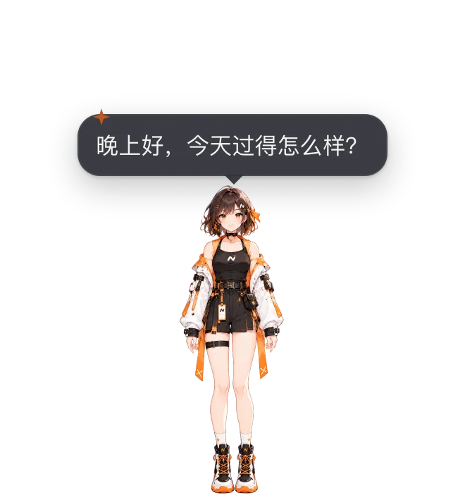

<p align="center"></p>

<h1 align="center">Nomi·诺米</h1>

<p align="center">
  <b>让每一种 AI 能力，都为你所用。</b><br>
  One place. Every AI capability.
</p>

<p align="center">
  把 Claude Code、Codex、Gemini CLI、Antigravity CLI 放到同一张看板上并行，也可以在主对话里按会话直接选用本机官方 CLI 底座。模型只接一次，官方、第三方或本地都能用。不必绑定云账号，也不用改那些 CLI 的全局配置。<br>
  桌面角色可选，不需要就关掉。
</p>

<p align="center">macOS · Windows · Linux　|　Go 内核，安装包约 25 MB　|　MIT</p>

<p align="center">
  <a href="https://github.com/Cookieboty/nomi-ai/stargazers"></a>
  <a href="https://github.com/Cookieboty/nomi-ai/releases"></a>
  <a href="https://github.com/Cookieboty/nomi-ai/releases/latest"></a>
  <a href="https://github.com/Cookieboty/nomi-ai/commits/main"></a>
  <a href="LICENSE"></a>
</p>

<p align="center">
  <a href="https://github.com/Cookieboty/nomi-ai/releases/latest">下载</a> ·
  <a href="https://withnomi.app/zh/">官网</a> ·
  <a href="docs/README.md">文档</a> ·
  <a href="docs/development/architecture.md">架构</a> ·
  <a href="CHANGELOG.md">更新日志</a>
</p>

<p align="center"><a href="README.md">English</a> · <b>简体中文</b></p>

<p align="center">
  
  
</p>

## 工作台里有什么

| 能力       | 在 Nomi 里                                                                                                                                                                                                              |
| ---------- | ----------------------------------------------------------------------------------------------------------------------------------------------------------------------------------------------------------------------- |
| **Agents** | 8 个内置 CLI — Claude Code、Codex、Gemini CLI、Grok、dsh、Kimi Code、MiniMax Code、Antigravity CLI（支持应用内本机 Google 登录），多会话并行；主对话也可直选本机 CLI；终端或 IDE 会话在看板只读显示，CLI 历史可直接续接 |
| **模型**   | 官方 API、第三方供应商或本地模型（llama.cpp / Ollama），接一次，内置 agents 和 Nomi 都能用；自定义 ACP agents 不经过本地网关                                                                                            |
| **工具**   | MCP、技能（`SKILL.md`）、内嵌浏览器、项目文件与分屏终端、命令审批与审计日志                                                                                                                                             |
| **Nomi**   | 本身就是一个 agent：长期记忆、文件夹知识库、生图与素材库、语音与提醒，还会把编码等子任务派给 agents                                                                                                                     |

它们都在一个**统一工作台**里：单一侧栏集中对话、任务、Agent 看板与素材库，谁在干活、做到哪了、占了多少资源、卡在哪，一眼看清。

## 为什么是 Nomi

### 1. 一张看板，统一工作台并行跑

Nomi 采用**统一单侧栏布局**（对话、任务、Agent 看板、素材库 + 端点筛选），检测到本机装有 CLI 时自动露出 agent 入口，无需手动切换模式。

- **Agent 看板**：把在干活的放在一起——Nomi 的对话与后台运行、派出的 agent、本地 agent 会话，以及你在终端或 IDE 里自己开的会话（只读）。每张卡片写明状态、项目目录、内存与 CPU，等你授权、等你验收的排在前面。
- **内存守护**：内存紧张时自动暂停 Nomi 派出的 agent，缓解后从暂停处接着跑；也可以随时手动暂停、继续，标题栏常驻负载指示。
- **多标签侧边工作区**：会话右侧按需展开，集中提供**变更 Diff & Git**（审查、提交、撤销）、**项目文件**（可拖入输入框生成 `@path`）、**分屏交互式终端**、**运行轨迹**（图谱、时间线、思考、模型审计）、**原生内嵌浏览器**与**副对话**。
- **8 个内置 CLI + 插件化 ACP 接入**：Claude Code、Codex、Gemini CLI、Grok、dsh、Kimi Code、MiniMax Code 与 Antigravity CLI（支持应用内本机 Google 登录），经四种会话驱动接入（`ACP`、`stream-json`、`Codex app-server`、`exec`）。接入层插件化，可继续扩展自定义 ACP agents（外部 ACP agents 不走网关，也不接官方账号）。

→ [agents](docs/features/coding-agents.md) · [Agent 看板](docs/development/agent-board.md) · [agent 接入](docs/development/coding-agents.md)

### 2. 模型只接一次

在 **设置 → 模型与 Agents** 里添加一次供应商（选预设或填 Base URL，粘贴 Key），官方 API、第三方中转或本地模型都能统一管理；也可以在主对话里按会话直选本机已安装的官方 CLI 底座，无需先配供应商（同会话内切换并在切回时自动恢复原 CLI 会话并补增量）。

- 本机统一网关自动识别并互转 **Anthropic Messages / OpenAI Responses / OpenAI Chat Completions / Gemini generateContent** 四种协议，流式、工具调用、推理、图片与上下文压缩都照常工作，所以第三方模型也能直接跑进 Claude Code 或 Codex。
- 断线会在同一把 Key 上自动重试；**跨供应商熔断降级默认关闭**，可在供应商卡片按需开启，开启后连续失败时仅换到也提供**同一个模型**的下一家。
- 第三方路由只作用于 Nomi 启动的那个进程，不改 CLI 的全局配置，不碰官方登录；Nomi 没有需要注册的云账号。

→ [统一网关设计](docs/development/gateway.md) · [第三方供应商](docs/features/providers.md)

### 3. 本地优先，不强制云账号

对话、记忆、知识库默认只存在本机。可以用各 CLI 的官方登录，也可以只用你自己的 API Key 或本地模型。

- macOS 上 agent 在**系统沙箱**里运行（默认开启）：阻止读取 SSH 与 Git 凭据、云账号凭据、浏览器数据和 `.env`，只允许写项目文件夹；被挡下时在对话里按本会话或「始终允许（只对这个项目）」放行即可继续。工作目录限定为已添加的项目文件夹，且不继承环境变量里的令牌和密钥。
- 命令执行前先由辅助模型按风险分级：低风险直接跑，高风险交给你确认；**这一轮读过外部内容（网页、MCP 返回、技能文件）后，中风险命令也要你确认**，防止提示注入借 Nomi 的手执行命令。
- 发给第三方模型前自动脱敏隐藏密钥；API Key 存系统钥匙串。

→ [隐私与安全](docs/features/privacy-security.md) · [agent 的本机保护](docs/features/coding-agents.md#本机保护)

### 4. Nomi 自己也是一个 agent

它能读写文件、跑命令、开内嵌浏览器、调 MCP 和技能，记得你说过的事（长期记忆），能在文件夹里查资料并给出可点击的引用，还能画图、改图、定提醒。

- 写代码这类活，它会委派给 agent：子任务在主对话旁边的独立栏里运行，可以随时插话、停止或追加一轮，结果回到主对话；它也会配合 Agent 看板做并发调度。
- 工具按需提供：闲聊时发给模型的工具定义约 2K token，聊到相关任务才按需展开。

→ [AI 对话](docs/features/chat.md) · [长期记忆](docs/features/memory.md) · [知识库](docs/features/knowledge-base.md)

### 5. 桌面角色可选

桌面角色不是使用 Nomi 的前提。需要时让它常驻：一个透明的小窗口，有表情、动作和口型；不需要，在它的工具栏「更多」里关掉，其余功能照常用。

开着它，很多事不用打开主窗口：任务完成或出错时用动作提示；回复的前一两句显示在旁边的气泡里；把文件拖到它身上直接总结；可以用语音对话并播报回复；双击打开对话。

→ [桌面角色](docs/features/mascot.md) · [语音](docs/features/voice.md)

### 6. 轻：Go 内核，原生 WebView

Go 内核 + [Wails v3](https://v3.wails.io)，不带 Chromium。macOS Apple 芯片上 DMG 约 24.5 MB，安装后约 49 MiB。

## 架构



视图与内核之间只有一条类型化契约，没有零散的 IPC 通道；哪些窗口能调用哪些过程、哪些属于危险操作，都在契约里声明。详见 [架构](docs/development/architecture.md)、[应用契约](docs/development/contract.md)。

## 功能一览

**统一工作台**

- **Agent 看板**：看清谁在干活、做到哪了、各占多少内存与 CPU；内存守护自动暂停 / 恢复，标题栏常驻负载指示
- **Agents**：8 个内置 CLI（含支持应用内 Google 登录的 Antigravity CLI）、多会话并行，多标签侧边工作区支持审查 Diff & Git、浏览文件、分屏交互式终端、运行轨迹、原生内嵌浏览器与副对话；主对话直选官方 CLI 底座、官方账号或第三方 / 本地模型任选；权限模式与 macOS 系统沙箱
- **任务**：持续任务、定时任务，执行者可以是 Nomi 或 agent

**模型、Agents 与工具**

- **模型与 Agents**：在「任务与成本路由 / Agents / 第三方供应商 / 本地模型 / 监视与会话」五个标签页统一管理；OpenAI、Anthropic、DeepSeek、Kimi、智谱、通义、豆包、Ollama 等预设；多 Key 自动轮询，跨供应商熔断降级默认关闭（按需开启）；按每次上游请求记账，用量和费用看得见
- **本地模型**：一键下载开源小模型（llama.cpp）或管理 Ollama；可以只用本地模型，也可以只让本地模型读文件
- **MCP 与技能**：图形化管理 MCP 服务器与 `SKILL.md`，可从其他工具导入；工具调用有审计日志
- **第三方供应商链接接入**：中转站和模型平台可以放一个「添加到 Nomi」链接，见下方[第三方供应商接入](#第三方供应商接入)

**Nomi**

- **对话**：读写文件、跑命令、开内嵌浏览器、委派 agent，也可在主对话直接选用本机已安装的官方 CLI；命令面板与斜杠命令
- **知识库与记忆**：文件夹问答带可点击引用；对话自动整理成长期记忆，可导出
- **生图**：直接画图、改图、以图生图，自动匹配同一厂商的图片模型；素材库统一管理
- **语音与提醒**：本地 whisper.cpp 或云端语音输入、语音播报；提醒、免打扰
- **桌面角色（可选）**：2D 立绘或 Rive 动画，表情与口型同步，任务进度用动作告诉你

<table>
  <tr>
    <td align="center" width="33%"><br><sub>Agents 与权限模式</sub></td>
    <td align="center" width="33%"><br><sub>模型与 Agents</sub></td>
    <td align="center" width="33%"><br><sub>桌面角色（可选）</sub></td>
  </tr>
</table>

更多界面见 [docs/screenshots](docs/screenshots/)。

## 下载安装

前往 [GitHub Releases](https://github.com/Cookieboty/nomi-ai/releases/latest)：

| 系统               | 安装包                                           | 说明                                    |
| ------------------ | ------------------------------------------------ | --------------------------------------- |
| macOS · Apple 芯片 | `Nomi-<版本>-arm64.dmg`                          | 拖进「应用程序」                        |
| macOS · Intel      | `Nomi-<版本>.dmg`                                | 同上                                    |
| Windows 10+（x64） | `Nomi-Setup-<版本>.exe`                          | 需要 WebView2（Windows 10/11 通常自带） |
| Linux（x64）       | `Nomi-<版本>.AppImage` / `nomi_<版本>_amd64.deb` | AppImage 需 `chmod +x`                  |

已安装的版本会在应用内提示更新。

> **macOS 提示「已损坏」？** 当前包已签名但尚未公证。拖到「应用程序」后执行：
>
> ```bash
> sudo xattr -dr com.apple.quarantine /Applications/Nomi.app
> ```
>
> **Windows 弹出 SmartScreen？** 确认安装包来自本仓库 Releases 后，选「更多信息 → 仍要运行」。

## 3 分钟上手

1. 打开 Nomi，完成首次引导（语言和外观、AI 能力、个性化）。桌面角色默认关闭。
2. 在主对话中直接选用本机已安装的官方 CLI（如 Claude Code、Codex、Gemini CLI 或 Antigravity CLI）并选择项目目录，或从左侧导航打开 **Agent 看板** 并行管理多个 agent 会话。
3. 打开 **设置 → 模型与 Agents**，配置任务与成本路由、管理 CLI 安装与官方账号、添加第三方供应商 API Key，或在 **本地模型** 下载开源模型（llama.cpp / Ollama）。
4. 把任务交给 Nomi：`Ctrl/⌘+N` 新建对话，`Ctrl/⌘+K` 打开命令面板（派出 agent、添加供应商、打开看板、新建任务）；需要审查 Diff、浏览项目文件、用分屏终端、看运行轨迹或开内嵌浏览器时，按需展开右侧多标签侧边工作区。

更细的步骤见 [快速上手](docs/getting-started.md)。

## 从源码构建

需要 Node.js ≥ 22.12、pnpm 9（`corepack enable`）、Go（版本见 `apps/desktop-go/go.mod`）与 cgo 工具链（Linux 还要 GTK3 与 WebKitGTK 4.1 开发包）。

```bash
git clone https://github.com/Cookieboty/nomi-ai.git && cd nomi-ai
corepack enable && pnpm install
pnpm dev          # 界面热更新，改 Go 代码自动重编译
pnpm test         # 视图与共享包的单元测试
(cd apps/desktop-go && go test ./...)   # Go 内核测试
```

`pnpm run doctor` 检查开发环境。应用细节见 [apps/desktop-go](apps/desktop-go/README.md)；打包与发布见 [docs/RELEASE.md](docs/RELEASE.md)；开发指南见 [docs/development](docs/development/)。欢迎 PR，提交前请看 [AGENTS.md](AGENTS.md) 里的约定。

## 第三方供应商接入

中转站、模型平台可以在自己的网页上放一个「添加到 Nomi」按钮，用户点一下就把你加进 Nomi：

- `nomi://provider/import`：直接导入地址和 Key，几行模板就能接，兼容 Cherry Studio 的导入格式；
- `nomi://provider/connect`：网页授权（OAuth + PKCE），Key 不出现在链接里。

两种方式**最后都停在 Nomi 的确认框上，用户确认前不会保存任何东西**。链接格式、授权流程和处理规则见 [第三方供应商链接接入](docs/integrations/provider-link.md)。

## 联系与交流

问题与建议请提 [GitHub Issues](https://github.com/Cookieboty/nomi-ai/issues)。微信扫码添加作者：

<table>
  <tr>
    <td align="center"><br><sub>言萧凡</sub></td>
    <td align="center"><br><sub>Tomo</sub></td>
  </tr>
</table>

## 致谢

- **赞助**：[Amux AI](https://amux.ai)、[@zihe-xu](https://github.com/zihe-xu) 赞助了 Nomi 的开发。
- **社区**：[Linux.do](https://linux.do) 社区的佬友们提了大量反馈与建议。

<a href="https://github.com/zihe-xu"></a>

Nomi 构建于 Go、Wails、React、Vite、Vercel AI SDK、MCP、whisper.cpp / llama.cpp、Rive 等开源项目之上，设计参考致谢见 [CREDITS.md](CREDITS.md)。

## 许可证

[MIT](LICENSE)。第三方组件见 [THIRD_PARTY_NOTICES.md](THIRD_PARTY_NOTICES.md)。
