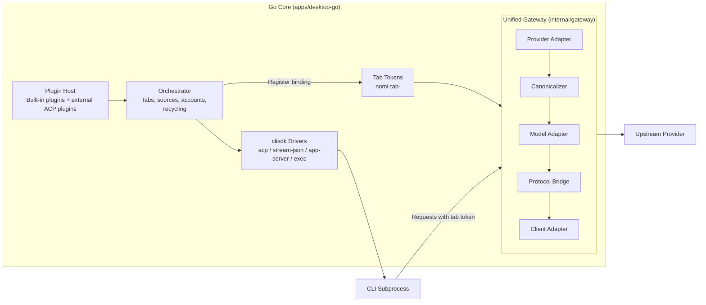

# Architecture Overview

Nomi is a pnpm + Turborepo monorepo. The desktop application lives in `apps/desktop-go` (Go core + Wails v3 shell), and the UI is built with React 19 + Vite, with its build artifacts embedded into the Go binary. As of 2.2.0, the Electron edition (Node core) has been removed.

## Processes and Windows

```
Go process (apps/desktop-go)
 ├─ Core (internal/core, internal/ai, internal/gateway, internal/clisdk, internal/cliplugins)
 ├─ Contract server (internal/contract: loopback WebSocket + per-window one-time token)
 ├─ Desktop character window (packages/renderer)  Transparent always-on-top, desktop character & toolbar
 ├─ Chat window (packages/ai-chat)               Chat, settings, feature panels
 └─ Auxiliary windows                           Dynamic Island (pages generated directly by Go), etc.
```

- The composition root is `main.go` and `*_wiring.go`: they instantiate services, register contract procedures, and launch the shell. `internal/shell` defines the shell interface, and `wailsshell/` is the only package that depends on Wails; business modules (`internal/core`) do not depend on Wails.
- Views access the core exclusively through the app contract: the page URL fragment carries `ws://127.0.0.1:<port>` and a per-window one-time token provided by the host. Each view's `services/api.ts` calls `installGoHostTransport` to configure the WebSocket transport (this is the only file in each view package allowed to select the transport and create the client; ESLint blocks all other locations).
  The core identifies the caller's surface by its token, and the contract guard enforces the `surfaces` and `dangerous` flags declared on each procedure. Window-scoped events are registered in the contract's `eventSurfaces`, and the transport layer filters subscriptions by the caller's surface.
- The contract's procedure table and types are generated from the TS contract (`packages/contract`) into `internal/contract/gen` via `node scripts/go-contract/gen.mjs` (CI checks for drift). Handlers are organized by domain under `internal/core/<domain>handlers`.
- Native paths of dropped files do not go through the contract: the host captures them from native drag-and-drop events (`WindowFilesDropped`). The desktop character window submits them directly, while the chat window matches them by filename (`nomi:host-files`); views cannot pick arbitrary paths.
- `chat-asset://` and `character-pack://` are served through the asset server gateway `/__scheme/<scheme>/...`. When Go serves pages (`internal/shell/viewpage`), it rewrites the CSP and injects the Wails runtime.

## Packages

| Location | Role |
| --- | --- |
| `apps/desktop-go/internal/core` | Business modules: agent orchestration, usage tracking, gateway provider store, desktop capabilities, knowledge base, long-term memory, scheduler, local models, extensions, voice, updates, diagnostics, etc., plus contract handlers |
| `apps/desktop-go/internal/ai` | AI runtime: providers and routing, LLM client, MCP bridge, AI facade |
| `apps/desktop-go/internal/gateway` | Unified gateway: request IR and streaming translation across Messages / Responses / Chat / Gemini |
| `apps/desktop-go/internal/clisdk` | Agent plugin contract and shared session drivers (`acp` / `stream-json` / `app-server` / `exec`); see `docs/development/coding-agents.md` |
| `apps/desktop-go/internal/cliplugins` | Built-in agent plugins (`claude` / `codex` / `gemini` / `grok` / `dsh`): launch injection, permission modes, official accounts, history scanning, etc. |
| `packages/renderer` | Desktop character window shell: transparent window, speech bubbles, toolbar, context menu, and a thin adapter layer (`src/avatar`, `src/ai`) connecting contract events to `avatar-runtime` |
| `packages/avatar-runtime` | Character engine (browser-only): Rive / sprite / static backends, expression and motion drivers, hit zones and interactions, lip-sync consumption; see [character-pack](../character-pack/README.md) for character packs; standalone dev page at `pnpm --filter @nomi-ai/avatar-runtime demo` |
| `packages/ai-chat` | Chat window: conversations, settings, onboarding, and feature panels |
| `packages/ai-sdk-client` | View-side AI client (`ClientAIClient`), shared per-window contract transport, and React hooks |
| `packages/contract` | API contract between views and core (procedures, events, schemas, version handshake, WebSocket transport); see [contract.md](contract.md) |
| `packages/character-contract` | Character pack contract: schemas, validation, and migration for manifest, persona, mapping, and locales; see [character-pack](../character-pack/CONTRACT.md) |
| `packages/cli-catalog` | Manifests and UI metadata for built-in agents (pure data, consumed by views) |
| `packages/ui` | Design tokens, 4 themes, shared components, and view locale adapter |
| `packages/i18n` (`@nomi-ai/i18n`) | Unified multilingual dictionary and runtime, organized by language / project / module (`packages/i18n/src/locales`); Go core embeds a copy; see [i18n.md](i18n.md) for `pnpm check:i18n` + `keepZh` |
| `packages/voice` | Voice input, VAD, and wake word |
| `packages/types` | Shared types and brand constants |

## Agents and Unified Gateway

See [coding-agents.md](coding-agents.md) and [gateway.md](gateway.md) for details.



- **Plugins**: `internal/clisdk` defines the contract (manifest, capability interfaces, session drivers, multi-option permission replies) and the four session drivers; `internal/cliplugins` contains the five built-in plugins. Only built-in plugins are supported (user-added "external CLIs" are no longer supported); manifests and UI metadata for views live in `@nomi-ai/cli-catalog`.
- **Orchestration**: `internal/core/cli/harness` manages tabs, persistence, sources (official / third-party), the official account catalog, recycling, and upgrade restarts. Protocol details live in the drivers, while per-CLI parsing (streaming, history transcripts, model catalogs, slash-command layouts) lives in each plugin.
- **Gateway layers**: On the request path, requests go through provider adapters (`providers/`) and model adapters (`models/`: catalog, family rules, request rules, error fixers). On the response path, responses go through canonicalization (`canonical/`, filling fields and detecting completion against protocol spec tables in `spec/`), the protocol bridge, and client adapters (`clients/`). Route planning lives in `route/`.
- **Provider storage**: Third-party providers and API keys are stored only in the gateway store (`userData/gateway/store.json`, `internal/core/gwstore`). Nomi chat, `agent-tools`, and `summary` resolve models through the gateway.
- **Delegation**: Nomi can asynchronously hand off tasks to agent tabs (`delegate_to_cli`, background by default). By default, edits happen in-place in the working directory (parallel tasks in the same repo coordinate by file and priority); a worktree is created only when a different base branch is specified. Delegated tabs and sessions are visible only inside Nomi, and identical delegations reuse sessions. See [coding-agents.md](coding-agents.md) and [security.md](security.md) (Python OS sandbox: macOS `sandbox-exec` / Linux `bwrap`).
- **Tab bindings**: Before launching a CLI process for a third-party tab, a `nomi-tab-` token is issued and registered with the gateway (tab, generation, model, thinking depth). The gateway resolves the model from the binding and tags request logs with the tab ID; the binding is invalidated when the process exits or the tab closes.
- **Diagnostics**: `internal/core/diagnostics` manages toggles, CLI subprocess I/O recording, and diagnostic bundle export. Gateway tracing assigns a trace ID per request (`x-nomi-trace-id` response header).

## Key Conventions

- **Data**: All data is stored under `userData` (macOS `~/Library/Application Support/Nomi`, Windows `%APPDATA%\Nomi`, Linux `~/.config/Nomi`) in feature-specific directories; API keys are stored in the OS keychain. Views never store business data in WebView `localStorage` (only UI preferences): chat sessions live in the core's `userData/conversations/` (`internal/core/convstore`, contract `conversations.*`, see [chat.md](../features/chat.md#where-conversations-are-stored)), so dev and packaged builds share the same data regardless of page origin. On first launch, data is migrated from the legacy Electron directory (`internal/migrate`).
- **Network and commands**: Outbound requests pass through the gateway's network guard, which blocks localhost/private IP addresses and pins DNS resolutions. Command execution escapes arguments, and private files are written with mode `0600`.
- **Logging**: Views use `createLogger` from `@nomi-ai/ui` rather than `console.log`; Go core uses the logger from `internal/core/services`.
- **UI**: CSS Modules + `var(--cd-*)` design tokens; feature panels are lazy-loaded; desktop character Rive scenes are loaded on demand.
- **i18n**: Package `@nomi-ai/i18n`; stable keys follow the `project.module.message` format; raw Chinese strings cannot be used as keys. Verified by `pnpm check:i18n` (including keys referenced in Go source and embedded JSON); see [i18n.md](i18n.md).
