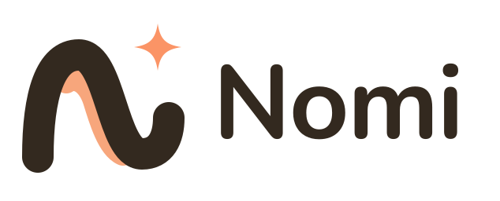

# Nomi·诺米 品牌规范

美术素材：项目所有者提供、AI 生成，由项目所有者授权使用（见 [CREDITS](../CREDITS.md)）。

## 1. 品牌定位

|              |                                                                                                                                                                                                          |
| ------------ | -------------------------------------------------------------------------------------------------------------------------------------------------------------------------------------------------------- |
| **名称**     | 英文 Nomi，中文 Nomi·诺米。仓库 / 包作用域：`nomi-ai`、`@nomi-ai/*`。中文界面首次写 Nomi·诺米，之后写 Nomi。应用内的产品名用 `brand.appName`（Nomi）；角色名泄漏检查把「诺米」视为角色名，不写进界面源码 |
| **品类**     | 本地优先的 Agent 工作台，带统一模型网关                                                                                                                                                                  |
| **Slogan**   | **让每一种 AI 能力，都为你所用。**                                                                                                                                                                       |
| **品牌承诺** | 模型只接一次。官方、第三方或本地都能用。数据留在这台电脑上。                                                                                                                                             |
| **三大支柱** | 看板 · 统一网关 · 边界在你手里                                                                                                                                                                           |
| **招牌句**   | 口号本身。不要另写一套伙伴口号。                                                                                                                                                                         |
| **辅助文案** | 把 Claude Code、Codex 放到同一张看板上并行。桌面角色可选，不需要就关掉。                                                                                                                                 |

Nomi·诺米首先是工作台：先说结果，再给下一步。桌面角色不是主角。温暖的口吻只在角色被打开之后出现。隐私是品牌的一部分：数据只留在用户自己的电脑上。模型来源说「官方、第三方或本地」，不强调地域。

不声称还没有的能力：看板上的终端 / IDE 会话是只读的；故障切换仍用同一个模型；没有按任务路由模型，也没有热切换。

## 2. 语气与口吻

**工作台语气：专业 · 冷静 · 可信。** 句子短，动词开头，面向会用编程助手的人。不要说明书腔，也不要用「简单高效、全方位、赋能、随时随地、一站式、陪你」。

**角色被打开之后：聪明 · 可靠。** 温暖只放在角色台词里，每条最多一点点。不卖萌、不叠词。

| 原则           | ✅ 这样说                                                  | ❌ 不要这样说                           |
| -------------- | ---------------------------------------------------------- | --------------------------------------- |
| 先帮忙，再暖心 | 「已经帮你建好提醒：明天 9:00 交周报。要顺便列个提纲吗？」 | 「好哒好哒～人家马上就去办啦～～」      |
| 清楚、诚实     | 「这个我不太确定，查一下再告诉你。」                       | （不确定时）「当然可以！100% 没问题！」 |
| 出错时冷静     | 「没连上模型，检查一下密钥？我在设置里等你。」             | 「出错了！！！」                        |
| 鼓励而不催促   | 「今天完成了 3 件事，辛苦啦。」                            | 「你还有 12 件没做完！」                |
| 俏皮要克制     | 每条消息最多一点点小俏皮：「搞定～」                       | 表情堆叠、叠词卖萌、一串「～～～」      |
| 尊重隐私       | 「这些只保存在你的电脑里。」                               | 暗示会上传云端或被追踪                  |

写作规则

- 称呼用户为「你」（不用「您」）；Nomi 自称「我」。
- 先说结果，再说下一步。气泡里不超过两句短句。
- 每条最多一个「～」或一个表情；报错、权限申请、安全提示中一律不用。
- 中文界面首次出现写「Nomi·诺米」，之后写「Nomi」；英文界面统一写 "Nomi"。

## 3. 角色设定

|              |                                                                                                             |
| ------------ | ----------------------------------------------------------------------------------------------------------- |
| 名字         | Nomi·诺米                                                                                                   |
| 身份         | 可选的桌面角色，不是产品主角。关掉之后工作台照常用                                                          |
| 外形         | Q 版女孩，暖棕色短发，橙色发夹与蝴蝶结，奶油色上衣，黑色颈带；温暖柔和的画风                                |
| 声音（TTS）  | 柔和温暖：提示语音为微软晓伊 `zh-CN-XiaoyiNeural` 预录（语速 -5%，音调 +0Hz），见 `docs/features/voice.md`  |
| 表情（看板） | 开心 · 思考 · 比心 · 工作 · 疑惑 · 惊讶 · 打招呼 · 加油 · 晚安                                              |
| 情绪映射     | neutral→开心 · happy→加油 · relaxed→比心 · sad→思考 · angry→疑惑 · surprised→惊讶 · 眨眼→晚安 · 说话→打招呼 |
| 习惯         | 按时段打招呼；完成任务时庆祝；晚上道晚安；从不唠叨                                                          |

## 4. Logo

文件：[`brand/nomi-mark.svg`](brand/nomi-mark.svg)（浅色底）、[`brand/nomi-mark-light.svg`](brand/nomi-mark-light.svg)（深色底）、[`brand/nomi-wordmark.svg`](brand/nomi-wordmark.svg)、[`brand/nomi-app-icon.svg`](brand/nomi-app-icon.svg)、[`brand/nomi-tray.svg`](brand/nomi-tray.svg)（单色 / 模板）。应用图标：`apps/desktop-go/assets/icon.{png,ico,icns}`、`icons/16–1024`。

寓意：流畅曲线组成 **N，代表 Nomi**；四角**星光**代表灵感；**流畅曲线**代表轻松与陪伴。

- 安全距离：四周至少留出一个星光的高度。最小尺寸：图标 16 px，字标宽 96 px。
- 用墨色配奶油底，或奶油色配墨色底。星光始终是 Nomi 橙（托盘模板图为单色）。
- 禁止：把 N 改成橙色、旋转、拉伸、加描边 / 阴影、拆开星光、放在杂乱的照片上。

## 5. 色彩

| 名称      | 色值                        | 用途                                         |
| --------- | --------------------------- | -------------------------------------------- |
| Nomi 橙   | `#FB9466`                   | Logo 星光                                    |
| 橙 · 悬停 | `#F17F4E`                   | 悬停 / 按下                                  |
| 蜜桃      | `#F7A67C` / `#FDBA94`       | Logo 飘带、柔和强调（`--cd-color-accent-2`） |
| 奶油      | `#FCEFE1`                   | 浅色背景、应用图标底板                       |
| 墨色      | `#33291F`（看板 `#362C23`） | Logo N、奶油底上的文字、**橙色上的文字**     |
| 暖灰      | `#6E5F4E`                   | 浅色界面上的次要文字                         |

上表是 Logo 与品牌物料的颜色，Logo 本身的颜色永远不变。

界面主题沿用已有语义令牌（`packages/ui/src/tokens.css`），不另起一套颜色。新安装只宣布一个默认主题：**浅色**。日落橙是品牌主题，不是第二个默认。名称用中文：浅色、深色、日落橙、暖墨、石墨、奶油、冷雾。组件只读语义令牌，不写 HEX；状态色（成功 / 警告 / 错误 / 信息）跨主题一致，不与品牌橙混用。
无障碍：所有主题的文字配对 ≥ 4.5:1、图标与焦点环 ≥ 3:1，由 `packages/ui/tests/theme-contrast.test.ts` 把关；规范值达不到时沿同一色相微调到刚好达标，并在令牌旁注明。

## 6. 字体

- 界面：系统字体栈（PingFang SC / 微软雅黑 / Noto Sans SC；西文 SF Pro / Segoe UI / Inter）。
- 字标 / 标题：圆润几何无衬线（Nunito、Quicksand、Poppins），粗体，字距略紧。
- 数字与代码：系统等宽字体。

## 7. 诺米使用规范

- 默认角色：**Nomi·诺米**（默认显示静态 SVG 立绘，在设置里开启动画后是 Rive 场景）。这是唯一内置角色；3D 渲染器仅用于用户导入/商店模型。
- 始终使用透明背景；不要从脸部裁切；保持半身构图和底部柔和渐隐。
- 表情要配合文案：完成任务用「加油」，处理中用「思考」，问候用「打招呼」，夜间用「晚安」。报错与安全弹窗中不用难过 / 生气的表情。
- 动作丰富，但**造型不变**：见 [品牌锁](#9-品牌锁)。
- 不得重绘、换装或性化 Nomi；不得用她为第三方产品背书；未经所有者许可，不得在项目之外的广告中使用。

## 8. 界面文案

工作台文案短、动词开头。界面只有一种形态（没有「对话 / 工坊」切换），装了编程助手才出现相关入口。看板空的时候只留一个主动作：派出 Claude Code 或 Codex。

| 场景   | 中文                                             | English                                                                       |
| ------ | ------------------------------------------------ | ----------------------------------------------------------------------------- |
| 口号   | 让每一种 AI 能力，都为你所用。                   | Every AI capability, working for you.                                         |
| 引导   | 选好语言和主题。装好编程助手，模型可以以后再接。 | Choose a language and a theme. Set up a coding assistant; the model can wait. |
| 空看板 | 派出 Claude Code 或 Codex。                      | Dispatch Claude Code or Codex.                                                |
| 模型   | 模型只接一次。官方、第三方或本地都能用。         | Connect a model once: official, third-party, or local.                        |
| 角色   | 桌面角色，可关。打开之后才会说话。               | Desktop character, optional. It speaks only after you turn it on.             |
| 隐私   | 对话、记忆和知识库只留在这台电脑上。             | Chats, memories and the knowledge base stay on this computer.                 |

## 9. 品牌锁

Nomi 的造型是品牌资产。诺米有 43 个动作，但**每一帧里，除了动作 / 姿态，其余都必须和认可的原画完全一致**。

**锁定的部件**：棕色短发与两缕橙色挑染、N 字发夹与橙色蝴蝶结、两根橙色发卡、耳坠、黑色颈带与星形挂饰、外套（白 / 橙配色与各处细节）、胸前 N 标志、工牌、腰带、眼睛与脸、全部颜色。

**怎么保证**

- 品牌素材只有两份，都只来自官方原画：静态立绘（SVG 骨架的母图 `rive/nomi-complete/reference/svg-rig/nomi-fullbody-mother.svg`，默认显示、Rive 无法启动时也回到它）与 Rive 场景（`characters/nomi/rive/character.riv`，远程素材，开启动画时下载）。官方参考图在 `docs/brand/reference/`（特写 `nomi-closeup.png`、半身 `nomi-clean-halfbody.jpg`）与 `docs/brand/nomi-brand-board.jpg`。
- 动作只能移动 / 旋转原画部件，**不重绘任何品牌部件**。手持物之类自然的遮挡（手挡住一部分胸前标志）是允许的，变形不允许。
- 2.0.8 起应用不再带 2D 分层立绘，原来按分层图层哈希校验的 `brand-lock.json` 与测试随之删除；改动品牌素材靠评审把关。

**AI 生成素材的边界**

- 禁止用 AI 生图重绘 / 重新生成整张全身图、头部图或任何带品牌细节的部件：生成的姿势图会漂移（发夹位置翻转、标志大小变化、皮肤色变化）。

- 例外：新手引导的 4 张场景插画（`characters/nomi/onboarding/`）是所有者要求的 AI 生成装饰图，只用于引导页顶部，不是品牌原画，不进品牌素材，也不能作为重绘参考；授权见 [CREDITS](../CREDITS.md)。窗口高度不超过 640px 时自动隐藏。

**要改品牌素材时**：先拿到所有者批准的新原画 → 更新 SVG 母图或 Rive 场景 → 在 PR 里附上与官方参考图的对比并说明为什么。
