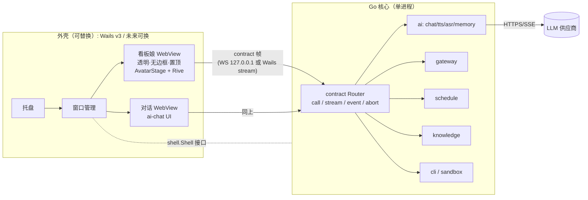

# 架构替换评估：Go 核心 + Wails v3 外壳（arch-go-wails）

> 状态：POC，勿合并。分支 `arch/go-wails-poc`，基于 `release/2.0.5`（d511566c）。
> 原型代码见 `poc/go-wails/`。本文所有“实测”数字都来自 Linux :2（无 GPU，Xfwm4 + picom）；没测到的标为 **未测**。

## 1. 量化目标（按平台）

| 指标                               | Linux (x64)                 | macOS (arm64)      | Windows (x64) |
| ---------------------------------- | --------------------------- | ------------------ | ------------- |
| 仅看板娘常驻，冷启动 +2min，总 USS | ≤ 200 MiB（2.0.5 实测 356） | ≤ 150 MiB          | ≤ 150 MiB     |
| 看板娘隐藏后总 USS                 | ≤ 60 MiB                    | ≤ 50 MiB           | ≤ 50 MiB      |
| 开对话增量 USS                     | ≤ 80 MiB                    | ≤ 80 MiB           | ≤ 80 MiB      |
| 安装包（压缩后）                   | ≤ 40 MiB                    | ≤ 40 MiB（单架构） | ≤ 40 MiB      |
| 冷启动到看板娘首帧                 | ≤ 1.5 s                     | ≤ 1.0 s            | ≤ 1.5 s       |

说明：Linux 的 WebView 用系统 WebKitGTK，mac 用 WKWebView，Windows 用 WebView2（Edge 运行时，内存口径与 Chromium 类似，**收益预计最小**）。目标值是需要达到才值得迁移的门槛，不是预测。

## 2. 架构图

核心与外壳之间只有两样东西：`contract` 线协议（前端 ⇄ 核心）和 Go 侧的 `shell.Shell` 接口（核心 → 窗口/托盘）。

## 3. core 子模块对照表

行数为 `packages/core/src/<mod>` 非测试 TS 行数（2.0.5）。

| 模块                                                                                            | 行数             | 主要外部依赖        | Go 侧落点                                                    | 难度 / 备注                             |
| ----------------------------------------------------------------------------------------------- | ---------------- | ------------------- | ------------------------------------------------------------ | --------------------------------------- |
| ai                                                                                              | 456              | ai-runtime / ai-sdk | `core/ai` + openai-go（POC 已做 chat.stream）                | 中：多供应商适配需逐个移植              |
| chat / agents / persona                                                                         | 253 / 2111 / 310 | —                   | `core/chat`、`core/agents`                                   | 中：纯逻辑                              |
| gateway                                                                                         | 4958             | fs, os, crypto      | `core/gateway`（net/http）                                   | 中                                      |
| schedule                                                                                        | 742              | —                   | `core/schedule`（time + robfig/cron 类）                     | 低                                      |
| knowledge                                                                                       | 1747             | tesseract.js, unpdf | `core/knowledge`；OCR/PDF 需换库或保留 Node sidecar          | **高**：tesseract.js 无同等纯 Go 方案   |
| tts                                                                                             | 961              | ws, crypto          | `core/tts`（coder/websocket）                                | 低-中                                   |
| voice                                                                                           | 2863             | onnxruntime-web, ws | 前端保留 onnxruntime-web 或 Go 调 onnxruntime C API（cgo）   | **高**                                  |
| memory                                                                                          | 997              | zod                 | `core/memory`                                                | 中                                      |
| cli / sandbox                                                                                   | 17571 / 497      | child_process       | `core/cli`（os/exec）                                        | **高**：体量最大，cli-plugins 生态是 JS |
| desktop                                                                                         | 4718             | fs, crypto, zod     | 拆分：窗口相关进 shell，其余进 core                          | 中                                      |
| extensions                                                                                      | 2088             | smol-toml           | Go 有 TOML 库；但 JS 扩展需宿主 → 保留 Node/QuickJS 方案待定 | **高**                                  |
| usage                                                                                           | 10194            | —                   | `core/usage`                                                 | 中：体量大但纯逻辑                      |
| diagnostics / local                                                                             | 519 / 987        | fflate              | archive/zip, compress/flate                                  | 低                                      |
| security / services / startup / utils / i18n / theme / onboarding / mascot / character / screen | 共约 3.3k        | dns, fs             | 对应 Go 包                                                   | 低                                      |

结论：约 2/3 的代码是可直接移植的纯逻辑；knowledge(OCR)、voice(onnx)、cli/extensions(JS 插件) 三块需要单独决策，可能保留一个可选的 Node sidecar。

## 4. contract 迁移方案

### 4.1 单一来源

- 现状：`packages/contract/src/app/*.ts` 用 zod 定义，约 **359 个过程**（mutation 252 / query 102 / stream 5）+ 事件。
- 方案：zod 仍是唯一来源。新增脚本 `scripts/contract-gen`：`zod → JSON Schema`（zod v4 自带 `z.toJSONSchema`）→ 生成
  - Go：类型 + `Router` 注册桩（每个过程一个 handler 接口方法）；
  - TS：不变（现有 `createClient(appContract)` 照用）。
- CI 校验生成物与源一致（`git diff --exit-code`）。POC 中 `internal/core/types.go` 是手写的 ChatOptions/ChatChunk 子集，用于验证线协议兼容；正式方案需生成。

### 4.2 流式与取消

- 线协议沿用 `protocol.ts` v1：`req{kind:stream}` → 多个 `chunk` → `end`/`err`；客户端 `abort{id}`。
- Go 侧每个请求一个 goroutine + `context.Context`；收到 `abort` 或连接关闭即 `cancel()`，handler 以 `ctx.Err()` 结束，回 `err{code:ABORTED}`。
- POC 实测：中止后前端收到 `ContractError: Call aborted`，上游 openai-go 流随 ctx 关闭（截图 `shot-chat-stream-and-abort.png`）。
- `Uint8Array` 继续用 `{"$u8":base64}`（`internal/contract/wire.go`）。

### 4.3 传输对比

|                      | 本地 WebSocket（POC 采用）                           | Wails binding / `HandleStream`                                    |
| -------------------- | ---------------------------------------------------- | ----------------------------------------------------------------- |
| 与现有 TS 客户端兼容 | ✅ 直接用 `createWebSocketClientTransport`，零改动   | 需写一个新 `ClientTransport` 适配器                               |
| 外壳可替换           | ✅ 与外壳无关（Electron/Tauri/浏览器都能连）         | ❌ 绑死 Wails                                                     |
| 安全                 | 需 127.0.0.1 + token + Origin + 子协议校验（已实现） | 不监听端口，攻击面更小                                            |
| 流式/取消            | 原生帧                                               | v3.0.0 streams 支持双向；binding 只适合 call，取消靠 cancel-async |
| 调试                 | 可用任意 WS 客户端抓包                               | 依赖 Wails devtools                                               |

建议：默认走本地 WS（保持外壳可替换），把 Wails streams 作为可选传输以后再接，二者共用同一 `Router`。

## 5. 分阶段计划与回退

| 阶段         | 内容                                                                                           | 回退方式                                           |
| ------------ | ---------------------------------------------------------------------------------------------- | -------------------------------------------------- |
| P0（本 POC） | Wails v3.0.0 双窗口 + Go chat.stream + 实测                                                    | 丢弃分支                                           |
| P1           | contract 生成器；Go 核心以 **sidecar** 形式被现有 Electron 版调用（WS），先迁 ai/chat/schedule | 配置开关切回 TS core；Electron 版不变              |
| P2           | 迁 gateway/memory/tts/usage/desktop 逻辑；knowledge/voice/cli 保留 Node sidecar                | 单模块开关回退到 TS 实现                           |
| P3           | 外壳切到 Wails（先 mac、Linux，Windows 视实测决定）                                            | 同一 Go 核心仍可被 Electron 外壳连接，发版时二选一 |
| P4           | 去掉 Node sidecar（如可行）                                                                    | 保留 sidecar                                       |

每阶段都保持 Electron 构建可发版，不合 main 前不删任何 TS 实现。

## 6. 窗口层风险

- **Linux 托盘**：Wails v3 用 StatusNotifierItem；无 SNI 宿主（如本测试机 Xfwm4 无插件、GNOME 默认）时托盘注册失败（实测报 `org.kde.StatusNotifierWatcher not provided`）。Electron 有 XEmbed 回退。需要兜底入口（单实例 + 命令行/快捷键）。
- **Linux 透明窗口**：依赖合成器（本机 picom）；GTK3 构建实测透明可用。GTK4/webkitgtk-6.0（v3 默认）**未测**。Wayland 下置顶/定位受限 **未测**。
- **鼠标穿透**：看板娘透明区域点击穿透需要 ignore-mouse（v3 有示例），按像素命中测试 **未测**。
- **WebKitGTK 渲染内存**：本机无 GPU，看板娘 WebProcess USS ≈ 430 MiB，远高于预期，怀疑 WebGL/Rive 走软件渲染 + 合成层缓冲；有 GPU 机器上 **未测**。这是本 POC 最大的未决问题。
- **WebView 差异**：三平台三种引擎，Rive WASM/WebGL2、AudioWorklet、onnxruntime-web 的兼容性需逐一回归（mac/Windows **未测**）。
- Windows WebView2 本身多进程，内存收益可能很小。

## 7. 与 MyGo 的对比与外壳可替换

- MyGo 类方案（Go 后端 + Wails 窗口直接 binding）把业务逻辑与 Wails 绑定方法耦合；本方案刻意不用 binding 承载业务：
  - 业务只依赖 `internal/contract`（线协议）和 `internal/shell.Shell` 接口（`Show/Destroy/Visible/Run/Quit` + `WindowKind`）；
  - Wails 实现仅在 `internal/shell/wailsshell`（约 150 行）。换外壳 = 新写一个 `shell.Shell` 实现，前端不改。
- 同一核心也可作为 sidecar 被现有 Electron 外壳连接（P1），这是回退路径的基础。
- magpie 使用 Wails v3 beta.24；本 POC 固定 **v3.0.0 正式版**。

## 8. 原型实测结果

### 8.1 Linux 本机

环境：Linux :2，1920×1200，无 GPU，16 GiB 内存、无 swap；Wails v3.0.0 `-tags gtk3`（webkit2gtk-4.1 2.54.0），Go 1.27.2；mock LLM（无 key）。
测前 `free -m`：available 9616 MiB。冷启动后等 120 s，每阶段 3 次取中位数；口径 USS = Private_Clean + Private_Dirty（smaps_rollup），整个进程树求和。原始数据 `/workspace/scratch/go-poc/mem/raw-*.json`。

| 场景                       | POC USS   | POC PSS | 2.0.5 USS             | 2.0.5 PSS      |
| -------------------------- | --------- | ------- | --------------------- | -------------- |
| 冷启动（仅看板娘）         | **538.8** | 654.6   | 356.5（另一次 287.1） | 515.7（328.1） |
| 打开对话                   | **583.5** | 754.6   | 376.7                 | 482.7          |
| 关闭对话                   | **532.4** | 648.6   | 357.7                 | 431.7          |
| 隐藏看板娘（销毁 WebView） | **163.5** | 212.1   | 315.8                 | 390.0          |

单位 MiB。2.0.5 数据为此前单次采样（部分在内存压力下，PSS 偏低），不是三次中位数。

POC 进程拆分（冷启动中位）：nomi-poc 77 / WebKitWebProcess 434 / WebKitNetworkProcess 28 (USS)。开对话新增一个 WebProcess ≈ 102。隐藏看板娘后 WebProcess 回收，但 nomi-poc 主进程从 78 升到 140（原因未查）。

结论（仅限此环境）：

- 在无 GPU 的 Linux 上，WebKitGTK 承载 Rive 看板娘比 Electron **更耗内存**（+51% USS），未达到目标；
- 销毁 WebView 的回收效果明显好于 Electron（163 vs 316）；
- 开对话增量 ≈ 45–50 MiB，比 2.0.5（≈ 20）大。

其他：

- 流式对话：首包 37 ms，总 2730 ms（mock，30 ms/字）；中止正常。
- 体积：Linux 二进制 49,726,752 B（47.4 MiB，含约 23.7 MB 前端资源，其中 character.riv 16.4 MB），tar.gz 24.5 MB；依赖系统 WebKitGTK，不含在内。2.0.5 Linux 安装包体积此处 **未测**。
- Rive 渲染：mark `rive-model-loaded` 已上报，相隔 1.5 s 两帧像素有差异（动画在动）。截图：`/workspace/scratch/go-poc/shot-mascot-rive-t0.png`、`shot-mascot-rive-t1.png`、`shot-chat-stream-and-abort.png`。
- 冷启动耗时：**未测**。macOS / Windows 见 8.2。
- GTK4 构建、Wayland、有 GPU 的 Linux：**未测**。

### 8.2 macOS / Windows（GitHub Actions）

Run：https://github.com/Cookieboty/nomi-ai/actions/runs/40808099424 （commit bd5073af，三平台全部成功；前一组 run 40807152337 数据接近）。
Runner：macos-14（arm64）、windows-latest（Windows Server 2025）。冷启动后等 **45 s**（WAIT=45），其余场景切换后各等待采样；每场景采 3 次，取合计的中位数。场景用 `NOMI_POC_CTL` 切换，对话用 mock。
对照组为 **v2.0.4** release 安装包（2.0.5 未发布安装包），同一 runner，**只测了冷启动**；v2.0.4 冷启动显示引导主窗口 + 看板娘，与 POC「仅看板娘」不完全对等。

体积（字节）：

| 平台    | POC                                       | v2.0.4                                                 |
| ------- | ----------------------------------------- | ------------------------------------------------------ |
| macOS   | zip 23,998,106；.app 47,156 KiB（du -sk） | zip 147,304,286；dmg 152,573,064；Nomi.app 345,836 KiB |
| Windows | exe 50,413,568；zip 24,401,203            | Setup.exe 139,479,868；安装目录 418,151,599            |
| Linux   | tar.gz 24,531,373（不含系统 WebKitGTK）   | AppImage 157,419,231                                   |

macOS 内存（MiB，进程树 + com.apple.WebKit.* 进程合计；footprint = `sudo vmmap -summary` Physical footprint，RSS = ps）：

| 场景       | POC footprint | POC RSS | v2.0.4 footprint | v2.0.4 RSS |
| ---------- | ------------- | ------- | ---------------- | ---------- |
| 冷启动     | 268.9         | 499.0   | 580.3            | 942.7      |
| 打开对话   | 307.0         | 591.1   | 未测             | 未测       |
| 关闭对话   | 310.8         | 519.2   | 未测             | 未测       |
| 隐藏看板娘 | 45.9          | 160.9   | 未测             | 未测       |

按进程（冷启动中位，footprint）：nomi-poc 22.5 / WebContent 176.1 / Networking 14.1 / GPU 17.2。打开对话多一个 WebContent 35.5；看板娘 WebContent 涨到 ≈314，关闭对话后不回落（≈300）。隐藏看板娘后 WebContent 退出，剩 nomi-poc 25.8 / Networking 6.8 / GPU 13.4。v2.0.4 冷启动：Nomi 91.6 / Helper(GPU) 265.1 / Renderer 141.1 + 52.6 / 其他 Helper 7.5 + 22.6。

Windows 内存（MiB，Win32_Process 递归进程树合计；privWS = 性能计数器 Working Set - Private，Private = PrivateMemorySize64，WS = WorkingSet64）：

| 场景       | POC privWS | POC Private | POC WS | v2.0.4 privWS | v2.0.4 Private | v2.0.4 WS |
| ---------- | ---------- | ----------- | ------ | ------------- | -------------- | --------- |
| 冷启动     | 332.7      | 415.1       | 636.6  | 415.8         | 501.2          | 825.4     |
| 打开对话   | 402.7      | 473.0       | 747.8  | 未测          | 未测           | 未测      |
| 关闭对话   | 382.4      | 445.5       | 682.3  | 未测          | 未测           | 未测      |
| 隐藏看板娘 | 30.3       | 81.8        | 76.9   | 未测          | 未测           | 未测      |

按进程（冷启动中位，privWS）：nomi-poc 39.5 / msedgewebview2 主 38.6 / gpu 89.9 / renderer 149.2 / utility 6.0 + 2.7 / crashpad 2.1。打开对话多一个 renderer 20.6。隐藏看板娘后整个 msedgewebview2 树退出，只剩 nomi-poc（需 `DisableQuitOnLastWindowClosed`，否则进程直接退出）。v2.0.4 冷启动：main 84.8 / gpu 100 / renderer 146.2 + 39.5 / utility 7.3 + 25。

Rive 渲染：两平台都上报了 `rive-model-loaded`，截图（artifact `mem-<os>` 中 `poc-cold.png`）可见看板娘。Windows 窗口已透明；**macOS 窗口仍是白底**（MacBackdropTransparent 未生效，待查）。
mock 对话（chat-done）：macOS 首包 39–47 ms、总 ≈2.85 s；Windows 首包 47–70 ms、总 ≈3.2 s（上一组）。

结论（仅 CI runner，无真实 GPU）：冷启动 POC 比 v2.0.4 低——macOS footprint −54%，Windows privWS −20%；隐藏看板娘可回收到 30–46 MiB。安装体积约为 v2.0.4 的 1/6（zip）。

未测：v2.0.4/2.0.5 的打开对话、关闭对话、隐藏看板娘场景（打包版无控制口）；2.0.5 安装包（未发布）；冷启动耗时；Intel Mac；真实 GPU 机器；签名/公证后的体积。

### 8.3 SVG 静态看板娘变体（无 Rive、无动画）

看板娘窗口改为只用 `` 显示一张已有的静态立绘 `rive/nomi-complete/reference/svg-rig/nomi-fullbody-mother.svg`（4,063,576 B，SVG 内嵌一张 1024×1536 透明底 PNG），前端包里不再含 Rive 运行时 / wasm / avatar-runtime / 角色包。默认构建即 SVG 版；`NOMI_POC_MASCOT=rive` 构建前端可恢复 Rive 版。窗口尺寸与透明设置不变。同口径（冷启动后等待 45 s，三次中位数，整个进程树）。CI run 40810089919，提交 983908db。

体积（字节）：

| 平台    | SVG POC    | Rive POC   | v2.0.4                |
| ------- | ---------- | ---------- | --------------------- |
| macOS   | 10,031,026 | 23,998,106 | dmg 152,573,064       |
| Windows | 10,654,734 | 24,401,203 | installer 139,479,868 |
| Linux   | 10,693,363 | 24,531,373 | AppImage 157,419,231  |

内存（MiB；macOS = vmmap footprint（括号内 RSS），Windows = privWS，Linux = 本机 USS 合计，等待 120 s）：

| 场景       | macOS SVG    | macOS Rive    | Windows SVG | Windows Rive | Linux SVG | Linux Rive |
| ---------- | ------------ | ------------- | ----------- | ------------ | --------- | ---------- |
| 冷启动     | 55.9 (177.6) | 268.9 (499.0) | 80.4        | 332.7        | 216.1     | 539        |
| 打开对话   | 96.7 (266.7) | 307.0 (591.1) | 106.3       | 402.7        | 289.5     | —          |
| 关闭对话   | 59.8 (194.7) | 310.8 (519.2) | 83.2        | 382.4        | 219.5     | —          |
| 隐藏看板娘 | 31.9 (109.8) | 45.9 (160.9)  | 14.5        | 30.3         | 153.9     | —          |

同 runner 的 v2.0.4 冷启动：macOS 582.8 footprint（952.5 RSS），Windows privWS 422.7。

按进程（冷启动中位）：macOS nomi-poc 21.9 / 看板娘 WebContent 28.0（Rive 版 176.1）/ Networking 6.1，**不再出现 GPU 进程**（Rive 版 17.2）；打开对话多一个 WebContent 36.9，看板娘 WebContent 保持 28.0，**Rive 版"打开对话后看板娘 WebContent 涨到 ≈300"不再出现**。Windows nomi-poc 15.1 / webview2 主 28.8 / gpu 5.9（Rive 版 89.9）/ renderer 19.7（Rive 版 149.2）/ utility 6.0 + 2.7 / crashpad 2.2；打开对话多一个 renderer 20.8。Linux nomi-poc 64.5 / WebKitWebProcess 131.2 / NetworkProcess 20.4（本机无 GPU，软件渲染）。

显示：三平台都上报 `svg-loaded`，截图可见立绘；Windows、Linux 透明，**macOS 仍是白底**（与 8.2 同一问题，与 Rive 无关）。

结论：去掉 Rive 后看板娘窗口成本基本消失——冷启动 macOS footprint 268.9 → 55.9（约为 v2.0.4 的 1/10），Windows privWS 332.7 → 80.4（约 v2.0.4 的 1/5）；包体积再减约 58%（SVG 自带 4 MB，仍在包内）。代价是没有任何动画/表情/口型。
