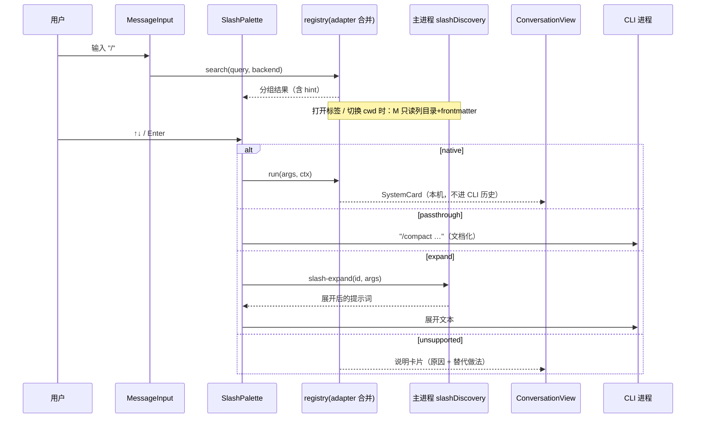

# 会话斜杠命令 / 插件接管设计

状态：设计 + 实现稿（分支 `feat/v1.0.3`）。调研日期 2026-10-18，所有结论只依据各项目**公开文档**；实现里没有读取任何凭据文件，也没有调用未文档化接口。关联：[统一会话视图](../features/coding-agent-harness.md)、[端信息卡](endpoint-info-card.md)、[用量卡片](usage-quota-cards.md)。

## 0. 要解决的问题

统一会话界面（`Conversation` / `ConversationView`，Nomi / Claude Code / Codex / Grok / dsh 共用）里，用户在输入框打 `/context`、`/compact` 这类 CLI 自带命令，过去只是把这行字当普通消息发给模型：模型把它当成一句话，用户看不到命令真正的效果。

目标：在 Nomi 输入框输入 `/` 弹出命令面板；选中后**在 Nomi 界面里执行并呈现结果**。命令分四种去向：

1. **Nomi 原生**：用本地账本 / 会话状态 / 第三方供应商直接算出来，以「系统消息卡片」显示在会话流里（`/context`、`/cost`、`/status`、`/model`、`/clear`、`/new`、`/help`、`/diff`、`/mcp`、`/skills`…）。
2. **透传**：该 CLI 的**文档明确说在非交互（`-p` / stream-json）模式可用**的命令，原样发给 CLI，结果走普通流式输出（`/compact`、自定义命令与 skill）。
3. **提示词展开**：CLI 没有文档化的无头入口，但命令本质是一段提示词（项目 / 用户目录里的 `commands/*.md`、`SKILL.md`，以及 Nomi 内置的 `/review`、`/init` 模板）：Nomi 在本地展开占位符后把**展开后的提示词**发给 CLI。
4. **不支持**：需要交互式终端 / 登录流程 / 未文档化接口的命令，给出明确的卡片说明原因与替代做法，**不发给 CLI、不静默失败**。

## 1. 调研：各 CLI 的命令能力

### 1.1 Claude Code

来源：<https://code.claude.com/docs/en/commands>、<https://code.claude.com/docs/en/skills>、<https://code.claude.com/docs/en/headless>、<https://code.claude.com/docs/en/agent-sdk/slash-commands>。

- **接入方式**：Nomi 用 `claude -p --input-format stream-json --output-format stream-json` 的会话级长驻进程（`CliHarnessService`）。
- **非交互模式下哪些命令可用**（headless 文档的 Note）：
  - 用户调用的 **skills 与自定义命令可用**：提示词里写 `/skill-name`，Claude Code 在运行前展开。
  - **只在终端界面里工作的内置命令不可用**，如 `/login`、`/theme`、`/terminal-setup`；这类命令在 SDK 里返回 `/<name> isn't available in this environment.`，不会产生模型轮次。
  - `/model`、`/effort`、`/fast`、`/color`、`/rename` 可以把值作为参数（`/model sonnet`）；`/mcp` 不带参数会输出文本形式的服务状态；`/config key=value` 可设置。
  - Agent SDK 文档：`/compact`、`/clear` 是可发送的内置命令（`compact_boundary` 消息标记压缩发生）；`system/init` 消息的 `slash_commands` 字段列出会话内可用命令（交互专用命令不在其中）。
  - 一个既不是会话命令也不是内置命令的 `/<name>` 不会报错，而是**当作普通消息发给模型**（附一句"命令没有运行"的说明）——这正是用户今天看不到效果的原因，Nomi 需要在发送前拦截。
- **自定义命令 / skills 目录与格式**（skills 文档）：
  - 自定义命令已合并进 skills：`.claude/commands/deploy.md` 与 `.claude/skills/deploy/SKILL.md` 都产生 `/deploy`；子目录用 `:` 连接（`commands/frontend/component.md` → `/frontend:component`）。
  - 位置：项目 `.claude/skills/<name>/SKILL.md`（向上查找到仓库根）、个人 `~/.claude/skills/<name>/SKILL.md`、插件 `<plugin>/skills/<name>/SKILL.md`（命令名 `/plugin-name:skill-name`）。企业级目录与 claude.ai 同步目录（`~/.claude/skills/synced/`）不在 Nomi 的发现范围内。
  - frontmatter：`name`、`description`、`argument-hint`、`arguments`、`disable-model-invocation`、`user-invocable`（`false` 时不在 `/` 菜单）、`allowed-tools`、`model`、`context` 等；命令文件支持同样的字段（除 `name`、`paths`）。正文占位符：`$ARGUMENTS`、`$ARGUMENTS[N]`、`$N`、命名参数 `$name`；`` !`cmd` `` 是 CLI 的动态注入，**只有 CLI 自己会执行**。
  - 同名优先级：企业 > 个人 > 项目；skill 压过 `.claude/commands/` 同名文件。
- **插件**：`/plugin` 命令与 `claude plugin ...`；插件 skills 在 `<plugin>/skills/`。Nomi 只读展示发现到的项目 / 用户级条目，不做启停（文档只给了交互式 `/plugin` 与子命令，改动影响用户的 CLI 配置，不在本次范围）。
- **MCP**：项目 `.mcp.json`（只读服务名与传输类型，**不读 env / headers / args**）。用户级 `~/.claude.json` 可能含凭据，不读。

### 1.2 Codex CLI

来源：<https://developers.openai.com/codex/cli/slash-commands>、<https://developers.openai.com/codex/app-server>、<https://developers.openai.com/codex/skills>、<https://developers.openai.com/codex/custom-prompts>。

- **接入方式**：Nomi 用 `codex exec --json`（`resume` 续接），**不是 app-server**。`exec` 没有斜杠命令入口，文档中的斜杠命令都属于 TUI。
- **TUI 斜杠命令**（节选）：`/status`（会话配置与 token 用量）、`/model`、`/permissions`（旧称 approvals）、`/compact`、`/new`、`/clear`、`/diff`、`/mention`、`/review`、`/init`、`/mcp`、`/plugins`、`/skills`、`/fork`、`/resume`、`/plan`、`/goal`、`/usage`、`/ps`、`/stop`……
- **app-server 协议里有对应方法**（文档化，但 Nomi 目前不走 app-server）：`thread/compact/start`（对应 `/compact`）、`review/start`（`/review`）、`model/list`（`/model` 的候选）、`skills/list`、`plugin/list`、`thread/tokenUsage/updated` 通知与 `account/rateLimits/read`（`/status`、`/usage` 的数据）、`thread/fork`、`turn/interrupt`。这是未来把 Codex 切到 app-server 后「透传 → 协议方法」的升级路径。
- **自定义 prompts 已废弃**（`~/.codex/prompts`），文档要求改用 skills。**skills**：`SKILL.md` + frontmatter（`name`、`description`），发现路径 `$CWD/.agents/skills`、`$CWD/../.agents/skills`、`$REPO_ROOT/.agents/skills`、`$HOME/.agents/skills`；显式调用用 `$skill-name`（不是 `/`）。
- **插件 / MCP**：`codex plugin list --json`、`codex mcp list --json` 是文档化的只读命令（Nomi 本次不起 CLI 进程去读，避免在面板里触发外部进程；`config.toml` 可能含凭据，不读）。

### 1.3 Grok CLI（Grok Build，`@xai-official/grok`）

来源：<https://docs.x.ai/build/modes-and-commands>、<https://docs.x.ai/build/features/skills-plugins-marketplaces>、<https://docs.x.ai/build/cli/headless-scripting>、`xai-org/grok-build` 仓库的 `04-slash-commands.md`、`09-plugins.md`。

- **接入方式**：`grok -p <prompt> --output-format streaming-json`（无头）。`grok -p` 会执行 `available_commands` 里的 shell 内置和 user-invocable skills（实测 `/workflow` 由命令分发，不是模型作文）。分页器才有的命令（`/theme`、`/find`、`/quit` 等）这种接入没有界面。
- **命令来源三层**：pager 内置（TUI 本地动作）、shell 内置（会话 / 代理动作，经 **ACP `AvailableCommandsUpdate`** 告诉 TUI）、user-invocable skills。内置名永远赢得裸名，冲突的 skill 用 `/local:name`、`/user:name`、`/<plugin>:name`。
- **skills**：`./.grok/skills/`（向上到仓库根）、`~/.grok/skills/`、启用插件的 `skills/`；`SKILL.md` frontmatter：`name`、`description`、`when-to-use`、`argument-hint`、`user-invocable`（只有字面量 `true` 算）、`disable-model-invocation`、`metadata`。`commands/` 下的扁平 `*.md` 也成为斜杠命令（兼容旧 Claude 布局）。
- **插件**：`./.grok/plugins/`、`~/.grok/plugins/`（含 `skills/`、`commands/`、`agents/`、`hooks/hooks.json`、`.mcp.json`、`.lsp.json`，可选 `plugin.json`）；`grok plugin list|install|enable|disable|details`、`grok inspect --json` 是文档化的 CLI 管理入口。
- **ACP**：`grok agent stdio` 可作为 ACP 代理运行，`available_commands_update` 是文档化机制（见 §3）。Nomi 目前走无头 JSON 流，不走 ACP，所以拿不到动态命令列表，只能靠文件发现。

### 1.4 dsh（`@deepseek-ai/dsh`）

仓库已有的调研（`coding-agent-harness.md` §12）：`dsh --profile headless --json [--session-id <id>] "<任务>"`，插件用 `dsh plugin --profile <name> ...` 管理。**没有找到公开的斜杠命令 / skills 目录文档**，因此按"不猜测"原则：dsh 只提供 Nomi 原生命令；自定义命令与插件发现不做，面板里明确写"该端没有公开文档化的命令目录"。

## 2. 命令 → 接管方式矩阵

图例：**N** = Nomi 原生（卡片）；**P** = 透传给 CLI；**X** = Nomi 提示词展开后发送；**D** = 文档化协议方法（当前未接入，写明方法名）；**✗** = 不支持（卡片说明）。

| 命令                                                                                            | Nomi                                     | Claude Code                                  | Codex                               | Grok                      | dsh                 |
| ----------------------------------------------------------------------------------------------- | ---------------------------------------- | -------------------------------------------- | ----------------------------------- | ------------------------- | ------------------- |
| `/help`                                                                                         | N                                        | N                                            | N                                   | N                         | N                   |
| `/context`                                                                                      | N（会话 token 估算 + 上次真实用量）      | N                                            | N（D: `thread/tokenUsage/updated`） | **P**（Grok 自己的命令）  | N                   |
| `/cost`（`/usage` `/stats`）                                                                    | N                                        | N（别名同官方）                              | N（D: `account/rateLimits/read`）   | N                         | N                   |
| `/status`                                                                                       | N                                        | N                                            | N                                   | N                         | N                   |
| `/model`                                                                                        | N（供应商 / 模型切换）                   | N（第三方供应商切换）                        | N（D: `model/list`）                | N                         | N                   |
| `/clear` `/new`                                                                                 | N（新会话）                              | N（新标签，旧会话保留）                      | N                                   | N                         | N                   |
| `/compact`                                                                                      | ✗（Nomi 对话暂无压缩）                   | **P**（SDK 文档化，`compact_boundary`）      | ✗（D: `thread/compact/start`）      | **P**（`grok -p` 会执行） | ✗                   |
| `/diff`                                                                                         | —                                        | N（`git diff`，只读）                        | N                                   | N                         | N                   |
| `/review`                                                                                       | —                                        | **P**（捆绑 skill，别名 `/code-review`）     | ✗（D: `review/start`）              | **P**（自带 skill）       | ✗                   |
| `/init`                                                                                         | —                                        | **P**                                        | ✗                                   | ✗（无头列表里没有）       | ✗                   |
| `/security-review`                                                                              | —                                        | **P**                                        | —                                   | —                         | —                   |
| `/effort` `/config k=v`                                                                         | —                                        | **P**（文档化：可带参数）                    | ✗                                   | ✗                         | ✗                   |
| `/mcp` `/skills` `/plugins` `/agents`                                                           | N（打开「插件面板」）                    | N（面板只读展示）                            | N                                   | N                         | N（说明无公开目录） |
| 项目 / 用户自定义命令                                                                           | N/A                                      | **P**（`/name args`，CLI 展开）              | —                                   | **P**（`/name args`）     | —                   |
| skills                                                                                          | N（Nomi 技能：展开）                     | **P**（`/skill`）                            | **X**（`$skill` 的等价展开）        | **P**（`/name args`）     | —                   |
| `/memory` `/permissions` `/login` `/logout` `/theme` `/vim` `/terminal-setup` `/ide` `/doctor`… | ✗                                        | ✗（交互式终端界面，headless 文档明确不可用） | ✗（TUI 配置界面）                   | ✗                         | ✗                   |
| `/mention`                                                                                      | ✗                                        | ✗                                            | ✗（Nomi 输入框直接写路径即可）      | ✗                         | ✗                   |
| 其它未知 `/xxx`                                                                                 | ✗ 卡片：未知命令，可选"作为普通文字发送" | 同                                           | 同                                  | 同                        | 同                  |

说明：

- **N 优先于 P**：官方也有 `/context` `/cost` `/status` 这些命令，但它们要么是 TUI 画面，要么在 `-p` 下无文档。Nomi 直接用本地账本算，**不起模型轮次、不花钱、即时**。例外：Grok 的 `/context` 在 `grok -p` 的命令列表里，原样发送，不再用 Nomi 卡片占用这个名字。`/status` 无头列表里的名字是 `/session-info`，所以 `/status` 仍是 Nomi 卡片。
- **P 只给这种接入真能执行的**：Claude 的 `/compact`、`/init`、`/code-review`、`/security-review`、`/effort`、`/config key=value`、用户 skills / 命令文件；Grok 的 shell 内置（`/compact`、`/context`、`/always-approve`、`/session-info`、`/feedback`、`/deep-research`、`/workflow`、`/goal`、`/loop`）和发现到的 skills / 工作流。其余内置命令一律走 ✗，宁可明确提示也不把命令当文字发给模型。
- **X 的边界**：展开只做占位符替换（`$ARGUMENTS`、`$N`、`$name`、`${CLAUDE_SKILL_DIR}`…不替换），`` !`cmd` `` **不执行**（原样保留并在卡片里提示"Nomi 不运行嵌入的 shell 命令"），避免通过命令文件绕过 CLI 的权限模型。
- **dsh**：没有任何文档化来源，所以 CLI 相关命令只有 N。`/review` `/init` 不做成 Nomi 提示词。

## 3. 开源方案对比与选型

对比对象：**Claude Code**（官方 CLI，作为被接管方）、**Cline**、**Continue**、**OpenCode**、**Zed**（Agent Panel / 扩展 API）、**Open WebUI**、**LobeChat**，以及 **ACP（Agent Client Protocol）`available_commands_update`**。只借鉴设计，不复制代码。

| 维度            | ACP                                                                            | Claude Code                                                                                  | Cline                                                           | Continue                                                                                           | OpenCode                                            | Zed                                                                                                      | Open WebUI                                                 | LobeChat                                                       |
| --------------- | ------------------------------------------------------------------------------ | -------------------------------------------------------------------------------------------- | --------------------------------------------------------------- | -------------------------------------------------------------------------------------------------- | --------------------------------------------------- | -------------------------------------------------------------------------------------------------------- | ---------------------------------------------------------- | -------------------------------------------------------------- |
| **注册模型**    | 代理推送 `availableCommands[{name, description, input?}]`，整表替换，`[]` 清空 | 内置 + 捆绑 skill + 用户 skill/命令文件 + MCP prompts 同一张表；`system/init.slash_commands` | 内置命令 + 启用的 skills；workflows 在 `.clinerules/workflows/` | `.prompt` / 带 `invokable: true` 的 md、助手 prompt 块、MCP prompts；旧 `slashCommands` 配置已弃用 | md 文件或 JSON `commands`，同一注册表，后者覆盖前者 | 扩展 `extension.toml` 声明命令 + `run_slash_command`；Agent Panel 已转向 Rules，扩展斜杠命令只在文本线程 | 工作区「Prompts」，每条设一个 `/command`，有版本历史与权限 | 未找到公开文档化的斜杠命令注册机制（仅有"快捷短语"需求 issue） |
| **参数提示**    | `input.hint` 文本提示                                                          | `argument-hint`                                                                              | 无结构化参数                                                    | prompt 模板变量                                                                                    | `$ARGUMENTS` / `$1..`                               | `complete_slash_command_argument` 返回补全，`requires_argument`                                          | `{{var \| type:…:required}}` 弹表单                        | —                                                              |
| **分组 / 标签** | 无（`_meta` 可扩展）                                                           | 菜单标注来源（插件、claude.ai sync）                                                         | 无                                                              | 无                                                                                                 | 弹层按 `source: command/mcp/skill` 标 badge         | 无                                                                                                       | 标签（Tags）过滤                                           | —                                                              |
| **搜索**        | 客户端负责                                                                     | 前缀 / 词边界匹配，打错字不高亮、`Enter` 不会静默提交                                        | —                                                               | 下拉过滤                                                                                           | 弹层过滤                                            | 补全                                                                                                     | 自动补全列表                                               | —                                                              |
| **结果呈现**    | 命令作为普通 `session/prompt` 文本发出，结果走会话更新流                       | 内置命令直接画界面；skills 注入为一条消息                                                    | 作为任务指令                                                    | 与高亮代码一起拼成用户消息                                                                         | 展开后作为一条用户提示提交                          | 输出以一段文本进入线程                                                                                   | 展开后的提示直接发送                                       | —                                                              |
| **扩展性**      | `_meta`、自定义 `_` 前缀输入类型；客户端须保留未知字段                         | skills 标准（Agent Skills）+ 插件                                                            | skills / 规则 / workflows                                       | prompt 文件、MCP                                                                                   | 文件 / JSON / 插件                                  | Rust 扩展                                                                                                | Prompts + 工具 + 技能                                      | —                                                              |
| **安全**        | 协议只传元数据；执行由代理决定                                                 | `!cmd` 受权限规则约束；`disableSkillShellExecution`；`allowed-tools` 只在当次生效            | 规则文件由用户信任                                              | 提示词只是文本                                                                                     | `!cmd` 注入 shell 输出（本地执行）                  | 扩展是沙箱化的 wasm                                                                                      | 变量表单、剪贴板需授权、按用户 / 组访问控制                | —                                                              |

**选型：以 ACP 的命令元数据模型为骨架，吸收三家的细节。**

1. **注册模型 = ACP `AvailableCommand` 的超集**。每条命令至少有 `name`、`description`、可选 `input.hint`（ACP 形状），再加 Nomi 自己需要的 `source`（分组）、`kind`（原生 / 透传 / 展开 / 不支持）、`handler`。理由：ACP 是 Grok 已经在用的、多代理的共同形状；以后 Nomi 若接 ACP 代理，`available_commands_update` 可以**零转换**注册进来（整表替换语义也直接复用）；未知字段保留（`meta`），符合 ACP 对客户端的要求。
2. **每个端一个 adapter，注册表合并**（借鉴 OpenCode 的"同一注册表、后来者覆盖"和 Grok 的"内置名赢得裸名"）：同名时当前端赢过 Nomi，自定义命令以限定名 `/project:name`、`/user:name`、`/<plugin>:name` 出现；不静默覆盖，菜单上同时显示两条并带来源徽标。
3. **分组 + 来源徽标**（借鉴 OpenCode 弹层的 `source` badge、Claude 的来源标注）：「当前端命令 / 项目自定义 / 用户自定义 / 插件 / Skills / Nomi / 界面」。当前端与 Nomi 同名时只展示当前端。
4. **参数提示**用 ACP `input.hint` + 命令文件的 `argument-hint`；不做 Open WebUI 那样的类型化表单（我们的命令参数都是一行文本，表单过重）；Zed 的"参数补全"思路用在 `/model <名>`：参数位置补全该端可选的模型 / 供应商。
5. **搜索**沿用仓库已有的 `utils/fuzzy.ts`（词 AND、子串 > 子序列、中文友好），按名字 > 别名 > 描述加权。借鉴 Claude 的细节：打错字时**不静默提交**——`Enter` 在没有匹配项时走"未知命令"卡片而不是发给模型。
6. **结果呈现**：原生命令的结果是会话流里的**系统消息卡片**（本机展示，不进 CLI 历史、不发给模型）；透传 / 展开的结果走普通流式输出。这是 ACP / OpenCode / Open WebUI 共同的做法（"命令 = 提示词前缀"）在无头 CLI 上的对应物。
7. **安全**：采用 Claude 的最保守姿势——命令文件里的 `` !`cmd` `` 不由 Nomi 执行；发现阶段只读文件名与 frontmatter；展开时只读被选中的那一个文件，且路径必须来自主进程自己的发现结果（渲染进程传的是命令 id，不是路径）；绝不读 `~/.claude.json`、`~/.codex/config.toml`、`auth.json`、`.credentials*`、`.env`。

未采用及原因：Open WebUI 的版本历史 / 访问控制（单用户本地应用不需要）；Cline 的 `/newtask` 式"带摘要的新任务"（需要模型生成摘要，留作后续）；LobeChat（没有可借鉴的公开设计）；Zed 扩展 API（我们没有第三方扩展运行时，插件只做只读发现）。

## 4. 设计

### 4.1 数据模型

```ts
type SlashSource = 'builtin' | 'endpoint' | 'project' | 'user' | 'plugin' | 'skill' | 'ui'; // 即分组与展示顺序
type SlashKind = 'native' | 'passthrough' | 'expand' | 'unsupported' | 'ui';

interface SlashCommand {
  id: string; // 唯一：'<source>:<name>'（重名改成限定名时追加 '#<限定名>'）
  name: string; // 输入的名字（不含 /），可带命名空间 'frontend:component'
  aliases?: string[];
  label: string; // 展示名（i18n）
  description: string;
  source: SlashSource;
  kind: SlashKind;
  args?: { hint: string }; // 同 ACP AvailableCommandInput.hint
  scope?: 'project' | 'user' | 'plugin'; // 自定义命令 / skill 的作用域，重名时用作限定前缀
  badge?: string; // 面板里的小标签（项目 / 用户 / 插件名）
  qualified?: boolean; // 与内置重名，已被改名为 'project:x' 之类
  run(args: string, ctx: SlashContext): SlashOutcome | Promise<SlashOutcome>;
}
type SlashOutcome =
  | { type: 'card'; card: SlashCardInput } // 在会话流里加一张卡
  | { type: 'send'; text: string; note?: string } // 作为用户消息发给 CLI（note：同时留一张提示卡）
  | { type: 'noop' };
```

### 4.2 模块

```
packages/ai-chat/src/slash/
  types.ts            SlashCommand / SlashContext / SlashCard / SlashBridge
  parse.ts            parseSlashInput：只认消息开头的 /name args；// 转义；paletteQuery / argPhase
  registry.ts         buildRegistry（重名 → 限定名）、searchCommands（fuzzy.ts + 分组）、executeSlash
  tokens.ts           token 估算、上下文窗口表（带 "估算" 标注）
  cards.ts            context / cost / status / model / help / unknown 卡片的数据构造（纯函数）
  data.ts             命令执行时按需读本机数据（cli-update / usage / cli-provider / provider，全部只读）
  adapters/
    common.ts         原生命令、不支持命令的构造器、/review /init 模板、发现条目 → 命令
    nomi.ts claude.ts codex.ts grok.ts dsh.ts index.ts
  useSlashCommands.ts 发现 + adapter + 注册表 + 卡片状态（按会话 scope 存放）→ SlashBridge
components/SlashPalette      命令面板（分组、高亮、参数提示、接管方式标签）
components/SystemCards       会话流里的卡片渲染（context / cost / status / list / notice / diff）
components/PluginPanel       「插件 / 命令」只读面板（Modal 抽屉形态）
components/MessageInput      接入：面板键盘 / 参数提示条 / 回车拦截（slash 桥）
electron/src/cli/slashDiscovery.ts   主进程只读发现 + 按 id 展开 + git diff（IPC ai:harness:slash-* / git-diff）
```

展开（`$ARGUMENTS` / `$N` / 命名参数）**在主进程**（`slashDiscovery.expandSlash`），渲染进程只传 id 与参数，拿不到也传不了路径。

### 4.3 流程



### 4.4 系统消息卡片

`ConversationView` 新增 `cards` / `onDismissCard` 属性；每张卡片带 `afterId`（创建时最后一条消息的 id；`null` = 会话开头；找不到 = 末尾）和 `at`，渲染在该消息之后；卡片状态由 `useSlashCommands` 按会话 scope（CLI 标签 id / Nomi 对话首条消息 id）保存在内存里（切换标签后在同一次运行内保留，重启不保留；每个会话最多 30 张、最多 24 个会话）——它是"命令的回显"，不是对话内容，所以**不写入 CLI 历史，也不会被发给模型**。

卡片种类：`context`（窗口占用进度条 + 分类明细）、`cost`、`status`（键值表）、`list`（help / 模型 / 插件）、`notice`（不支持 / 未知命令 / 提示，可带动作按钮）、`diff`。

- `/context`：上下文窗口占用 = 若最近一次助手消息带真实用量（账本 / CLI 回报的 `inputTokens + cacheReadTokens`）则取它（输入 + 缓存读取 + 输出），并标"实际"；否则用字符数估算并标"估算"。明细按 用户消息 / 助手回复 / 工具调用与输出 / 思考 分类（估算）。窗口大小来自模型名匹配的内置表，未知模型用 128K 并标"窗口大小为默认值"。
- `/cost`：本会话各轮 `usage.costUsd` 与 token 累计 + 本端今日 / 近 7 日（`usageClient.endpoint`，即账本）。
- `/status`：端、模型 · 供应商、工作目录、登录方式（额度条目 `auth`，主进程按官方登录状态命令判断，不读凭据）、CLI 版本（`cli-update inspect`）、会话 id、运行中标签数。
- `/model`：无参数 → 列出该端可选的第三方供应商（可点击切换）；`/model <名>` → 按名字 / 模型匹配并切换（Nomi：`providerClient.setActive`；CLI：已有的 `cliProviderClient.activate`，与输入栏按钮同一条路径）。
- `/clear`、`/new`：Nomi 主对话 → `newConversation`；CLI 标签 → 在同端同目录新开标签，旧标签保留。
- `/compact`：Claude 与 Grok 透传；其余端卡片说明。

### 4.5 自定义命令 / skills / 插件发现（主进程，只读）

`slashDiscovery.discover(backend, cwd)` 返回元数据列表 `{ id, name, description, argumentHint, source, kind: 'command'|'skill'|'plugin-skill', scope, path, plugin? }`：

| 端     | 扫描位置（仅这些）                                                                                                                                                                                                                                                                                                                        |
| ------ | ----------------------------------------------------------------------------------------------------------------------------------------------------------------------------------------------------------------------------------------------------------------------------------------------------------------------------------------- |
| Claude | 项目：`<cwd>` 向上到含 `.git` 的目录（含）每层的 `.claude/commands/**/*.md`、`.claude/skills/*/SKILL.md`；用户：`~/.claude/commands`、`~/.claude/skills`；agents：`.claude/agents/*.md`、`~/.claude/agents`；MCP：`<cwd 向上>/.mcp.json` 的服务名                                                                                         |
| Codex  | `$CWD/.agents/skills`、各级父目录到仓库根的 `.agents/skills`、`~/.agents/skills`                                                                                                                                                                                                                                                          |
| Grok   | `.grok/skills`（向上）、`~/.grok/skills`、`.grok/commands`、`~/.grok/commands`、`.grok/workflows`、`~/.grok/workflows`、`~/.grok/bundled/skills`、`~/.grok/bundled/workflows`、`.grok/plugins/*`、`~/.grok/plugins/*`（插件内 `skills/`、`commands/`、`plugin.json` 的 name / description）。自带条目排在项目和用户之后，重名时让出裸名。 |
| dsh    | 不扫描（无公开文档）                                                                                                                                                                                                                                                                                                                      |

限制：每个目录最多读 200 个条目、递归深度 ≤ 3、每个文件只读前 8 KB 解析 frontmatter（简易 YAML：`key: value`，不引入 YAML 依赖）；跳过符号链接指向目录之外的条目、`.trash`、`synced` 外的隐藏目录；**不会读取**任何名为 `.credentials*`、`auth.json`、`.env*`、`*.key`、`settings*.json`、`config.toml` 的文件。展开 `slash-expand(id, args)` 只接受发现结果里存在的 id，由主进程按 id 找到路径再读该文件正文（≤ 64 KB），渲染进程不能传路径。

### 4.6 插件面板

输入框工具栏上一个"插件 / 命令"按钮（`data-testid="plugin-panel-open"`，也可输入 `/plugins`），打开面板：按当前端列出已发现的 **命令 / Skills / 插件 / MCP 服务 / Agents**（名称、描述、来源、路径末段），只读；Nomi 端额外显示 Nomi 自己的 Skills 与 MCP（`extClient`），并带"在设置里管理"入口。**不提供开关**：Claude / Codex / Grok 的启停只有交互式命令或会改写用户 CLI 配置的子命令（`/plugin`、`codex plugin`、`grok plugin enable|disable`），Nomi 不代用户改动。

### 4.7 面板与输入规则

- 只在输入**以 `/` 开头且还没出现空白**时弹出面板；`/usr/bin` 这类含第二个 `/` 的输入视为路径，按普通文字发送；`//x` 发送字面的 `/x`。
- Enter：执行高亮命令。passthrough / expand 命令有参数提示（或提示以 `<` 开头）时，第一次 Enter 先补全成 `/名字 `；Tab 总是只补全；Esc 关闭并清空。
- 未知命令：阻止发送，出现"未知命令"卡片（带相近命令建议和"作为普通文字发送"按钮），**不会发给模型**。
- 重名：当前端优先于 Nomi，同名时只留当前端的裸名；自定义命令降为 `<scope>:<name>`（先分配真名再分配别名；Claude 作用域优先级 user > project > plugin，其余端 project > user > plugin；同作用域 skill 优先于命令文件）。
- 原有的"model"UI 命令（打开供应商设置）改名为 `/providers`，`/model` 让位给原生的模型切换。
- 数据按需加载：只有执行命令时才调 `cli-update inspect`、`usage endpoint / quota`（缓存，不联网）、`cli-provider state`、`provider state`。

### 4.8 实现与验证状态

单测：`packages/ai-chat/tests/slash*.test.ts(x)`、`pluginPanel.test.tsx`（解析 / 注册 / 模糊搜索 / 各 adapter / token 估算 / 面板与卡片 UI）与 `packages/electron/tests/unit/cli/slashDiscovery.test.ts`；有头 e2e：`e2e-headed/tests/E27.slash-commands.headed.spec.ts`（Claude / Grok / Codex / Nomi，mock CLI）。截图见验收目录 `accept-shots/slash-commands/`。

## 5. 不做 / 未验证（诚实清单）

- **不读凭据**：`~/.claude.json`、`~/.codex/config.toml`、`auth.json`、`.credentials*`、`settings*.json`（可能含 token / 命令）均不读，所以 Claude 的用户级 MCP、Codex 的 MCP / 插件列表、各端 `settings` 里的 `skillOverrides` 禁用状态**不展示**。
- **不调未文档化接口**：不碰 Claude 的 `/v1/…` 内部接口、不解析 Codex rollout 内部格式来取 token、不启动 ACP / app-server（`codex app-server` 文档标注 Experimental，本次不接）。
- **未用真实 CLI 验证**：Claude 透传的 `/compact`、`/init` 等的实际输出、Grok 的 skills 目录布局，仅依据官方文档与 mock CLI 验证；真实二进制的行为差异需要用户机器上回归。
- **Claude `system/init.slash_commands` 动态列表**：文档化，但 Nomi 的流解析尚未把它转成会话事件，本次用"文档化的静态集合 + 目录发现"代替；动态列表是 §6 的后续项。
- **dsh**：只有原生命令。
- **Nomi 对话 `/compact`**：没有压缩实现，明确提示"不支持"。
- **上下文窗口表是经验值**：`/context` 的窗口大小来自按模型名匹配的内置表（公开标称值），可能与实际不符；识别不了的模型用 128K。卡片上始终标注来源，分类占比始终是估算。CLI 用自带账号登录时，Nomi 不知道实际模型名（模型取自 Nomi 第三方供应商或本机用量账本），此时按默认窗口估算。
- **`/model` 只切换 Nomi 里配置的第三方供应商**：不改 CLI 自带账号登录时 CLI 自己选的模型；写入 CLI 配置由已有的 `cli-provider activate` 完成（会备份），下一轮生效。
- **启停插件不做**：没有稳定、公开的非交互接口；面板只读。
- **expand 后的提示词会作为用户气泡出现**：Codex 的自定义命令展开后整段显示在用户消息里（并留一张"已展开并发送"提示卡）；长 skill 会比较长。Grok 的自定义命令原样发送 `/name args`，由 Grok 自己展开。
- **Nomi 新对话里的卡片**：空对话（`nomi:new`）里产生的卡片在发出第一条消息后不跟随（对话 scope 改变）。
- **`!\`cmd\`` 动态注入**：Codex / Grok 展开时不执行，原样保留并提示；Claude 透传时由 CLI 自己按其权限模型处理。
- **Windows / macOS 路径与 HOME**：发现逻辑按 `os.homedir()` 与 `path` 实现，e2e 只在 Linux（xvfb）验证。

## 6. 后续

- 解析 Claude `system/init` 的 `slash_commands` / `skills` 并作为会话级命令表（ACP 同样的"整表替换"语义）。
- Codex 切 app-server 后，`/compact` → `thread/compact/start`、`/review` → `review/start`、`/model` 候选 → `model/list`。
- Grok 走 ACP（`grok agent stdio`）后直接消费 `available_commands_update`。
- MCP prompts 作为命令来源（Continue / Claude / Open WebUI 都有）。
