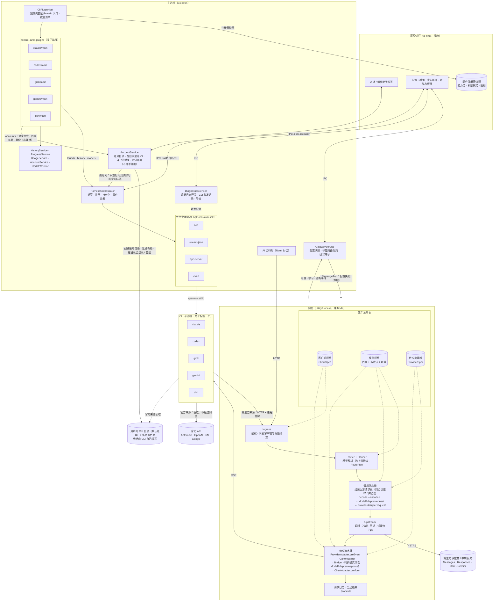
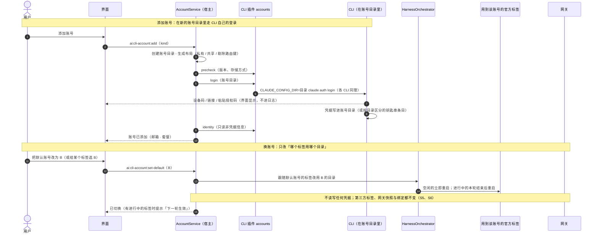
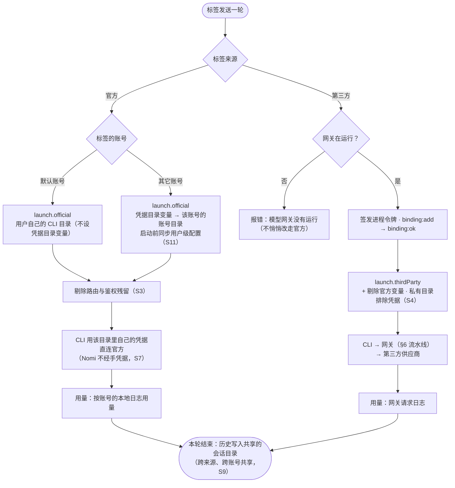
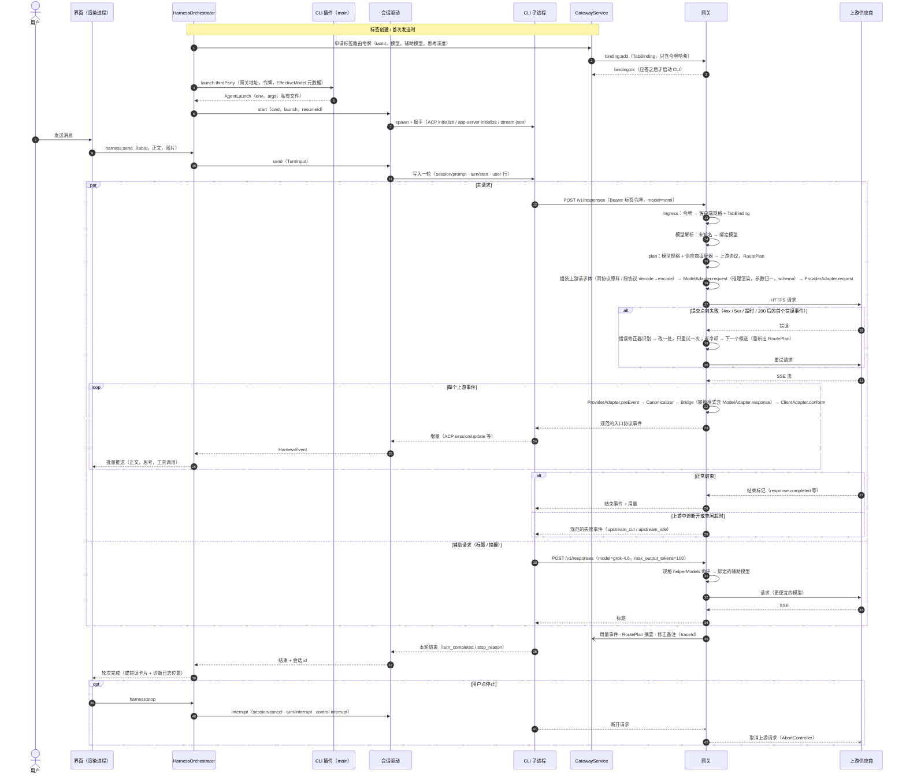
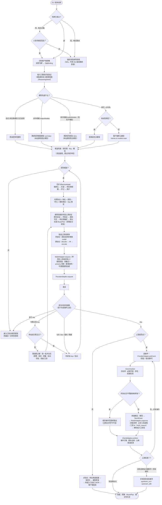

# 编程助手插件化与网关分层适配（设计稿）

> 状态：**已实现（v2.0.0）**。起草 2026-10-24；实现与本稿的偏差、遗留项见 [§14](#14-实现偏差与遗留v200)（实施计划草稿已归档删除，以本稿与代码为准）。
> 查证：Grok Build 1.0.67（真机逐字段实测，附录 A）、Claude Code 2.1.309、Codex CLI 0.163.0；中转服务以 Amux 的真实流为样本。
> 相关：[统一模型网关](unified-gateway.md)（本稿是它的第二阶段：把「能转换」做成「可扩展、可验证」）、[编程助手接入](../features/coding-agent-harness.md)、[权限模式](cli-permission-modes.md)、[子代理](cli-subagents.md)、[官方账号](cli-official-accounts.md)。

## 0. 一句话

把「每个编程助手（CLI）的接入」做成**插件**，把网关的处理拆成**供应商适配器 → 规范化 → 模型适配器 → 协议桥 → 客户端适配器**五级，分别由供应商规格、模型规格、客户端规格驱动：

- 新接一个 CLI = 写一个插件（多数只要一份清单 + 启动参数 + 历史解析，协议驱动直接复用）；
- 新接一个中转服务的非标准行为 = 写一个供应商适配器（数据为主，必要时一个钩子），不碰转换内核；
- 新接一个模型 = 补一份模型规格（多数来自内置目录，自动生效）：选哪个上游协议、思考强度怎么换算、参数和工具 schema 怎么归一，都由网关按模型决定并记录在每次请求的路由计划里（§6.9）；
- 任何字节到达 CLI 之前都经过规范化与客户端校验，上游再怎么不规范，CLI 也不会因为「缺一个字段」丢掉整轮；
- 每一层都有可回放的日志和对着**真实 CLI 二进制**的一致性测试，规则来自证据，不靠猜；
- **官方账号不受影响、可多账号并行**：网关分层只服务第三方来源；官方账号按 Anthropic 文档推荐的方式「一个账号一个配置目录」，登录、刷新都由 CLI 自己完成，Nomi 不收集、不存储、不中转官方凭据；多个账号可在不同标签里同时使用，并用隔离不变式与测试守住两种来源互不干扰（§5.10）。

## 1. 背景：为什么要改（代码事实与两天内的事故）

### 1.1 一组真实事故（2026-10-23 ～ 24）

| #   | 现象                                                   | 根因                                                                                                               | 本该在哪一层被拦住               |
| --- | ------------------------------------------------------ | ------------------------------------------------------------------------------------------------------------------ | -------------------------------- |
| I1  | Grok 选 gpt 发消息，报 `missing field sequence_number` | Amux 的保活事件伪装成 `response.output_text.delta`，没有序号；同协议透传原样转给 Grok                              | 供应商适配器 + 规范化            |
| I2  | Grok 选 claude-fable-5，报 `missing field summary`     | `reasoning` 条目缺 `summary`                                                                                       | 规范化                           |
| I3  | Grok 选 gpt，报 `missing field model`                  | `response.created` 里的 response 缺 `model` / `output`                                                             | 规范化                           |
| I4  | 正文已经返回，最后仍报 Internal error                  | 中转服务自定义事件 `response.metadata`，Grok 遇到未知事件类型直接失败                                              | 规范化（事件白名单）             |
| I5  | Claude Code 选 gpt-6.1-sol，一直计时、没有回复         | 上游没发 `response.completed` 就断开；解码器把保活当成「已开始」，按正常完成收尾，Claude Code 收到空回复后静默重试 | 规范化（结束检测）               |
| I6  | 「我只用 Grok 调 gpt，为什么调用了 Claude」            | Grok 生成标题用写死的 `grok-4.6`；网关不认识，落到客户端默认模型                                                   | 客户端适配（辅助模型）+ 路由绑定 |
| I7  | Grok 历史会话全部消失                                  | Grok 新版把用户消息记成 `user_message_chunk`、内容是单个块；解析器不认，**静默**把所有会话过滤掉                   | CLI 插件（历史适配，失败要显式） |
| I8  | 启动时 Amux 报 `"model" is required`                   | Nomi 自己的旧供应商配置默认模型为空；请求不经网关，**没有任何日志**                                                | 可观测性                         |

这些问题的共同点：

1. **同协议透传绕过了所有规范化**（I1～I4）。上游的原始字节直接到了 CLI。
2. **客户端的严格程度没有建模**。Grok 用 serde 严格反序列化，Codex 宽松，Claude Code 介于两者之间；目前只有一个 `ResponsesUsagePatcher` 对所有 Responses 入口统一处理。
3. **供应商的非标准行为没有归属**。请求方向在 `gateway/src/fixes.ts` 与预设 `quirks`，响应方向分散在各解码器的分支、`stream/chatPatch.ts`、`responsesUsage.ts`。
4. **路由不知道请求来自哪个标签**（I6）。网关只认客户端级的配置（`clients.<cli>.models` 的 main / tiers / small，以及只匹配到一个供应商的裸模型名），不知道某个标签选了什么。
5. **CLI 的差异散落在全仓库**（I7）。改一个 CLI 的行为要在主进程、网关、界面里找。
6. **出错是静默的**（I5、I7、I8）。没有结束标记当成功、解析失败当没有、请求失败没日志。

### 1.2 耦合度（量化）

按「代码里出现 `'grok'` 等字面量的文件」统计（不含测试）：

| CLI    | 涉及文件数 |
| ------ | ---------- |
| claude | 60         |
| codex  | 51         |
| grok   | 49         |
| gemini | 62         |
| dsh    | 52         |

Grok 的 49 个文件横跨三个运行环境：主进程（`cli/CliHarnessService.ts`、`cli/SessionHistoryService.ts`、`cli/historyTranscript.ts`、`cli/modelCatalog.ts`、`cli/modelDiscovery.ts`、`cli/permissionMode.ts`、`cli/slashDiscovery.ts`、`cli/detect.ts`、`cli/CliUpdateService.ts`、`cli/promptImages.ts`、`cli/accounts/*`、`agents/*`、`usage/*`、`gateway/agents/index.ts`、`gateway/TerminalCommands.ts`…）、网关（`config.ts`、`server.ts`、`route/resolve.ts`）、界面（`HarnessTabsContext`、`ChatTabs`、`CodingMonitor`、`UsagePanel/*`、`slash/adapters/grok.ts`、各 `services/*Client.ts`…）。

「CLI 是哪几种」这个事实本身就被重复声明了至少 12 次，而且互不一致：

| 声明                      | 位置                                                                                                     | 取值                             |
| ------------------------- | -------------------------------------------------------------------------------------------------------- | -------------------------------- |
| `HarnessBackend`          | `core/src/cli/types.ts`、`ai-chat/src/services/harnessClient.ts`                                         | 含 `nomi`                        |
| `CliKind`                 | `core/src/cli/types.ts`                                                                                  | 含 `cursor`                      |
| `CliKind`                 | `ai-chat/src/services/cliSource.ts`                                                                      | `Exclude<ClientId, 'nomi'>`      |
| `AgentKind`               | `core/src/agents/parsers.ts`、`core/src/gateway/agents/index.ts`、`ai-chat/src/services/agentsClient.ts` | 各自定义                         |
| `HistoryBackend`          | `core/src/cli/historyTranscript.ts`、`ai-chat/src/services/historyClient.ts`                             | 五个 CLI                         |
| `CliBackend`              | `CliHarnessService.ts`、`modelCatalog.ts`、`permissionMode.ts`、`ai-chat/src/utils/permissionModes.ts`   | `Exclude<HarnessBackend,'nomi'>` |
| `ClientId` / `CLIENT_IDS` | `gateway/src/config.ts`                                                                                  | 含 `nomi`                        |

`CliHarnessService.ts` 4638 行，按后端分出了五套会话实现：Claude 的 stream-json 长驻进程（`ensureClaudeLive`、`onClaudeLine`、`requestClaudeControl`…）、Codex 的 app-server（`ensureCodexLive`、`onCodexNotification`…）与 exec 退路（`runCodex`）、ACP（Grok 与 Gemini 共用，`ensureAcpLive`、`syncAcpOverrides`…）、Grok 的 exec 退路（`runGrok`）、dsh 每轮一个进程（`runDsh`）。

已有的局部适配可以复用：`cli/accounts/adapters.ts`（官方账号）、`ai-chat/src/slash/adapters/*`（斜杠命令）、`gateway/agents/index.ts`（第三方启动注入）。它们证明了「按 CLI 分适配器」这条路走得通，只是没有统一的契约和注册表。

## 2. 目标与非目标

### 2.1 目标

- G1 **CLI 插件化**：一个 CLI 的全部差异（检测、安装更新、启动、协议会话、模型、权限、历史、进度、用量、账号、斜杠命令、界面元数据、网关侧客户端规格）收拢到一个插件里；核心代码里不再出现 CLI 名字的字面量。
- G2 **新 CLI 低成本接入**：说 ACP 的 CLI（Grok、Gemini 已是，越来越多新 CLI 采用）只需「清单 + 启动 + 历史」三件事。
- G3 **网关分层**：供应商适配器、规范化、模型适配器、协议桥、客户端适配器各司其职，接口清晰、可单独测试。
- G4 **对 CLI 的输出可证明合规**：按客户端规格校验，违规可修复、可报告。
- G5 **请求与标签绑定**：辅助请求（标题、摘要、提示）跟着标签选的模型走；第三方换模型尽量不重启进程。
- G6 **失败要显式**：没有结束标记、解析失败、请求失败都要变成用户看得见的错误或日志，不再静默。
- G7 **可观测**：诊断日志（开发版必开，正式版在隐私设置里由用户打开），分层记录、可关联、可一键导出。
- G8 **证据驱动的测试**：对着真实 CLI 二进制的一致性测试 + 录制回放 + 故障注入。
- G9 **路由接管与模型适配**：网关为每个请求按模型选上游协议，并按模型渲染推理、参数、工具 schema、推理回传与响应修复；推理意图跨协议不丢失；选择理由与转换损失可见（§6.9）。
- G10 **官方账号与切换不受影响**：每个标签可选官方或第三方来源；切换官方账号只影响官方标签，第三方的任何操作不改写全局凭据，网关不接触官方凭据（§5.10.2 的 S1～S11）。

### 2.2 非目标（本阶段不做）

- 不做第三方代码插件市场。外部插件只开放「声明式」形态（§5.9），代码插件只限仓库内置。
- 不改官方账号体系（[官方账号](cli-official-accounts.md)）与网关「只管第三方」的边界（[统一网关 §13](unified-gateway.md)）。
- 不重写转换内核：`NormEvent` 与请求 IR 的整体结构保持，只做两处扩展：推理意图（`IRReasoning` → `ReasoningIntent`，§6.9.5）与错误事件的 `kind`（§6.8）。
- 不改用户可见的数据格式（供应商、Key、模型选择、会话）；只做代码重组与行为修正。

## 3. 设计原则

1. **核心不认识任何具体 CLI、模型或供应商**。核心只认识「插件」「规格」「适配器」「协议」。CLI 名字只出现在各自的插件目录里。
2. **按运行环境切分插件入口**。主进程（Electron）、网关（`utilityProcess`，纯 Node）、界面（渲染进程，沙箱）三处的代码不能互相 import；插件为每个环境各提供一个入口，环境之间只交换**可序列化的数据**。
3. **能声明的不写代码**。字段要求、事件白名单、辅助模型名、保活标记等都是数据；只有数据表达不了的才给钩子。
4. **规范事件流是唯一的中间形态**。上游 → 规范事件流 → 客户端，透传只是「规范事件流原样输出」的特例；不改动时字节不变（保持现有的字节一致承诺）。
5. **每条规则都有证据和测试**。修正规则要写明来源（哪个供应商、哪次录制、哪个 CLI 版本），并附回放夹具。
6. **失败要显式**（G6），宁可报错，不要伪装成功。
7. **渐进迁移**。每个阶段都可发布，行为只朝「更合规」变化（§11）。
8. **三条轴互相独立**：CLI（客户端规格）、模型（模型规格）、供应商（供应商规格）各有注册表，互不引用；每个请求由路由计划组合三者（§6.9）。
9. **来源隔离**：官方与第三方两种来源共用 CLI 插件与会话驱动，但凭据、流量、用量、切换互不交叉；隔离以不变式表达并由测试守住（§5.10）。

## 4. 总体架构

```
┌───────────────────────── 渲染进程（ai-chat，沙箱） ─────────────────────────┐
│ 只读插件注册表快照（id、名称、图标、能力位、权限模式、斜杠命令适配…）       │
│ 标签页、历史、监视、用量等界面按能力位渲染，不写 if (cli === 'grok')       │
└──────────────▲───────────────────────────────────────────────────────────────┘
               │ IPC（具名白名单）：cli:registry、harness:*、history:*、diagnostics:*
┌──────────────┴──────────────── 主进程（Electron） ──────────────────────────┐
│ CliPluginHost ── 加载内置插件的 main 入口，校验清单，按能力位注册            │
│   ├ HarnessOrchestrator  标签、排队、持久化、事件分发（原 CliHarnessService 的编排部分）│
│   ├ SessionDrivers       stream-json / app-server / acp / exec（协议驱动，共享）│
│   ├ HistoryService       调插件的 history 适配                               │
│   ├ ProgressService / UsageService / AccountService / UpdateService …       │
│   └ GatewayService       生成配置快照：供应商、三类规格、标签绑定             │
│ DiagnosticsService      诊断日志开关、CLI 收发记录、导出                    │
└──────────────┬───────────────────────────────────────────────────────────────┘
               │ MessagePort：配置快照（含规格与绑定，全是数据）／用量与诊断事件
┌──────────────┴──────────── 网关（utilityProcess，纯 Node） ─────────────────┐
│ ingress → ClientAdapter.request → route(绑定) → plan(RoutePlan)              │
│   → 组装上游请求体 → ModelAdapter.request → ProviderAdapter.request → fetch │
│   → ProviderAdapter.preEvent → Canonicalizer → Bridge（转换模式：解码 →     │
│     ModelAdapter.response → 编码）→ ClientAdapter.conform → 写给 CLI       │
│ 三个注册表：客户端规格 · 模型规格（内置目录 + 覆盖）· 供应商规格             │
│ 适配器的「代码钩子」随网关进程入口组装，快照里只引用 id                     │
└──────────────────────────────────────────────────────────────────────────────┘
```

### 4.1 架构图

各运行环境、注册表与数据流（实线：调用 / 数据；虚线：读取注册表）：



## 5. CLI 插件系统

### 5.1 插件形态

一个 CLI 插件 = 一份**清单**（纯数据）+ 最多三个**入口**：

| 入口       | 运行环境            | 允许依赖                     | 内容                                                           |
| ---------- | ------------------- | ---------------------------- | -------------------------------------------------------------- |
| `manifest` | 任意（纯数据）      | 无                           | id、名称、能力位、协议、模型路由提示、权限模式表…（§5.2）      |
| `main`     | Electron 主进程     | `node:*`、`@nomi-ai/cli-sdk` | 检测、启动、会话驱动选择、历史、进度、用量、账号、更新（§5.3） |
| `gateway`  | 网关 utilityProcess | `@nomi-ai/cli-sdk/gateway`   | 客户端规格的代码钩子（多数插件不需要，§5.5）                   |
| `renderer` | 渲染进程            | `@nomi-ai/ui`、React         | 斜杠命令适配、少量专属界面（多数插件不需要，§5.6）             |

**为什么分入口**：网关跑在 `utilityProcess`，不能 import electron（与 `bundle-ig-base` 同样的约束，见 AGENTS.md）；渲染进程在沙箱里，不能 import node。一个插件的三份代码之间只通过清单里的数据和 IPC / MessagePort 交换数据。入口之间的 import 边界用 ESLint `no-restricted-imports` 强制（`*/gateway/**` 禁止 `electron`、`*/renderer/**` 禁止 `node:*`）。

契约的写法与仓库已有插件一致（`defineXxx` 工厂函数 + 纯数据清单），但宿主独立：CLI 插件的生命周期是「应用级注册 + 每个进程一个会话」，与 AI 运行时插件（每次对话的钩子链，`bundle-ig-base` 的 `definePlugin`）不同，不复用其 `provide` / `inject`。

```ts
// apps/desktop-electron/internal/cli-sdk/src/plugin.ts
export interface CliPlugin {
  manifest: CliManifest;
  main?: (host: CliMainHost) => CliMainImpl | Promise<CliMainImpl>;
}
export function defineCliPlugin(p: CliPlugin): CliPlugin;
```

### 5.2 清单（`CliManifest`）

```ts
export interface CliManifest {
  /** 稳定 id，也是会话键、存储目录、网关客户端 id 的来源；只用 [a-z0-9-] */
  id: string;
  /** 插件契约版本：宿主据此判断兼容性 */
  apiVersion: 1;
  displayName: string;
  /** 图标资源（随插件打包；界面按 id 取） */
  icon: string;
  /** 可执行文件与检测 */
  binary: {
    names: string[]; // 'grok'、'grok.cmd'…
    versionArgs: string[]; // ['--version']
    versionPattern: string; // 正则，取版本号
    minVersion?: string; // 低于它提示升级
    install?: InstallSpec; // npm 包名 / 官方安装脚本 / 链接
  };
  /** 与 Nomi 的会话协议：决定用哪个共享驱动（§5.4） */
  transport: 'acp' | 'stream-json' | 'app-server' | 'exec';
  /** 驱动起不来时的退路（如 Codex app-server → exec） */
  fallbackTransport?: 'exec';
  /** 第三方模式下 CLI 打到网关的入口协议 */
  ingress: 'messages' | 'responses' | 'chat' | 'gemini';
  /** 能力位：界面与编排按位启用功能，不按 id 判断 */
  capabilities: {
    officialAccount?: boolean;
    thirdParty?: boolean;
    images?: 'native' | 'path' | 'none';
    permissionModes?: PermissionModeSpec[]; // 名称、对应 CLI 参数 / ACP mode id
    subagents?: boolean;
    slashCommands?: boolean;
    resume?: boolean;
    fork?: boolean;
    usageQuota?: boolean;
    progressMonitor?: boolean;
    terminalCommand?: boolean;
  };
  /** 模型切换方式的上限：网关绑定即可 / CLI 原地切 / 必须重启进程；每次切换按 §6.7 的条件降级 */
  modelSwitch: 'gateway' | 'inplace' | 'restart';
  /** 测试过的最高版本；更高的版本照常运行，但在诊断日志与「编程助手」页提示「未验证的版本」 */
  maxTestedVersion?: string;
  /** 按版本开关的能力（semver 范围 → 能力位覆盖），例如某版本起支持 loadSession */
  versionGates?: Array<{ range: string; capabilities: Partial<CliManifest['capabilities']> }>;
  /** 网关侧客户端规格（纯数据，§5.5） */
  clientSpec: ClientSpec;
}
```

清单在主进程加载时用 schema 校验（`zod` 已在依赖里则复用，否则手写校验函数）；校验失败的插件不注册，并在诊断日志里记一条。

**有效能力 = 清单声明 ∩ 版本开关（按检测到的 CLI 版本）∩ 握手协商（`StartResult.capabilities`）**（审查意见 I9）。思考档位、是否支持图片这类**跟着模型走**的能力不放在 CLI 清单里，由模型规格给出（§6.9.3），界面按「CLI 能力 ∩ 当前模型能力」显示。

**CLI 在会话进行中升级**：更新服务检测到新版本后，不打断进行中的轮次；空闲的会话在下一轮之前重启并续接，进行中的等本轮结束再重启。Windows 上运行中的可执行文件被占用，升级前先排空该 CLI 的所有会话（提示用户），再执行升级。

### 5.3 主进程能力接口（`CliMainImpl`）

每个能力一个接口，插件按清单里的能力位选择实现；宿主对未实现的能力给出默认行为（隐藏对应界面）。

```ts
export interface CliMainImpl {
  detect?: DetectCapability; // 找可执行文件、读版本（默认实现按清单的 binary 跑）
  update?: UpdateCapability; // 检查 / 执行升级
  launch: LaunchCapability; // 必需：官方 / 第三方两种启动注入
  session?: SessionCustomization; // 对共享驱动的定制（参数、事件映射补丁）
  models?: ModelCatalogCapability; // 模型目录、默认模型、发现
  permissions?: PermissionCapability; // 权限模式 ↔ 参数 / mode id
  history?: HistoryCapability; // 历史会话（§5.7）
  progress?: ProgressCapability; // 外部进程监视（agents/*）
  usage?: UsageCapability; // 本地日志用量、订阅额度
  accounts?: AccountCapability; // 官方账号（复用 cli/accounts/adapters.ts 的接口）
  slash?: SlashDiscoveryCapability; // 斜杠命令 / 子代理发现
  terminal?: TerminalCapability; // 「在终端里打开」的命令行
}

export interface LaunchCapability {
  official(ctx: LaunchContext): AgentLaunch;
  /** 第三方：网关地址、标签路由令牌、模型元数据都在 ctx 里（§6.7） */
  thirdParty(ctx: ThirdPartyLaunchContext): AgentLaunch;
  /** CLI 发给网关的占位模型名（如 Grok 的 nomi）；有它才可能用 gateway 方式换模型（§6.7） */
  placeholderModel?: string;
}

export interface AgentLaunch {
  env: Record<string, string>;
  args: string[];
  /** 要从继承环境里剔除的变量（会抢鉴权的 API Key 等） */
  strip: string[];
  /** 进程级私有目录里要写的文件（宿主统一写入、统一回收） */
  files?: Array<{ path: string; content: string; mode?: number }>;
  /** 私有 HOME 的共享条目（软链回用户目录；宿主统一实现，Grok 的 GROK_HOME 就是这种） */
  privateHome?: { envVar: string; shared: string; keepPrivate: string[] }; // 正则字符串，可序列化（L1 声明式插件也能用）
}
```

现有 `gateway/agents/index.ts` 的五个函数直接成为五个插件的 `launch.thirdParty`；私有 HOME（Grok）、叠加配置文件（dsh）、模型目录文件（Codex）这三种模式由宿主提供通用实现（`files` / `privateHome`），插件只声明。

### 5.4 共享会话驱动（`SessionDriver`）

把 `CliHarnessService` 里按后端写的五套会话实现，抽成四个**按协议**的驱动，放进 `@nomi-ai/cli-sdk/drivers`：

| 驱动          | 现在的实现                                                     | 使用者                         |
| ------------- | -------------------------------------------------------------- | ------------------------------ |
| `acp`         | `ensureAcpLive`、`runAcp`、`syncAcpOverrides`、`AcpConnection` | Grok、Gemini、未来所有 ACP CLI |
| `stream-json` | `ensureClaudeLive`、`onClaudeLine`、`requestClaudeControl`     | Claude Code                    |
| `app-server`  | `ensureCodexLive`、`onCodexNotification`                       | Codex                          |
| `exec`        | `runCodex`、`runGrok`、`runDsh`                                | 退路与 dsh                     |

```ts
export interface SessionDriver {
  start(o: { cwd: string; launch: AgentLaunch; resumeId?: string; signal?: AbortSignal }): Promise<StartResult>;
  /** 会话级事件流：轮次内外的所有事件都从这里出来 */
  readonly events: AsyncIterable<SessionEvent>;
  /** 发起一轮；轮次内的增量从 events 出来，这里只返回本轮结果 */
  send(turn: TurnInput): Promise<TurnResult>;
  interrupt(): Promise<void>;
  setModel?(model: string | null, effort: string | null): Promise<'applied' | 'restart'>;
  setPermissionMode?(mode: string): Promise<'applied' | 'restart'>;
  respondPermission(id: string, answer: PermissionAnswer): void;
  readonly sessionId: string | null;
  close(): Promise<void>;
}

/** 握手时协商出来的运行时能力（ACP initialize、app-server initialize 的应答） */
export interface StartResult {
  version?: string;
  capabilities: { loadSession?: boolean; images?: boolean; audio?: boolean; [k: string]: unknown };
}

export type SessionEvent =
  | { kind: 'harness'; event: HarnessEvent; turnId?: string } // 现有 HarnessEvent，turnId 为空表示轮次之外
  | { kind: 'commands'; commands: SlashCommand[] } // ACP available_commands_update 等
  | { kind: 'permission'; id: string; request: PermissionRequest }
  | { kind: 'health'; state: 'ready' | 'degraded' | 'exited'; code?: number; stderrTail?: string };

/** 权限应答：二元确认、ACP 的多选项、Claude 的改写入参都能表达 */
export type PermissionAnswer =
  | { decision: 'allow' | 'deny' | 'cancel' }
  | { optionId: string } // ACP 的 options（allow_once / allow_always / reject_once …）
  | { decision: 'allow'; updatedInput: unknown }; // Claude 的 updatedInput
```

审查意见 I8：每轮一个 `AsyncIterable` 收不到轮次之外的事件（ACP 在轮次结束后的 `session/update`、`available_commands_update`、Codex 的线程通知、进程退出），所以改为会话级事件流 + 每轮返回结果；权限应答覆盖 ACP 的多选项（现在的 `pickPermissionOption`）与 Claude 的 `updatedInput`。

插件可以通过 `session` 定制驱动的差异点（例如 Grok 的 `session/set_config_option reasoning_effort`、Claude 的 control 请求），但**不再自己实现会话**。`CliHarnessService` 只剩编排：标签、排队、持久化、前文携带、事件批量推给界面、闲置回收。

**新 CLI 接入的最短路径**：如果它说 ACP，插件只需清单（`transport: 'acp'`）+ `launch` + `history`，会话、权限确认、模型切换、取消都由 `acp` 驱动完成。

### 5.5 网关侧客户端规格与适配器（`ClientSpec` / `ClientAdapter`）

规格主体是数据（清单里的 `clientSpec`），随配置快照送进网关；只有数据表达不了的行为才在插件的 `gateway` 入口里写钩子，按 id 关联。

```ts
export interface ClientSpec {
  /** 严格：任何不合规都会让 CLI 丢掉整轮（Grok）；宽松：未知字段 / 事件被忽略（Codex） */
  strictness: 'strict' | 'lenient';
  /** 超出协议规范、这个 CLI 额外要求的字段（按事件 / 对象类型） */
  extraRequired?: Record<string, string[]>;
  /** 这个 CLI 能接受的事件类型子集；缺省 = 规范全集 */
  acceptedEvents?: string[];
  /** 辅助请求用的模型名（标题、摘要、提示、子代理默认模型…），按正则匹配 */
  helperModels?: string[];
  /** 内置模型名映射（Claude 的 haiku / sonnet / opus 档位等），原 route/resolve.ts 的 mapBuiltinModel */
  builtinModels?: Array<{ pattern: string; slot: 'main' | 'small' | string }>;
  /** 会话键从哪取（缓存亲和、会话归属表），原 affinity.ts 的写死逻辑 */
  sessionKey?: Array<{ header?: string; bodyPath?: string }>;
  /** 长时间无输出时要不要发心跳、发什么 */
  heartbeat?: { idleMs: number; kind: 'sse-comment' | 'ping-event' };
  /** 遗留识别（没带令牌的旧版本按 UA 认） */
  legacyUserAgent?: string;
}

/** 插件 gateway 入口可选提供的钩子 */
export interface ClientAdapterHooks {
  request?(body: unknown, ctx: GatewayRequestContext): unknown;
  conform?(ev: CanonicalEvent, ctx: ConformContext): CanonicalEvent | null;
}
```

网关里所有 `client === 'claude'` 之类的分支（`route/resolve.ts` 的 `mapBuiltinModel`、`affinity.ts` 的会话键、`server.ts` 的 `legacyClient`）改成读规格。

插件的 `gateway` 入口**不进 `apps/desktop-electron/internal/gateway`**：网关内核只定义钩子接口，在 Electron 侧的网关进程入口（`core/src/gateway/worker.ts`）把内置插件的钩子组装进去，内核保持不依赖任何插件。

### 5.6 界面侧

- 界面不 import 插件代码，只读主进程推来的**注册表快照**（`cli:registry` IPC）：id、名称、图标、能力位、权限模式表、思考深度档位。
- 现在散在界面里的 CLI 判断（`cliImageSupport.ts`、`permissionModes.ts`、`endpointBadge.ts`、`ChatTabs`、`CodingMonitor`、`UsagePanel/Quota.tsx`…）改成按能力位渲染。
- 斜杠命令适配（`ai-chat/src/slash/adapters/*`）属于插件的 `renderer` 入口；构建时由一个生成的索引文件静态引入内置插件的 renderer 入口（渲染进程不做动态加载）。
- 所有 CLI 类型联合（§1.2 那 12 处）统一成 `CliId = string`（运行时）+ `BuiltinCliId`（由内置插件清单生成的字面量联合，供编译期穷举检查）。

### 5.7 历史会话适配（`HistoryCapability`）

```ts
export interface HistoryCapability {
  /** 会话文件在哪（尊重 CLI 的 HOME 环境变量） */
  roots(env: NodeJS.ProcessEnv, home: string): string[];
  /** 列出候选文件（只读目录，不解析内容） */
  scan(root: string): AsyncIterable<{ path: string; dirId?: string }>;
  /** 解析元数据与对话；认不出的格式返回 { error }，不要返回 null */
  parse(text: string, f: FileRef): HistoryParse | { error: string; formatHint?: string };
  /** 续接时给 CLI 的参数 / ACP 的 session/load */
  resume(sessionId: string): ResumeSpec;
}
```

- **失败显式**：解析失败的条目计数，历史列表底部显示「N 个会话无法读取（Grok 1.0.67 的新格式？）」，并写诊断日志（含 CLI 版本、`formatHint`）。I7 那种「全部静默消失」不会再发生。
- **按版本留夹具**：每个 CLI 版本出现格式变化时，在插件目录 `fixtures/history/<version>/` 留一份脱敏样本，契约测试（§9.1）逐个解析。

### 5.8 注册表与生命周期

```ts
export interface CliPluginHost {
  list(): CliManifest[];
  get(id: string): LoadedCliPlugin | undefined;
  /** 某能力的全部实现（例如所有支持 usageQuota 的插件） */
  withCapability<K extends keyof CliManifest['capabilities']>(k: K): LoadedCliPlugin[];
  onChange(fn: () => void): () => void;
}
```

- 启动时加载内置插件（`apps/desktop-electron/internal/cli-plugins/*`），校验清单，检查 `apiVersion`，调用 `main()` 得到实现。
- 用户可以在设置里**停用**某个 CLI 插件：界面隐藏，宿主不探测、不启动、不扫描历史。
- 插件实现抛错只影响它自己：宿主捕获、记诊断日志、把该插件标为「出错」，其它插件照常工作。
- 网关配置快照里携带「启用的插件规格」，插件启停时推新快照。

### 5.9 外部插件（后期，分级开放）

| 级别 | 形态                     | 能力                                                                   | 安全                                                       |
| ---- | ------------------------ | ---------------------------------------------------------------------- | ---------------------------------------------------------- |
| L0   | 内置（仓库内）           | 全部                                                                   | 代码审查                                                   |
| L1   | 声明式（只有 JSON 清单） | 说 ACP 的 CLI：检测、启动参数模板、权限模式、规格；历史用通用 ACP 解析 | 不执行代码；启动参数模板只允许占位符替换，经 `shellEscape` |
| L2   | 代码插件                 | 暂不开放                                                               | 需要签名与隔离方案，另立设计                               |

L1 让用户自己接入一个新的 ACP CLI（「设置 → 编程助手 → 添加 CLI」填可执行文件和参数），不发版。

### 5.10 来源与官方账号

前面的网关分层（§6）只服务**第三方**来源。每个编程助手标签还有另一种来源：**官方账号**（订阅 / Google 登录，CLI 用自己的凭据直连官方）。本节定义官方账号在插件体系里的形态，以及「多个官方账号同时使用」的做法，并把两种来源互不干扰写成**必须由测试守住的不变式**。

#### 5.10.0 合规前提（2026-10-24 查证原文）

- Anthropic 的 [Claude Code 法务与合规](https://code.claude.com/docs/en/legal-and-compliance)：「developers may not collect, store, or intermediate Claude.ai credentials or session tokens — sign-in to a Claude account must complete through Anthropic's own flow」；同时明确允许「an end user signing in to the unmodified Claude Code binary with their own Claude subscription」。
- Anthropic 的 [身份验证文档](https://code.claude.com/docs/en/authentication)：多账号的官方做法是「give each account its own configuration directory… set `CLAUDE_CONFIG_DIR`… Each directory has its own settings, session history, and claude.ai login」；设了 `CLAUDE_CONFIG_DIR` 后 `.credentials.json` 放在该目录下，macOS 钥匙串条目也按目录区分。
- OpenAI 的 Codex 文档同样建议「一个 `auth.json` 只给一条并发流使用，不要在并发任务之间共享」，因为一处刷新会让另一处的副本失效。

**结论**：Nomi **不收集、不存储、不中转任何官方凭据**（Claude 为强制要求，其它 CLI 为统一做法）。一个官方账号 = 一个**账号目录**；登录、登出、刷新全部由 CLI 自己在该目录里完成；Nomi 只决定「哪个标签的进程指向哪个账号目录」。

> **对现有实现的影响**：已上线的官方账号功能（[官方账号](cli-official-accounts.md) A1～A3：把凭据加密存进保险箱、切换时写回 CLI 的全局凭据存储）在 Claude 上正落在上面的禁止条款里。本设计用账号目录取代它，**随本版本 v2.0.0 一起迁移**（§5.10.9，§12 Q4 已定）。

#### 5.10.1 两种来源

| 方面        | 官方账号                                                                                                       | 第三方供应商                                                      |
| ----------- | -------------------------------------------------------------------------------------------------------------- | ----------------------------------------------------------------- |
| 选择粒度    | 每个标签选来源（`tab.source`）；同一个 CLI 可以一个标签官方、另一个标签第三方                                  | 同左                                                              |
| 账号 / 模型 | 标签选一个官方账号（缺省 = 「默认账号」）；多个账号可同时运行；模型来自 CLI 自己的模型目录                     | 标签绑定的模型（§6.7）；模型来自网关的模型列表                    |
| 流量        | CLI **直连官方**，不经过网关                                                                                   | CLI → 网关 → 第三方供应商                                         |
| 凭据        | 在账号目录里，由 CLI 自己读写；**Nomi 不读取、不复制、不保存**                                                 | 网关的进程级令牌（只在子进程环境变量里）；供应商 Key 只在网关内存 |
| 动到的文件  | 账号目录（Nomi 创建目录与非凭据配置；凭据由 CLI 写）；「默认账号」就是用户自己的 CLI 目录，Nomi 不改其中的凭据 | 只有 Nomi 自己的目录（`userData/gateway/*`、进程私有目录）        |
| 用量        | 按账号的本地日志用量；订阅额度显示见 §5.10.8                                                                   | 网关请求日志与用量统计                                            |
| 会话驱动    | 同一套驱动（§5.4），只有启动注入不同                                                                           | 同左                                                              |

#### 5.10.2 隔离不变式（每条都有自动化测试，§9.5）

| #   | 不变式                                                                                                                                                                                                                                                                                                                                           | 由谁保证                                                                      |
| --- | ------------------------------------------------------------------------------------------------------------------------------------------------------------------------------------------------------------------------------------------------------------------------------------------------------------------------------------------------ | ----------------------------------------------------------------------------- |
| S1  | **第三方路径从不写 CLI 的配置与凭据**（用户目录与账号目录都不写）。第三方只用进程级注入：环境变量、命令行参数、进程私有目录                                                                                                                                                                                                                      | 宿主统一执行 `AgentLaunch`；插件只能通过 `files` / `privateHome` 写进私有目录 |
| S2  | **网关不读、不写、不转发任何官方凭据**。网关只认自己签发的令牌（`nomi-gw-` / `nomi-tab-` 前缀），其他 Bearer 一律拒绝；不提供「订阅当上游」                                                                                                                                                                                                      | 网关入口鉴权；契约测试                                                        |
| S3  | **官方会话的进程环境里没有会改变路由或鉴权的残留**：网关地址与令牌，以及继承来的 `ANTHROPIC_BASE_URL`、`ANTHROPIC_API_KEY`、`ANTHROPIC_AUTH_TOKEN`、`CLAUDE_CODE_OAUTH_TOKEN`、`ANTHROPIC_PROFILE`、`OPENAI_API_KEY`、`CLAUDE_CONFIG_DIR`、`CODEX_HOME`、`GROK_HOME`、`GEMINI_CLI_HOME` 等；账号目录里的 `settings.json` 也不含这些键（§5.10.8） | 宿主对 `launch.official` 的结果统一剔除；账号目录的配置由宿主生成             |
| S4  | **第三方会话的进程读不到官方凭据**：环境里没有官方鉴权变量（插件的 `strip`）；私有 HOME 的 `keepPrivate` 覆盖该 CLI 的全部凭据与锁文件                                                                                                                                                                                                           | 插件契约测试检查 `strip` 与 `keepPrivate`                                     |
| S5  | **换账号只影响用到它的官方标签**：改「默认账号」只影响跟随默认账号的标签（本轮结束后重启）；单个标签换账号只重启该标签；第三方标签、网关快照与绑定都不变                                                                                                                                                                                         | 编排层按来源与账号回收                                                        |
| S6  | **第三方的任何操作不影响官方账号**：换模型、换供应商、改绑定、网关重启、网关崩溃，都不改写任何账号目录或用户目录，也不改变官方标签的状态                                                                                                                                                                                                         | S1 + 编排层按来源分流                                                         |
| S7  | **Nomi 不收集、不存储、不中转官方凭据**：登录与登出都在账号目录里调用 CLI 自己的命令完成；Nomi 只读取账号目录里的**非凭据**身份信息（如 Claude `.claude.json` 的 `oauthAccount` 里的邮箱）；凭据文件、钥匙串条目的内容永不读取、复制、上传或进日志                                                                                               | 账号服务的实现与代码审查；测试扫描主进程对凭据路径的读访问（§9.5）            |
| S8  | **诊断日志不含官方凭据与登录信息**：凭据文件内容、设备码、授权 URL 里的一次性参数、粘贴的授权码一律不记；登录子进程不走 CLI 收发记录（§8）                                                                                                                                                                                                       | `cliTrace` 按「登录进程」标记跳过；脱敏规则补设备码与授权码格式               |
| S9  | **历史会话跨账号、跨来源共享**：账号目录的会话历史目录指向用户目录里的同一份；历史列表不按来源或账号过滤；原会话文件从不修改                                                                                                                                                                                                                     | 账号目录布局（§5.10.8）+ `HistoryCapability` 契约测试                         |
| S10 | **一个账号只有一个目录**：同一账号的所有标签共用同一个账号目录，CLI 自己的锁负责并发刷新（Claude 的刷新锁、Codex 的「刷新前先重读」）；发现同一身份同时登录在两个目录（例如用户在终端里又登录了一次）时提示，因为两处各自刷新会让其中一处失效                                                                                                    | 账号服务按身份（`accountUuid` / 账号 id / 邮箱）检测重复                      |
| S11 | **账号目录的私有状态不泄漏、不分叉**：凭据、实例记录、远程设置缓存等留在账号目录；用户级的 MCP、项目信任、主题等在每次启动前从用户目录同步进来（§5.10.8）                                                                                                                                                                                        | 宿主生成账号目录；契约测试比对同步结果                                        |

#### 5.10.3 插件契约里的官方账号部分

清单声明（静态、可序列化）：

```ts
export interface CliManifest {
  // …（§5.2）
  capabilities: {
    officialAccount?: boolean; // 支持官方账号来源
    multiAccount?: boolean; // 支持多个账号目录同时使用（需满足 account.minVersion）
    thirdParty?: boolean;
    // …
  };
  account?: {
    /** 凭据目录变量：指向账号目录即切换账号 */
    homeEnv: 'CLAUDE_CONFIG_DIR' | 'CODEX_HOME' | 'GROK_HOME' | 'GEMINI_CLI_HOME';
    /** 按账号目录隔离凭据的最低 CLI 版本（例如 Claude 的钥匙串按目录区分自某个版本起） */
    minVersion?: string;
    /** 登录方式（界面展示用） */
    login: 'device-code' | 'browser' | 'acp-authenticate';
    /** 账号目录布局：私有条目、软链回用户目录的共享条目、每次启动前从用户目录同步的字段（正则 / 路径字符串，可序列化） */
    layout: {
      private: string[];
      shared: string[];
      syncFromUser?: Array<{ file: string; keys: string[] }>;
      /** 生成的配置里必须剔除的键（S3），如 settings.json 的 env 里的路由与鉴权键 */
      stripKeys?: Array<{ file: string; paths: string[] }>;
    };
  };
}
```

主进程能力接口（`CliMainImpl.accounts`）**只描述命令与布局，不接触凭据**：

```ts
export interface AccountCapability {
  /** 在账号目录里登录：给出 CLI 自己的登录命令与输出解析（设备码 / 链接 / 粘贴授权码） */
  login(home: string): LoginSpec;
  /** 在账号目录里登出（CLI 自己的命令，会撤销令牌） */
  logout?(home: string): LoginSpec;
  /** 读身份：只读非凭据文件（如 .claude.json 的 oauthAccount），或调用 CLI 的状态命令 */
  identity(home: string): Promise<AccountIdentity | null>;
  /** 前置检查：CLI 版本是否支持按目录隔离、Codex 的存储方式、Gemini 是否开启了全局钥匙串存储等 */
  precheck(home: string): Promise<string | null>;
  /** 该账号目录里还有没有活着的进程（删除 / 迁移账号目录前必须为否；包括用户在终端里开的进程） */
  liveProcesses(home: string): Promise<number>;
  /** 官方来源下这个 CLI 的模型目录 */
  models?(home: string): Promise<CliModelCatalog>;
}
```

**宿主负责、插件不碰的部分**：账号列表（只存 id、名字、账号目录路径与身份展示信息，不存凭据）、账号目录的创建与布局、启动前同步、删除账号（先确认没有活着的进程，再在目录里执行 `logout`，再删除目录）、IPC、界面。

启动注入的两个入口（§5.3）在来源上的约束：

| 入口                     | 输出                                                                          | 宿主在其后统一执行                                                              |
| ------------------------ | ----------------------------------------------------------------------------- | ------------------------------------------------------------------------------- |
| `launch.official(ctx)`   | 只能是与网关无关的参数（权限模式、思考深度、会话续接）；`ctx.home` = 账号目录 | 设置凭据目录变量（默认账号则不设）；剔除 S3 列出的变量；不签发令牌、不登记绑定  |
| `launch.thirdParty(ctx)` | 网关地址、进程令牌、模型元数据、私有目录文件                                  | 先登记绑定再启动（§6.7）；按 `strip` 剔除官方变量；私有 HOME 排除凭据文件（S4） |

#### 5.10.4 换账号的时序



#### 5.10.5 来源切换矩阵

| 从 → 到                   | 进程                                   | 会话续接                                                                                                                  | 推理内容                                   |
| ------------------------- | -------------------------------------- | ------------------------------------------------------------------------------------------------------------------------- | ------------------------------------------ |
| 第三方 → 第三方（换模型） | 按 §6.7 的 gateway / inplace / restart | 原会话                                                                                                                    | 网关按目标剥掉不属于它的加密推理与签名     |
| 官方 → 第三方             | 重启该标签（签令牌、登记绑定）         | Claude 续接原会话；Codex 续接**副本**（Codex 续接时会把会话改归到 `nomi_gateway`，原地续接会让它从 Codex 官方视图里消失） | 网关剥掉官方的加密推理                     |
| 第三方 → 官方             | 重启该标签（作废令牌、删除绑定）       | Claude / Codex 用副本（复制会话并去掉推理签名 / `encrypted_content`）；Grok / Gemini / dsh 用「带上下文新建会话」         | 由 Nomi 在副本里预先去掉（网关不在路径上） |
| 官方账号 A → B            | 只重启用到它的官方标签（S5）           | 先直接续接；收到推理校验类 400 再提示用副本或新建会话                                                                     | 同上                                       |

插件为此提供（`HistoryCapability` 的扩展）：

```ts
export interface HistoryCapability {
  // …（§5.7）
  /** 复制会话为新 id，可选去掉不透明推理；原文件不动。不支持复制的 CLI 不实现，编排层退回「带上下文新建会话」 */
  fork?(sessionId: string, o: { stripSealedReasoning: boolean }): Promise<{ sessionId: string } | null>;
  /** 会话的来源与账号（列表标签用）：官方 / 第三方 / 其他自定义供应商；账号身份 */
  provenance?(meta: HistoryParse): { route: 'official' | 'third-party' | string; accountId?: string };
}
```

#### 5.10.6 发送时按来源分流



#### 5.10.7 官方来源下各层的作用范围

| 层                                                   | 官方来源是否参与                                             |
| ---------------------------------------------------- | ------------------------------------------------------------ |
| CLI 插件（检测、启动、驱动、历史、进度、权限、斜杠） | 参与（与第三方共用）                                         |
| 账号能力（`AccountCapability`）                      | 只服务官方；只描述命令与布局，不接触凭据                     |
| 网关（各类规格、路由计划、标签绑定）                 | **不参与**                                                   |
| 模型目录                                             | 官方：CLI 自己的目录（按账号目录读取）；第三方：网关模型列表 |
| 诊断日志                                             | CLI 收发记录参与（S8 的脱敏）；网关追踪不涉及                |
| 用量                                                 | 官方：按账号的本地日志；第三方：网关统计                     |

#### 5.10.8 账号目录与多个账号并行

**做法**：每个官方账号一个账号目录，标签的进程通过凭据目录变量指向它。这是 Anthropic 文档推荐的多账号方式，也是 GitHub 上成熟工具收敛到的做法（[realiti4/claude-swap](https://github.com/realiti4/claude-swap) 的 `cswap run`、[Dicklesworthstone/caam](https://github.com/Dicklesworthstone/caam) 的「浅层档案」、[vika2603/ccs](https://github.com/vika2603/ccs)）。

- **账号目录位置**：`userData/cli-accounts/homes/<cli>/<账号 id>/`，0700。用户自己原来的 CLI 目录（`~/.claude`、`~/.codex`…）作为「默认账号」，Nomi 不改其中的凭据。
- **凭据目录变量指向的路径**：绝对路径、NFC 规范化、无结尾斜杠、不含软链成分。Claude 在 macOS 上用这个字符串的 sha256 前 8 位区分钥匙串条目，各工具对「原样字符串」还是「规范化路径」取哈希的做法不一致，导出一个本身已经规范化的路径可以让两者一致。
- **版本门槛**：钥匙串按目录区分需要较新的 Claude Code（aisw 的记录：2.1.19 及以前共用一个条目，2.1.121 起按目录区分，中间版本未知），低于 `account.minVersion` 时不允许多账号并行，并提示升级。

**目录布局**（合并了 claude-swap 的排除表与 ccs 的身份表；各 CLI 由插件的 `account.layout` 声明）：

| CLI    | 私有（留在账号目录）                                                                                                                                                                                                                       | 软链回用户目录（共享）                                                                                                 | 每次启动前从用户目录同步                                                                                                                                |
| ------ | ------------------------------------------------------------------------------------------------------------------------------------------------------------------------------------------------------------------------------------------ | ---------------------------------------------------------------------------------------------------------------------- | ------------------------------------------------------------------------------------------------------------------------------------------------------- |
| Claude | `.credentials.json`（或按目录区分的钥匙串条目）、`.claude.json`、`.config.json`、`backups/`、`sessions/`、`ide/`、`statsig/`、`policy-limits*`、`remote-settings*`、`mcp-needs-auth-cache.json`、`plugins/`、`settings.json`（生成的副本） | `projects/`、`history.jsonl`（会话历史）、`CLAUDE.md`、`keybindings.json`、`skills/`、`commands/`、`agents/`、`rules/` | `.claude.json` 里的 `mcpServers`、`projects[*]` 的信任与已允许工具、主题、`hasCompletedOnboarding`；`settings.json` 去掉 `env` 里的路由与鉴权键后的副本 |
| Codex  | `auth.json`、`config.toml`（生成的副本，强制 `cli_auth_credentials_store = "file"`）                                                                                                                                                       | `sessions/`、`archived_sessions/`、`state_5.sqlite`（会话索引）、`skills/` 等                                          | `config.toml` 里与账号无关的表（MCP、权限、模型偏好），去掉 `model_provider` 等路由键                                                                   |
| Grok   | `auth.json`、`*.lock`                                                                                                                                                                                                                      | `sessions/` 等（待实测确认）                                                                                           | `config.toml`（去掉路由键）                                                                                                                             |
| Gemini | `.gemini/oauth_creds.json`、`.gemini/google_accounts.json`                                                                                                                                                                                 | `.gemini/tmp/`（会话历史）                                                                                             | `.gemini/settings.json`；**禁止**开启 `GEMINI_FORCE_ENCRYPTED_FILE`（它的钥匙串键不按目录区分，所有账号会互相覆盖）                                     |

几条来自上述项目的教训，写成规则：

1. **`settings.json` 不软链**：用户级 `settings.json` 的 `env` 里可能有其它工具（如 cc-switch）或旧版 Nomi 写入的 `ANTHROPIC_BASE_URL` / `ANTHROPIC_AUTH_TOKEN`，软链过去会让官方标签悄悄走别的地址（S3）。用生成的副本，或用 `claude --settings` 叠加。
2. **实例记录私有**：`sessions/<pid>.json`、`ide/*.lock` 是每个实例的记录，共享会让 CLI 误判其它账号的进程。它们同时是「这个账号目录还有没有活着的进程」的依据（`liveProcesses`），删除或迁移账号目录前必须为零，包括用户在终端里开的进程。
3. **一个账号一个目录**（S10）：所选账号就是默认账号时直接用用户目录，不再建第二个目录；检测到同一身份登录在两个目录时提示。
4. **后台常驻进程**：Claude 的 Agent View 后台进程不跟随 `CLAUDE_CONFIG_DIR`，续接会话时可能用到别的账号（caam issue #49），非默认账号的标签设置 `CLAUDE_CODE_DISABLE_AGENT_VIEW=1`。
5. **MCP 的 OAuth 授权按账号目录各自保存**，在新账号里要重新授权；界面上说明。
6. **不要先登出再添加**：在 CLI 里 `/logout` 会撤销刷新令牌；「导入当前登录」改为把用户目录登记成默认账号，而不是复制凭据。
7. **Windows**：目录软链用 junction（不需要开发者模式），文件软链（`history.jsonl`）失败时该账号的输入历史不共享，会话历史（`projects/` 目录）仍共享；任何一项共享失败都在界面上说明，不静默复制导致历史分叉。

**订阅额度**（Q4 已定）：现有额度层（`usage/quota.ts`）本来就不读凭据，只用 CLI 自己给出的数据；账号目录化之后按账号执行同一套规则：

1. **先用 CLI 已经给出的数据（被动）**：Claude 的 statusline 快照（账号目录生成的 `settings.json` 里带上 Nomi 的 statusline 命令，快照按账号目录分开存）、Codex 写进会话日志的额度快照、进行中的会话里 CLI 推送的额度信息。
2. **拿不到时，降低频率主动请求一次**：在该账号目录里拉起官方 CLI，让 CLI 用自己的登录态去查（`CLAUDE_CONFIG_DIR=目录 claude -p /usage`、Codex app-server 的额度接口、Grok ACP 的 `_x.ai/billing`，现有 `claudeSubscription.ts`、`codexRateLimits.ts`、`grokSubscription.ts`）。频率：自动请求每个账号**至少间隔 30 分钟**，且只在额度卡片可见、该账号最近 24 小时用过时才发起；用户手动刷新沿用现有的 60 秒节流（`quotaCache.ts`）。
3. 两步都拿不到就显示「暂无额度数据」，不读凭据、不直接调用官方用量接口。

**待实测**（M6b 之前完成，结果写进附录）：

1. 各 CLI 的身份读取方式（只读非凭据信息）：Claude `.claude.json` 的 `oauthAccount`；Codex、Grok、Gemini 有没有不读凭据文件就能拿到邮箱的状态命令。
2. Claude 的版本门槛与钥匙串哈希输入（原样字符串 / 规范化路径），以及删除账号时 `claude auth logout` 能否清掉按目录区分的钥匙串条目。
3. `GROK_HOME` 的布局与会话目录（目前只有第三方工具的记录，未查到官方文档）。
4. Windows 上 junction 共享 `projects/`、`sessions/` 的实际效果。

#### 5.10.9 从现有实现迁移（Q4 已定：随本版本 v2.0.0 一起发布）

现有实现（[官方账号](cli-official-accounts.md) A1～A3）的保险箱里存着各账号的凭据。迁移在现有代码上实施（迁移路线 M0.7），不等插件化；之后 M6 再把它装进插件契约。迁移只走「重新登录」，不搬运凭据：

1. 用户自己的 CLI 目录登记为「默认账号」，保持现在的登录，不做任何改动。
2. 保险箱里的其它账号显示为「需要重新登录」，用户点一下即在新的账号目录里走 CLI 自己的登录。
3. 迁移完成（或用户选择放弃某个账号）后，**清除保险箱里的凭据**，备份目录一并清除。
4. 「全局切换」（改写用户目录里的凭据）下线，由「默认账号」（新标签默认用哪个账号目录）取代；需要在终端里用某个账号时，「终端启动命令」（[统一网关 §12.6](unified-gateway.md)）给出带 `CLAUDE_CONFIG_DIR=…` 的命令，这正是 Anthropic 文档里的用法。

## 6. 网关分层流水线

### 6.1 流水线与接口

```
请求方向：
  ingress（鉴权、识别客户端与标签绑定）
  → ClientAdapter.request（规格的请求改写：内置模型名、会话键）
  → route（模型解析：显式 → 辅助 / 档位 → 标签绑定 → 默认，§6.7）
  → plan（路由接管：按模型规格选上游协议、生成 RoutePlan，§6.9.4）
  → 组装上游请求体：
      同协议：原始请求体，只替换 model（不经过 IR，保持现有的字节级透传）
      跨协议：decode（入口 → 请求 IR，推理写成 ReasoningIntent）→ encode（IR → 上游协议）
  → ModelAdapter.request（作用在「上游协议的请求体」上，两条路径都执行：
      推理渲染、参数归一、工具 schema、推理回传，§6.9.5～§6.9.6）
  → ProviderAdapter.request（供应商适配器的请求改写）           现有 fixes.ts 的供应商部分
  → upstream fetch（超时、冷却、回退；提交点之前可修正重试，§6.9.8、§6.11.2）

响应方向：
  上游 SSE 字节（非流式 JSON 先展开成同一种事件序列，§6.11.1）
  → ProviderAdapter.preEvent（供应商预处理：识别保活 → 转成心跳、私有事件丢弃或改名）
  → Canonicalizer[wire]（只做「协议有效性」：白名单、必填字段、序号、结束检测，§6.4）
  → Bridge（§6.5）
      透传模式：规范事件流原样输出（无修正时字节不变）
      转换模式：解码 → NormEvent → ModelAdapter.response（结构修复，§6.9.7）→ 编码成入口协议
  → ClientAdapter.conform（客户端校验、心跳、错误形状，§6.6）
  → 写给 CLI（遵守背压，§6.11.4）
```

**两条硬规则**（审查意见 C1、C2）：

1. **请求侧的模型规则作用在「上游协议的请求体」上**，不放在 IR 里。最常见的路径（Codex → GPT、Grok → GPT、Claude Code → Claude 中转）是同协议透传，根本不经过 decode / encode；IR 只负责跨协议时携带 `ReasoningIntent`。每条规则 = 一个 `(上游协议, 模型规格) → 请求体变换`，两条路径共用。同协议且没有任何规则命中时，请求体与现在逐字节一致。
2. **响应侧的结构修复只作用在 `NormEvent` 上**（内联思考、正文里的工具调用、工具配对、finish_reason、复读）。同协议路由需要其中任何一条时，`RoutePlan` 切到**转换模式**（同协议也走 解码 → 编码），并在 `losses` 里记 `passthrough`。现在 Codex 的 custom 工具改函数就是这么做的（`server.ts` 的 `customToolsAsFunctions`）。规范化层只做协议有效性，不做结构修复，两层不再重叠。

每一级都是同一个形状，方便组合与测试：

```ts
export interface StreamStage<In, Out> {
  push(ev: In): Out[];
  /** 上游结束：补齐、或给出失败事件 */
  end(): Out[];
  /** 这一级做过的修正（记日志、记请求备注） */
  readonly notes: readonly FixNote[];
}
```

### 6.2 规范事件流的定义

「规范」以官方协议文档为准，并用真实严格客户端交叉验证（附录 A）。每种协议一份**机器可读的规范表**（`gateway/src/spec/<wire>.ts`）：

| 内容         | Responses 示例                                                                                                   |
| ------------ | ---------------------------------------------------------------------------------------------------------------- |
| 事件类型全集 | 49 个，与 Grok 1.0.67 的接受列表逐项一致（附录 A.2）                                                             |
| 对象必填字段 | response：`id`、`object`、`status`、`created_at`、`model`、`output`；message：`id`、`role`、`status`、`content`… |
| 事件必填字段 | 所有事件 `type`、`sequence_number`；增量事件 `item_id`、`output_index`、`content_index`                          |
| 结束标记     | `response.completed` / `incomplete` / `failed`、`error`                                                          |
| 顺序约束     | `created` 在最前；条目 `added` 先于其增量；`done` 在增量之后                                                     |

同一份表同时用于：规范化（补什么、丢什么）、校验器（测试与诊断）、编码器自检（编码器产出必须通过校验）。

其它协议：

| 协议     | 结束标记                                         | 典型非规范输入                                                                                               |
| -------- | ------------------------------------------------ | ------------------------------------------------------------------------------------------------------------ |
| Chat     | `finish_reason` 或 `[DONE]`                      | `tool_calls` 不带 `index`、`arguments` 是对象、`content` 是数组、空 `reasoning_content`、`finish_reason: ""` |
| Messages | `message_stop`（或 `message_delta.stop_reason`） | 缺 `message_start.usage`、`content_block` 索引跳号                                                           |
| Gemini   | 候选的 `finishReason`                            | `MALFORMED_FUNCTION_CALL`、只有 `usageMetadata` 的空块                                                       |

### 6.3 供应商规格与适配器（`ProviderSpec` / `ProviderAdapter`）

```ts
export interface ProviderSpec {
  id: string; // 'generic' | 'amux' | 'openrouter' | 'ollama' | 'deepseek' …
  /** 匹配：预设 id、域名、或用户手动指定 */
  match: { presets?: string[]; hosts?: string[] };
  /** 请求方向（现有 ProviderQuirks 迁入，字段不变） */
  request?: ProviderQuirks;
  /** 响应方向的声明式规则 */
  response?: {
    /** 保活事件的特征（命中即从上游流里去掉，并转成给客户端的心跳，§6.6） */
    keepAlive?: Array<{ field: string; equals: unknown }>;
    /** 私有事件：丢弃或改名 */
    events?: Record<string, 'drop' | { rename: string }>;
  };
}

export interface ProviderAdapterHooks {
  request?(wire: Wire, body: unknown, ctx: ProviderContext): unknown;
  preEvent?(wire: Wire, ev: RawEvent, ctx: ProviderContext): RawEvent | null;
}
```

- `generic` 供应商适配器放所有供应商都可能出现的通用问题；具体供应商适配器只放该供应商独有的东西。I1 的保活特征写在 `amux` 供应商适配器里，**同时** `generic` 规范化也会因为「不在白名单 / 缺序号」把它拦截：供应商适配器负责「识别」，规范化负责「拦截」。
- 预设（`ai-runtime` 的 presets）通过 `match.presets` 关联供应商适配器，不再在预设里散写 `quirks`。
- 用户添加的未知中转服务默认用 `generic`；诊断日志里统计「被规范化修正过的事件类型」，为新增供应商适配器提供证据。

### 6.4 规范化（`Canonicalizer`）

职责只有一条：**让每种协议的事件流满足规范表（§6.2）**。不改变语义、不做模型相关的结构修复（那是 §6.9.7 在 `NormEvent` 上做的事）。

| 职责          | 说明                                                                                                                                                                                   | 来自（现状）                                             |
| ------------- | -------------------------------------------------------------------------------------------------------------------------------------------------------------------------------------- | -------------------------------------------------------- |
| 事件白名单    | 不在规范全集里的事件丢弃并记备注                                                                                                                                                       | `responsesUsage.ts` 的 `RESPONSES_EVENTS`                |
| 必填字段补全  | 按规范表补；能从上下文推出的用上下文（response id、条目 id ↔ output_index），推不出的用确定的默认值                                                                                    | `responsesUsage.ts`                                      |
| 序号          | **只给缺失的事件补** `sequence_number`（取上一个 + 1），从不改写上游已有的序号；补出的序号与上游后续序号重复时记备注（实测严格客户端只要求字段存在）；故障注入测试检查补号后不出现倒序 | `responsesUsage.ts`                                      |
| 完整条目展开  | 上游只在 `output_item.done` / `completed` 里给完整内容时，展开成规范的 added / 增量 / done 序列                                                                                        | `stream/decoders.ts` 的 `emitWhole`                      |
| 空输出回退    | `completed.output` 为空时用收集到的条目补                                                                                                                                              | `responsesUsage.ts`                                      |
| 结束检测      | 没有结束标记就断开 → 规范的失败事件；`end()` 负责                                                                                                                                      | `BaseDecoder.end()`、`passthrough.ts` 的 `TerminalWatch` |
| Chat 字段归一 | 解析层面的不规范写法：`tool_calls` 缺 `index`、`arguments` 是对象、`content` 是数组、空 `reasoning_content`、`finish_reason: ""`                                                       | `decoders.ts`、`chatPatch.ts`                            |
| Gemini 归一   | 非法工具调用（`MALFORMED_FUNCTION_CALL` 等）→ 规范的失败事件                                                                                                                           | `decoders.ts`                                            |

规范化之后的流满足规范表，**解码器只处理规范事件流**，里面的兼容分支全部删除，回到纯协议翻译。

**性能**：透传热路径上每个事件都要解析 JSON 做校验。规则是「解析用于检查，没有修正就输出原始字节」，并给 Messages / Responses 透传加基准测试（目标：单事件额外开销 < 50µs，长流吞吐下降 < 5%）。

### 6.5 协议桥（`Bridge`）

- **透传模式**（同协议、且 `RoutePlan` 没有要求结构修复）：规范事件流原样输出。没有任何修正时输出与上游字节一致（现有承诺不变）。
- **转换模式**（跨协议，或同协议但需要 §6.9.7 的结构修复）：规范事件流 → 解码 → `NormEvent` → `ModelAdapter.response` → 编码成入口协议。IR 与编码器不变；编码器的产出在测试里必须通过目标协议的规范校验。
- 现在的 `createPassthrough`、`RepetitionPassthrough`、`ChatStreamPatcher` 的透传部分合并进 Bridge；`ChatStreamPatcher` 与 `stream/fixer.ts` 里重复的结构修复（正文工具调用、工具名还原、复读）统一到 `NormEvent` 上的一份实现。

### 6.6 客户端校验（`ClientAdapter.conform`）

- 输入是规范事件流，按规格再校验一次：`acceptedEvents` 之外的事件丢弃、`extraRequired` 补齐、`strict` 客户端的任何违规都**修复并记录**是哪一级遗漏的。
- 开发版与诊断日志打开时，`lenient` 客户端的违规也记录（不修复），用来发现规范化的盲区。
- **心跳默认开**（审查意见 I3）：供应商适配器丢弃的每一个保活、以及上游长时间只有推理（编码器不输出）的阶段，都转成给客户端的心跳（`NormEvent` 的 `alive`，按规格的 `heartbeat.kind` 输出成 SSE 注释或 ping 事件），保证 CLI 的空闲计时不会误判（Claude Code 默认 300 秒，`CLAUDE_STREAM_IDLE_TIMEOUT_MS`）。规格只决定心跳的形式，不决定要不要。
- 错误形状：同一个失败，按入口协议和规格生成 CLI 能正确展示的错误（例如 Responses 的 `response.failed`，透传中途出错时不重复 `response.created`）。提交点之前的错误按 §6.11.5 的状态码矩阵返回 HTTP 错误。

### 6.7 路由：请求与标签绑定

**问题**：网关只知道「这是 Grok 客户端」，不知道是哪个标签、选了哪个模型；CLI 自己发的辅助请求（I6）只能落到客户端默认模型。

**方案：进程级路由令牌 + 绑定**

- **令牌**：第三方会话的 CLI 进程每次启动，`GatewayService` 签发一个令牌，格式 `nomi-tab-<32 字节随机>`（固定前缀，便于在日志里按格式脱敏，§8.4）。令牌只在子进程环境变量里，不落盘。令牌跟**进程代次**绑定而不是跟标签：闲置回收（`reclaimIdle`）、重启型换模型、崩溃重启都会签新令牌并作废旧的。
- **绑定**复用现有的 `ClientModels` 结构（`main`、`tiers`、`subagent`、`tools`、`summary`），不另起一套：

  ```ts
  interface TabBinding {
    tokenHash: string; // 快照只放哈希；明文令牌只在主进程内存与子进程环境里
    client: string; // 插件 id
    tabId: string;
    generation: number; // 进程代次
    models: ClientModels; // main = 标签选的主模型；tiers / subagent / tools / summary = 档位与辅助槽位
    effort?: string; // 标签选的思考深度（推理意图来源之一，§6.9.5）
  }
  ```

- **先登记、后启动**（审查意见 C4）：现在配置快照整份推给网关、没有回执（`gateway/src/worker.ts` 的 `port.on('message')`），新进程的第一个请求可能比绑定先到，被当成无效令牌返回 401，而 Claude Code 会把 401 理解成「请重新登录」。改成请求 / 应答：主进程发 `binding:add`，网关回 `binding:ok` 之后才 spawn CLI。网关对「格式正确但未知」的令牌，在短窗口（2 秒）内等待绑定到达，超时才拒绝，且拒绝时按 §6.11.5 返回不会触发重新登录的状态码。
- **模型解析顺序**：
  1. 请求里是显式的 `供应商/模型`，且该模型启用 → 用它；
  2. 匹配规格的 `builtinModels`（Claude 的 opus / sonnet / haiku / fable 档）→ `binding.models.tiers[档位]`，未设置时回落到 `binding.models.main`（与现有 `mapBuiltinModel` 的语义一致，用户在 `tiers.haiku` 的选择优先，不被辅助模型覆盖）；
  3. 匹配规格的 `helperModels`（`grok-4.6` 之类的标题 / 摘要 / 提示请求）→ `binding.models.summary ?? binding.models.main`；子代理默认模型 → `binding.models.subagent ?? binding.models.main`；
  4. 其它名字 → `binding.models.main`，**并在请求记录里加备注「未知模型名 x，已按标签主模型处理」**（不让拼写错误被静默丢弃，G6）；
  5. 没有绑定（终端里手动启动的 CLI，用客户端级令牌）→ 现有逻辑：`clients.<cli>.models`。
- **辅助模型**（Q2 已定）：「设置 → 模型」里每个编程助手可以设「辅助模型」（对应 `ClientModels.summary`，生成标题、摘要、下一句提示等辅助请求用），通常选同一供应商里更便宜的模型；标签上可以单独覆盖。未设置时跟主模型。辅助模型同样经模型规格渲染（§6.9），请求日志标明「辅助请求」，用量页可按主 / 辅助分开统计。
- **换模型的三种方式**（审查意见 C3）：

  | 方式      | 条件                                                                                                                                                               | 做法                                          |
  | --------- | ------------------------------------------------------------------------------------------------------------------------------------------------------------------ | --------------------------------------------- |
  | `gateway` | CLI 发的是**占位模型名**（插件在 `launch` 里声明 `placeholderModel`，例如 Grok 的 `nomi`），且新模型与启动时注入的元数据（上下文窗口、最大输出、是否支持图片）一致 | 只更新绑定（`binding:update` + 应答），不重启 |
  | `inplace` | CLI 自己支持运行中换模型（Claude 的 `set_model`、ACP 的 `session/set_model`、Codex 的 `turn/start` 带 model）                                                      | 走驱动的 `setModel`，同时更新绑定             |
  | `restart` | 其余情况：配置里写死了具体模型名（Gemini 的 `GEMINI_MODEL`、dsh 的叠加配置），或元数据变了（Codex 的 `model_context_window`、Claude 的上下文环境变量只在启动时读） | 签新令牌、重启进程、续接会话                  |

  占位模型名有代价：CLI 按模型名做的内部判断（例如 Gemini CLI 按模型名选思考配置）会失效。所以 `gateway` 方式只给声明了占位名、并通过契约测试的插件使用；清单里的 `modelSwitch` 是**上限**，每次切换按上表条件降级。

- **回收**：进程退出或标签关闭即作废令牌、删除绑定。
- 请求日志里记录 `tabId`、进程代次和「模型是怎么解析出来的」（显式 / 档位 / 辅助 / 绑定 / 未知名 / 默认），「为什么调用了 Claude」这类问题在用量页可以直接查看。
- 现在为 Grok 写的 `session_summary = "nomi"`、`prompt_suggestion = "nomi"` 保留为第二道保险（成本为零）。

### 6.8 错误模型

统一的错误种类（在 `NormEvent` 的 `error` 上加 `kind`）：

| kind             | 例子                   | 用户看到                                   |
| ---------------- | ---------------------- | ------------------------------------------ |
| `upstream_http`  | 4xx / 5xx              | 供应商的原始错误信息 + 状态码              |
| `upstream_cut`   | 没有结束标记就断开     | 「上游中途断开」+ 已收到的内容             |
| `upstream_idle`  | 空闲超时               | 「上游 N 秒没有输出」                      |
| `nonconformant`  | 规范化修不了的结构问题 | 「供应商返回的数据格式不对」+ 诊断日志位置 |
| `model_behavior` | 复读、非法工具调用     | 具体原因                                   |
| `gateway`        | 网关自身异常           | 「Nomi 网关出错」+ 诊断日志位置            |

错误备注同时写进请求日志的 `notes`，用量页可以按种类筛选。

### 6.9 路由接管与模型适配（`ModelSpec` / `RoutePlan`）

前面几节解决「CLI 的差异」和「供应商的非标准行为」；这一节解决第三条轴：**同一个请求发给不同的模型，要按模型做不同的转换**。三条轴互相独立，每次请求由 `RoutePlan` 把它们组合起来：

```
            ClientSpec（哪个 CLI）     ModelSpec（哪个模型）     ProviderAdapter（哪家供应商）
                    │                            │                              │
                    └──────────────┬─────────────┴──────────────┬───────────────┘
                                   ▼                             ▼
                          RoutePlan（每个请求一份，可记录、可回放）
                    上游协议 · 推理渲染 · 参数归一 · 工具 schema · 回传策略 · 响应修复 · 预期损失
```

#### 6.9.1 现状（代码事实）

| #   | 问题                                                                                       | 位置                                                                      | 后果                                                                                                                    |
| --- | ------------------------------------------------------------------------------------------ | ------------------------------------------------------------------------- | ----------------------------------------------------------------------------------------------------------------------- |
| MA1 | 请求 IR 解析出了推理意图（`IRReasoning`：effort / budget / off），**四个编码器都没有使用** | `request/decode.ts` 填，`request/encode.ts` 不读                          | 跨协议时思考强度整个丢失：Claude Code 的 `thinking.budget_tokens` 到不了 GPT，Codex 的 `reasoning.effort` 到不了 Claude |
| MA2 | 模型知识靠名字正则写死                                                                     | `route/native.ts` 的 `isClaudeModel` / `isOpenAIModel`                    | 新模型、改名、中转服务加前缀（`openai/gpt-…`）都可能认错                                                                |
| MA3 | 模型属性只有 `ctx`、`maxOutput`、`reasoning`、`vision`、`toolCalling`、`wires`             | `gateway/src/config.ts` 的 `RuntimeModel`                                 | 表达不了「只支持哪些思考档位」「只接受 adaptive」「推理模型不收 temperature」「要回传推理」                             |
| MA4 | 推理回传是**供应商**属性                                                                   | `ProviderQuirks.reasoningPassback`                                        | 同一个中转服务里 DeepSeek 要回传、GPT 不要，无法同时满足                                                                |
| MA5 | Chat 编码一律用 `max_tokens`；`temperature` 原样转发                                       | `request/encode.ts`                                                       | o 系列 / gpt-5 在 Chat 上要求 `max_completion_tokens`；推理模型拒绝非默认 temperature                                   |
| MA6 | 工具 schema 清理按「是不是官方接口」决定，而不是按目标模型                                 | `fixes.ts` 的 `cleanTools`（`!isAnthropicOfficial && !isOpenAIOfficial`） | Gemini 系、Kimi、DeepSeek 各自的 schema 限制无从表达                                                                    |
| MA7 | 选协议的规则是代码里的 if 链，选择理由不记录                                               | `route/native.ts` 的 `pickWire`                                           | 「为什么这次走了 Chat」无从解释，也无法按模型调整                                                                       |

#### 6.9.2 参考实现（2026-10-24 读源码）

| 项目                                        | 值得借鉴                                                                                                                                                                                                                                                                                                                            | 要避免                                         |
| ------------------------------------------- | ----------------------------------------------------------------------------------------------------------------------------------------------------------------------------------------------------------------------------------------------------------------------------------------------------------------------------------- | ---------------------------------------------- |
| **magpie**（yetone/magpie，Go）             | 与本网关结构最接近：统一 IR、`SealedBy` 的不透明推理只原样回原协议、`Provider.Speaks()` 按协议列地址、`ResponsesFirst`；模型目录来自 models.dev（`internal/catalog`，含 `Efforts`、`Temperature`、`APIs`、`Output`）；发送的思考档位按模型可用档位贴合（`fitLevel`），并把「请求的档位 / 实际发出的档位」写日志（`wire_effort.go`） | 数百个按名字匹配的谓词，依靠不断增加规则来扩展 |
| **cc-switch**（farion1231/cc-switch，Rust） | 按错误修正后重试的 rectifier（签名、思考预算、不透明状态）；Gemini 的双 schema 通道（表达不了时用 `parametersJsonSchema`）；内联 `<think>` 拆分（`inline_think.rs`）                                                                                                                                                                | 协议只能按供应商设，能力靠模型名猜             |
| **claude-code-router / @musistudio/llms**   | 按「供应商 → 模型」叠加的 transformer 链，配置是数据（`transformer.use` + 每个模型的 `use`）；新版 `@the-next-ai/ai-gateway` 用 `models` glob + `when` 条件挂钩子                                                                                                                                                                   | 链的顺序脆弱，没有能力模型                     |
| **LiteLLM**                                 | 数据化的能力表（`model_prices_and_context_window.json`：`supports_reasoning`、`supports_*_reasoning_effort`、`supports_adaptive_thinking`、`supports_sampling_params`…）；`drop_params` 契约（不支持的参数：丢弃并记录，或严格模式报错）                                                                                            | 固定的小预算（1024 / 2048 / 4096）偏保守       |
| **OpenRouter**（文档）                      | 统一的 `reasoning: { effort \| max_tokens, exclude }`；effort 按 `max_tokens` 的比例换算预算；`require_parameters` 不支持就换供应商                                                                                                                                                                                                 | 默认静默忽略不支持的参数                       |
| **new-api relaykit**（Go）                  | 与协议无关的推理意图 `Intent{Mode, Effort, BudgetTokens, IncludeThoughts, Source}`，多跳转换时携带原始意图；每次转换报告 `Quality` / `Steps` / `Diagnostics`；按模型族的 Claude 能力表                                                                                                                                              | —                                              |

结论：**意图中立 + 能力数据化 + 计划可记录 + 纠错可学习 + 规则声明式组合**。下面逐项落到本网关。

#### 6.9.3 模型规格（`ModelSpec`）：能力是数据，不是名字猜测

```ts
export interface ModelSpec {
  /** 匹配：去掉供应商前缀后的模型 id glob（'gpt-5*'、'claude-opus-4-*'、'deepseek-*'） */
  match: string[];
  family: string; // 'gpt' | 'claude' | 'gemini' | 'deepseek' | 'glm' | 'kimi' | 'qwen' | 'minimax' | 'grok' …
  limits: { context?: number; maxOutput?: number };
  /** 模型在哪些协议上提供、偏好顺序与理由（§6.9.4） */
  wires?: { prefer: Wire[]; reason?: string };
  input: { images?: boolean; pdf?: boolean };
  tools: {
    calling: boolean;
    parallel?: boolean;
    freeform?: boolean; // 支持 custom（自由文本）工具，如 Codex 的 apply_patch
    schema?: SchemaVariant; // 'full' | 'gemini' | 'openai-strict' | 'kimi' | 'deepseek'（§6.9.6）
  };
  reasoning?: {
    /** 这个模型怎么表达思考强度 */
    control: 'effort' | 'budget' | 'adaptive' | 'level' | 'toggle' | 'none';
    efforts?: Effort[]; // 支持的档位，发送前贴合（fitLevel）
    budget?: { min: number; max: number };
    canDisable?: boolean;
    /** 历史推理要不要回传、用什么字段（§6.9.6） */
    passback?: 'required' | 'optional' | 'never';
    /** 推理在响应里的形态 */
    surface?: 'field' | 'inline-think' | 'summary' | 'encrypted';
  };
  sampling?: { temperature?: boolean; topP?: boolean }; // false = 不接受（推理模型）
  params?: {
    maxTokensField?: 'max_tokens' | 'max_completion_tokens' | 'max_output_tokens';
    requireMaxTokens?: boolean;
  };
  caching?: 'explicit' | 'automatic' | 'none';
  /** 声明式规则列表（§6.9.9） */
  rules?: Array<{ use: string; when?: { wire?: Wire; ingress?: Wire; client?: string }; options?: unknown }>;
}
```

**数据从哪来（优先级从低到高合并成 `EffectiveModel`，后者覆盖前者）：**

1. **族默认值**（`models/families/*.ts`）：按 `family` 的默认规格；只有这一级允许按名字 glob 匹配（cc-switch / new-api 的做法，只作回退）。
2. **内置目录**：构建时从 models.dev（magpie、claude-code-router 都用它）生成 `gateway/src/models/catalog.json`，随应用发布、离线可用；字段按上表裁剪。LiteLLM 的能力表作补充来源（推理档位、adaptive、sampling）。目录带版本号。
3. **供应商覆盖**：供应商规格里声明「这家的这个模型只走 Chat」「这家把 GLM 的思考参数叫什么」（§6.3）。
4. **运行时学习**：错误修正器学到的「这个模型不走这个协议」「这个参数被拒」「只支持这些档位」（§6.9.8）。每条带有效期（默认 7 天）并记下当时的目录版本，目录升级或过期后重新验证；现在只有 `wireDown` 有有效期（`route/native.ts` 的 `WIRE_DOWN_TTL_MS`）。
5. **用户设置**：模型编辑页里的上下文、最大输出、协议限定、是否推理、思考档位（现有 `RuntimeModel` 字段扩展）。**用户明确设置的值永远优先**，学到的结论与之冲突时只提示，不覆盖。

`EffectiveModel` 同时是 CLI 启动时注入模型元数据的唯一来源（统一网关 §12.7.1 的上下文窗口、Codex 的模型目录、Claude 的档位映射），不再各自维护一份。

#### 6.9.4 路由接管：选上游协议（`RoutePlan`）

网关是唯一的决策者：CLI 发来的模型名先经 §6.7 解析成 `供应商/模型`，再由 `plan()` 生成本次请求的计划。

```ts
export interface RoutePlan {
  candidate: { provider: string; key: string; model: string };
  ingress: Wire;
  upstream: Wire;
  /** 为什么选这个协议（规则 id，按顺序） */
  why: string[];
  reasoning: { asked: ReasoningIntent; sent: RenderedReasoning | null };
  params: { dropped: string[]; renamed: Record<string, string>; filled: Record<string, unknown> };
  /** 预期损失：转换会丢掉什么 */
  losses: Loss[]; // 'sealed-reasoning' | 'cache-control' | 'signature' | 'freeform-tools' | 'images' …
  quality: 'lossless' | 'good' | 'degraded';
}
```

选协议从 if 链改成「**先过滤、再排序**」两步，二者分开（现在的 `wiresFor` 是过滤、`pickWire` 是排序，概念保持）：

**过滤**（不满足就不考虑）：配了地址、探测未判为不可用、未学到不可用、模型的用户协议限定、Key 的协议限定。

**排序**（数据化的规则表，从上到下第一条命中的胜出）：

| 规则         | 条件                                                                       | 理由                                                                                             |
| ------------ | -------------------------------------------------------------------------- | ------------------------------------------------------------------------------------------------ |
| 模型原生协议 | 规格 `wires.prefer`（Claude → Messages、GPT → Responses、Gemini → Gemini） | 保住签名、加密推理、缓存与思考控制；**由本网关做可观测、可测试的转换，而不是让中转服务在内部转** |
| 同协议透传   | 上游支持入口协议                                                           | 零转换                                                                                           |
| 缓存可见     | 供应商规格 `responsesTellsCache`                                           | Chat 接口不报缓存用量                                                                            |
| 供应商偏好   | 供应商规格 `preferWire`                                                    | 中转服务的已知最佳入口                                                                           |
| 默认顺序     | chat → responses → messages → gemini                                       | 兼容面最广                                                                                       |

**这是一处行为变化**（审查意见 I5）：现在只有 Claude 模型的原生协议排在同协议透传之前（`native.ts` 规则 2），GPT 是排在透传之后（规则 3）。新规则让所有模型的原生协议都优先：例如 Claude Code → gpt，现在会把 Messages 直接透传给中转服务、由中转服务自己转换；新规则改为由本网关转成 Responses，思考强度与推理按 §6.9.5 渲染。用户给模型设了协议限定时，以用户为准（过滤阶段生效），与现在「手动限定只关掉 Claude 规则」的语义不同，迁移时在更新说明里写明。

损失（加密推理、签名、缓存控制、自由文本工具、图片…）**不参与排序**，只写进 `RoutePlan.losses` 用于展示与诊断；`quality` 由损失项推出。

**影子模式上线**：M3b 第一步只计算新计划、不生效，把与 `pickWire` 不一致的请求写日志；观察一个版本、确认差异都符合预期后再切换。回退到下一个候选或学到「此路不通」时重新出计划，并在日志里关联起来。

#### 6.9.5 推理：中立意图 + 按模型渲染

IR 的 `IRReasoning` 换成与协议无关的意图（借鉴 new-api `Intent`），**多跳转换时始终携带原始意图**，不做「effort → budget → effort」的往返：

```ts
export interface ReasoningIntent {
  mode: 'default' | 'enabled' | 'adaptive' | 'disabled';
  effort?: 'minimal' | 'low' | 'medium' | 'high' | 'xhigh' | 'max';
  budget?: number;
  includeThoughts?: boolean; // 是否要把思考内容返回给客户端
  source: 'explicit' | 'binding' | 'client-default';
}
```

**意图从哪来**（审查意见 C5）：请求里的推理参数不一定是用户的选择。Claude Code 的 `thinking.budget_tokens` 来自 Nomi 启动时注入的 `MAX_THINKING_TOKENS`（`gateway/agents/index.ts`：`min(16000, maxOutput / 2)`），不随标签的思考深度变化；直接把它换算成 effort，每次都会得到同一个档位。优先级：

1. **explicit**：CLI 按用户的每轮选择显式发出的（Codex 的 `reasoning.effort` 跟随 `turn/start` 的 effort；Claude 的 `/effort`、`output_config.effort`）；
2. **binding**：标签上选的思考深度（`TabBinding.effort`）；
3. **client-default**：CLI 自己合成的默认值（Claude Code 启动时注入的预算等），只在前两者都没有时使用。

插件在规格里声明「这个 CLI 的哪些推理字段是合成的」（例如 Claude Code 的 `budget_tokens` 恒为 client-default），解码时据此标注 `source`。

入口解码（各 CLI 的写法 → 意图）：

| 入口      | 写法                                                                       | 意图                                    |
| --------- | -------------------------------------------------------------------------- | --------------------------------------- |
| Messages  | `thinking: {type:'enabled', budget_tokens}`                                | `enabled` + `budget`                    |
| Messages  | `thinking: {type:'adaptive'}` / `output_config.effort`                     | `adaptive` / `effort`                   |
| Messages  | `thinking: {type:'disabled'}`                                              | `disabled`                              |
| Responses | `reasoning: {effort, summary}`                                             | `effort`，`summary` → `includeThoughts` |
| Chat      | `reasoning_effort`；`reasoning: {effort \| max_tokens}`（OpenRouter 写法） | `effort` / `budget`                     |
| Gemini    | `thinkingConfig.thinkingBudget` / `thinkingLevel` / `includeThoughts`      | `budget` / `effort`（`0` = `disabled`） |

出口渲染（意图 + `EffectiveModel` + 上游协议 → 请求字段），按模型规格的 `reasoning.control` 选渲染器：

| control    | 典型模型                         | 渲染                                                                                                    |
| ---------- | -------------------------------- | ------------------------------------------------------------------------------------------------------- |
| `effort`   | GPT / o 系列、Grok 4.5+          | Responses `reasoning.effort`；Chat `reasoning_effort`                                                   |
| `budget`   | Claude（旧）、Gemini 2.5、Qwen   | Messages `thinking.budget_tokens`；Gemini `thinkingBudget`；Qwen Chat `thinking_budget`                 |
| `adaptive` | Claude 4.6+                      | Messages `thinking: {type:'adaptive'}`（+ `output_config.effort`）                                      |
| `level`    | Gemini 3.x、GLM-5.x、MiniMax     | Gemini `thinkingLevel`；GLM / MiniMax `output_config.effort`                                            |
| `toggle`   | GLM（旧）、DeepSeek、Qwen3、Kimi | Chat `thinking: {type:'enabled'\|'disabled'}` / `enable_thinking`（字段名由模型族规格或供应商规格给出） |

**effort ↔ budget 换算**（OpenRouter、new-api 的比例法为主，固定表回退）：

- effort → budget：`max_tokens × 比例`，比例 minimal 5%、low 20%、medium 50%、high 80%、xhigh / max 95%；再夹到 `[max(1024, 模型最小值), min(max_tokens − 1, 模型最大值)]`。
- 请求里没有 `max_tokens` 时，**先用固定表**：low 4096、medium 10000、high 24000、xhigh / max 32000（magpie `budgetOf`），不拿 `maxOutput × 比例` 推算（否则 Codex → Claude 在 high 档会算出接近 10 万的预算，费用失控）；发 Messages 时 `max_tokens` 按「预算 + 正文余量」补，不超过 `maxOutput`。
- budget → effort：按 `budget / max_tokens` 落到最近的比例档；`max_tokens` 未知时用 ≤ 4096 low、≤ 12000 medium、≤ 24000 high、其余 xhigh（magpie `effortOfBudget`）。
- 渲染出的档位按模型支持的档位**贴合**（`fitLevel`：取不高于请求的最高可用档，没有就取最低档）。
- `disabled` 只发给 `canDisable` 的模型；不能关的模型发最低档并记损失。
- 预算必须小于 `max_tokens`：放不下最小预算时，先按模型上限抬高 `max_tokens`，仍不行才去掉思考并记损失（现有 `fitThinkingBudget` 并入这里）。
- `RoutePlan.reasoning` 记录「请求的意图 / 实际发出的字段」，诊断日志与用量页显示「请求 high → 发出 effort=medium（模型最高 medium）」（magpie `wire_effort.go`）。

#### 6.9.6 请求方向的其它模型规则

| 规则         | 内容                                                                                                                                                                                                                | 来源                                          |
| ------------ | ------------------------------------------------------------------------------------------------------------------------------------------------------------------------------------------------------------------- | --------------------------------------------- |
| 参数归一     | `params.maxTokensField`（o 系列 / gpt-5 在 Chat 用 `max_completion_tokens`）；`requireMaxTokens`（Messages 必填，按 `maxOutput` 补）；`sampling` 为 false 的模型去掉 temperature / top_p / top_k                    | LiteLLM、magpie `maxoutput.go`                |
| 不支持的参数 | 默认：丢弃并在 `RoutePlan.params.dropped` 记录（LiteLLM `drop_params`）；严格模式（用户可开）：直接报错，说明哪个参数不被支持                                                                                       | LiteLLM、OpenRouter `require_parameters`      |
| 工具 schema  | 按 `tools.schema` 选清理器：`gemini` 能表达时用 `parameters`，否则改用 `parametersJsonSchema`，再不行用白名单清理（`$ref` 展开、去掉不支持的关键字）；`kimi` / `deepseek` / `openai-strict` 各自的清理器            | cc-switch `gemini_schema.rs`、LiteLLM、magpie |
| 自由文本工具 | `tools.freeform` 为 false 的模型，Codex 的 custom 工具改成函数工具，回程还原（现有 `customToolsAsFunctions`，从「运行时学到」提前为「规格已知」）                                                                   | 现有 `customTools.ts`                         |
| 推理回传     | `reasoning.passback: 'required'`（DeepSeek、MiMo、Kimi 的思考模式）：历史 assistant 消息带回推理，字段名沿用客户端发来时的名字（`reasoning_content` / `reasoning` / `reasoning_details`）；工具调用前缺推理时补占位 | magpie、cc-switch `REASONING_VENDOR_HINTS`    |
| 不透明推理   | 签名、`encrypted_content`、`redacted_thinking` 只原样发回产生它的协议与供应商（现有 `reasoning.ts` 与会话归属表），其它目标转成纯文本或去掉，并记 `sealed-reasoning` 损失                                           | magpie `SealedBy`、OpenRouter                 |
| 缓存         | `caching: 'explicit'` 的模型保留 / 注入 `cache_control`；`automatic` 的去掉并记损失                                                                                                                                 | cc-switch `cache_injector.rs`                 |
| 图片         | `input.images` 为 false 时替换成占位文本（现有 `stripImages`，判断依据从 `RuntimeModel.vision` 改成 `EffectiveModel`）                                                                                              | 现有 `fixes.ts`                               |

#### 6.9.7 响应方向的模型规则（作用在 `NormEvent` 上；同协议需要时切换到转换模式）

| 规则             | 内容                                                                                                                                                                                                                                                                                                                                                                                                                             | 来源                                              |
| ---------------- | -------------------------------------------------------------------------------------------------------------------------------------------------------------------------------------------------------------------------------------------------------------------------------------------------------------------------------------------------------------------------------------------------------------------------------- | ------------------------------------------------- |
| 内联思考         | `reasoning.surface: 'inline-think'` 的模型：把正文开头的 `<think>…</think>` / `<thinking>` 拆成推理事件（流式跨分片）                                                                                                                                                                                                                                                                                                            | cc-switch `inline_think.rs`、llms `extrathinktag` |
| 推理字段         | Chat 上游的 `reasoning_content` / `reasoning` / `reasoning_details` 统一成规范事件流的推理事件                                                                                                                                                                                                                                                                                                                                   | magpie、OpenRouter                                |
| 正文里的工具调用 | Hermes `<tool_call>`、DeepSeek 等写在正文里的调用转成真正的工具调用（现有 `textTools.ts` 挪到这一级）                                                                                                                                                                                                                                                                                                                            | magpie `textcalls.go`                             |
| finish_reason    | 有工具调用却报 `stop` → `tool_calls`；空字符串 → null                                                                                                                                                                                                                                                                                                                                                                            | 现有 `chatPatch.ts`                               |
| 工具调用 id      | **确定性生成**：上游没给 id（Gemini 没有调用 id、正文里的工具调用、Chat 缺 id）时，按「本轮序号 + 工具名 + 参数摘要」派生，而不是随机（现在 `stream/fixer.ts` 用 `randomBytes`）；这样 CLI 下一轮带回的历史逐字节一致，上游的提示缓存不失效。跨协议时维护 id 映射：Responses 的条目 `id` 与 `call_id` 分开保存，Messages 的 `tool_use.id`、Chat 的 `tool_calls[].id`、Gemini 的 `functionCall.id` 各自按协议格式生成并在回程还原 | magpie `chat_call_ids.go`                         |
| 工具配对         | 缺 id 的工具调用补 id；结果与调用对不上时修复                                                                                                                                                                                                                                                                                                                                                                                    | magpie `pairToolBlocks`                           |
| 复读             | 推理或正文陷入复读时结束并报错（现有 `repetition.ts`）                                                                                                                                                                                                                                                                                                                                                                           | magpie loop guard                                 |

#### 6.9.8 错误驱动的修正重试（rectifier）与学习

把现有 `learn.ts`（协议不存在、模型不走这个协议、可选参数被拒）扩展成统一的**错误修正器**：识别特定的 4xx → 改一处 → 只重试一次 → 把结论按 (供应商, 模型) 记下来，下次计划直接用。

| 错误修正器          | 识别                           | 改动                                    | 来源                                     |
| ------------------- | ------------------------------ | --------------------------------------- | ---------------------------------------- |
| 签名 / 加密推理被拒 | 现有 `REASONING_REJECTION`     | 去掉不透明推理重试                      | 现有 `reasoning.ts`、cc-switch           |
| 思考预算不合法      | budget / max_tokens 相关的 400 | 按模型上限重算预算与 `max_tokens`       | cc-switch `thinking_budget_rectifier.rs` |
| 档位不支持          | effort 取值被拒                | 降一档重试，记住该模型的档位集合        | magpie `fitLevel`                        |
| 参数不支持          | 现有 `OPTIONAL_PARAMS` 被拒    | 去掉重试，记 `droppedParams`            | 现有 `learn.ts`、LiteLLM                 |
| 协议不支持          | 现有 `model-wire`              | 换协议重试，记 `modelWire`              | 现有 `learn.ts`、magpie Mantle           |
| 自由文本工具被拒    | 现有 `isCustomToolRefusal`     | 改函数工具重试，记 `customToolsRefused` | 现有 `customTools.ts`                    |

修正与回退只在**提交点之前**进行（§6.11.2：第一个内容事件，而不是响应头），每次修正写进 `RoutePlan` 和请求备注。

#### 6.9.9 规则的声明式组合

模型规格、供应商规格里的规则都写成「匹配条件 + 规则名 + 选项」的有序列表（借鉴 claude-code-router 的 `transformer.use` 与 ai-gateway 的 `providerHooks{models, when}`），实现是代码、组合是数据：

```ts
// models/families/deepseek.ts
export const deepseek: ModelSpec = {
  match: ['deepseek-*'],
  family: 'deepseek',
  reasoning: { control: 'toggle', passback: 'required', surface: 'field', canDisable: true },
  tools: { calling: true, schema: 'deepseek' },
  rules: [{ use: 'reasoning.passback' }, { use: 'tool.schema', options: { variant: 'deepseek' } }],
};
```

- 顺序与 §6.9.3 一致：族默认 → 目录 → 供应商规格 → 学到的结论 → 用户设置；同名规则后者覆盖前者（不是追加），避免链式顺序的脆弱性。
- 规则实现登记在 `models/rules/*`，每条规则有单测与回放夹具；新模型多数只需要写数据。
- 将来的外部插件（§5.9 L1）也能以数据形式提交模型规格。

#### 6.9.10 典型转换路径（验收用例）

| 入口 → 模型                           | 选的协议                | 推理                                                          | 其它                                           | 预期损失                             |
| ------------------------------------- | ----------------------- | ------------------------------------------------------------- | ---------------------------------------------- | ------------------------------------ |
| Claude Code → claude-opus（中转服务） | Messages（模型原生）    | 原样                                                          | 透传                                           | 无                                   |
| Claude Code → gpt-6.1-sol             | Responses（模型原生）   | `budget_tokens` → 比例换算 → `reasoning.effort`，贴合模型档位 | `cache_control` 去掉；签名去掉                 | cache-control、signature             |
| Claude Code → deepseek                | Chat                    | `enabled` → `thinking.type:enabled`                           | 推理回传 `reasoning_content`；schema 清理      | signature                            |
| Codex → glm-5.x                       | Chat / 供应商偏好       | `reasoning.effort` → `output_config.effort`                   | custom 工具 → 函数工具并还原                   | sealed-reasoning、freeform（已还原） |
| Codex → claude-fable                  | Messages                | `effort` → 比例换算 `budget` 或 `adaptive`                    | 加密推理去掉                                   | sealed-reasoning                     |
| Grok → gpt-6-sol                      | Responses（同协议透传） | 原样                                                          | 规范化 + Grok 规格校验                         | 无                                   |
| Gemini CLI → gpt                      | Responses               | `thinkingBudget` → effort                                     | 工具 schema 原样（目标是 OpenAI）              | thought-signature                    |
| 任意 → gemini-3.x                     | Gemini                  | effort → `thinkingLevel`                                      | schema：`parameters` 或 `parametersJsonSchema` | 视来源                               |

这张表就是 §9 模型 × 协议矩阵测试的种子用例。

### 6.10 一次请求的完整过程

#### 6.10.1 时序图

第三方标签上的一轮对话：建立绑定 → 发送 → 网关处理（主请求与辅助请求并行）→ 流式返回 → 结束；含提交点前的修正 / 回退、中途断开和用户停止。



#### 6.10.2 流程图

网关处理单个请求的决策流程（模型解析 → 候选 → 选协议 → 发送 → 修正 / 回退 → 流式处理 → 结束）：



### 6.11 流水线之外的路径与约束

#### 6.11.1 非流式路径（审查意见 I1）

现在有三条不经过流式阶段的路径：上游非流式 JSON → 入口 JSON（`jsonToJson`）、同协议 JSON 的修正（`completeResponsesBody`、`patchChatJson`）、客户端要流式而上游回了 JSON（`jsonToSse`）。统一做法：**把 JSON 响应展开成同一种事件序列**（现有 `jsonToEvents`），走完全相同的供应商适配器、规范化、模型修复、客户端校验各级，最后按需要聚合回 JSON（`stream/aggregate.ts`）或输出成 SSE。这样每条规则只写一份，非流式也有同样的保证；附录 B 的每个用例都补一份非流式版本。

#### 6.11.2 提交点（审查意见 I2）

现在的提交点是上游返回 2xx 响应头（`server.ts` 收到 2xx 就 `writeHead`），之后的失败都不能再修正或回退。但中转服务常常先回 200，第一个事件就是 `error` / `response.failed`。改为：

- **提交点 = 第一个内容事件**（正文、推理、工具调用的增量），不是响应头；
- 提交前收到的元事件（`response.created`、`message_start`、`in_progress`）先缓存（最多 8 个事件或 10 秒），期间给客户端发 SSE 注释保持连接（响应头可以先发 200，因为之后的失败都能用协议内的错误事件表达）；
- 提交前出现错误事件 → 按错误修正器 / 回退处理，缓存的元事件丢弃，换候选重新开始；
- 提交后的失败只能变成规范的失败事件（§6.8）。

#### 6.11.3 并发与限流

多个标签加上辅助请求会同时打到同一个 Key。按 (供应商, Key) 维护并发上限与每分钟请求数（供应商规格给出默认值，用户可改）：超出时排队（带超时），排队中的请求给客户端发心跳；429 时按 `retry-after` 冷却该 Key 并换下一个（现有冷却机制）。参考 magpie `internal/gateway/concurrency.go`、`rpm.go`。

#### 6.11.4 背压与取消

- 写给 CLI 时遵守背压：`res.write` 返回 false 就暂停读上游，等 `drain`；新增的各级只缓存当前事件，不攒整段。
- 客户端断开（用户停止、CLI 退出）→ 立即中止上游请求（`AbortController`），并把已收到的用量记账。
- 进程级取消：主进程关闭标签时，作废令牌之前先等进行中的请求结束或中止（最多 2 秒）。

#### 6.11.5 计数与状态码

- **count_tokens**（Claude Code 会调）：现在绕过路由直接处理（`server.ts` 的 count_tokens 分支）。改为走同一个绑定与计划：上游是 Messages 且支持时转发给计划选中的上游，否则本地估算（现有 `tokens.ts`），估算时用 `EffectiveModel` 的分词族。
- **提交前的 HTTP 状态码矩阵**：上游的状态码不原样透传给 CLI，按客户端规格映射，避免触发 CLI 的错误行为：

  | 上游 / 网关情况             | 给 CLI              | 原因                                              |
  | --------------------------- | ------------------- | ------------------------------------------------- |
  | 上游 401 / 403（Key 无效）  | 502 + 说明          | Claude Code 等把 401 理解为「请重新登录官方账号」 |
  | 令牌未知且等待绑定超时      | 503 + `retry-after` | 让 CLI 自己重试，而不是要求登录                   |
  | 上游 429（所有候选都用尽）  | 429 + `retry-after` | CLI 会按自己的退避重试                            |
  | 上游 400（修正后仍失败）    | 400 + 上游原文      | 让用户看到真实原因                                |
  | 上游 5xx / 网络（候选用尽） | 502 / 504           | 区分上游错误与超时                                |

## 7. 解耦清单：现有代码去哪

### 7.1 新的包与目录

```
apps/desktop-electron/internal/cli-sdk/                     纯 TS，无 electron 依赖
  src/plugin.ts                       defineCliPlugin、CliManifest、能力接口
  src/drivers/{acp,stream-json,app-server,exec}.ts   共享会话驱动
  src/launch/{privateHome,overlayFiles}.ts           启动注入的通用实现
  src/history/                        通用 jsonl 读取、ACP updates 解析
  src/gateway/                        ClientSpec、钩子类型（网关可 import 的子路径）
  src/testing/                        插件契约测试套件（§9.1）
apps/desktop-electron/internal/cli-plugins/
  claude/{manifest.ts,main/,gateway/,renderer/,fixtures/}
  codex/  gemini/  grok/  dsh/        同上
  index.ts                            内置插件列表（生成）
apps/desktop-electron/internal/gateway/src/
  spec/{responses,chat,messages,gemini}.ts           规范表
  canonical/{responses,chat,messages,gemini}.ts      规范化
  providers/{generic,amux,openrouter,…}.ts            供应商规格与适配器钩子
  models/catalog.json                                模型目录快照（构建时由 models.dev 生成）
  models/families/*.ts                               模型族默认规格
  models/rules/*.ts                                  模型规则实现（推理渲染、参数归一、schema 清理、内联思考…）
  models/effective.ts                                合并出 EffectiveModel（族 → 目录 → 供应商规格 → 学习 → 用户）
  route/plan.ts                                      RoutePlan：过滤 + 规则排序选协议，记录理由与损失
  bridge.ts                                          协议桥
  profile/conform.ts                                 客户端校验
  route/binding.ts                                   标签绑定
```

### 7.2 迁移对照

| 现在                                                                          | 去处                                                                                            |
| ----------------------------------------------------------------------------- | ----------------------------------------------------------------------------------------------- |
| `core/src/gateway/agents/index.ts`（五个启动函数）                            | 各插件 `main/launch.ts`；私有 HOME / 叠加文件 → `cli-sdk/launch`                                |
| `CliHarnessService.ts` 的 Claude / Codex / ACP / exec 会话                    | `cli-sdk/drivers/*`；编排部分留在主进程 `HarnessOrchestrator`                                   |
| `cli/historyTranscript.ts`、`SessionHistoryService.ts` 的分支                 | 各插件 `main/history.ts`；服务只做调度、缓存、分页                                              |
| `agents/parsers.ts`、`agents/processes.ts`                                    | 各插件 `main/progress.ts`                                                                       |
| `cli/modelCatalog.ts`、`modelDiscovery.ts`                                    | 各插件 `main/models.ts`                                                                         |
| `cli/permissionMode.ts`、`ai-chat/src/utils/permissionModes.ts`               | 清单 `permissionModes` + 插件 `main/permissions.ts`                                             |
| `cli/slashDiscovery.ts`、`ai-chat/src/slash/adapters/*`                       | 插件 `main/slash.ts` + `renderer/slash.ts`                                                      |
| `cli/accounts/adapters.ts`                                                    | 各插件 `main/accounts.ts`（接口不变）                                                           |
| `usage/logParsers.ts`、`grokAuth.ts`、`grokSubscription.ts` 等                | 各插件 `main/usage.ts`                                                                          |
| `cli/detect.ts`、`CliUpdateService.ts` 的分支                                 | 清单 `binary` + 插件 `main/update.ts`                                                           |
| `gateway/TerminalCommands.ts`、`windowsTerminal.ts` 的分支                    | 插件 `main/terminal.ts`                                                                         |
| `gateway/src/route/resolve.ts` 的 `mapBuiltinModel`                           | 规格 `builtinModels` / `helperModels` + `route/binding.ts`                                      |
| `gateway/src/affinity.ts` 的会话键                                            | 规格 `sessionKey`                                                                               |
| `gateway/src/server.ts` 的 `legacyClient`                                     | 规格 `legacyUserAgent`                                                                          |
| `gateway/src/fixes.ts`、预设 `quirks`                                         | 供应商相关 → `providers/*`；模型相关（schema 清理、图片、思考预算、推理参数）→ `models/rules/*` |
| `gateway/src/route/native.ts` 的 `pickWire`、`isClaudeModel`、`isOpenAIModel` | `route/plan.ts` 的规则表 + 模型规格 `wires.prefer`                                              |
| `ProviderQuirks.reasoningPassback`                                            | 模型规格 `reasoning.passback`（供应商规格可覆盖）                                               |
| `request/decode.ts` 的 `IRReasoning`                                          | `ReasoningIntent`；`request/encode.ts` 调用推理渲染器                                           |
| `gateway/src/learn.ts`、`customTools.ts` 的拒绝识别                           | `route/rectifiers.ts`（§6.9.8）                                                                 |
| `RuntimeModel`（ctx、maxOutput、reasoning、vision…）                          | `EffectiveModel` 的用户覆盖层；CLI 启动注入也读 `EffectiveModel`                                |
| `gateway/src/responsesUsage.ts`                                               | `canonical/responses.ts` + `profile/conform.ts`                                                 |
| `stream/decoders.ts` 里的兼容分支                                             | `canonical/*`                                                                                   |
| `stream/passthrough.ts`、`chatPatch.ts`                                       | `bridge.ts` + `canonical/chat.ts`                                                               |
| 界面里的 12 处 CLI 类型联合                                                   | `CliId` + 生成的 `BuiltinCliId`；界面读注册表快照                                               |

### 7.3 依赖规则（ESLint 强制）

- `apps/desktop-electron/internal/gateway` 不得 import `cli-plugins/*/main`、`electron`。
- `cli-plugins/*/gateway` 只能 import `@nomi-ai/cli-sdk/gateway`。
- `cli-plugins/*/renderer` 只能 import `@nomi-ai/ui`、`react`、`@nomi-ai/cli-sdk/renderer`。
- 核心目录（`core/src/cli`、`gateway/src` 除 `providers/`、`ai-chat/src` 除插件生成索引）禁止出现 CLI 名字字面量：加一条自定义 lint 规则，白名单之外命中即报错。

## 8. 可观测性与诊断日志

### 8.1 开关

| 版本   | 默认 | 界面                                                             |
| ------ | ---- | ---------------------------------------------------------------- |
| 开发版 | 必开 | 「设置 → 隐私与权限」显示为开、不可关，注明「开发版始终记录」    |
| 正式版 | 关   | 同一位置的开关「保存诊断日志」+「打开日志文件夹」+「导出诊断包」 |

用量页现有的网关「调试模式」并入这个开关（保留原入口作为跳转）。

### 8.2 记录什么

| 层                | 内容                                                                                                  | 开关关时             |
| ----------------- | ----------------------------------------------------------------------------------------------------- | -------------------- |
| Nomi 自身模型请求 | 供应商、Key 序号、请求的模型、实际模型、成败、耗时（I8）                                              | 照常记（只有元数据） |
| 网关请求          | 现有请求日志 + 绑定的标签、模型解析方式、各级修正备注                                                 | 照常记（元数据）     |
| 网关正文          | 上游原始字节、规范化后的事件、给 CLI 的输出（三份，同一个 trace id）                                  | 不记                 |
| 官方账号          | 登录、切换、回收的步骤与结果（不含凭据、设备码、授权 URL 参数、授权码）；登录子进程不做收发记录（S8） | 照常记（只有步骤）   |
| CLI 子进程        | 启动参数（脱敏）、stdin / stdout / stderr 原文、退出码                                                | 不记                 |
| 编排事件          | 标签生命周期、驱动状态切换、权限请求、模型切换                                                        | 只记 INFO 以上       |
| 校验违规          | 哪一级、哪个字段 / 事件、上游供应商                                                                   | 记计数               |

### 8.3 关联

- 每个标签一个 `tabId`；第三方标签的令牌绑定把 `tabId` 带进网关请求日志。
- 网关为每个请求生成 `traceId`，写进响应头 `x-nomi-trace-id` 与三份正文记录的文件名；CLI 收发记录里按 `tabId` 分组。
- 排查时从界面上的一轮对话 → `tabId` → 该轮的网关请求 → `traceId` → 三层正文，一条线关联起来。

### 8.4 存储与安全

- 目录：`userData/logs/`（`app.log`、`cli-YYYY-MM-DD.jsonl`）、`userData/gateway/trace/`。
- 保留：`app.log` 与 CLI 记录 7 天；网关正文 24 小时（正文含代码与对话，保留更短）。单日上限 200 MB，超出停写并留一行说明。
- **体积**（审查意见 I4）：三层正文不各存一份全文。上游原始字节存全文；规范事件流与客户端输出只存「相对上一层的差异」（被丢弃 / 补全 / 改写的事件），没有差异就不存。写盘异步、攒批，不阻塞流。开发版必开诊断日志，但正文追踪可以在开发版里单独关掉（例如压测时）。
- **脱敏**：
  - 已知原文替换：主进程持有的 Key 与客户端令牌原文（复用 `@nomi-ai/gateway` 的 `redactText`）；
  - **按格式替换**：标签令牌有固定前缀 `nomi-tab-`，现有客户端令牌是 `nomi-gw-`，按前缀匹配脱敏，不依赖网关知道明文（快照里只有哈希）；
  - **按参数名替换**：URL 查询参数 `key`、`api_key`、`access_token`（Gemini 的 `?key=`）与请求头 `authorization`、`x-api-key`、`x-goog-api-key`；
  - 环境变量一律不记。文件权限 0600。
- **导出诊断包**：把最近 N 小时的日志打成 zip，导出前再脱敏一遍，并在界面上提示「包含对话内容」。

## 9. 测试体系

### 9.1 插件契约测试（每个插件必须通过）

`@nomi-ai/cli-sdk/testing` 提供共享套件，每个插件在自己的测试里调用一次：

- 清单通过 schema 校验，能力位与实现一致（声明了 `history` 就必须实现）；
- `launch` 在给定上下文下输出确定、不含明文 Key（只引用环境变量名）；
- `fixtures/history/<version>/` 下的样本全部能解析，标题与消息数与快照一致；
- 规格 `clientSpec` 引用的事件与字段都在规范表里。

### 9.2 网关分层测试

- 每一级独立的单元测试（供应商适配器、规范化、桥、校验）。
- **故障注入**：对规范事件流随机删除必填字段、插入未知事件、伪装保活、在任意位置截断、重排事件，断言规范化后的输出通过规范校验，且「截断」一定变成失败事件。
- **编码器自检**：所有跨协议转换的输出必须通过目标协议的规范校验。
- **非流式**：附录 B 每个用例都有非流式版本（§6.11.1）；「要流式但上游回 JSON」单独覆盖。
- **提交点**：上游先回 200、第一个事件就是错误时，必须触发修正 / 回退（§6.11.2）。
- **背压与取消**：慢客户端下内存不增长；客户端断开后上游请求在 100ms 内被中止。
- **透传性能基准**：Messages / Responses 长流透传的单事件开销与吞吐（§6.4 的目标）。
- **模型 × 协议矩阵**：§6.9.10 的典型路径作为种子，对「入口协议 × 上游协议 × 模型族 × 推理意图」生成快照测试，断言渲染出的请求字段、`RoutePlan` 的协议选择与损失；推理换算（比例、夹取、贴合档位、往返不漂移）单独做性质测试。
- **模型目录快照**：`catalog.json` 更新时比对差异（新增模型、档位或上限变化），差异需人工确认后才进仓库。

### 9.3 真实 CLI 一致性测试（`e2e-cli/`）

把本次排查中手动做的事情自动化（附录 A 就是这样测出来的）：

```
脚本化的假上游（场景：缺字段 / 保活 / 未知事件 / 截断 / 只给完整条目 / 慢推理…）
  → 网关（真实构建）
  → 真实 CLI 二进制（grok -p、codex exec、claude -p、gemini -p、dsh）
  → 断言：CLI 的退出码与输出文本
```

- 场景 × CLI 的矩阵；本机装了哪个 CLI 就跑哪个，CI 夜间任务安装固定版本跑全量。
- **必填字段探测**：对每个 CLI 自动逐个删除字段 / 注入事件，产出「这个版本要求什么」的表，与规格的快照比对；CLI 升级导致要求变化时测试失败并给出差异，提示更新规格。
- 辅助请求探测：记录 CLI 在一轮里发出的所有请求及其模型名（I6 就是这样发现的），校验规格的 `helperModels`。

### 9.4 录制回放

- 诊断日志里的「上游原始字节」可以一键转成夹具（自动脱敏、去掉对话正文只留结构）。
- 真实供应商出过的每一个非标准行为都沉淀成 `gateway/tests/fixtures/providers/<供应商>/<日期>-<现象>.sse` 回归用例；附录 B 的事故先补齐。

### 9.5 来源隔离测试（S1～S11）

| 不变式 | 测试                                                                                                                                                            |
| ------ | --------------------------------------------------------------------------------------------------------------------------------------------------------------- |
| S1     | 在临时 HOME 下准备各 CLI 的全局配置与凭据文件，跑完每个插件的 `launch.thirdParty` 与一轮假上游对话，比对前后快照：全局目录无任何变化，只有 Nomi 私有目录有写入  |
| S2     | 网关用官方格式的 Bearer（`sk-ant-…`、OAuth access token、`xai-…`）请求一律拒绝；网关进程的文件访问记录里没有任何 CLI 全局凭据路径                               |
| S3     | 每个插件的 `launch.official` 经宿主处理后，环境变量里没有网关地址、`nomi-gw-` / `nomi-tab-` 令牌、被覆盖的 `*_BASE_URL`                                         |
| S4     | 每个插件的 `launch.thirdParty`：`strip` 覆盖该 CLI 的全部官方鉴权变量；私有 HOME 的 `keepPrivate` 覆盖全部凭据文件（软链里没有凭据）                            |
| S5     | 同一个 CLI 同时开两个官方账号的标签与一个第三方标签：改默认账号、给某个标签换账号时，只有用到该账号的官方标签被重启；第三方标签的进程 pid、令牌、网关绑定都不变 |
| S6     | 第三方换模型、换供应商、网关重启 / 崩溃：全局凭据快照不变，官方标签状态不变                                                                                     |
| S7     | 在测试中给主进程的文件访问加钩子：完整走一遍添加账号、换账号、删除账号、发送消息，主进程从未读取凭据文件或钥匙串条目的内容；账号列表文件里没有凭据字段          |
| S8     | 执行一次完整登录与切换后，扫描诊断日志与导出包：不含凭据文件内容、设备码、授权码                                                                                |
| S9     | 历史契约测试：官方与第三方、不同账号创建的会话样本都能列出；`fork` 后原文件字节不变                                                                             |
| S10    | 同一账号的多个标签共用同一个账号目录；用户目录与某个账号目录登录了同一身份时给出提示                                                                            |
| S11    | 账号目录的 `settings.json` / `config.toml` 不含路由与鉴权键；启动前同步的 MCP、项目信任与用户目录一致；`sessions/`、`ide/` 等实例记录不共享                     |

真实官方账号的端到端验证不能进 CI（需要登录），作为每个版本的人工检查清单：在账号目录里登录、两个账号的标签同时对话、改默认账号后跟随的标签下一轮生效且其它标签不中断、删除账号（登出并清除目录）、终端里用 `CLAUDE_CONFIG_DIR=…` 打开同一账号。

## 10. 安全

- 标签令牌：随机生成、固定前缀、只在子进程环境变量里、快照只存哈希、跟进程代次绑定、进程退出即作废（§6.7）。
- 插件代码只来自仓库（L0）；L1 声明式插件的启动参数模板只允许占位符替换。
- **Windows**：`.cmd` / `.bat` 垫片要按 cmd 的规则转义（`shellEscape` 只覆盖 POSIX，需要补 cmd 版本，现有 `resolveHarnessLaunch` 已解开 npm 垫片，L1 插件也必须走它）；私有 HOME 的文件软链在没有开发者模式时会失败：现统一走 `cli-sdk` `ensurePrivateHome` / `ensureSharedHome`，问题经 logger 与账号 `problems` 报到界面（非静默）。可执行文件路径必须由用户选择或在 PATH 里解析。
- IPC：新增通道沿用现有命名（编程助手已有的是 `ai:harness:*`；新增 `ai:cli:registry`、`diagnostics:get` / `diagnostics:set` / `diagnostics:export`），**全部经 `guardedHandle` 注册**并校验 sender；preload 只暴露具名接口。
- 诊断日志见 §8.4。

## 11. 迁移路线

每个阶段可单独发布；行为只朝「更合规、更显式」变化。顺序按「先紧急修复、先建立回归防护、再重构」排（审查意见 I11）。

| 阶段  | 内容                                                                                                                                                                                                                                                                         | 验收                                                                               | 规模 |
| ----- | ---------------------------------------------------------------------------------------------------------------------------------------------------------------------------------------------------------------------------------------------------------------------------- | ---------------------------------------------------------------------------------- | ---- |
| M0    | 本设计评审；提交当前工作区的修复（它们会在后续阶段原样迁移，不推翻）                                                                                                                                                                                                         | 现有测试全部通过                                                                   | S    |
| M0.5  | **紧急修复：推理意图不再丢失**（MA1）。用现有 `RuntimeModel` 的 `reasoning` 字段，在四个编码器里渲染推理参数（按 §6.9.5 的固定表与 explicit / binding 优先级）                                                                                                               | Claude Code → gpt、Codex → Claude 的上游请求带推理参数；不改其它行为               | S    |
| M0.7  | **官方账号迁移到账号目录（本版本 v2.0.0）**：在现有代码上实施 §5.10.8～§5.10.9 —— 账号目录与布局、在目录里登录 / 登出、默认账号取代全局切换、标签选账号与多账号并行、额度按账号（§5.10.8）、保险箱凭据清除、终端启动命令带 `CLAUDE_CONFIG_DIR` 等；先完成 §5.10.8 的待实测项 | S5、S7、S10、S11 测试通过；人工检查清单（§9.5）全部通过；迁移后保险箱里没有凭据    | L    |
| M1a   | **回归防护：最小的真实 CLI 一致性测试**（§9.3 的子集）：Grok 与 Codex 对着假上游，覆盖附录 B 的流式用例；**来源隔离测试 S1～S6（§9.5）同时建立**，之后每个阶段都必须通过                                                                                                     | 本机可跑；作为 M1 重构前后的对照                                                   | M    |
| M1    | 网关：规范表 + 规范化 + 协议桥（透传 / 转换两种模式）；非流式路径并入；提交点改为第一个内容事件                                                                                                                                                                              | 现有测试 + 故障注入 + M1a 全部通过；附录 B（含非流式）全部通过                     | M    |
| M2    | 网关：供应商适配器注册表；`fixes.ts` 的供应商部分与预设 `quirks` 迁入 `providers/*`；新增 `amux` 供应商适配器；保活转心跳                                                                                                                                                    | 请求方向与现在逐字节一致（快照测试）                                               | M    |
| M3    | 网关：客户端规格 + 校验 + 进程级令牌与绑定（先登记后启动）；状态码矩阵；count_tokens 走绑定                                                                                                                                                                                  | I6 场景：标题请求走辅助模型；新进程首个请求不出现 401；换模型按 §6.7 三种方式      | M    |
| M3b-1 | 模型适配一：`ReasoningIntent` 与渲染器、参数归一、schema 清理器、确定性工具 id；规则作用在上游请求体上（两条路径共用）                                                                                                                                                       | §6.9.10 的推理与参数断言通过；同协议无规则命中时请求体逐字节不变                   | M    |
| M3b-2 | 模型适配二：内置模型目录、`EffectiveModel` 合并、错误修正器与带有效期的学习                                                                                                                                                                                                  | 目录快照测试；错误修正器回放用例                                                   | M    |
| M3b-3 | 模型适配三：`RoutePlan` 与新的选协议规则，**先影子模式**一个版本，再切换                                                                                                                                                                                                     | 影子日志里与 `pickWire` 的差异全部符合 §6.9.4 的预期；请求日志显示协议、理由与损失 | M    |
| M4    | 诊断日志（可与 M1 并行）：开关、CLI 收发、Nomi 请求元数据、trace id、差异存储、按格式脱敏、导出                                                                                                                                                                              | 本稿 §8 全部条目；I8 场景在日志里能直接定位                                        | M    |
| M5    | `cli-sdk` + 四个共享驱动（会话级事件流、权限多选项）；`CliHarnessService` 拆成编排 + 驱动（先 ACP，Grok / Gemini 共用）                                                                                                                                                      | 现有 harness 测试全部通过；ACP 驱动被 Grok 与 Gemini 共用                          | L    |
| M6    | 五个内置插件：启动、历史、模型、权限、进度、用量、账号、斜杠、终端；类型联合统一；界面读注册表。账号部分按 §5.10.3 的契约（只描述命令与布局）                                                                                                                                | 新增一个 CLI 能力不需要改核心目录                                                  | L    |
| M6b   | 把 M0.7 的账号目录实现装进插件契约（`AccountCapability`、`account.layout`），行为不变                                                                                                                                                                                        | S5、S7、S10、S11 测试继续通过；新增 CLI 的官方账号只需插件声明                     | M    |
| M7    | 真实 CLI 一致性测试扩到五个 CLI、必填字段探测进夜间 CI；录制回放工具                                                                                                                                                                                                         | 五个 CLI 的探测表进仓库并与规格一致                                                | M    |
| 部分  | L1 声明式外部插件（**已随 v2.0.0 落地，已知限制见 §14**）；「核心目录零 CLI 字面量」lint 规则仍推迟                                                                                                                                                                          | L1：见 §14；lint：M6 稳定后再评估                                                  | —    |

当前工作区修复的去向：

| 修复                                                                 | 归入                                         |
| -------------------------------------------------------------------- | -------------------------------------------- |
| 保活与非规范事件丢弃、必填字段补全、序号、空输出回退                 | M1 `canonical/responses.ts`                  |
| 没有结束标记 → 错误（转换与透传）                                    | M1 规范化 `end()`                            |
| 只给完整条目的流、Chat 字段归一、Gemini 非法调用                     | M1 `canonical/*`                             |
| Amux 保活特征、`response.metadata`                                   | M2 `providers/amux.ts`                       |
| Grok `session_summary` / `prompt_suggestion`                         | M6 Grok 插件 `launch`（M3 后降为第二道保险） |
| Grok 历史 `user_message_chunk` 解析                                  | M6 Grok 插件 `history`                       |
| 诊断日志半成品（`diagnostics/cliTrace.ts`、`DiagnosticsService.ts`） | M4，按 §8 补齐                               |

## 12. 风险与待定问题

### 12.1 v2.0.0 明确推迟（只记档，本版本不实现）

| 项                                         | 说明                                                                 |
| ------------------------------------------ | -------------------------------------------------------------------- |
| 完整拆分 `CliHarnessService`（约 4886 行） | 已拆：`cli/harness/*` + 薄 facade（行为不变）                        |
| Permission PR3 ExitPlanMode UX             | 已落地：approve-plan 卡 + 模式回写                                   |
| `taken_over` 中途接手打断                  | 见 [nomi-delegate-cli §12](nomi-delegate-cli.md)；异步委派 P2 已实现 |
| LFS / 历史 rewrite                         | 发布流程                                                             |
| `routePlan` 默认非影子                     | 已切默认 active；`NOMI_ROUTE_PLAN=shadow` 回滚（§14.1）              |

**风险**

| #   | 风险                                                                               | 应对                                                                                                             |
| --- | ---------------------------------------------------------------------------------- | ---------------------------------------------------------------------------------------------------------------- |
| R1  | 规范化补默认值可能掩盖上游真正的错误                                               | 每次补全都记备注并计数；某个字段被持续补全时在用量页提示「这个供应商的数据不完整」                               |
| R2  | 事件白名单会丢掉官方新增的事件                                                     | 规范表随 OpenAI 文档更新；夜间探测（§9.3）发现 CLI 接受了新事件时提示更新                                        |
| R3  | 绑定频繁变化                                                                       | 绑定走独立的 `binding:add / update / remove` 消息（带应答），不推整份快照；绑定变化不影响进行中的请求            |
| R4  | `gateway` 方式换模型时 CLI 显示的模型名与实际不一致                                | 只在占位模型名的插件上使用；界面以绑定为准显示                                                                   |
| R5  | 拆 `CliHarnessService` 的回归风险最大                                              | M5 先只迁移 ACP 驱动，保持对外接口不变；harness 的现有测试与 M1a 作为验收门槛                                    |
| R6  | 真实 CLI 测试依赖安装与网络                                                        | 只依赖本机假上游；CLI 版本固定在夜间任务里安装；本机未安装的跳过而不是失败                                       |
| R7  | 外部声明式插件的安全                                                               | 推迟；做时只到 L1，L2 另立设计                                                                                   |
| R8  | 内置模型目录过时（新模型、档位变化）                                               | 目录随版本更新；未知模型走族默认 + 运行时修正；用户可在模型编辑页覆盖；诊断日志统计「被修正过的模型」            |
| R9  | effort ↔ budget 换算与官方默认不一致，影响效果或费用                               | 换算表集中在一处、可配置；没有 `max_tokens` 时用固定表；`RoutePlan` 记录请求值与实际发出值；用户可按模型固定档位 |
| R10 | 选协议规则改变（原生协议优先于透传）带来的行为变化                                 | 影子模式一个版本（§6.9.4）；更新说明写明；用户可按模型限定协议                                                   |
| R12 | 插件化或网关改造波及官方账号                                                       | 隔离测试 S1～S11 从 M1a 起每个阶段必须通过；真实账号的人工检查清单每个版本执行                                   |
| R13 | 第三方私有 HOME 或账号目录的软链把凭据暴露给不该看到的进程                         | `keepPrivate` / `layout.private` 覆盖全部凭据与锁文件（S4、S11 测试）；软链失败时不复制凭据                      |
| R14 | 同一身份登录在两个目录（用户在终端里又登录一次），两处各自刷新令牌导致其中一处失效 | S10 检测并提示；文档与界面说明「一个账号只在一个目录登录」                                                       |
| R15 | 账号目录的私有状态与用户目录分叉（MCP、项目信任、插件）                            | 启动前按布局同步（S11）；MCP 的 OAuth 授权需在各账号里重新授权，界面说明                                         |
| R11 | 提交点后移增加首字延迟                                                             | 只缓存元事件、最多 8 个或 10 秒；第一个内容事件立即放行                                                          |

**已定的问题**

| #   | 问题                                                                                        | 决定（2026-10-24）                                                                                                                                                                                                                                   |
| --- | ------------------------------------------------------------------------------------------- | ---------------------------------------------------------------------------------------------------------------------------------------------------------------------------------------------------------------------------------------------------- |
| Q1  | 插件包粒度                                                                                  | 一个 `@nomi-ai/cli-plugins` 包，按 CLI 与运行环境分子路径（`/grok/main`、`/grok/gateway`、`/grok/renderer`），ESLint 维持边界（§7.3）                                                                                                                |
| Q2  | 辅助请求能否单独指定更便宜的模型                                                            | 允许，对应 `ClientModels.summary`，见 §6.7                                                                                                                                                                                                           |
| Q3  | 严格模式（不支持的参数直接报错）默认开还是关                                                | 默认关（丢弃并记录，与 LiteLLM `drop_params` 一致），在模型 / 供应商设置里可开                                                                                                                                                                       |
| Q4  | 现有官方账号功能与 Anthropic「不得收集、存储、中转 Claude.ai 凭据」条款冲突；订阅额度怎么取 | **已定（2026-10-24）**：① 四个 CLI 的官方账号都按 §5.10.9 迁移到账号目录，**随本版本 v2.0.0 一起发布**；② 额度先用 CLI 已经给出的数据，拿不到再在账号目录里降频拉起官方 CLI 查询一次（自动 ≥ 30 分钟一次，手动 60 秒节流），Nomi 不读凭据（§5.10.8） |

## 13. 评审意见处理（2026-10-24）

独立评审对照代码与参考实现提出的意见及处理：

| #    | 意见                                                                                                                                     | 处理                                                                                                                                                                                                                  |
| ---- | ---------------------------------------------------------------------------------------------------------------------------------------- | --------------------------------------------------------------------------------------------------------------------------------------------------------------------------------------------------------------------- |
| C1   | 请求侧模型规则放在 decode / encode 之间，同协议透传根本不经过                                                                            | 规则改为作用在上游协议的请求体上，两条路径共用（§6.1 规则 1、§6.9）                                                                                                                                                   |
| C2   | 响应侧模型规则没有定义事件类型，与规范化层重叠                                                                                           | 结构修复只在 `NormEvent` 上做，同协议需要时切换转换模式；规范化只管协议有效性（§6.1、§6.4、§6.5、§6.9.7）                                                                                                             |
| C3   | 靠绑定换模型对 Grok / Gemini / dsh 不成立（配置里写死模型名、启动时元数据）                                                              | 换模型分 gateway / inplace / restart 三种，按条件降级；占位模型名写进 `LaunchCapability`（§6.7、§5.3）                                                                                                                |
| C4   | 绑定推送与 CLI 首个请求有竞态，Claude Code 会把 401 当成需要登录                                                                         | 先登记后启动（带应答）；未知令牌短暂等待；令牌跟进程代次（§6.7、§6.11.5）                                                                                                                                             |
| C5   | Claude Code 的 `budget_tokens` 是 Nomi 合成的，不是用户意图；比例法在无 `max_tokens` 时费用失控                                          | 意图来源分 explicit / binding / client-default；无 `max_tokens` 先用固定表（§6.9.5）                                                                                                                                  |
| I1   | 非流式路径缺失                                                                                                                           | JSON 展开成事件序列走同一流水线（§6.11.1）                                                                                                                                                                            |
| I2   | 提交点是响应头，200 后的首个错误无法回退                                                                                                 | 提交点改为第一个内容事件（§6.11.2）                                                                                                                                                                                   |
| I3   | 丢弃保活后长推理阶段像空闲                                                                                                               | 丢弃的保活默认转心跳（§6.6）                                                                                                                                                                                          |
| I4   | 快照只有哈希无法按原文脱敏；三份正文体积过大                                                                                             | 令牌固定前缀按格式脱敏、按参数名脱敏；正文只存差异（§8.4）                                                                                                                                                            |
| I5   | 选协议规则自相矛盾，且与现有 `pickWire` 不一致                                                                                           | 过滤与排序分开；原生协议优先写明是行为变化；影子模式上线（§6.9.4）                                                                                                                                                    |
| I6   | 模型规格合并顺序前后矛盾；学习覆盖用户设置                                                                                               | 统一为 族 → 目录 → 供应商规格 → 学习 → 用户；学习带有效期与目录版本（§6.9.3）                                                                                                                                         |
| I7   | 绑定没复用现有 `ClientModels`；辅助模型会覆盖用户的 haiku 档；未知名静默处理                                                             | 绑定复用 `ClientModels`；档位优先于辅助；未知名加备注（§6.7）                                                                                                                                                         |
| I8   | `SessionDriver` 收不到轮次外事件、权限应答过窄                                                                                           | 会话级事件流 + 每轮结果；权限应答支持多选项与改写入参（§5.4）                                                                                                                                                         |
| I9   | 能力应协商、思考档位属于模型、缺版本策略                                                                                                 | 有效能力 = 清单 ∩ 版本开关 ∩ 握手；档位归模型规格；`maxTestedVersion` 与升级策略（§5.2）                                                                                                                              |
| I10  | 工具调用 id 随机生成破坏提示缓存                                                                                                         | 确定性派生，跨协议维护映射（§6.9.7）                                                                                                                                                                                  |
| I11  | 迁移顺序：MA1 应先修、回归防护应先建、M3b 太大                                                                                           | 新增 M0.5、M1a，M3b 拆三步，推迟 L1 与 lint，去掉行数验收（§11）                                                                                                                                                      |
| 用户 | 方案只覆盖第三方，必须加入官方账号，且切换不受影响                                                                                       | 新增 §5.10（两种来源、隔离不变式 S1～S11、账号契约、切换时序、来源切换矩阵、按来源分流）、§9.5 隔离测试；架构图补官方路径；迁移与风险同步                                                                             |
| 用户 | CLI 可以同时用多个官方账号；参考 GitHub 方案                                                                                             | 调研 claude-swap、caam、ccs、aisw、cc-switch、CLIProxyAPI 等并核对 Anthropic 原文：改为「一个账号一个目录、Nomi 不经手凭据」（§5.10.0、§5.10.8），现有保险箱方案迁移（§5.10.9、Q4）；账号池代理类方案因违反条款不采用 |
| 次要 | IR 措辞、§1.1 第 4 条、`RegExp` 不可序列化、契约说法、钩子位置、IPC、Windows、count_tokens、并发、背压、透传性能、状态码、序号、风险编号 | 已在 §2.2、§1.1、§5.1、§5.3、§5.5、§6.4、§6.11、§9.2、§10、§12 逐条修改                                                                                                                                               |

## 14. 实现偏差与遗留（v2.0.0）

下面只列与本稿不一致的地方和没做完的事（旧实施计划进度表已删除，以免与已发布行为冲突）。

### 14.1 实现偏差

| 项                         | 本稿                                        | 实现                                                                                                                | 原因                                                                                                                  |
| -------------------------- | ------------------------------------------- | ------------------------------------------------------------------------------------------------------------------- | --------------------------------------------------------------------------------------------------------------------- |
| 推理意图（§6.5）           | 改 IR 的 `IRReasoning` 为 `ReasoningIntent` | IR 不变，意图直接从入口请求体读（`gateway/src/intent.ts`），再由模型适配器的请求规则渲染                            | 与 C1「规则作用在请求体上」一致，改动面小                                                                             |
| 路由计划（§6.9）           | 规则排序后直接决定协议                      | **默认 active**（按 `RoutePlan` 选上游协议）；`routePlan: 'shadow'` / `NOMI_ROUTE_PLAN=shadow` 回滚影子模式         | 影子观察一个版本后切换；保留 env 回滚旋钮                                                                             |
| 同协议非流式（§6.11.1）    | JSON 展开成事件走同一流水线再聚合           | 同协议非流式正文直通，跨协议才经 `bridgeJson`                                                                       | 展开再聚合做不到字节一致（原因写在 `bridge.ts`）                                                                      |
| 账号目录布局（§5.10）      | 复用 cli-sdk 的 `ensureSharedHome`          | 布局数据来自插件，软链 / junction 代码仍在 `core/src/cli/accounts/homes.ts`                                         | 已有条目、Windows junction 与失败报告的处理不同，切换要重做真机核对                                                   |
| 模型发现与账号登录（§5.4） | 走会话驱动                                  | 走 cli-sdk 的 `JsonRpcConnection`（主进程只加本地化超时文案）                                                       | 驱动自带握手与会话 / 权限处理，这两个流程要发原始 `authenticate` / `session/new` 并拒绝所有代理请求，换驱动会改变行为 |
| 标签 id 进请求日志（§8.3） | 由诊断追踪关联                              | 由标签绑定带上（`tabId`、代次、解析方式随用量事件上报）                                                             | 绑定本来就知道标签，不依赖诊断开关                                                                                    |
| 外部插件（§5.9）           | L1 声明式插件                               | 已实现，但没有历史列表（ACP 不能列会话，续接用 `session/load`），权限只有「逐项确认」，不进进度监视与看板娘权限提醒 | L1 只做声明式能力                                                                                                     |

### 14.2 遗留项

- **网关**：Kimi / DeepSeek 的 schema 清理器只内联本地 `$ref`（没有权威资料说明其它限制）；`count_tokens` 经标签绑定的路径没有专门的测试；档位 / 预算被拒的识别规则按常见错误文案写成，还没有真实供应商的回放；规范化层相对上游的差异没有写进诊断追踪（目前只有上游原文 + 给客户端输出的差异）。
- **编排层**：`HarnessOrchestrator` 仍是一个约 4300 行的文件（协议代码已全部移出）；`AcpBackend`（编排层内部）与 `MigrateTool`（扩展迁移，没有对应的能力位）仍是名字列表。
- **斜杠命令**：各 CLI 的目录布局已由插件声明，但允许扫描的用户内容目录（`slashDiscovery.ts` 的 `USER_CONTENT_DIRS`）仍是写死的安全白名单。
- **CLI 名字字面量**：`nomi/no-cli-literal` 规则的白名单里还有 12 个文件（用量读取、进度监视、终端命令、一次性迁移、斜杠适配分发），见 `scripts/eslint/cli-literal-allowlist.mjs`。
- **需要真实账号 / 平台的人工核对**：Codex 用 ChatGPT 登录后 `account/read` 与账号 id 的返回；Grok / Gemini 运行时打开的文件（删除账号前的活进程检测）；Windows 目录联接与 Windows 上只能检测 Claude 活进程；同一账号目录里两个进程并发刷新令牌；在账号目录里登录后的文件 / 钥匙串形态。

## 附录 A：Grok Build 1.0.67 实测（2026-10-24）

方法：本机假上游 → （可选）网关 → `grok -p`，逐个删除字段 / 注入事件，看 Grok 是否报 `serialization error`。

### A.1 必填字段

| 位置                         | 必填                                                           | 可缺省         |
| ---------------------------- | -------------------------------------------------------------- | -------------- |
| response 对象                | `id`、`object`、`status`、`created_at`、`model`、`output`      | 其余           |
| message 条目                 | `id`、`role`、`status`、`content`                              |                |
| output_text 部分             | `annotations`                                                  |                |
| reasoning 条目               | `summary`                                                      |                |
| function_call 条目           | `call_id`、`name`、`arguments`                                 | `id`、`status` |
| `response.output_text.delta` | `item_id`、`output_index`、`content_index`                     |                |
| `response.output_item.done`  | `output_index`                                                 |                |
| 所有事件                     | `type`、`sequence_number`                                      |                |
| usage                        | `input_tokens_details`、`output_tokens_details`（1.0.62 实测） |                |

### A.2 接受的事件类型（49 个，与官方列表一致）

`response.created`、`response.in_progress`、`response.completed`、`response.failed`、`response.incomplete`、`response.queued`、`response.output_item.added`、`response.output_item.done`、`response.content_part.added`、`response.content_part.done`、`response.output_text.delta`、`response.output_text.done`、`response.output_text.annotation.added`、`response.refusal.delta`、`response.refusal.done`、`response.function_call_arguments.delta`、`response.function_call_arguments.done`、`response.custom_tool_call_input.delta`、`response.custom_tool_call_input.done`、`response.file_search_call.{in_progress,searching,completed}`、`response.web_search_call.{in_progress,searching,completed}`、`response.reasoning_summary_part.{added,done}`、`response.reasoning_summary_text.{delta,done}`、`response.reasoning_text.{delta,done}`、`response.image_generation_call.{completed,generating,in_progress,partial_image}`、`response.mcp_call_arguments.{delta,done}`、`response.mcp_call.{completed,failed,in_progress}`、`response.mcp_list_tools.{completed,failed,in_progress}`、`response.code_interpreter_call.{in_progress,interpreting,completed}`、`response.code_interpreter_call_code.{delta,done}`、`error`。

未知类型（如 `response.metadata`）直接失败：`unknown variant`。

### A.3 辅助请求

一轮对话 Grok 会发出：标题生成（`max_output_tokens=100`，模型名写死 `grok-4.6`，可用 `models.session_summary` 覆盖）+ 主请求（配置的默认模型）。可覆盖的辅助模型键：`models.session_summary`、`models.prompt_suggestion`、`models.web_search`、`models.image_description`（见 `~/.grok/docs/user-guide/26-config-reference.md`）。

### A.4 历史格式

1.0.67 的 `updates.jsonl`：`{"method":"session/update","params":{"update":{"sessionUpdate":"user_message_chunk","content":{"type":"text","text":…}}}}`；`content` 是单个块而非数组；思考为 `agent_thought_chunk`；工具名在 `_meta["x.ai/tool"].name`，入参在 `rawInput`；`tool_call_update` 在执行中也会发（不带 `status`）。

## 附录 B：事故回放用例清单（M1 补齐）

| 用例                                      | 上游                                   | 期望                                                    |
| ----------------------------------------- | -------------------------------------- | ------------------------------------------------------- |
| `amux-keepalive-responses`                | 保活伪装成 output_text.delta，无序号   | 保活被丢弃；Grok 正常完成                               |
| `amux-reasoning-no-summary`               | reasoning 条目缺 summary               | 补 `summary: []`                                        |
| `amux-created-no-model`                   | response.created 缺 model / output     | 补齐；Grok 正常完成                                     |
| `amux-metadata-event`                     | 自定义 response.metadata               | 丢弃；Grok 正常完成                                     |
| `responses-cut-before-completed`          | created + 保活后断开                   | Claude Code 收到错误事件，不是空回复                    |
| `responses-whole-items-only`              | 只有 output_item.done / completed      | 正文与工具调用完整                                      |
| `chat-toolcalls-no-index`                 | 两个调用都不带 index                   | 两个独立的工具调用                                      |
| `chat-args-object` / `chat-content-array` | 对象参数 / 数组 content                | 参数与正文完整                                          |
| `gemini-malformed-function-call`          | finishReason MALFORMED_FUNCTION_CALL   | 错误事件                                                |
| `grok-helper-model`                       | Grok 一轮的全部请求                    | 标题请求走标签模型                                      |
| `grok-history-1.0.67`                     | 新格式 updates.jsonl                   | 历史可列出、可打开                                      |
| `commit-point-early-error`                | 先回 200，第一个事件是 response.failed | 触发回退到下一个候选，客户端看不到错误                  |
| `binding-race`                            | CLI 启动后立刻请求                     | 不出现 401；请求等到绑定后正常处理                      |
| `reasoning-intent-cross-wire`             | Claude Code 带 `budget_tokens` 调 gpt  | 上游请求带 `reasoning.effort`，档位按比例换算并贴合模型 |
