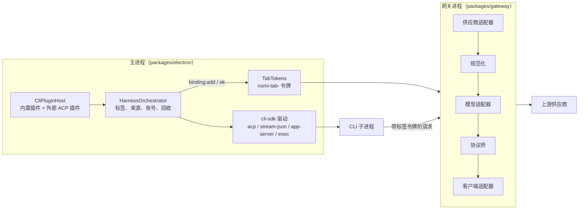

# 架构概览

Nomi 是一个 pnpm + Turborepo monorepo，桌面端基于 Electron，界面为 React 19 + Vite。

## 进程与窗口

```
Electron 主进程（packages/electron）
 ├─ 看板娘窗口（packages/renderer）    透明置顶，Nomi 与工具栏
 ├─ 对话窗口（packages/ai-chat）      对话、设置、各功能面板
 └─ 辅助窗口                          截图遮罩、灵动岛、受控浏览器、TTS 配置
```

- 入口 `packages/electron/src/main.ts` → `core/Application.ts`；窗口由 `WindowManager` 管理。
- 所有窗口开启上下文隔离与沙箱；页面只能通过 preload 暴露的**具名白名单**接口访问主进程（AI 能力为 `window.aiIPC`）。
- IPC 通道命名为 `'<领域>:<动作>'`；`ai:*` 调用会经 `security/ipcSenderGuard.ts` 校验发送方。

## 包

| 包                                                                | 作用                                                                                                                                                                                                                                     |
| ----------------------------------------------------------------- | ---------------------------------------------------------------------------------------------------------------------------------------------------------------------------------------------------------------------------------------- |
| `electron`                                                        | 主进程：窗口、托盘、IPC、各功能服务（桌面能力、知识库、记忆、日程、本机管理、屏幕记忆、更新、灵动岛……）                                                                                                                                  |
| `renderer`                                                        | 看板娘窗口：角色渲染（`src/mascot`）、气泡、工具栏                                                                                                                                                                                       |
| `ai-chat`                                                         | 对话窗口：对话、设置、引导与功能面板                                                                                                                                                                                                     |
| `ai-runtime`                                                      | AI 运行时：插件宿主、基于 Vercel AI SDK 的 LLM 客户端与 MCP 桥；应用内供应商配置以网关 `GatewayStore` 为准                                                                                                                               |
| `gateway`                                                         | 统一网关内核（纯 Node，不依赖 Electron）：Messages / Responses / Chat / Gemini 的请求 IR 与流式互转；主进程的本地路由服务在用                                                                                                            |
| `cli-sdk`                                                         | 编程助手插件契约（清单、能力接口）与共享会话驱动 acp / stream-json / app-server / exec（纯 Node，不依赖 Electron），见 `docs/design/cli-plugin-architecture.md` §5                                                                       |
| `cli-plugins`                                                     | 内置编程助手插件：清单、启动注入、权限档位、官方账号目录、历史扫描、exec 收尾规则等；`manifest` / `gateway` / `renderer` 子路径是纯数据（ESLint 入口边界），`main` 只给主进程；主进程由 `cli/CliPluginHost.ts` 加载（`ai:cli:registry`） |
| `ai-sdk`                                                          | 主进程侧 AI 门面（`AIClient`）                                                                                                                                                                                                           |
| `ai-sdk-client`                                                   | 渲染进程侧客户端与 preload 桥                                                                                                                                                                                                            |
| `bundle-ig-base` / `bundle-ig-electron-caps` / `bundle-ig-mascot` | 插件包：基础能力（不得依赖 electron）/ Electron 能力 / 看板娘能力                                                                                                                                                                        |
| `ui`                                                              | 设计令牌、4 套主题、通用组件与渲染层语言适配                                                                                                                                                                                             |
| `i18n`（`@nomi-ai/i18n`）                                         | 统一多语言词典与运行时，按语言 / 项目 / 模块组织（`packages/i18n/src/locales`）；`pnpm check:i18n` + `keepZh` 见 [i18n.md](i18n.md)                                                                                                      |
| `voice`                                                           | 语音输入、VAD、唤醒词                                                                                                                                                                                                                    |
| `types`                                                           | 共享类型                                                                                                                                                                                                                                 |

## 编程助手与统一网关

设计与实现偏差见 [cli-plugin-architecture](../design/cli-plugin-architecture.md)。



- **插件**：`@nomi-ai/cli-sdk` 定义契约（清单、能力接口、`SessionDriver`、多选项权限回答）与四种会话驱动；`@nomi-ai/cli-plugins` 是五个内置插件，按 `<cli>/{manifest,main,gateway,renderer}` 分子路径（`manifest` / `gateway` / `renderer` 是纯数据，ESLint 入口边界规则保证）。`cli/CliPluginHost.ts` 加载插件、校验清单、算有效能力（清单 ∩ 版本开关 ∩ 握手），出错隔离，注册表快照经 `ai:cli:registry` 给界面。外部 ACP 插件只有声明式清单（`userData/cli-plugins/external/*.json`），不加载代码。
- **编排**：`cli/CliHarnessService.ts`（类名 `HarnessOrchestrator`）管标签、持久化、来源（官方 / 第三方）、官方账号目录、回收与升级重启；协议细节都在驱动里，每个 CLI 的解析（流式、历史转录、模型目录、斜杠布局）在插件里，插件文案经 cli-sdk 的 `t()` 由主进程注入翻译。
- **网关分层**：请求方向经供应商适配器（`providers/`，按预设 / 域名匹配规格）和模型适配器（`models/`：目录、族规则、合并后的有效模型、请求规则、错误修正器）；响应方向经规范化（`canonical/`，按 `spec/` 的协议规范表补齐与检测结束）、协议桥（`bridge.ts`，透传或转换，`commit.ts` 在第一个内容事件提交）和客户端适配器（`clients/`，客户端规格由插件的 `gateway` 入口在网关进程启动时登记）。**路由计划**（`route/plan.ts`）**默认 active**（按计划选上游协议）；`routePlan: 'shadow'` / `NOMI_ROUTE_PLAN=shadow` 仅作回滚比对。
- **GatewayStore-only**：第三方供应商与 Key 只存在 `userData/gateway/store.json`；Nomi 对话、agent-tools、summary 经网关解析模型。升级时旧 `ai-providers.json` / `cli-providers/*/store.json` 迁移一次后改名为 `*.migrated`。
- **可靠性与观测**：`GET /metrics`（回环 + Host 校验、无需令牌）暴露 RoutePlan 质量/损失实时快照；A2 自适应降权按 (供应商, Key, wire) 滚动健康样本把差候选排到队尾（`NOMI_ADAPTIVE_ROUTE=0` 关闭）；出站 **DNS 钉 IP**（`net/upstreamFetch.ts`）防 TOCTOU 重绑定；入站 **请求体上限** 默认 32 MiB（1–256 MiB 可配）；utilityProcess **崩溃熔断**（默认 60s 内 5 次异常退出后停止自动重启）。详见 [unified-gateway](../design/unified-gateway.md) §11 / §15 与 [model-quality](../design/model-quality.md)。
- **委派**：Nomi 可把任务异步交给编程助手标签（`delegate_to_cli`，默认后台）；git 仓库内用 worktree 隔离，AgentProfile 可覆盖委派模型。见 [nomi-delegate-cli](../design/nomi-delegate-cli.md)、[delegate-isolation](delegate-isolation.md)、[code-sandbox-os](code-sandbox-os.md)（Python OS 沙箱：macOS `sandbox-exec` / Linux `bwrap`）。
- **标签绑定**：第三方标签每启动一个 CLI 进程，主进程先签一个 `nomi-tab-` 令牌并向网关登记绑定（标签、代次、模型、思考深度），收到确认才启动；网关按绑定解析模型，请求日志带标签 id；进程退出或标签关闭时作废。
- **诊断**：`diagnostics/` 管开关（开发版必开）、CLI 子进程收发记录（只经 `spawnHarness`，登录进程不记录）与诊断包导出；网关追踪按请求生成追踪 id（响应头 `x-nomi-trace-id`），存上游原文与给客户端输出的差异；`packages/gateway/scripts/trace-to-fixture.ts` 把追踪转成回放夹具。

## 关键约定

- **数据**：全部保存在 Electron `userData` 下按功能划分的目录；密钥使用 `safeStorage`。
- **网络**：外部请求经 `netGuard` 拦截本机 / 内网地址；执行命令使用 `shellEscape`；私有文件经 `utils/privateFile` 以 0600 写入。
- **日志**：主进程使用 `LoggerService` / `createMainLogger`，渲染进程使用 `@nomi-ai/ui` 的 `createLogger`，不直接用 `console.log`。
- **界面**：CSS Modules + `var(--cd-*)` 设计令牌；功能面板懒加载；看板娘 Rive 场景按需加载。
- **i18n**：包名 `@nomi-ai/i18n`；稳定 key 使用 `project.module.message` 格式；中文原文不能当 key。`pnpm check:i18n` 校验；面向模型的源文件可列入 `keepZh`。详见 [i18n.md](i18n.md)。
