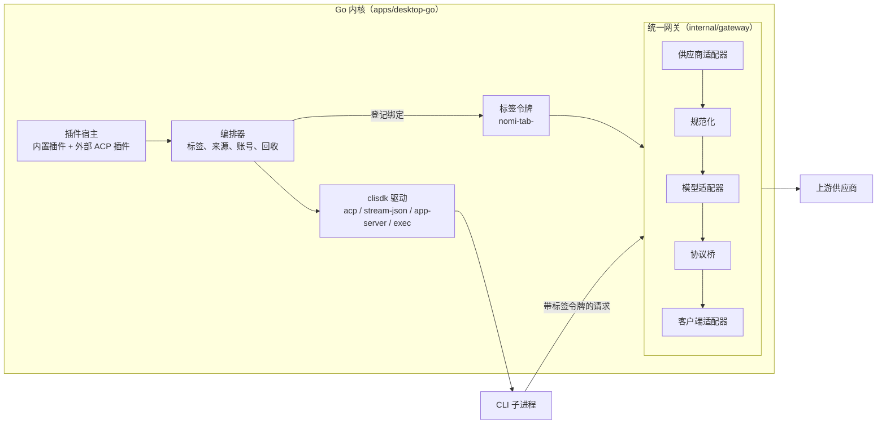

# 架构概览

Nomi 是一个 pnpm + Turborepo monorepo：桌面应用是 `apps/desktop-go`（Go 内核 + Wails v3 外壳），界面为 React 19 + Vite，
构建产物内嵌进 Go 程序。2.2.0 起 Electron 版（Node 内核）已删除。

## 进程与窗口

```
Go 进程（apps/desktop-go）
 ├─ 内核（internal/core、internal/ai、internal/gateway、internal/clisdk、internal/cliplugins）
 ├─ 契约服务端（internal/contract：回环 WebSocket + 每个窗口一次性 token）
 ├─ 桌面角色窗口（packages/renderer）  透明置顶，桌面角色与工具栏
 ├─ 对话窗口（packages/ai-chat）        对话、设置、各功能面板
 └─ 辅助窗口                            灵动岛（Go 直接生成页面）等
```

- 组合根是 `main.go` 与 `*_wiring.go`：创建各服务、注册契约过程、启动外壳。`internal/shell` 定义外壳接口，`wailsshell/` 是唯一依赖
  Wails 的包；业务模块（`internal/core`）不依赖 Wails。
- 视图只经契约访问内核：页面地址片段里有宿主给的 `ws://127.0.0.1:<端口>` 与本窗口的一次性 token，视图的 `services/api.ts`
  调 `installGoHostTransport` 装上 WebSocket 传输（每个视图包只在这一个文件里选传输、建客户端，eslint 拦下其余位置）。
  内核按 token 认出调用方的界面，过程声明的 `surfaces` 与 `dangerous` 由契约守卫判定；只给某个窗口的事件在契约的
  `eventSurfaces` 里登记，传输层按调用者的界面过滤订阅。
- 契约的过程表与类型由 TS 契约（`packages/contract`）生成到 `internal/contract/gen`（`node scripts/go-contract/gen.mjs`，CI 检查漂移）；
  处理函数按域在 `internal/core/<域>handlers`。
- 拖入文件的本机路径不走契约：宿主从原生拖放事件（WindowFilesDropped）里拿到路径，桌面角色窗口直接提交，对话窗口按文件名配对
  （`nomi:host-files`），视图选不了路径。
- `chat-asset://`、`character-pack://` 经资产服务器网关 `/__scheme/<scheme>/…` 提供；Go 提供页面时（`internal/shell/viewpage`）
  改写 CSP 并插入 Wails 运行时。

## 包

| 位置                                  | 作用                                                                                                                                                                                                       |
| ------------------------------------- | ---------------------------------------------------------------------------------------------------------------------------------------------------------------------------------------------------------- |
| `apps/desktop-go/internal/core`       | 业务模块：编程助手编排、用量、网关供应商存储、桌面能力、知识库、记忆、日程、本机模型、扩展、语音、更新、诊断……与契约处理函数                                                                               |
| `apps/desktop-go/internal/ai`         | AI 运行时：供应商与路由、LLM 客户端、MCP 桥、AI 门面                                                                                                                                                       |
| `apps/desktop-go/internal/gateway`    | 统一网关：Messages / Responses / Chat / Gemini 的请求 IR 与流式互转                                                                                                                                        |
| `apps/desktop-go/internal/clisdk`     | 编程助手插件契约与共享会话驱动 acp / stream-json / app-server / exec，见 `docs/development/coding-agents.md`                                                                                               |
| `apps/desktop-go/internal/cliplugins` | 内置编程助手插件（claude / codex / gemini / grok / dsh）：启动注入、权限档位、官方账号、历史扫描等                                                                                                         |
| `packages/renderer`                   | 桌面角色窗口壳：透明窗口、气泡、工具栏、右键菜单，以及把契约事件接到 `avatar-runtime` 的薄适配层（`src/avatar`、`src/ai`）                                                                                 |
| `packages/avatar-runtime`             | 角色引擎（纯浏览器）：Rive / sprite / static 后端、表情与动作驱动、命中区与互动、口型消费，角色包见 [character-pack](../character-pack/README.md)；独立开发页 `pnpm --filter @nomi-ai/avatar-runtime demo` |
| `packages/ai-chat`                    | 对话窗口：对话、设置、引导与功能面板                                                                                                                                                                       |
| `packages/ai-sdk-client`              | 视图侧 AI 客户端（`ClientAIClient`）、窗口共享的契约传输与 React Hooks                                                                                                                                     |
| `packages/contract`                   | 视图与内核之间的 API 契约（过程、事件、schema、版本握手、WebSocket 传输），见 [contract.md](contract.md)                                                                                                   |
| `packages/character-contract`         | 角色包契约：manifest、persona、mapping、locales 的 schema、校验与迁移，见 [character-pack](../character-pack/CONTRACT.md)                                                                                  |
| `packages/cli-catalog`                | 内置编程助手的清单与界面信息（纯数据，视图用）                                                                                                                                                             |
| `packages/ui`                         | 设计令牌、4 套主题、通用组件与视图语言适配                                                                                                                                                                 |
| `packages/i18n`（`@nomi-ai/i18n`）    | 统一多语言词典与运行时，按语言 / 项目 / 模块组织（`packages/i18n/src/locales`）；Go 内核内嵌一份副本；`pnpm check:i18n` + `keepZh` 见 [i18n.md](i18n.md)                                                   |
| `packages/voice`                      | 语音输入、VAD、唤醒词                                                                                                                                                                                      |
| `packages/types`                      | 共享类型与品牌常量                                                                                                                                                                                         |

## 编程助手与统一网关

细节见 [coding-agents.md](coding-agents.md) 与 [gateway.md](gateway.md)。



- **插件**：`internal/clisdk` 定义契约（清单、能力接口、会话驱动、多选项权限回答）与四种会话驱动；`internal/cliplugins` 是五个内置插件。
  外部 ACP 插件只有声明式清单（`userData/cli-plugins/external/*.json`），不加载代码；视图要的清单与界面信息在 `@nomi-ai/cli-catalog`。
- **编排**：`internal/core/cli/harness` 管标签、持久化、来源（官方 / 第三方）、官方账号目录、回收与升级重启；协议细节都在驱动里，
  每个 CLI 的解析（流式、历史转录、模型目录、斜杠布局）在插件里。
- **网关分层**：请求方向经供应商适配器（`providers/`）和模型适配器（`models/`：目录、族规则、请求规则、错误修正器）；响应方向经
  规范化（`canonical/`，按 `spec/` 的协议规范表补齐与检测结束）、协议桥和客户端适配器（`clients/`）。路由计划在 `route/`。
- **供应商存储**：第三方供应商与 Key 只存在网关存储（`userData/gateway/store.json`，`internal/core/gwstore`）；Nomi 对话、agent-tools、
  summary 经网关解析模型。
- **委派**：Nomi 可把任务异步交给编程助手标签（`delegate_to_cli`，默认后台）；默认直接在工作目录里改（同仓库并行按文件、按优先级让路），
  指定别的分支做基线时才用 worktree；委派的标签与会话只在 Nomi 里看，同一种委派复用会话。见
  [coding-agents.md](coding-agents.md)、[security.md](security.md)
  （Python OS 沙箱：macOS `sandbox-exec` / Linux `bwrap`）。
- **标签绑定**：第三方标签每启动一个 CLI 进程，先签一个 `nomi-tab-` 令牌并向网关登记绑定（标签、代次、模型、思考深度）；网关按绑定
  解析模型，请求日志带标签 id；进程退出或标签关闭时作废。
- **诊断**：`internal/core/diagnostics` 管开关、CLI 子进程收发记录与诊断包导出；网关追踪按请求生成追踪 id（响应头 `x-nomi-trace-id`）。

## 关键约定

- **数据**：全部保存在 userData（macOS `~/Library/Application Support/Nomi`、Windows `%APPDATA%\Nomi`、Linux `~/.config/Nomi`）下按功能划分的目录；
  API Key 存系统钥匙串。首次启动从旧 Electron 版的目录复制数据（`internal/migrate`）。
- **网络与命令**：外部请求经网关的网络守卫拦截本机 / 内网地址、DNS 钉 IP；执行命令做参数转义；私有文件以 0600 写入。
- **日志**：视图用 `@nomi-ai/ui` 的 `createLogger`，不直接用 `console.log`；Go 内核用 `internal/core/services` 的 logger。
- **界面**：CSS Modules + `var(--cd-*)` 设计令牌；功能面板懒加载；桌面角色 Rive 场景按需加载。
- **i18n**：包名 `@nomi-ai/i18n`；稳定 key 使用 `project.module.message` 格式；中文原文不能当 key。`pnpm check:i18n` 校验（Go 源码与
  内嵌 JSON 里用到的 key 也计入）；详见 [i18n.md](i18n.md)。
