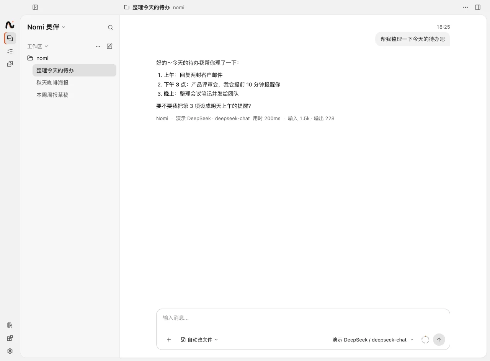
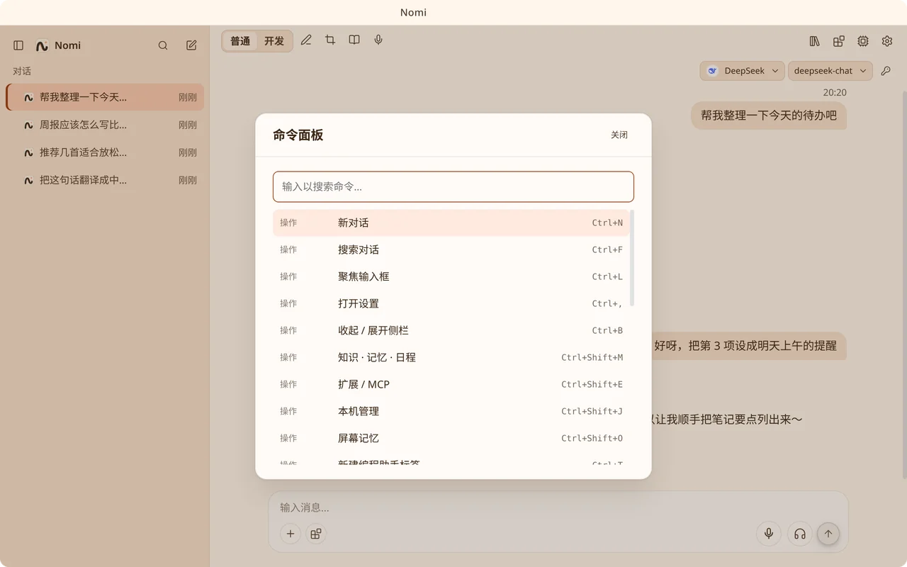

# AI 对话

从托盘「打开 AI 对话」、桌面角色（打开时）或 `Ctrl/⌘+N` 打开对话窗口。

## 对话与工坊

会话面板顶部的菜单切换两种模式：

- **对话**：和 Nomi 聊天、查知识库、看记忆。后台还有编程助手标签在跑时，菜单旁显示运行中的数量。
- **工坊**：派出 Claude Code、Codex 等编程助手，改项目、看 Diff（`Ctrl/⌘+T` 新建编程助手标签）。左侧导航栏竖排列出各端点，点一下只看这个端点的会话。见 [编程助手](coding-agents.md)。

新建 Nomi 对话时，如果这个工作区已经有还没说话的空对话，会直接切过去，不会再多一个空对话。对话用哪个端点在新建对话时选（侧栏「新对话」菜单），之后不在输入栏切换。

## 对话

- 流式输出。左侧是会话列表（按项目分组，见 [个性化](personalization.md)），`Ctrl/⌘+B` 或标题栏旁的按钮收起 / 展开；收起后鼠标移到导航栏的「对话」上，会话面板以浮层弹出。新会话的输入框上方是「项目 · 分支」，项目可以搜索、切换、新建或不使用（多个文件夹的项目显示「名称 +N」，悬停看全部文件夹；分支是主文件夹的）；发出第一条消息后项目就定下来，不在顶栏显示。`Ctrl/⌘+Shift+F` 搜索对话。
- `Enter` 发送，`Alt/Option+Enter` 或 `Shift+Enter` 换行；输入框为空时按 `↑` 找回上一条提问；输入 `/` 打开 [斜杠命令](slash-commands.md)。
- 输入栏一行（Codex 式，按钮都不带边框）：左边是「+」菜单和权限模式，右边是模型选择、语音和发送。「+」里是给这条消息加东西的：添加图片或文件（和拖入 / 粘贴一样）、引用文件或文件夹（插入 `@`，有工作区时）、交给编程助手（Nomi 对话，列出已安装的，选了之后输入框上方显示「交给 X」，与 `/agent` 相同）、知识库问答开关；编程助手标签里还有「插件 / 命令」。模型在模型按钮里换，设置在左侧导航栏最下面。
- 每条回复下写着它用的模型；同一会话中途换了模型时，末尾会出现一行提示：新模型会接着之前的上下文继续。
- 会话详细程度：全局默认在「设置 → 通用 → 外观 → 会话详细程度」（初始「显示思考」），新会话和没有单独设置的会话用它；标题栏的菜单可以给当前会话单独选一档，优先于全局默认，各会话分别记住，重启后保留（编程助手按它的会话记，关掉标签再从历史打开同一个会话仍在；分叉出的新会话跟随全局）；菜单底部「跟随全局设置」清掉这个会话的单独选择。Nomi 对话和编程助手标签都适用：
  - **精简**：两段回复之间的工具调用按类型各合成一行（探索 / 命令 / 编辑 / 其它，同类不必相邻，每段每类最多一行，按第一次出现排序），如「已探索 3 个文件、2 次搜索」「已运行 2 条命令」「已编辑 1 个文件 +12 −3」；进行中的那一类显示正在做的那一步（如「运行命令 pnpm test」），失败数标在对应那一行上；点开是这一类的每一步，再点开看参数与输出。思考不单独显示（一段只有思考时显示一行「已思考」）。子任务卡片、中途插入的消息和生成的图片照常单独显示。
  - **显示思考**：工具调用同样按类型各一行；两段回复之间的思考合并成一块单独显示（进行中展开，结束后折叠，耗时只算思考）。
  - **详细**：每次工具调用单独一行，不合并；参数与输出、思考内容和子代理都默认展开。
  - 思考那一行折叠时显示「已思考 N 秒」加这段思考的第一句；进行中显示「思考中」和正在想的那一句。进行中的思考和工具步骤，文字上有一道流动的灰度渐变（系统开了「减少动态效果」时不动）。
- 用到知识库或长期记忆时，回复里会标出引用和参考了几条记忆。
- 对话快满时（约 95%）发送前会自动把较早的内容压缩成摘要，也可以手动 `/compact`，后面可以写重点（如 `/compact 重点保留接口设计`）。是否快满按上一轮模型实际用掉的上下文判断，不只靠估算。摘要按「需求、决定、文件与代码、错误与修复、结果、待办、当前在做的事」分节写，后面补上最近读过或改过的文件、最近一次计划和用过的技能；压缩前带给模型的长期记忆也会跟着保留。
- 上一轮实际用量过了约 60% 时，最近 3 轮之前的工具记录里的大段输出只留开头和结尾，对话原文能保留得更久、晚一些才需要压缩成摘要。缩短的范围只在再次超过时才往后挪，平时每轮发出的前缀不变，不打断缓存。
- 一轮里连续调工具时（读文件、跑命令），每一步按实际用量检查：快满时较早的大段工具输出只留开头和结尾，Nomi 需要时会重新读；还是快满就把这一轮较早的步骤压成摘要，接着做；模型仍提示超出上下文长度时，压得更短后重试这一步一次，不直接报错。后台的 Nomi 任务也一样。
- 命令和代码的输出超过上限（命令 3 万字）时保留开头和结尾，中间省略，报错和失败的用例不会被截掉。任何工具的输出超过 3 万字时，Nomi 先只看开头和结尾，需要时再分页读中间（只在本次运行期间保留，换对话读不到；读出的内容同样受「仅本地模型可读文件」保护）。
- 模型说「做完了」不等于做完：这一轮的计划（`plan_update`）还有没做完的步骤时，Nomi 会被提醒接着做，或者把做不了的标成跳过并说明原因，每轮最多提醒两次；提醒之后什么也没做就不再提醒。自动续轮时，如果这一轮只改了计划、或者原样重复之前的调用，就停下来，不再空转。
- 前几轮的思考内容不随历史重发（Anthropic 以外的协议会把它算进输入）。按需提供的工具在同一个对话里开过就一直提供，系统提示也不随话题变化，前缀缓存不被打断。执行轨迹和 `/context` 里能看到上一轮的缓存命中率。
- 和 Codex 一样，上一轮的工具调用和结果（读过的文件、命令输出）会原样带进下一轮，不只是回复的文字；发过的内容每轮按原样再发，配合供应商的提示缓存（Anthropic 的缓存断点、OpenAI 的 `prompt_cache_key`），续聊时大部分输入走缓存。
- 会话行的菜单里可以重命名、删除或「分叉…」；每条回复末尾有「从这里分叉」，只带到这条回复为止。`Ctrl/⌘+Shift+F` 直接把当前对话分叉为新对话。

## 会话保存在哪里

会话（Nomi 对话与编程助手标签在侧栏里的条目）由内核保存在 `userData/conversations/`：

| 文件                  | 内容                                                                 |
| --------------------- | -------------------------------------------------------------------- |
| `index.json`          | 会话列表（名称、端点、工作区、更新时间等）、每个会话的条数、当前会话 |
| `previews.json`       | 每个会话第一条用户消息的前 300 字（侧栏搜索用）                      |
| `migrated.json`       | 已从旧 localStorage 导入过的标记（`index.json` 里也有一份）          |
| `messages/<id>.jsonl` | 一行一条消息                                                         |

- 新消息只追加到 `jsonl` 末尾；编辑重发、清空、分叉、超出「最多保留条数」时整份重写。整份重写与索引都先写临时文件再改名，文件权限 0600。
- 对话窗口只在内存里留最近打开的十几个会话的消息（当前会话、还有没写进内核的会话一直在），其余打开时再从内核读。
- 写入：界面先更新，写入按顺序排队发给内核（一次一条，前一条回来立刻发下一条，不攒批）。暂时写不进（连接断开、磁盘出错）时退避重试几次；还不行就留在队列里（不丢），约 15 秒后或下一次写入时再试，并提示一次「对话记录暂时没能保存」。内核说会话不在（新建时没写成、索引重建过）时，按界面里的名称与全部消息重新建一份再接着写；重试追加时整份写，不会重复。内核拒收的写入（入参不合法）不重试，同样提示。
- 退出（托盘、⌘Q、注销）时，内核在关窗之前等对话窗口排着的写入写完：最多 1.5 秒，最近 200 毫秒没有写入就直接退出。剩下的风险窗口是退出前几毫秒里刚产生、还没发到内核的那一条，以及重试中的写入。
- `index.json` 坏了（不是 JSON）：挪成 `index.json.corrupt`（已有就加时间戳，不覆盖），按 `messages/*.jsonl` 重建会话列表（名称取第一条用户消息、时间取消息时间，标 `recovered`；没有消息的会话不恢复，当前会话指针丢失）。`index.json` 不见了而消息文件还在时同样重建。「已导入」以 `migrated.json` 为准，重建后不会再从旧 localStorage 导一遍。`index.json` 读不出来（权限 / IO 错误）时不当作空：所有读写报错，对话窗口启动时显示「对话记录暂时读不出来」与「重试」，不显示空列表、也不迁移。
- 启动时先显示启动画面（不白屏）：取会话列表（每次限时 5 秒、重试 3 次），首次导入旧会话时显示进度。
- 2.2.0 及以前会话存在对话窗口的 localStorage 里（WebKit 约 5 MB 的配额，满了会写不进）。2.3.0 首次启动时把它们（以及 2.0.4 Electron 版抽出来的旧对话）一次性导入内核（几个会话同时导），核对条数后记完成；没导完的下次启动接着导，已有的会话不覆盖。会话 id 与内核用同一条规则（字母、数字、`_`、`-`，不能是 Windows 保留名 `con`、`nul`、`com1` 等，规则在契约的 `isValidConversationId`）；不合法的旧 id 换成固定的新 id（`m_<散列>_<原 id 能用的部分>`）导入，原 id 记在元信息的 `legacyId`。旧的 localStorage 键保留一个版本，降级回 2.2.0 仍能看到当时的会话（之后的新消息不在里面）。
- 设置里的「数据导出」把 `userData/conversations/` 整个打包成 zip 里的 `conversations/`（`conversations.json` 只有对话偏好）。应用没有从导出包恢复的功能，导出包只给人看或自己备份。

## 图片与文件

- 把图片**粘贴**或**拖入**输入框：一次最多 4 张，单张不超过 20 MB（PNG / JPEG / WebP / GIF / BMP），发送前自动压缩。会话历史只保存缩略图，原图不落盘。
- 需要能看图的模型；本机视觉模型（如 Ollama 的 `qwen2.5vl`、`llava`）也可以。开启「仅本地模型可读文件」时不会发给云端；云端模型第一次收到图片前会征得你的同意。
- 其它文件最多附 10 个：不超过 200 KB 的文本文件连内容一起发，其余只发本机路径，由模型用工具去读。

## 生成图片与素材库

在「设置 → 模型与供应商 → 分配」给 Nomi 选一个图片生成模型（默认「自动」，按对话模型挑同一家的图片模型），之后直接让 Nomi 画图即可。生成的图片和编程助手产出的图片都会进侧栏的**素材库**：

- 按分类（插画 / 人物 / 风景 / 动物 / 其他）、来源和搜索（提示词、文件名、标签）筛选，右上角是已用空间（全部图片的实际大小）。
- 生成后自动分类：先按提示词的关键词分，再让辅助模型分一次（和命令审核同一个模型；没配、或模型在云端而你还没同意发送时只用关键词）；以前的图按关键词显示。
- 瀑布流里信息收在图片里：左上分类，底部是来源与分辨率；提示词在点开后的详情里看。
- 点开一张：大图左上是真实分辨率，可以全屏查看、复制图片，「更多」里下载、在文件夹中显示、删除（移到系统废纸篓）；左右切换、底下一排缩略图；右边是文件名、提示词、标签（可以加删）、分类（可以改）、素材信息与同一分类的相关推荐；还可以以此修改、作为参考图或重新生成（会再调用一次图片模型）。
- 素材库里没有上传：图片都来自生成（或你在对话里发送的原图）。

图片服务暂时出错（网络、超时、限流、服务端错误）时会自动重试两次；图已生成只是下载失败时只重新下载，不重新生成。鉴权、参数错误不重试。

## 命令面板

`Ctrl/⌘+K` 打开，可搜索全部操作（新对话、各功能面板、语音开关……）和每一个设置分区。

## 交给编程助手（委派）

Nomi 可以把具体的开发、文档、审查、调研任务交给本机的编程助手去做，**默认后台执行**：派出后 Nomi 可以继续聊，做完把结果带回对话。

- 直接说「让 Codex 修一下登录 bug」，或用 `/agent codex 修复登录 bug` 指定交给谁。这条命令会立刻派出编程助手，消息里附的图片会把素材库地址一起交给它；需求超过 4000 字时不派出，请精简后再发。等确认时可以点停止。派不出去（没安装、关了委派、没有工作目录、用户拒绝、停止）时对话里直接说明，不会再由对话模型回一句当作已经交出。只输入 `/agent codex` 时，下一条消息交给它（输入框上方会显示，点一下取消）。
- 派出前按 Nomi 的权限模式确认（「计划」档不会派出）。对话选了工作区时，编程助手在工作区（或它里面的子目录）里开工。
- 「全部自动」开着（默认）时，子任务从「完全放开」开始；关掉后子任务的档位不比 Nomi 当前的宽。
- 子任务开成一个后台的编程助手标签，用这个编程助手新标签的默认来源（官方账号或第三方供应商）。对话里的子任务卡片显示进度、子代理和待确认的审批，可以单独停止；完成后对话里会出现结果，连同它改动的文件和生成的图片（派给后台 Nomi 的生图任务也一样），Nomi 下一轮能读到。后台的 Nomi 用你交代任务时用的语言写结果（英文需求就用英文）。
- 点子任务卡片上的「查看」，子任务在主对话列里打开（和这个编程助手自己的会话同一套消息、输入栏和提问 / 审批），顶上可以返回来源对话。运行中发送会插话（不支持插话的等这一轮结束再发），「停止」打断这一轮，空闲时发送就接着再做一轮。之后每一轮的结果也会回到主对话（「… 在子任务里接着做完了」），Nomi 下一轮能读到。输入栏外按 Esc，或点「返回对话」，回到来源对话。设计见 [子任务对话与主对话对齐](../design/subagent-chat-parity.md)。
- 标题栏右侧文件栏开关前面的「会话详情」按钮（有消息时显示）在对话卡片右侧开一栏（不盖住对话，对话区相应变窄，四周留有空隙；再点或 Esc 收起，开关状态会记住）：上面是工作区名和当前分支（悬停看完整路径）；「变更」一行是本会话改过的文件数和增删行数，点开看 Diff（没有改动时只显示「还没有改动」，不能点开）；「Agents」列出本会话用到的子任务和子代理及各自的状态（进行中 / 等你确认 / 已完成 / 出错 / 已停止），点子任务在主对话列里打开；「任务」列出从这个会话建的持续任务及状态（包括派给后台 Nomi 的，比如「生成一组图」；派给编程助手的子任务在「Agents」里，不重复），点开到任务页。两个列表都先显示 5 个，点「…」展开其余的；没有 Agents 或任务时，对应的区块不显示。展开中栏 Diff 或文件预览时这一栏自动收起（不管窗口多宽）；窗口宽度小于 1440 时，展开文件栏也自动收起，给对话留地方；宽屏下文件栏开着时不收起，但改成浮层盖在对话右上角，不挤压对话（点外面不收回，再点按钮或 Esc 关掉）。自动收起后点按钮可以再打开，这时它以浮层盖在对话这一列的右上角（中栏开着也是盖在对话上，不落到 Diff 或文件预览上），不挤占对话；点浮层外面或按 Esc 收回，那几栏开关变化后又按自动规则来。
- 委派开的标签，审批最多等 10 分钟（自己开的标签是 2 分钟）。
- 做完后编程助手按固定格式汇报：做了什么、改了哪些文件、没做完的、需要你决定的。
- 设置：「设置 → Nomi → 权限与委派」里有总开关，以及按任务类型（编程开发、需求文档、代码审查、调研分析）默认交给谁；选「让 Nomi 选」时从已安装的编程助手里挑。
- **没装编程助手，或关了委派**：Nomi 不再提出委派，改为自己做：用文件工具读代码、`fs_edit` 小步修改、`workspace_run` 构建和跑测试（需要先给对话选一个工作区）。

## 长任务

- 多步的事 Nomi 会先用 `plan_update` 列出计划清单（步骤 + 进行中 / 完成），每做完一步更新一次，对话里能看到做到哪了。
- 一轮最多连续调用 20 次工具；用完时如果 Nomi 还要接着调工具，会**自动续一轮**，不用你说「继续」，最多续 20 轮，不按用量停下。这一轮里你拒绝过某一步时不会自动续。停下时回复末尾会说明原因，说「继续」就接着做。随时可以点停止。
- 续轮时，这一轮里较早的大段工具输出（读过的文件、测试日志）只保留开头一截，避免上下文被撑满；Nomi 需要时会重新读取。
- 工具按需提供，没用上的不占上下文：选了工作区时查看文件的工具总是在，写文件类（新建、修改、移动、删除）要对话里说到改动才提供，委派给编程助手 / 后台 Nomi 的工具要说到编程任务、要做一阵子的事（文档、报告、一组图、后台做）或问到进度才提供，「现在做还是派出去」的规则也跟着它们出现。一旦提供就一直提供，不打断提示缓存。
- 读文件默认一次读 4000 字、搜索默认返回 20 条；不够时 Nomi 会接着往后读或调大数量。
- 拿不准时 Nomi 会在输入栏上方问你（`ask_user`）：一次一张，选项用字母选，最后一行可以自己写；可以多选。Enter 继续（还有下一问就翻到下一问），Esc 跳过整张卡，下面可以再补一句。答完、跳过、点停止、紧急停止、关掉这个会话，或 10 分钟没答，这一轮都会继续或停住；跳过和超时后 Nomi 按最稳妥的做法继续，并说明它的假设。Claude Code、Codex（app-server 的提问，以及表单式的 MCP elicitation）和 ACP（`elicitation/create` 表单）的提问也用这张卡。命令、改文件和 ACP 的工具允许 / 拒绝仍是原来的卡片。Codex 退回 exec 时没有来回通道，问不了。

## 侧栏

侧栏底部是应用级入口：设置，「知识 · 记忆 · 日程」（`Ctrl/⌘+Shift+M`，右侧抽屉），「扩展 / MCP」（`Ctrl/⌘+Shift+E`）。有新版本下载完成时，标题栏右侧（会话详细程度按钮左边）会出现「重启更新」，在设置页时则在设置导航底部。会话列表上方有「任务」（见 [日程与任务](scheduling-calendar.md#任务)）与「素材库」入口。主窗口的位置和大小会被记住。

## 实现

- 视图：`packages/ai-chat/src`（`App.tsx` 只做组装，各部分的状态在 `app/`：面板开关、命令与快捷键、斜杠命令、右栏；`components/Sidebar`、`components/MessageInput`、`components/AssetLibrary`）。
- 会话存储：内核 `apps/desktop-go/internal/core/convstore`（契约 `conversations.*`，处理函数 `internal/core/shellhandlers/conversations.go`）；视图 `packages/ai-chat/src/services/conversationStore.ts`（同步门面 + 消息缓存 + 有序写队列）、`conversationBoot.ts`（启动时取索引、迁移）、`conversationMigration.ts`（旧 localStorage 导入）、`components/BootScreen`（启动画面）；退出前等写入：`shellhandlers.ConversationWrites`（`main.go` 的 `OnShutdown`）。
- 跨轮上下文：内核在一轮结束时发 `steps` 块（这一轮工具循环实际发出的消息，`internal/ai/runtime/aisdk/provider.go`），视图存进回复的 `steps`，下一轮原样带回（`services/history.ts`）；新召回的记忆存在用户消息的 `memory` 上、放在用户原话前面发，不进 system；压缩时合并到压缩消息上（`services/compaction.ts`）。
- 内核：`apps/desktop-go/internal/aichat`（2.0.4 Electron 旧对话的抽取），图片生成 `internal/ai/runtime/igtools/image.go`，素材库 `internal/core/chatassets`，委派 `internal/core/cli/harness`。

## 文件侧栏与专注阅读

用户和助手消息中的裸网址、Markdown 超链接均可点击。网页使用默认浏览器打开；本地 Markdown、文本和代码链接进入独立文件侧栏，支持 `文件:30-40` 或 `文件#L30-L40` 的行号范围定位与高亮。代码围栏、行内代码和普通裸文件路径保持原样。

侧栏支持多文件标签、目录与章节跳转、文件内查找，以及 Markdown 渲染与源码切换。可编辑的文件会自动保存；外部修改冲突或保存失败时保留草稿并提示。用鼠标选中文字后弹出菜单（右键同样可以）：复制，或「问助手」把文件名与行号范围加入输入框引用卡片，点击卡片回到文件，发送前也可移除。选中后弹出的菜单不抢焦点，继续打字就收起。

拖动分隔线调整侧栏宽度，展开后进入文件专注模式。原会话与输入框收成右下角的 Nomi 圆形按钮，不遮挡文档；点按钮或在选区菜单里点「问助手」展开成可拖动浮窗，浮窗右上角可再收成按钮，输入框为空时点文档也会收起。草稿和后台回复一直保留；可选择同一工作区的会话，或创建继承来源设置的分支。文档来源与接收会话不一致时会提示，避免发错会话。

`Ctrl/⌘+F` 查找当前文件，`Ctrl/⌘+Shift+F` 搜索会话，`Ctrl/⌘+Shift+T` 创建会话分支。Esc 逐级收起：先关闭当前菜单或查找，再收起会话内容、把浮窗收成按钮，最后退出全屏与关闭预览。

会话与文件的 Markdown 分别维护渲染行为，均支持 Mermaid 图表。图片使用独立查看器；HTML、PDF、Office、CSV、音视频文件交给系统默认应用，打开本地文件仍需通过内核的路径与授权检查。
