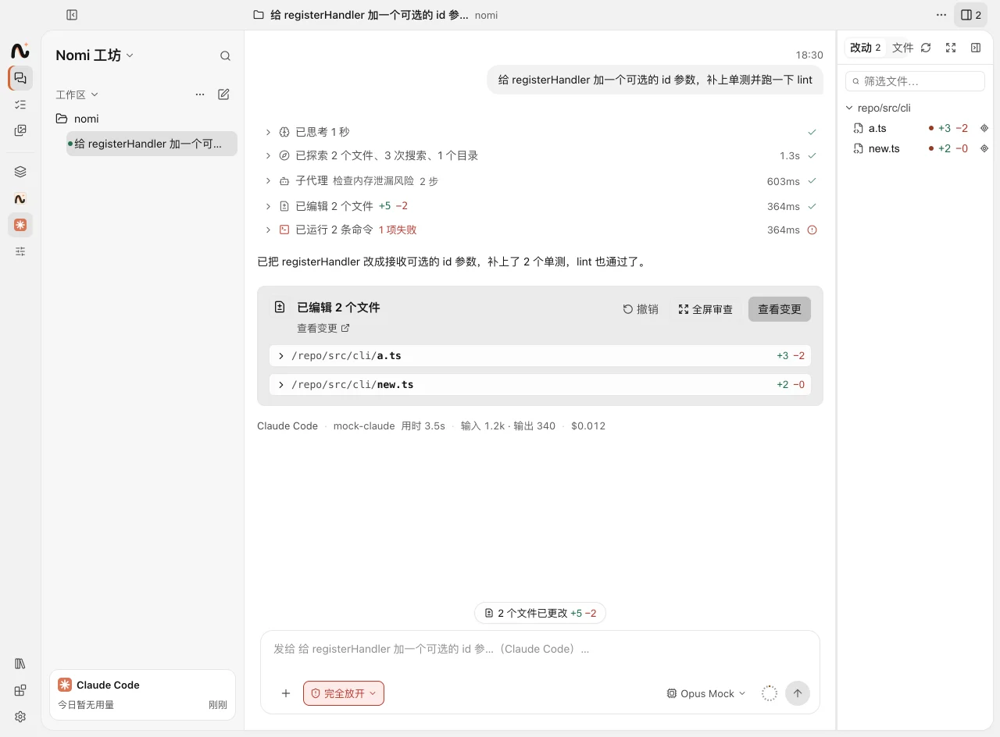
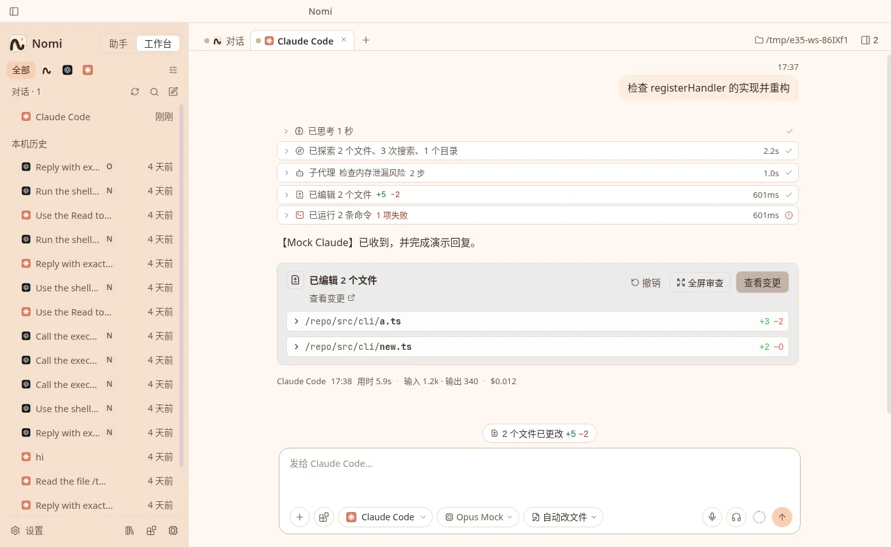

# 编程助手

> 截图由模拟的 CLI 驱动真实界面生成，对话内容与路径仅作演示。

Nomi·诺米 的对话窗口可以当作本机编程助手的界面：消息、工具确认、权限与进度都转给真实的 CLI，智能与工具由 CLI 自己完成。内置支持 **Claude Code**、**Codex**、**Grok**、**Gemini CLI**、**dsh**、**Kimi Code**、**MiniMax Code**，另外可以接入任意支持 ACP（Agent Client Protocol）的 CLI。

切到侧栏顶部的「工坊」后，在「新对话」菜单里选端点即可新建编程助手标签（`Ctrl/⌘+T`）。多个标签可以同时运行，在跑的会话在侧栏行里显示「进行中」。

## 安装与版本

「设置 → 编程助手 → 助手」左侧列出各编程助手和它的状态（未安装 / 有新版本 / 版本号）：

- 每个编程助手有「版本」卡片：检查更新、一键安装、更新到最新版。安装和更新用本机的 Node.js 与 npm。
- 「通用」里检查运行环境（没有 Node.js、版本过低、找不到 npm 时会提示，并给出下载链接），以及「全部自动」开关（见下文）。

## 官方账号与第三方供应商

每个标签在对话区右上角选来源，只影响这一个标签：

- **官方账号**：CLI 自己的官方登录。可以添加多个官方账号：每个账号一个独立的配置目录，登录由 CLI 自己的官方流程完成，Nomi 不保存登录凭据；默认账号用于新标签和「跟随默认」的标签。dsh 没有官方账号。
  Kimi Code、MiniMax Code 用 Kimi / MiniMax 账号登录；没登录时标签里会提示去「设置 → 编程助手」登录。
- **第三方**：「设置 → 模型与供应商」里的任意模型，经 Nomi 的本机网关自动转换协议。只作用于 Nomi 启动的那个 CLI 进程，不改 `~/.claude`、`~/.codex`、`~/.grok`、`~/.gemini`、`~/.kimi-code`、`~/.minimax` 等全局配置；终端里直接运行的 CLI 仍是你自己的配置。
  Kimi Code、MiniMax Code 换第三方模型时会重启进程并续接同一个会话。
- 新标签默认用哪个来源，在「设置 → 编程助手 → 助手 → 某个编程助手 → 新建标签」里选；各 CLI 用第三方时默认的模型在「设置 → 模型与供应商 → 分配」里设，见 [第三方供应商与模型](providers.md#编程助手用第三方模型)。

## 权限模式

输入栏的权限模式按标签设置（`/mode` 或 `Shift+Tab` 切换），统一为五档，映射到各 CLI 自己的参数：

| 档位       | 含义                       |
| ---------- | -------------------------- |
| 计划       | 只读，不改文件             |
| 逐项确认   | 每次改动都在卡片里问你     |
| 自动改文件 | 自动改文件，其它操作仍确认 |
| 自动       | 大部分操作不再问           |
| 完全放开   | 不再确认，由 CLI 自己决定  |

不支持某一档的 CLI 会降到更安全的一档（dsh 只有计划 / 自动改文件 / 完全放开；Grok 没有「自动」；Kimi Code 没有「自动改文件」；
MiniMax Code 只有计划 / 逐项确认）。需要确认时，对话里出现允许 / 拒绝卡片，2 分钟没回应按拒绝处理。

**全部自动**（「设置 → 编程助手 → 助手 → 通用」，默认开）：新的编程助手标签和 Nomi 委派的编程助手默认「完全放开」，改文件、跑命令都不再问你；关掉后新标签按默认档位逐项询问。只在你信任的文件夹里这样用。

## 本机保护

不管哪个权限档位，下面几条都由 Nomi 把关：

- **系统沙箱**（macOS，默认开，「设置 → Nomi → 桌面权限 → 隐私保护 → 编程助手沙箱」）：编程助手在系统沙箱里运行，读不到敏感位置（SSH 与 Git 凭据、云账号凭据、密钥库、浏览器数据、邮件 / 信息 / 照片等个人数据、`.env` 和私钥文件）与受保护的文件夹，只能写项目文件夹、它自己的配置和缓存。被挡下时对话里出现卡片（委派的子任务卡片和任务详情里也有；不在前台时桌面角色会提醒），写明它想读 / 写什么：**本会话允许**（这个会话里不再问）、**始终允许**（记进设置，可在「隐私保护」里撤销；只在这个项目里生效）、**不允许**（这个会话里不再问）。`.env` 这类密钥文件按文件授权，只放开被挡下的那一个。写入只放开最小的范围（所在文件夹，或它所在的 git 仓库）；开机自启、命令目录（如 `~/.local/bin`）和 shell 配置（如 `~/.zshrc`）不能授权写入。允许后编程助手自动重开并接着做；编程助手也知道自己在沙箱里，被挡下会停下说明，不会绕路。后台任务可以在新建时勾选「编程助手沙箱里预先允许」的类别（有 GitHub 对外动作时自动带上 SSH 与 Git 凭据），跑的时候不用再问。开着沙箱，可以放心让编程助手「全部自动」运行。其他系统暂不支持，下面几条照常生效。

- **工作目录**：只能是项目文件夹。根目录、主目录、文稿 / 桌面 / 下载这类大文件夹、系统目录、内置敏感目录（`.ssh`、`.aws` 等）和你在「设置 → Nomi → 桌面权限 → 隐私保护」里加的受保护文件夹都不行；选目录、新建标签、每次启动 CLI 前都会检查，设置改了之后旧标签的目录不符合也会拦下并说明原因。
- **环境变量**：CLI 不继承你环境里的令牌、密码、云账号密钥、数据库连接串（如 `GITHUB_TOKEN`、`AWS_SECRET_ACCESS_KEY`、`DATABASE_URL`）；模型服务的凭据（`ANTHROPIC_*`、`OPENAI_*` 等，走 Bedrock / Vertex 时的云账号）照常传。确实需要的变量（比如装私有 npm 包要 `NPM_TOKEN`）在「隐私保护 → 放行的环境变量」里加。
- **Codex 联网**：默认关闭，沙箱里的命令不能联网；「自动改文件」档位下 Codex 要联网或写工作区外时会发确认卡片。「设置 → 编程助手 → 权限 → 允许 Codex 联网」打开后直接联网（「完全放开」不受这项限制）。Nomi 的系统沙箱开着时 Codex 不再用自己的沙箱，这一项不起作用。

## 工坊的布局

- **左**：会话列表与「本机历史」（各 CLI 自己记录的历史会话，点开可以续接）。
- **中**：对话；点「查看变更」后 Diff 和文件预览也在这里打开。
- **右**：「改动 · 文件」，默认收起，顶栏开关上显示改动数。

分割线都可以拖动，位置会被记住，双击复位。工作目录在新会话的输入框上方选（可以搜索最近用过的目录、选择文件夹），发出第一条消息后定下来；分支也能在那里切换：点分支名可以搜索本地分支、切过去，或「创建并检出新分支」；右栏「改动」顶部的分支名是同一个切换器（助手正在跑时不能切）。有会被覆盖的未提交改动时 git 会拒绝切换，改动不会丢；默认工作目录是「文稿/nomi」（第一次用到时创建）。

### 改动与 Git

- 工作目录是 git 仓库时，「改动」以 git 状态为准，分已暂存 / 未暂存 / 未跟踪；可以只看「本会话里助手改过」的文件。分支和上游分支显示在右栏顶部。
- 可以直接暂存 / 取消暂存、放弃未暂存的改动（存进 git stash，可撤销）、写提交信息并提交（可以让辅助模型按改动写提交信息）、撤销还没推送的提交、推送、拉取（只快进）。Nomi 不会 force-push，也不会弹出密码输入。
- 「让助手提交」只把提交指令填进输入框，由你确认后再发给助手。
- 「文件」列出整个工作目录（跳过 `node_modules`、`.next` 等依赖与缓存目录，被 `.gitignore` 忽略的置灰）；文件预览可以直接编辑保存，Markdown 有渲染预览。读写会拒绝经符号链接指向工作目录外的路径。

### 本轮改动摘要卡

助手每轮改了文件，消息下出现「已编辑 N 个文件」：可以展开行级 Diff、「查看变更」、「全屏审查」（所有改动文件依次排开，旁边是文件树），或撤销这一轮的写入（先确认，只限工作区内）。

### 上下文环

输入栏旁的环形指示是当前上下文占用，悬停显示「当前上下文 xK / 最大」。用量取这一轮最后一次模型请求，窗口大小优先用 CLI 上报的值，未识别的模型按 128K 估算。`/context` 用同一口径。

### 运行中发消息

助手还在跑时也可以继续输入：`Enter` 插入这一轮，`Ctrl/⌘+Enter` 排队到这一轮结束再发，在输入框按 `Esc` 停止并马上发送。

### 图片

粘贴或拖入图片发给 Claude Code、Codex、Grok、Gemini；当前模型不支持看图时会提示。dsh 不支持图片。

## 会话管理

- **切换模型 / 思考深度**：标签输入栏的模型按钮只换这一个标签。能原地切换的 CLI 不重启进程，其它的重启后续接同一个会话。
- **新会话沿用设置**：每个编程助手记住最近一次选的权限模式、模型与思考深度（「完全放开」不记）。
- **休眠**：长时间（默认 30 分钟）空闲的标签会释放进程，侧栏显示「已休眠」，下一条消息自动续接。
- **分叉**：会话菜单里可以分叉为新对话，或分叉到其他端点。

## 外部 CLI

「设置 → 编程助手 → 助手 → 外部 CLI」可以添加任意支持 ACP 的编程助手：填命令、参数（可用工作目录与主目录占位符，不经 shell）和需要的环境变量**名字**（值从启动 Nomi 的环境里继承，Nomi 不保存），「测试」会做一次握手。外部 CLI 以你的身份在本机运行，只添加你信任的程序；它的每次工具调用都要你逐项确认，也不接 Nomi 的官方账号、网关和订阅额度。

## 监视与额度

- 终端里运行的编程助手也能被盯着，见 [编程助手监视](agent-monitor.md)。
- 官方账号的订阅额度与用量费用在「设置 → 用量与分析」，见 [隐私与安全](privacy-security.md#订阅额度与登录凭据)。

## 实现

- 设计与架构：[编程助手接入](../development/coding-agents.md)。
- 清单（能力位、权限档位、安装方式）：`packages/cli-catalog/src/<cli>/manifest.ts`。
- 内核：会话编排 `apps/desktop-go/internal/core/cli/harness`，Git 操作 `internal/core/cli/gitops.go`，安装与更新 `internal/core/cli/cli_update_service.go`，官方账号 `internal/core/cli/accounts`；会话驱动 `internal/clisdk`，各 CLI 插件 `internal/cliplugins/<cli>`。
- 视图：`packages/ai-chat/src/components/SessionWorkspace`、`ProvidersPage`。
