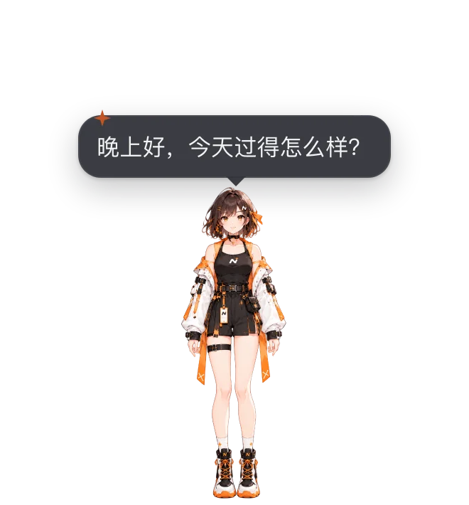

# 桌面角色诺米

诺米住在一个透明、置顶的小窗口里，只有角色本身可以点击，其余区域鼠标直接穿透到下面的窗口。

## 她会做什么

- **表情与动作**：开心、生气、难过、放松等表情随对话和任务状态切换；会眨眼、呼吸、视线跟随鼠标，说话时口型同步。她有 43 个命名动作（见下文「动作」）：任务完成会点赞、失败会道歉，思考时托腮、工具运行时打字，闲着会张望、哼歌、打哈欠。AI 也可以调用工具让她做动作、换表情。
- **互动**：悬停、摸头、单击、双击各有反应（表情 + 动作 + 台词），双击还会打开工作台（对话窗口）。按住可以拖动；开启「重力与落地」后松手会落到任务栏 / Dock 上并回弹。窗口贴近屏幕右边时，工具栏和气泡会换到角色左侧，贴近左边时换到右侧。
- **气泡**：AI 回复的前一两句显示在她身边，长回复显示「查看全文」，点击打开对话窗口。可以在互动设置里关闭。
- **拖文件给她**：把文件拖到她身上，她会总结内容（气泡里一句话，完整摘要写进对话窗口）。

## 动作

诺米有 **43 个命名动作**（`packages/avatar-runtime/src/rig/actions.ts`），托盘「诺米动作」菜单里可以让她做其中常用的几个。AI 工具 `avatar_gesture` / `avatar_emotion` 与应用内的提醒只说**语义名**（手势 `thumbsUp`、`shakeHead`，情绪 `happy`，活动 `thinking` 等，词表见 [角色包契约](../character-pack/CONTRACT.md#mappingjson)），由角色包的 `mapping.json`（官方包 `characters/nomi/mapping.json`）翻译成下表的动作；角色包没有映射的手势与情绪不会表现。

| 动作                                                                                                                                                                                                                                               | 名称             | 类别 | 时长         | 优先级 | 触发场景                                    | 应用内自动触发                                  |
| -------------------------------------------------------------------------------------------------------------------------------------------------------------------------------------------------------------------------------------------------- | ---------------- | ---- | ------------ | ------ | ------------------------------------------- | ----------------------------------------------- |
| `wave`                                                                                                                                                                                                                                             | 挥手             | 问候 | 2.3s         | 1      | 问候 / 早安 / 首次打开 / 用户说“你好”       | 启动 / 问候；文本含“你好 / 再见”；点击手部      |
| `hello`                                                                                                                                                                                                                                            | 打招呼           | 问候 | 1.9s         | 1      | 界面首次出现的轻招呼（点头 + 小幅挥手）     | 界面首次出现（启动问候）                        |
| `nod`                                                                                                                                                                                                                                              | 点头             | 回应 | 1.2s         | 1      | 回答“好 / 明白了”、确认                     | 回复含“好的 / 当然”；点击头部；摸头             |
| `shake_head`                                                                                                                                                                                                                                       | 摇头             | 回应 | 1.4s         | 1      | 否定、“不行 / 没有”                         | 点击裙摆（不高兴）；回复里出现否定 / 难过的情绪 |
| `bow`                                                                                                                                                                                                                                              | 鞠躬             | 问候 | 2.0s         | 1      | 感谢 / 告别 / 道歉的礼貌版                  | 回复含“谢谢 / 抱歉”                             |
| `salute`                                                                                                                                                                                                                                           | 敬礼             | 问候 | 1.9s         | 1      | 收到指令 / “收到！”                         | —                                               |
| `think`                                                                                                                                                                                                                                            | 托腮思考         | 思考 | 3.4s（保持） | 1      | AI 思考中 / 长时间等待                      | AI 思考 / 等待模型（保持，回复完成时放开）      |
| `explain`                                                                                                                                                                                                                                          | 讲解             | 思考 | 2.6s         | 1      | 长回答 / 讲解步骤（竖起食指）               | 回复超过 280 字                                 |
| `eureka`                                                                                                                                                                                                                                           | 灵光一闪         | 思考 | 2.2s         | 1      | 想到办法 / 找到答案                         | —                                               |
| `puzzled`                                                                                                                                                                                                                                          | 疑惑歪头         | 思考 | 2.4s         | 1      | 听不懂 / 需要澄清                           | —                                               |
| `look_around`                                                                                                                                                                                                                                      | 张望             | 空闲 | 3.0s         | 0      | 空闲随机 / 等待用户（手遮额头远眺）         | 空闲随机                                        |
| `look_lr`                                                                                                                                                                                                                                          | 左顾右盼         | 空闲 | 2.6s         | 0      | 空闲随机                                    | 空闲随机                                        |
| `peek`                                                                                                                                                                                                                                             | 偷看             | 情绪 | 2.6s         | 0      | 空闲随机（害羞地偷看用户）                  | 空闲随机                                        |
| `heart`                                                                                                                                                                                                                                            | 比心             | 情绪 | 2.6s         | 1      | 表达喜欢 / 被夸奖 / 摸头                    | —                                               |
| `blow_kiss`                                                                                                                                                                                                                                        | 送飞吻           | 情绪 | 2.4s         | 1      | 告别 / 感谢                                 | —                                               |
| `shy`                                                                                                                                                                                                                                              | 害羞             | 情绪 | 2.8s         | 1      | 被夸奖 / 被摸头太久                         | —                                               |
| `cover_face`                                                                                                                                                                                                                                       | 捂脸             | 情绪 | 2.6s         | 1      | 尴尬 / 出错后的不好意思                     | —                                               |
| `sorry`                                                                                                                                                                                                                                            | 道歉             | 情绪 | 2.8s         | 3      | 任务失败 / 出错（双手交叠在身前，轻轻低头） | 任务 / 端点失败（灵动岛同步）                   |
| `surprise`                                                                                                                                                                                                                                         | 惊讶             | 反应 | 1.8s         | 2      | 拖入文件 / 突然的事件                       | 拖入文件；点击脸 / 身体；落地                   |
| `sigh`                                                                                                                                                                                                                                             | 叹气             | 情绪 | 3.0s         | 1      | 长时间失败 / 无聊                           | —                                               |
| `pray`                                                                                                                                                                                                                                             | 合十             | 情绪 | 2.8s         | 1      | 感谢 / 拜托 / 祈祷                          | —                                               |
| `smug`                                                                                                                                                                                                                                             | 得意             | 情绪 | 2.4s         | 1      | 做对难题 / 任务一次成功                     | —                                               |
| `aggrieved`                                                                                                                                                                                                                                        | 委屈             | 情绪 | 3.0s         | 1      | 被批评 / 反复失败                           | —                                               |
| `tears`                                                                                                                                                                                                                                            | 流泪             | 情绪 | 3.0s         | 1      | 感动 / 很难过                               | —                                               |
| `angry`                                                                                                                                                                                                                                            | 生气（轻微）     | 情绪 | 2.2s         | 1      | 被打断 / 连续失败                           | —                                               |
| `cold_sweat`                                                                                                                                                                                                                                       | 冷汗             | 情绪 | 2.4s         | 1      | 紧张 / 尴尬 / 超时                          | —                                               |
| `daze`                                                                                                                                                                                                                                             | 发呆             | 空闲 | 3.4s         | 0      | 空闲随机                                    | 空闲随机                                        |
| `cheer`                                                                                                                                                                                                                                            | 加油握拳         | 庆祝 | 2.2s         | 1      | 鼓励用户 / 开始新任务                       | 强烈开心的回复；“太好了 / 恭喜”                 |
| `thumbs_up`                                                                                                                                                                                                                                        | 点赞             | 庆祝 | 2.2s         | 3      | 任务完成 / 用户做得好                       | 任务 / 端点完成（灵动岛同步）                   |
| `peace`                                                                                                                                                                                                                                            | 剪刀手           | 庆祝 | 2.2s         | 1      | 拍照 / 自拍 / 开心                          | —                                               |
| `ok_hand`                                                                                                                                                                                                                                          | OK 手势          | 庆祝 | 2.2s         | 1      | 确认 / 没问题 / OK                          | —                                               |
| `celebrate`                                                                                                                                                                                                                                        | 庆祝（双手举高） | 庆祝 | 2.6s         | 3      | 任务全部完成 / 里程碑                       | 全部任务完成                                    |
| `clap`                                                                                                                                                                                                                                             | 鼓掌             | 庆祝 | 2.4s         | 1      | 夸奖 / 用户完成目标                         | 开心的回复；双击                                |
| `hop`                                                                                                                                                                                                                                              | 开心跳动         | 庆祝 | 1.6s         | 1      | 被点击 / 高兴                               | 点击                                            |
| `wink`                                                                                                                                                                                                                                             | 眨眼             | 情绪 | 1.6s         | 1      | 俏皮 / 彩蛋                                 | —                                               |
| `tongue`                                                                                                                                                                                                                                           | 吐舌             | 情绪 | 1.8s         | 1      | 调皮 / 小失误后的卖萌                       | —                                               |
| `cute`                                                                                                                                                                                                                                             | 卖萌             | 情绪 | 2.4s         | 1      | 被摸头 / 撒娇                               | —                                               |
| `work`                                                                                                                                                                                                                                             | 打字工作         | 工作 | 2.4s（保持） | 1      | 工具运行中 / 正在写代码                     | 工具运行中（保持）                              |
| `yawn`                                                                                                                                                                                                                                             | 打哈欠           | 休息 | 3.0s         | 0      | 夜间 / 长时间空闲                           | 夜间 / 长时间空闲                               |
| `stretch`                                                                                                                                                                                                                                          | 伸懒腰           | 休息 | 3.2s         | 0      | 长时间空闲 / 久坐提醒                       | 长时间空闲                                      |
| `goodnight`                                                                                                                                                                                                                                        | 晚安             | 休息 | 3.4s（保持） | 1      | 深夜 / 长时间无操作 / 说晚安                | 深夜空闲（保持）                                |
| `listen`                                                                                                                                                                                                                                           | 倾听             | 思考 | 2.6s（保持） | 1      | 用户正在输入 / 语音录入                     | —                                               |
| `peek_note`                                                                                                                                                                                                                                        | 哼歌             | 空闲 | 3.0s         | 0      | 空闲随机 / 播放音乐                         | 空闲随机                                        |
| 优先级：0 空闲行为 · 1 普通 · 2 互动反应（点击 / 拖文件）· 3 任务事件（完成 / 失败）。高优先级会替换正在播放的动作，低优先级默认丢弃。「保持」类动作（托腮思考、打字工作、倾听、晚安）会停在末姿态，直到回复完成、被新动作替换或超过最长保持时间。 |

### 触发规则

- **任务事件**：一轮任务完成 → 点赞；全部完成 → 庆祝；失败 → 道歉。
- **对话**：等待模型 → 托腮思考；工具运行 → 打字工作；回复超过 280 字 → 讲解；回复里的「你好 / 谢谢 / 恭喜」等关键词 → 挥手 / 鞠躬 / 加油。
- **互动**：点击、双击、摸头、拖入文件各有对应动作。
- **空闲**：安静 18 秒后不时随机做一个（张望 / 左顾右盼 / 偷看 / 发呆 / 哼歌）；空闲超过 1.5 分钟可能打哈欠，超过 2.5 分钟可能伸懒腰；23:00–06:00 偏向打哈欠 / 晚安。说话、思考或有动作在播放时不会触发；开启系统「减少动态效果」后完全不触发。

## 显示方式

默认显示一张静态立绘。「设置 → 通用 → 启动与窗口」里打开「诺米动画（Rive）」后用 Rive 动画显示（会多占一些内存和显卡）；动画素材第一次开启时下载，下载完成前或失败时仍显示静态立绘。

只内置诺米一个角色，不提供角色切换或导入自己的模型。工具栏「更多 → 致谢 / Credits」列出角色与图标的作者与许可。品牌规则见 [品牌规范](../BRAND.md#9-品牌锁)。

## 工具栏

角色旁边的竖向工具栏：AI 对话、语音（点按静音，右键语音偏好）等常用按钮，其余在「更多」里（大小、关闭诺米、关闭应用等）。空闲时淡出，光标靠近时出现；靠近屏幕边缘会自动翻到另一侧。

关闭诺米后她从桌面隐藏、不再播放语音和监听唤醒词，提醒改由 [灵动岛](dynamic-island.md) 或系统通知送达；在「设置 → 通用 → 启动与窗口」里可以重新打开。

## 大小

默认 50%，可调 30%–150%（以 420×450 的角色框为 100%）；小屏幕上上限会按工作区自动压低。

| 入口            | 用法                                      |
| --------------- | ----------------------------------------- |
| Ctrl / ⌘ + 滚轮 | 光标在角色上时按住 Ctrl（macOS 为 ⌘）滚动 |
| 右键菜单        | 在角色上右键 → 放大 / 缩小                |
| 设置 → 通用     | 「启动与窗口」里的「诺米大小」滑块与重置  |

缩放时脚底中心在屏幕上不动；数值保存在本机，下次启动保持。

## 互动设置

托盘 →「互动设置（穿透 / 重力 / 散步）…」：

| 选项             | 默认 | 说明                                   |
| ---------------- | ---- | -------------------------------------- |
| 透明区域点击穿透 | 开   | 透明像素上的点击交给下面的窗口         |
| 重力与落地       | 关   | 松手后落到任务栏 / Dock 上方，撞墙回弹 |
| 偶尔散步         | 关   | 不时沿屏幕底边走一小段                 |
| 触摸反应         | 开   | 悬停、摸头、点击的反应                 |
| 视线跟随全局鼠标 | 开   | 光标在窗口外时也会看向它               |
| 气泡显示 AI 回复 | 开   | 回复显示在她身边的气泡里               |

## 新增一个动作

1. 在 `actions.ts` 的 `ACTIONS` 里加一项：`id`（英文小写下划线）、`label`（界面文案 key）、`category`、`dur`、`trigger` 与轨道；中文名加到 `packages/i18n/src/locales/zh/ui/` 对应的文件，英文同步加到 `en`。
2. 只改动作与姿态参数，不改图层、锚点或布局（品牌锁）。
3. 在本页的表里补一行，并把上面的动作数改对：`packages/renderer/tests/mascot/motionDocs.test.ts` 会检查本页列出了每个动作的 id 和中文名。
4. 想让它自动触发：在 `packages/avatar-runtime/src/expressionDirector.ts`（事件 → 动作）或 `src/rig/idleBehavior.ts`（空闲池）接线。

## 实现

- 角色引擎：`packages/avatar-runtime`（动作 `src/rig/actions.ts`，分层骨架 `src/layeredRig.ts` 供 `sprite` 模式的角色包使用）；诺米窗口：`packages/renderer`。
- 窗口、拖动物理与大小：`apps/desktop-go/internal/core/mascot`（`controller.go`、`physics.go`、`mascot_size.go`）。
- Linux 的点击穿透用窗口形状实现；Wayland 下拿不到全局光标位置。
