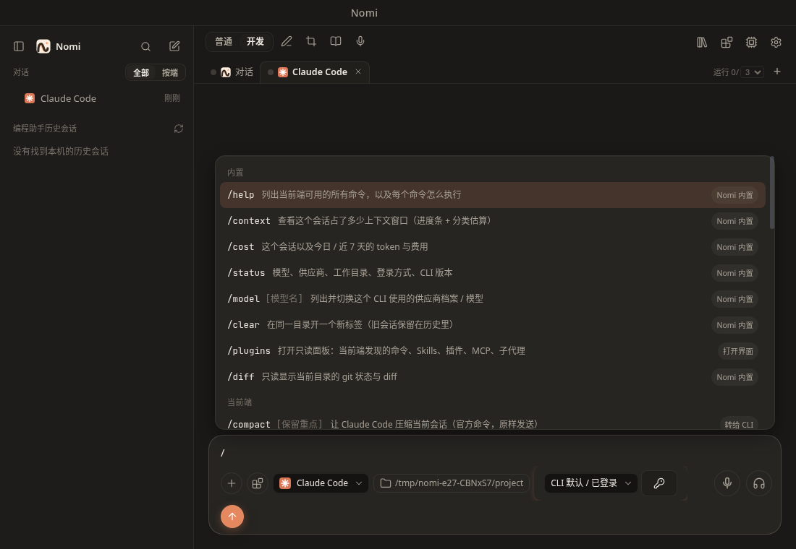
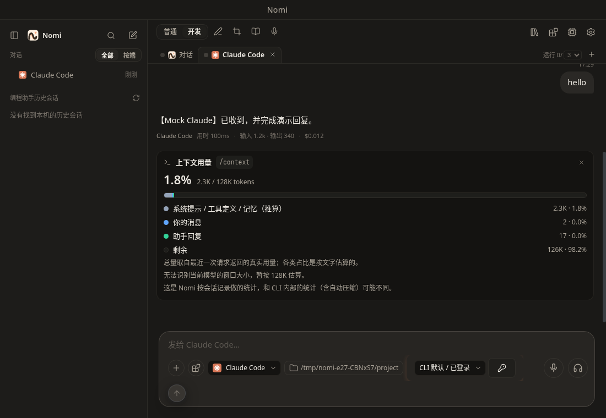

# 斜杠命令与插件面板

在任意会话（Nomi 对话、Claude Code、Codex、Grok、dsh）的输入框里输入 `/`，会弹出命令面板；选中后命令**在 Nomi 界面里执行，结果以卡片形式出现在会话流里**，而不是把文字发给 CLI 后什么也看不到。

设计与调研（命令矩阵、开源方案对比、选型理由、安全边界）见 [设计稿](../design/chat-slash-commands.md)。

## 使用

| 操作                | 说明                                                                              |
| ------------------- | --------------------------------------------------------------------------------- |
| 输入 `/`            | 弹出面板；继续输入做模糊搜索（`/cnt` 可以找到 `/context`）                        |
| ↑ ↓                 | 选择命令                                                                          |
| Enter               | 执行；需要参数的命令（面板里显示 `‹参数›` 提示）先补全成 `/名字 `，再输入参数回车 |
| Tab                 | 只补全，不执行                                                                    |
| Esc                 | 关闭面板并清空输入                                                                |
| `//xxx`             | 发送字面的 `/xxx`（不当作命令）                                                   |
| `/usr/bin` 这类路径 | 当作普通文字发送                                                                  |

面板按组排列：**当前端**（该 CLI 自己的命令）、**项目自定义**、**用户自定义**、**插件**、**Skills**，然后才是 **Nomi**。Nomi 对话里没有「当前端」这一组，所以仍从 Nomi 的命令开始。切换标签后命令集随之切换。右侧小标签表示接管方式：`Nomi 内置`（本机直接执行）、`转给 CLI`、`已展开`（Nomi 读取命令文件展开后发送）、`不支持`。

## 内置的原生命令（本机执行，不占用一轮模型对话）

- `/context`：上下文窗口占用，进度条 + 分类明细。有 CLI 回报的真实用量时标"实际"，否则标"估算"；窗口大小来自按模型名匹配的内置表，未知模型按 128K，卡片上会标明。
- `/cost`（`/usage`、`/stats`）：本会话与今日 / 近 7 天的 token 和费用，来自本机用量账本。
- `/status`：端、模型 / 供应商、工作目录、登录方式、CLI 版本、会话。
- `/model [名字]`：列出可用的第三方供应商并一键切换；也可 `/model 名字` 直接切换。Nomi 对话中的"打开设置"改名为 `/providers`。
- `/clear`（`/new`、`/reset`）：开始新对话，旧对话保留在历史里。
- `/cli 名字 [需求]`（仅 Nomi 对话）：指定下一个需求交给哪个编程助手，如 `/cli codex 修复登录 bug`；只写名字时下一条消息交给它，`/cli off` 取消。详见 [AI 对话](chat.md#交给编程助手委派)。
- `/help`：当前端可用命令和执行方式。
- `/diff`（仅 CLI 标签）：当前工作目录的 `git diff` 摘要。
- `/plugins`（`/skills`、`/mcp`、`/agents`）：打开只读的插件面板。

## 转给 CLI / 展开的命令

- **Claude Code**：文档化的 `/compact`、`/init`、`/code-review`、`/security-review`、`/effort`、`/config` 等以 `-p` 方式转给 CLI；项目 / 用户的 `.claude/commands`、`.claude/skills` 里的自定义命令和 Skills 也会列出来，选中后原样转给 CLI。
- **Grok**：`grok -p` 能执行的命令原样发送，徽标是 Grok。包括 `/compact`、`/context`、`/workflow`、`/goal`、`/loop`，以及项目、用户和 `~/.grok/bundled` 里的 skills / 工作流（例如 `/review`）。不在本地展开成提示词。
- **Codex**：`codex exec` 没有斜杠入口。项目 / 用户 skills 由主进程展开（`$ARGUMENTS`、`$1` …）后作为用户消息发送，并留一张"已展开并发送"提示卡。`/compact`、`/review`、`/init` 不做成 Nomi 提示词。
- **dsh**：只有原生命令和模板（dsh 没有公开文档化的命令来源）。

## 不支持与未知命令

当前这种接入用不了的 CLI 自带命令（如 `/memory`、`/permissions`、`/login`）不进菜单。打出全名时说明它是 CLI 自己的命令，回车只出原因和替代做法。输入不存在的 `/xxx` 时**不会发给模型**，而是提示未知命令，并提供"作为普通文字发送"按钮。

## 插件 / 命令面板（只读）

输入框工具栏的积木图标（或 `/plugins`）打开：列出当前端已发现的命令、Skills、插件、MCP 服务（只有名字与传输类型）、子代理；Nomi 端另显示 Nomi 自己的 Skills 与 MCP，并有"在设置里管理"入口。

面板**只读，没有开关**：各 CLI 的启停只有交互式命令或会改写用户 CLI 配置的子命令，Nomi 不代用户改动。

## 隐私与安全

- 发现只读文件名与 frontmatter（每个文件前 8 KB），**不读取**任何凭据 / 设置文件（`auth.json`、`.credentials*`、`.env*`、`settings*.json`、`config.toml`、`~/.claude.json`）；`.mcp.json` 只取服务名与传输类型，不取 env / headers / 命令参数。该规则同时作用于路径别名和符号链接解析后的真实目标（含 `~/.ssh`、`.git/` 等目录）；项目里的符号链接只能指向项目目录或 `~/.claude` / `~/.agents` / `~/.grok` 之内，用户目录里的共享 skill 链接仍可指向别处。
- 展开由主进程按 id 完成，渲染进程不能传路径；`!`cmd`` 动态注入不会被 Nomi 执行。
- 没有调用任何未文档化接口；`/model` 的切换复用已有的"CLI 第三方供应商"机制（写入前自动备份）。

## 已知限制

- 未用真实 CLI 二进制回归：Claude 透传命令的输出、Grok 的目录布局以官方文档 + mock CLI 验证。
- 看不到 Claude 的用户级 MCP、Codex 的 MCP / 插件列表（它们在凭据 / 配置文件里，不读取）。
- `/compact` 在 Nomi 对话、Codex、dsh 上不支持。Claude 和 Grok 会把 `/compact` 原样交给各自的 CLI。
