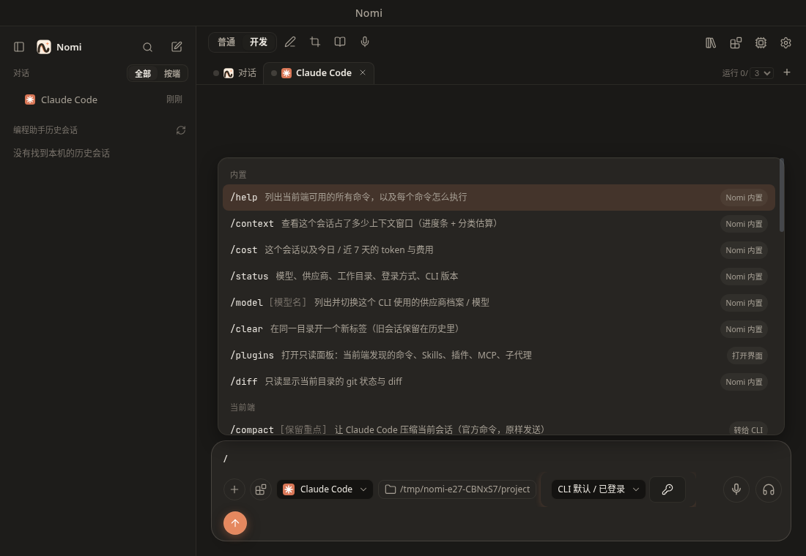
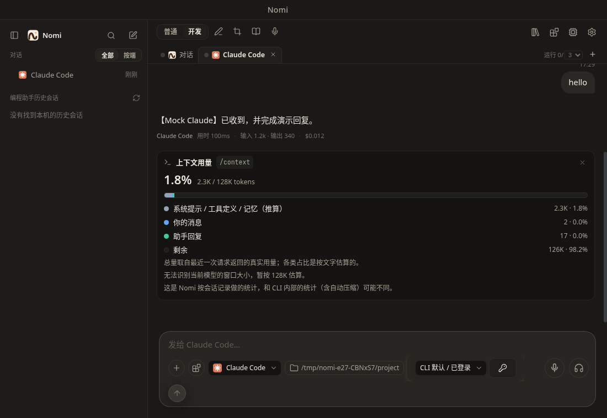

# 斜杠命令与插件面板

在任意会话（Nomi 对话或编程助手标签）的输入框里输入 `/`，会弹出命令面板；选中后命令**在 Nomi 界面里执行，结果以卡片形式出现在会话流里**。

## 使用

| 操作                | 说明                                                                      |
| ------------------- | ------------------------------------------------------------------------- |
| 输入 `/`            | 弹出面板；继续输入做模糊搜索（`/cnt` 可以找到 `/context`）                |
| ↑ ↓                 | 选择命令                                                                  |
| Enter               | 执行；需要参数的命令（面板里有参数提示）先补全成 `/名字 `，再输入参数回车 |
| Tab                 | 只补全，不执行                                                            |
| Esc                 | 关闭面板                                                                  |
| `//xxx`             | 发送字面的 `/xxx`（不当作命令）                                           |
| `/usr/bin` 这类路径 | 当作普通文字发送                                                          |

面板按组排列：当前端点（该 CLI 自己的命令）、项目自定义、用户自定义、插件、Skills，最后是 Nomi 内置命令。每条命令右侧的小标签表示由谁执行：Nomi 内置、转给 CLI、已展开（Nomi 读取命令文件展开后发送）、不支持。

会话有工作目录时，输入 `@` 可以补全里面的文件路径。

## 内置命令（本机执行，不占一轮模型对话）

- `/context`：上下文窗口占用，进度条 + 分类明细。有 CLI 回报的真实用量时标「实际」，否则标「估算」；未识别的模型按 128K 计。Grok 标签里 `/context` 交给 Grok 自己执行。
- `/cost`（`/usage`、`/stats`）：本会话与今日 / 近 7 天的 token 和费用，来自本机用量账本。
- `/status`：端点、模型 / 供应商、工作目录、登录方式、CLI 版本、会话。
- `/model [名字]`：列出可用的模型并切换；也可 `/model 名字` 直接切换。
- `/mode`：切换权限模式（计划 / 逐项确认 / 自动改文件 / 自动 / 完全放开），同 `Shift+Tab`。
- `/clear`（`/new`、`/reset`）：开始新对话，旧对话留在历史里。
- `/diff`：当前工作目录的未提交改动（相对 HEAD，含未跟踪文件）。
- `/plugins`（`/skills`、`/mcp`、`/agents`）：打开只读的插件面板。
- `/help`：当前端点可用的命令和执行方式。

只在 Nomi 对话里：

- `/agent 名字 [需求]`：指定交给哪个编程助手（默认后台执行），如 `/agent codex 修复登录 bug`；只写名字时下一条消息交给它，`/agent off` 取消。敲 `/agent ` 后会列出编程助手（已安装的在前）。详见 [AI 对话](chat.md#交给编程助手委派)。
- `/compact`：把较早的对话压缩成摘要，腾出上下文（快满时发送前也会自动压缩）。
- 启用的 Nomi 技能（见 [MCP 与技能](mcp-skills.md)）也以 `/技能名` 出现，选中后按技能说明完成任务。

## 转给 CLI / 展开的命令

- **Claude Code**：`/compact`、`/init`、`/code-review`、`/security-review`、`/effort`、`/config` 等原样转给 CLI；项目 / 用户 `.claude/commands`、`.claude/skills` 里的自定义命令和 Skills 也会列出来，选中后原样转给 CLI。
- **Codex**：`/compact` 转给 Codex 压缩当前会话；项目 / 用户的 skills 由 Nomi 展开（`$ARGUMENTS`、`$1` …）后作为用户消息发送。
- **Grok**：Grok 无头模式能执行的命令（如 `/compact`、`/context`）和 skills 原样发给 Grok。
- **Gemini、dsh**：只有 Nomi 内置命令。

## 不支持与未知命令

当前接入方式下用不了的 CLI 自带命令（如 `/memory`、`/permissions`、`/login`、`/resume`）不进菜单；打出全名时说明原因和替代做法。输入不存在的 `/xxx` 时**不会发给模型**，而是提示未知命令，并提供「作为普通文字发送」。

## 插件面板（只读）

编程助手标签里从输入框「+」菜单的「插件 / 命令」（或 `/plugins`）打开：列出当前端点已发现的命令、Skills、插件、MCP 服务（只有名字与传输类型）和子代理。Nomi 对话里 `/plugins` 显示 Nomi 自己的技能与 MCP，管理在「扩展」里。面板没有开关：Nomi 不代你改写各 CLI 的配置。

## 隐私与安全

- 发现命令时只读文件名与开头（每个文件前 8 KB），**不读取**凭据 / 设置文件（`auth.json`、`.credentials*`、`.env*`、`settings*.json`、`config.toml`、`~/.claude.json`）；`.mcp.json` 只取服务名与传输类型。符号链接按解析后的真实路径判断。
- 命令文件由内核按 id 展开，视图不能传路径；命令文件里的 `` !`cmd` `` 动态注入不会被 Nomi 执行。

## 实现

- 视图：`packages/ai-chat/src/slash`（`registry.ts`、`adapters/<端点>.ts`、`atPathComplete.ts`）、`components/SlashPalette`、`components/PluginPanel`。
- 内核：命令发现 `apps/desktop-go/internal/core/cli/slashdiscovery.go`。
